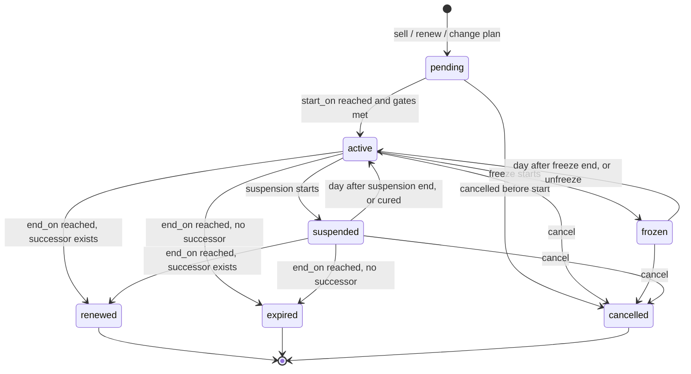

# ADR 0005: Recurring billing and memberships

Status: Accepted. Date: 2026-11-10. Conforms to `docs/architecture/overview.md` (context table, 3.4 jobs, 3.6
money, 3.7 time, 3.11 outbox, 3.12 idempotency). Feature IDs refer to `docs/discovery/feature-inventory.md`;
"U-nnn" is a line number in `docs/discovery/unknowns.md`.

## Context

- The reference product sells a membership as a **contract per term** with billing periods generated up front
  (MEM-02, MEM-07), renews by creating a successor contract ahead of expiry (MEM-11, U-235), and leaves most
  of the hard parts to staff: freeze withdraws invoices and switches autopay and auto-renew off until someone
  re-invoices by hand (MEM-12, MEM-13); a mid-term cancel produces no credit (MEM-15, MEM-16); there is no
  upgrade or downgrade command (MEM-11); status actions must be repeated on a pending renewed term (MEM-10).
- Autopay retry and dunning are undocumented anywhere public (PAY-09, BIL-22, U-331), so they are our design.
- Sources conflict on freeze (U-240), suspension fee (U-242, U-287), bundled packages on cancel (U-286),
  cancel reversibility (U-245) and member self-service scope (U-259, U-288). Proration arithmetic is
  undocumented (U-239). This ADR states the rule we adopt for each.
- Lead decisions taken as given: our own schedule in Postgres, not Stripe Subscriptions (U-236);
  `charge -> invoice -> payment -> payment_allocation` plus immutable `ledger_entry`; `PaymentProvider` port;
  per-location run times (RES-01); every billing run has a dry-run preview and per-item results (overview
  section 7, row 8; complaint B5).

## Decision

### 1. Ownership and shape

| Table | Context | Purpose |
|---|---|---|
| `membership_contract` | memberships | One sold term. Immutable snapshot of plan terms at sale (MEM-07). `status`, `start_on`, `end_on`, `cadence_unit` (`day`,`week`,`month`,`year`), `cadence_interval`, `period_count`, `fee_minor`, `initiation_fee_minor`, `payments_due_day`, `proration_mode`, `proration_tail`, `invoice_mode`, `is_autopay`, `is_auto_renew_enabled`, `auto_renew_lead_days` (null = never), `renews_as_plan_id` (null = copy of itself), renewal discount fields (MEM-10), `previous_contract_id`, `origin` (`sale`,`renewal`,`plan_change`,`import`), `cancel_reason`, `cancel_effective_on`, `merge_lane`, `version`. |
| `billing_schedule_period` | memberships | One row per billable unit of a contract: `seq`, `kind` (`initiation`,`stub`,`dues`,`suspension_fee`), `service_during daterange`, `due_on`, `amount_minor` (pre-tax, after contract discount), `state` (`scheduled`,`invoiced`,`voided`), `charge_id`. |
| `membership_freeze` | memberships | `contract_id`, `during daterange` (upper bound may be open), remarks. |
| `membership_suspension` | memberships | `contract_id`, `during daterange` (open allowed), `fee_minor`, `reason` (`staff`,`non_payment`), remarks. Child table, not in the overview's root list: see open question 3. |
| `autopay_run`, `autopay_attempt` | billing | One run per `(tenant_id, location_id, business_on)`; one attempt per `(tenant_id, invoice_id, attempt_no)`. |
| `invoice` dunning columns | billing | `dunning_state` (`none`,`retrying`,`awaiting_method`,`exhausted`), `attempt_count`, `next_attempt_on`. |

- **Contract per term, chained by `previous_contract_id`** with `UNIQUE (tenant_id, previous_contract_id)`.
  That one constraint makes renewal and plan change idempotent (the reference shipped a double-click
  duplicate, MEM-11). Month-to-month is `month x 1` with a renewal lead: one row per month, which is cheap.
  Rejected: an open-ended subscription row with a moving period pointer (loses the per-term snapshot that
  "renew as copy" and the Upcoming view depend on, MEM-10, MEM-11).
- **One contract per owner at a time** (MEM-07, U-298): `EXCLUDE USING gist (tenant_id WITH =,
  owner_client_id WITH =, merge_lane WITH =, daterange(start_on, end_on) WITH &&)`. A cancel truncates `end_on`
  to the effective date, so a contract cancelled to its start has an empty range and never collides.
  `merge_lane` (default 0) exists only so the asynchronous `clients.client.merged` handler can land a second
  contract on the survivor (lane 1) and raise a staff task, instead of failing forever; the reference only
  warns (MEM-17).
- **Memberships owns time, billing owns money.** A period becomes a `charge` and an invoice only through
  `billing.service`, with origin `('memberships','billing_schedule_period', id)`; billing enforces one live
  charge per origin, so re-running the invoicing job cannot double-bill. Paid or unpaid is never stored on the
  period; memberships learns it from `billing.invoice.paid` and `.past_due`.
- Staff-facing vocabulary: stored `pending` is labelled "Upcoming" on the profile and "Pending" in reports,
  matching both reference labels (U-249).

### 2. Contract lifecycle

`status` is a stored `text + CHECK` column, changed only by commands and by the daily lifecycle step (section
8). Check-in and entitlement use the pure function `effective_status(contract, freezes, suspensions, on_date)`
so a late job cannot admit or refuse anyone wrongly; a test asserts the job always converges to the function.

- `pending` covers three cases: future-dated start, awaiting document acceptance (MEM-08, activated by
  `documents.document.accepted`), and online checkout awaiting payment confirmation (MEM-09). A sale with
  `start_on <= today` and no open gate activates in the selling transaction (same-day active, MEM-04 fix).
- Terminal: `renewed` (superseded by a successor at term end), `expired` (ran out), `cancelled` (reason coded).
- A frozen contract never expires or renews; freeze and suspension may not overlap (each table has its own
  `EXCLUDE (tenant_id, contract_id, during)`; the cross-table check runs under the contract row lock).
- Any other transition is `409 invalid-state-transition`. Freeze, suspend and cancel require remarks when
  `membership_settings.require_status_change_remark` is on (MEM-05; one switch, U-244).
- **Commands fan out to the pending successor in the same transaction** (the reference leaves this to staff,
  MEM-10, U-235): cancel cancels it, freeze shifts it, suspension is inherited by it.
- Events: the overview's seven, plus `memberships.contract.unsuspended` and `.plan_changed` (open question 3).

### 3. Schedule generation and proration

Generated in full in the selling transaction by a pure function `build_schedule(terms, start_on)` (property
tested: amounts sum to the contract total; ranges tile `[start_on, end_on)` with no gap or overlap).

- Periods step by cadence **from the anchor date, not from the previous period**, so a contract anchored on the
  31st bills Feb 28/29 then Mar 31. `due_on` is the period start, or `payments_due_day` clamped to month end
  when the plan sets it (MEM-02: the due day is also the autopay day).
- `initiation` is its own row due at sale, never prorated, never repeated on renewal or plan change (U-256).
- Proration (MEM-03) is resolved onto the contract at sale; plan mode `custom` means the seller picks one:

| `proration_mode` | Schedule |
|---|---|
| `none` | `period_count` full periods from `start_on`; bills on the sale's day of month. |
| `first_of_month` | A `stub` for `[start_on, first of next month)`, then full periods on the 1st. No stub when `start_on` is already the 1st. Evaluated from `start_on`, so a plan with a fixed start date prorates from that date, not the sale date (U-239). |

| `proration_tail` | Full periods after the stub | `end_on` |
|---|---|---|
| `extend_last` | `period_count` | anchor + `period_count` cadences (term longer by the stub) |
| `drop_last` | `period_count - 1` | anchor + `period_count - 1` cadences (term shorter) |
| `prorate_last` | `period_count - 1`, then a final `stub` | `start_on` + `period_count` cadences (exact nominal term) |

- Arithmetic (ours, not parity): `stub = fee * stub_days / days_in_reference_period`, half-up, on
  location-local dates; the reference period is the full cadence period that ends (first stub) or starts
  (final stub) at the anchor, so a monthly stub divides by the actual days of that calendar month.
- At a prorated staff sale the seller chooses what to collect now: stub only, or stub plus first full period
  (MEM-03). That is a payment choice over already generated rows, not a schedule variant.
- `invoice_mode` (MEM-02, MEM-07): `per_period` (default) invoices each period `invoice_lead_days` before
  `due_on` (tenant setting, default 7, so reminders and portal payment have something to show: BIL-22, PAY-18);
  `single_invoice` charges every period at sale onto one invoice whose `payment_schedule` mirrors the due dates
  (BIL-06). "Invoice later" is `per_period` with autopay off. Rejected: creating all twelve invoices at sale as
  the reference does; every freeze, cancel and plan change then has to unwind issued documents.
- Autopay default resolves plan, then tenant preference by channel (in-facility vs portal), and is copied to
  each invoice at issue (BIL-17). Tax is computed by billing on the period's revenue date (BIL-12).
- Edits to remaining `scheduled` rows (single or bulk reprice across contracts) are allowed with a permission
  and audited; the reference has no bulk path (MEM-10, U-237). Invoiced rows are changed only by reversal.

### 4. Freeze: pauses billing, moves time, never moves money

Resolves U-240 (video wins: end date extends, frozen time is not billed, billing restarts on the resume date).

1. `POST /membership-contracts/{id}/freezes` with `start_on`, optional `end_on`. On the start date the status
   becomes `frozen`. No fee exists for a freeze (U-243).
2. Jobs skip frozen contracts: no invoicing, no autopay of periods inside the freeze, no renewal. **Flags are
   not flipped**: `is_autopay` and `is_auto_renew_enabled` keep their values and take effect again on resume.
   The reference switches both off and relies on staff to restore them (MEM-12, MEM-13).
3. A period already invoiced but unpaid whose service range lies wholly inside the freeze has its charge
   reversed (negating charge, BIL-07) and returns to `scheduled`. Paid periods are untouched. On a
   `single_invoice` contract the charges for not-yet-started periods are reversed the same way and the contract
   continues as `per_period`.
4. On resume (`resume_on` = day after the freeze end, or the manual unfreeze date), with `D` frozen days:
   `end_on += D`; the remaining `scheduled` periods are re-dated so the first is due on `resume_on` and the rest
   step by cadence from there (parity: no realignment to the 1st or the sale day, MEM-13). The paid-but-unused
   days of the interrupted period reappear as an uncharged tail before the new `end_on`. Invariant (property
   tested): the sum of non-voided period amounts is unchanged by any freeze.
5. A pending successor is shifted by `D` in the same transaction, successor first (answers the U-300 gap).
6. Editing or removing a freeze (MEM-13) recomputes from the pre-freeze schedule kept in the audit diff;
   removal before the start date is a no-op on money. Backdated freezes need a separate permission and credit
   paid periods wholly inside the range to account credit (BIL-21).
7. No prompt about how to invoice the unfrozen items (the reference asks, MEM-13): the schedule just resumes.

### 5. Suspension: access off, dues continue, fee on top

Resolves U-242 and U-287 in favour of the newer training evidence.

- `POST /membership-contracts/{id}/suspensions` with `start_on`, optional `end_on`, optional `fee_minor`.
  Status `suspended`; `end_on` and renewal dates do not move; dues periods keep invoicing and autopaying
  (MEM-14).
- **Fee rule (ours, cadence undocumented, U-296):** the fee is a per-billing-period amount. A `suspension_fee`
  row is added beside each dues period whose `due_on` falls inside the suspension, and one at the suspension
  start if no dues fall due on that day. This reads both sources consistently: "fee on top" during the term,
  and a periodic price at renewal.
- Renewal while suspended: the successor is priced at dues plus fee and starts `suspended` (U-287 default).
- Access is denied through `effective_status` (CHK-08); packages granted by the contract are unusable while it
  is suspended (the reference's behaviour here was flagged as a possible defect, U-295).
- Ending: day after `end_on`, or manual unsuspend; `suspension_fee` rows due after the end are voided.
- **Non-payment suspension** (ours): tenant setting `suspend_after_past_due_days` (null = off, the default,
  which is parity: access is then governed only by the past-due access rule, CHK-08). The lifecycle step asks
  `billing.service` for the contract's oldest past-due date and opens a suspension with reason `non_payment`
  and the tenant's default fee (default 0). `billing.invoice.paid` with nothing else past due ends it the same
  day. A contract suspended for non-payment does not auto-renew; it expires and the debt stays in receivables
  (BIL-19, BIL-20).

### 6. Renewal, plan change, cancel

**Renewal (MEM-11).** Selected when `is_auto_renew_enabled`, status `active` or `suspended`, no successor and
`end_on - auto_renew_lead_days <= today`; manual "renew now" runs the same command. The successor is `pending`,
starts on the predecessor's `end_on`, never prorates, carries autopay flag, shares, payment method and renewal
discount. Target: `renews_as_plan_id` null copies the contract's own terms and price; a plan id reads that
plan's terms at renewal time, so plan price edits flow through (MEM-02). Chaining an intro plan into a
full-price plan is just a non-null target. `memberships.contract.renewed` fires at successor creation with the
new price and start date, so engagement can send a renewal notice (the reference sends none on a price change,
MEM-02). Bundled packages are re-granted by `packages` only when the package plan itself renews (MEM-04).

**Plan change (ours; the reference has only cancel-and-resell, MEM-11, MEM-15).**
`POST /membership-contracts/{id}/plan-changes` with `target_plan_id`, `effective` (`immediate` or
`next_period`), `dry_run`. Changing only what happens at renewal is the existing `renews_as_plan_id` edit.

- Mechanism: the current contract ends on the effective date as `cancelled` with reason `upgrade` or
  `downgrade` (classified by annualised fee; equal is `other_modification`), and a successor with
  `origin = 'plan_change'` starts that day. This keeps contract snapshots immutable, reuses the successor
  chain, and matches the reference's reason codes, so attrition reports exclude it the same way (MEM-15).
  Rejected: mutating the contract in place (rewrites sold terms and breaks revenue history by type).
- `next_period`: effective date is the next period boundary; no adjustment money; stored as a `pending`
  successor, so it is visible and cancellable.
- `immediate`: the unused part of the current period is credited (`amount * unused_days / period_days`, as a
  negating charge) only if that period is paid; if unpaid its charge is reversed and re-raised for the used
  days. The successor opens with a `stub` at the new price from today to the old next due date, then full
  periods on the same anchor. Credit and stub go on one invoice: a positive net is collected now, a negative
  net stays as account credit and offsets future invoices (BIL-21); no automatic refund (PAY-05 is separate).
- Term: same cadence keeps the predecessor's `end_on`; a different cadence takes the target plan's full term
  from the effective date. No initiation fee. Renewal discount is not carried. Shares carry over. A new
  default document on the target plan must be accepted in the same flow (MEM-08).
- Blocked while `frozen`; allowed while `suspended` (the suspension carries over). Staff only in v1.

**Cancel (MEM-15, MEM-16).** `POST /membership-contracts/{id}/cancellation` with `effective_on` in
`[start_on, end_on]`, reason (`voluntary`, `upgrade`, `downgrade`, `administrative_error`,
`other_modification`), remarks, `credit_minor`, `cancel_bundled_packages`.

- `effective_on = start_on`: every charge is reversed and payments become account credit (parity).
- Later date: `scheduled` periods after it are voided; invoiced-unpaid periods that start after it are
  reversed; for the period containing the date the response to `dry_run` proposes a pro-rata credit, and the
  command applies whatever `credit_minor` staff confirm, default 0 (parity is no automatic partial refund;
  resolves U-247). Debts for consumed periods stay owed.
- A future `effective_on` is a scheduled cancel: status stays `active` until the lifecycle step reaches it.
- `cancel_bundled_packages` (default false) touches only packages granted by this contract (U-286, version B).
- Undo (U-245): `memberships.contract.cancel_undo`, Owner and Admin by default, allowed while the exclusion
  constraint still admits the original range. It re-raises fresh charges; nothing is un-reversed.

### 7. Click-to-cancel (MEM-18)

`POST /api/v1/portal/membership-contracts/{id}/auto-renew/disable`. Sets `is_auto_renew_enabled = false`,
audits the client actor, emails a confirmation. Access runs to `end_on`; nothing for the current term is
refunded. If a successor is already `pending` it is cancelled and anything paid for it is reversed to the
original method.

- Scope (resolves U-259): every auto-renewing contract the identity owns or may act for, whatever the sale
  channel, with no tenant switch to turn it off. Rejected: "online purchases only" as the reference words it;
  the narrower rule buys nothing and is the riskier compliance reading.
- One-way from the portal, as documented; staff can re-enable. Outright cancel, freeze and suspension remain
  staff-only (U-288). Remaining instalments of a committed term (`month x 12`) stay owed.
- `packages` and recurring pre-defined items (BIL-14) expose the same verb on their own resources.

### 8. Jobs, autopay and dunning

All are two-stage fan-outs per location at the configured local time, keyed on `(location_id, business_on)`
and catching up any missed business date (U-42).

| Step | Runs at | Idempotency key | Does |
|---|---|---|---|
| Lifecycle | `membership_renewal_run_time` | contract id + row lock | Applies date-driven transitions; opens and ends non-payment suspensions. |
| Renewal | after lifecycle | `UNIQUE (tenant_id, previous_contract_id)` | Creates successors. |
| Invoicing | after renewal | period id; billing's origin uniqueness | Turns `scheduled` periods inside the lead window into charge plus invoice. |
| Autopay | `autopay_run_time` | `autopay_run` unique key; attempt unique key; provider key `{tenant}:autopay:{attempt_id}` | Collects due autopay invoices and schedule entries (PAY-09). |

**Autopay run.** Selects invoices and `payment_schedule` entries with `is_autopay`, balance above zero,
`due_on <= business_on` and `next_attempt_on` null or reached. Account credit is applied first; a zero
remainder is settled without a provider call. `GET /autopay-runs/preview` returns the same selection without
side effects. Each attempt is: commit a `payment` in `initiated`, call the provider off-session with the
deterministic key, record the outcome in a second transaction; a reconciler replays orphans with the same key.
ACH returns `pending`; the invoice is not past due while a pending payment covers it, and a later failure
webhook re-opens it (PAY-10, U-333). A card needing customer authentication is a soft failure whose notice
links to portal payment (PAY-18). No stored method is `awaiting_method`: notify, do not retry.

**Dunning policy (ours; tenant setting, defaults shown).**

- Past due means balance above zero, `due_on` before today in the location's zone, and no pending payment.
  `billing.invoice.past_due` fires once on entering that state, so a failed autopay can deny entry from the
  next day through the access rule (CHK-08).
- Retries at due date +3, +5 and +7 days (four attempts in total). Hard declines (provider category: closed
  account, stolen or invalid card, revoked authorisation) are never retried and go to `awaiting_method`. ACH is
  re-presented at most twice and only for insufficient-funds returns.
- Saving a new default payment method retries every `retrying` or `awaiting_method` invoice immediately.
- Notices through engagement: pre-charge reminder 3 days before due; client decline notice per failure and
  staff alert per event or daily digest (PAY-08); final notice at `exhausted`; expiry warnings are separate
  (PAY-07). Email and push in v1, SMS through the no-op port (BIL-22, MKT-15).
- After `exhausted` nothing is charged automatically again. No late fees or interest: the reference shows none
  (U-339); the suspension fee is the only penalty mechanism.
- A dispute (PAY-17) re-opens the invoice and is treated like any other past-due balance. A refund alone never
  changes contract state.

## Consequences

- One code path serves sale, renewal and plan change (create contract, build schedule), and one invariant
  ("freeze moves time, not money") replaces the reference's manual re-invoicing.
- Lazy invoicing means receivables show only the lead window, not the whole term; deferred-revenue reporting
  (MEM-21) reads `billing_schedule_period` through an `rpt_*` view instead of future invoices.
- Month-to-month members produce one contract row per month; lists filter to the current chain head.
- Dunning state lives in billing and non-payment suspension in memberships, joined only by events and one
  downward service call, so the layer graph stays acyclic.
- Stored status can lag the calendar until the lifecycle step runs; `effective_status` covers the gap.
- Tests required beyond the overview's list: schedule and freeze property tests, every job run twice, renewal
  and plan change raced against themselves, run times across both DST transitions in three zones.

## Alternatives considered

- **Stripe Subscriptions and Smart Retries.** Rejected by the lead; freeze-with-extension, renew-as-other-plan,
  suspension fee and account credit do not map, and `FakeProvider` could not exercise them (U-236).
- **Status derived purely from dates in SQL** (the parity matrix suggestion for MEM-10). Rejected as the stored
  model: gates such as document acceptance and non-payment are not date facts, and events need a transition
  moment. Kept as the `effective_status` cross-check.
- **Freeze by shifting every remaining period by the frozen day count.** Rejected: due dates drift to arbitrary
  days and it contradicts the observed "bills on the resume date" behaviour (MEM-13).
- **Suspension fee charged once per suspension.** Rejected: cannot explain the "renews at the suspension fee"
  wording; per-period covers both sources.
- **Automatic pro-rata refund on mid-term cancel.** Rejected as default: not parity and a policy decision per
  facility; we compute the proposal and let staff confirm.
- **Auto-cancel after failed dunning.** Rejected for v1: irreversible for the member and loses the debt trail;
  optional suspension is the reversible form.
- **Service-level check instead of an exclusion constraint for one-contract-per-owner.** Rejected: the rule is
  hit by sale, renewal, plan change, freeze extension and import concurrently.

## Open questions

1. **Suspension fee**: confirm per-billing-period cadence and that a successor renewed while suspended is
   priced at dues plus fee (U-287, U-296).
2. **Plan change term and channel**: confirm "same cadence keeps the end date, otherwise a fresh term", and
   that portal self-service upgrade waits until after v1.
3. **Overview amendments needed**: child tables `membership_suspension` and `autopay_attempt`; events
   `memberships.contract.unsuspended` and `.plan_changed`; dunning columns on `invoice`.
4. **`merge_lane`**: accept the escape column, or give `clients` a pre-merge check hook so a merge that would
   create two live contracts is refused up front.
5. **Defaults**: `invoice_lead_days = 7`, retry offsets 3/5/7, non-payment suspension off, pre-charge reminder
   3 days. All tenant-editable; confirm the shipped values.
6. **Recurring-payment authorisation**: the reference's Classic agreement had a separate autopay signature
   (U-175). Proposed: capture a `documents` acceptance when a method is first flagged for autopay; ACH mandate
   wording needs a legal read before module 8.
7. **Freeze limits and freeze fee**: neither exists in the reference (U-243). Left out; say if a per-term
   maximum or a fee is wanted before module 5.

## Reconciliation with the data model (Phase 1 review)

`docs/architecture/data-model-people.md` section 3 (memberships) and `data-model-money.md` section 1 (autopay,
dunning) are the schema of record. The decisions of this ADR stand; the column names and three enum
vocabularies below are the ones that ship. Money's autopay and dunning tables already match this ADR.

| This ADR says | Schema of record |
|---|---|
| `membership_contract.status = 'pending'` | `'upcoming'` (stored, API and events); "Pending" is a report label only |
| `cadence_unit`, `cadence_interval`, `period_count` | `billing_interval_unit`, `billing_interval_count`, `billing_occurrences_count` |
| `fee_minor` | `term_fee_minor` |
| `payments_due_day` | `payment_due_day` |
| `is_auto_renew_enabled`, `auto_renew_lead_days` | `is_auto_renew`, `auto_renew_lead_count` + `auto_renew_lead_unit`, with the derived work-queue date `renew_on` |
| `proration_mode` on the contract | `is_prorated` + `proration_tail` on the contract (the mode lives on `membership_plan`) |
| `cancel_effective_on` | `cancelled_on` |
| `origin` (`sale`, `renewal`, `plan_change`, `import`) | `sales_channel` (`staff`, `portal`, `mobile`, `pos`, `api`, `renewal`, `import`) |
| `billing_schedule_period.seq`, `.state` (`scheduled`, `invoiced`, `voided`) | `.sequence_number`, `.status` (`scheduled`, `billed`, `withheld`, `cancelled`); `withheld` is a period held back by a freeze (`withheld_by_freeze_id`) |
| period `kind` `stub` | no `stub` kind: a prorated first or last period is a `dues` row with `is_prorated = true`; `addon_item` added for recurring add-on items (MEM-04) |
| `membership_freeze.contract_id`, `membership_suspension.contract_id` | `membership_contract_id` |
| location job times | `location.membership_renewal_run_time`, `.package_renewal_run_time`, `.autopay_run_time` |

Decisions of this ADR changed by the review:

- **`merge_lane` is not built** (open question 4, the alternative is adopted): `clients` runs a pre-merge
  check that blocks a merge whose two clients hold overlapping live contracts, so the exclusion constraint
  `ex_membership_contract_term_overlap` needs no escape column. Cost: staff must end or re-date one contract
  before merging.
- **Plan change (`POST /membership-contracts/{id}/plan-changes`) is deferred out of v1.** The data model and
  API carry no plan-change command (parity for MEM-11 is renewal into another plan through
  `renews_as_plan_id`, or cancel with reason `upgrade` / `downgrade` and sell anew). Adding it later is one
  endpoint and no schema change, because a plan change is "end the current contract early, create a successor".
