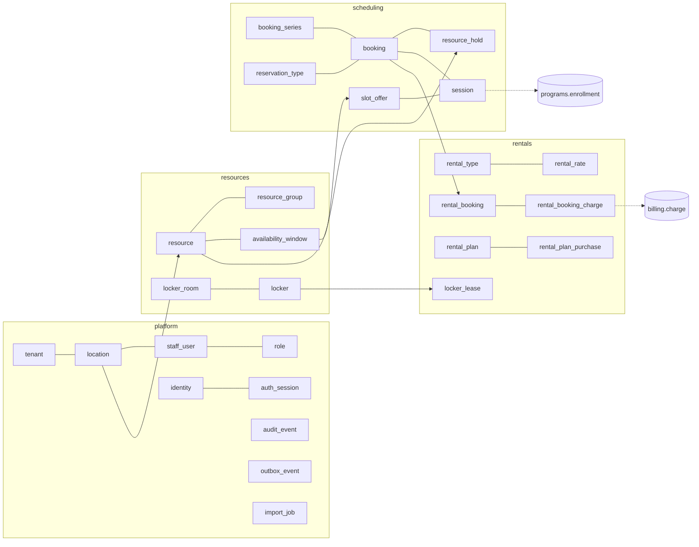
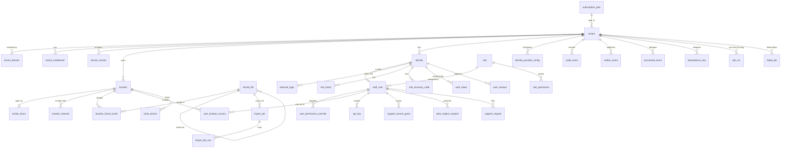
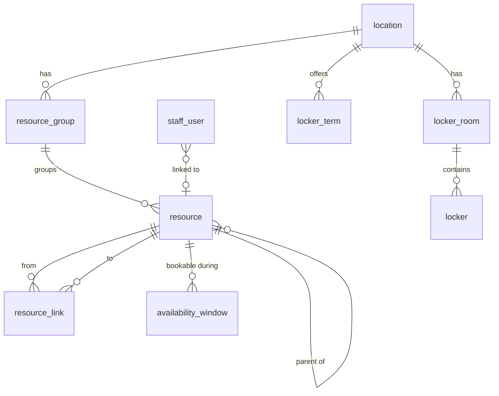
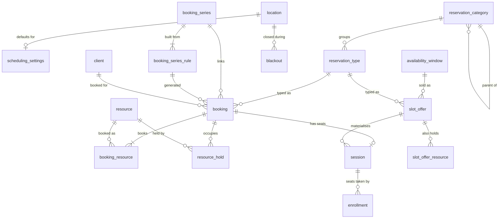
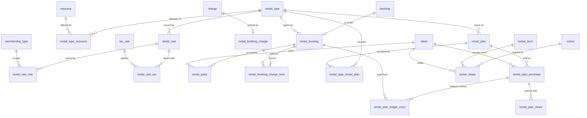
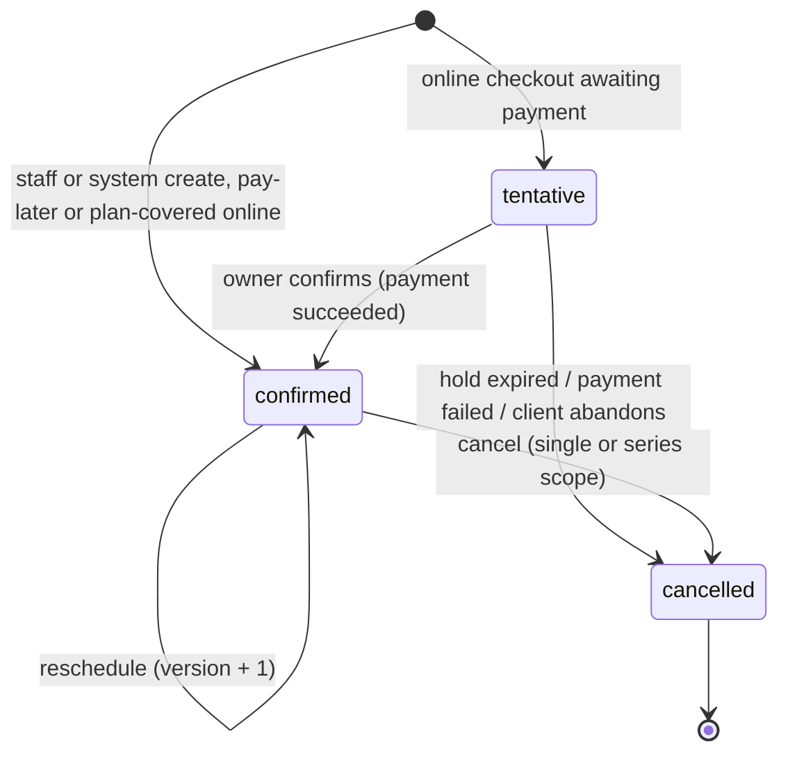
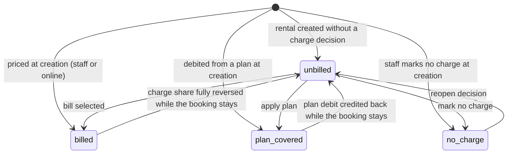
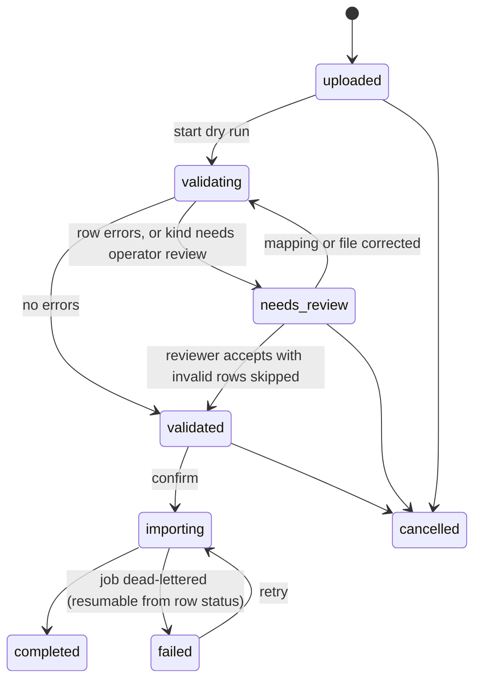

# FacilityHub Data Model: Core (platform, resources, scheduling, rentals)

Status: Phase 1 draft for GATE 1. Date: 2026-11-10. Conforms to `docs/architecture/overview.md` and ADRs 0001,
0002, 0007, 0008; where this document needs one of them to change, the point is listed in section 9 and not
assumed. Discovery prefixes covered: PLT, RES, SCH, RNT, CLS (session side), IMP, ONB. Feature IDs refer to
`docs/discovery/feature-inventory.md`. Names are ours (clean-room); the reference product's labels never appear
in the schema.

This is the physical model migrations are generated from. Tables owned by other contexts are referenced by name
only (`client`, `charge`, `revenue_category`, `tax_rate`, `membership_type`, `enrollment`, ...).

## 0. Reading rules

**Standard columns, present on every table below and not repeated in the column lists** (overview 3.1):

| column | type | null | default | notes |
|---|---|---|---|---|
| `id` | `uuid` | no | `app.uuid_v7()` | `pk_<table>`; application normally supplies it (`new_id()`) |
| `tenant_id` | `uuid` | no | from `session.info` | composite FK to `tenant (id)`; RLS predicate |
| `created_at` | `timestamptz` | no | `now()` | |
| `updated_at` | `timestamptz` | no | `now()` | set by the ORM on flush |

Exceptions are stated on the table: the global allow-list (`subscription_plan`, `tenant`) has no `tenant_id`;
append-only and infrastructure tables (`audit_event`, `outbox_event`, `processed_event`, `idempotency_key`,
`rental_plan_ledger_entry`) have no `updated_at` (see 9.9).

**Standard constraints on every tenant-owned table, not repeated:** `UNIQUE (tenant_id, id)` named
`uq_<table>_tenant_id_id`; `enable_rls(<table>)` (enabled, forced, `tenant_isolation` policy, DML grants to
`fh_app`).

**Notation.**

- `-> t` in notes is the composite foreign key `FOREIGN KEY (tenant_id, <col>) REFERENCES t (tenant_id, id) ON
  DELETE RESTRICT`. `-> t CASCADE` is the same with `ON DELETE CASCADE` and is only used from an aggregate root
  to its own children. Every FK column gets `ix_<table>_<col>` on `(tenant_id, <col>)` unless a listed unique
  or composite index already leads with those columns.
- **[L]** after a table name: location-partitioned (`location_id uuid NOT NULL -> location`, permission-scoped,
  ADR 0001 section 1). **[L?]**: location-optional (`NULL` = tenant default; readers resolve location, then
  tenant, ADR 0001 L4).
- Enumerations are `text` with a named check `ck_<table>_<col>`; the allowed values are listed in the notes as
  `a | b | c`. Tenant-editable vocabularies are tables.
- Money is `bigint` minor units in `_minor` columns, currency is `tenant.currency`.
- **Added suffix `_min`**: `integer`/`smallint` whole minutes (buffers, cut-offs, lengths). The overview suffix
  list has none for durations; `interval` was rejected because every value here is edited as minutes and
  compared with integer arithmetic.
- Weekdays are ISO: `smallint` 1 = Monday ... 7 = Sunday (matches `EXTRACT(isodow ...)`; SCH-01 weeks run
  Monday to Sunday). Weekday sets are `smallint[]` with a check that every element is in 1..7.
- Colours are `text` matching `^#[0-9a-f]{6}$` (`ck_<table>_color`).
- `uniq nd` means `UNIQUE NULLS NOT DISTINCT` (PostgreSQL 15+).
- "Serves" lists P0/P1 features unless a P2 is cheap enough to fall out for free, which is then marked `(P2)`.

## 1. Context map of this document

## 2. platform

Layer L0. Owns tenancy, locations, identity, RBAC, audit, outbox, idempotency, files, imports and data-subject
requests. Calls no other context.

### 2.1 Tenancy and entitlements

#### `subscription_plan` (global: no `tenant_id`, no RLS; `fh_app` has `SELECT` only)

| column | type | null | default | notes |
|---|---|---|---|---|
| `code` | `text` | no | | `uq_subscription_plan_code`; our own tier codes |
| `name` | `text` | no | | |
| `member_limit` | `integer` | yes | | null = unlimited |
| `resource_limit` | `integer` | yes | | null = unlimited |
| `feature_tier` | `text` | no | `'full'` | `limited \| standard \| full` |
| `support_channels` | `text[]` | no | `'{}'` | subset of `chat, email, phone` |
| `included_modules` | `text[]` | no | `'{}'` | module keys copied into `tenant_entitlement` on assignment |
| `is_active` | `boolean` | no | `true` | |

Serves: PLT-14. Limits are never read from here at runtime; services read `tenant_entitlement` (overview
divergence 15).

#### `tenant` (global: `id` is the tenant id; policy `id = app.current_tenant_id()`, ADR 0001 section 3)

No `tenant_id` column.

| column | type | null | default | notes |
|---|---|---|---|---|
| `name` | `text` | no | | |
| `slug` | `citext` | no | | `uq_tenant_slug`; default subdomain label |
| `status` | `text` | no | `'active'` | `active \| suspended \| closed` (ADR 0001 section 4) |
| `currency` | `char(3)` | no | `'USD'` | ISO 4217; immutable once any `charge` exists (service rule) |
| `default_time_zone` | `text` | no | | IANA, validated by `zoneinfo` |
| `locale` | `text` | no | `'en-US'` | BCP 47; selects terminology and date formats (REL-04) |
| `subscription_plan_id` | `uuid` | yes | | plain FK to `subscription_plan (id)` |
| `billing_cycle` | `text` | yes | | `monthly \| annual` |
| `trial_ends_on` | `date` | yes | | trial is a dated attribute, not a status |
| `staff_mfa_policy` | `text` | no | `'privileged'` | `optional \| privileged \| all` (ADR 0002 section 6) |
| `platform_billing_ref` | `text` | yes | | our own billing customer for this tenant; unrelated to its Connect account |
| `billing_locked_through_on` | `date` | yes | | period lock: `billing` rejects a ledger posting with `effective_on <=` this date (`period-locked`, ADR 0003 section 3); advanced by the accounting export (ADR 0012 section 5) or by an Owner |
| `email_sending_state` | `text` | no | `'active'` | `active \| marketing_paused \| suspended`; the deliverability circuit breaker written by `engagement` through `platform.service` (ADR 0011 section 5) |
| `is_listed_in_app_directory` | `boolean` | no | `false` | shared mobile app's tenant search (APP-01). On the global row because the directory query runs before a tenant is chosen and cannot read `app_config` under RLS; `fh_platform` reads `id`, `app_directory_name`, `slug` only |
| `app_directory_name` | `text` | yes | | display name in that directory; edited through `PUT /app-config` |
| `settings` | `jsonb` | no | `'{}'` | terminology overrides, dismissed onboarding steps, seed vertical |

Indexes: `uq_tenant_slug`. Serves: PLT-01, PLT-14, PLT-15, ONB-01.

Trade-off: onboarding checklist (ONB-01) is computed from real state (users, hours, resources, provider
account) with only dismissals stored in `settings`. Rejected: a checklist table that can drift from reality.

#### `tenant_domain` (global allow-list but has `tenant_id` and the standard policy; `fh_platform` may `SELECT`)

| column | type | null | default | notes |
|---|---|---|---|---|
| `host` | `citext` | no | | `uq_tenant_domain_host` is global by nature |
| `kind` | `text` | no | `'subdomain'` | `subdomain \| custom` |
| `is_primary` | `boolean` | no | `false` | `uq_tenant_domain_primary (tenant_id) WHERE is_primary` |
| `verified_at` | `timestamptz` | yes | | custom domains resolve only when set |

Serves: PLT-01 (tenant resolution for anonymous routes, overview 3.4).

#### `tenant_entitlement`

| column | type | null | default | notes |
|---|---|---|---|---|
| `key` | `text` | no | | module key (`leagues`, `lockers`, `branded_app`, `advanced_email`, `accounting_sync`, `league_advertising`) or limit key (`limit.members`, `limit.resources`); catalogue is code, so no check |
| `limit_value` | `integer` | yes | | only for `limit.*`; null there means unlimited |
| `source` | `text` | no | | `plan \| addon \| promo \| manual` |
| `starts_on` | `date` | no | `current_date` | |
| `ends_on` | `date` | yes | | inclusive; null = open-ended |

Constraints: `uq_tenant_entitlement (tenant_id, key, source, starts_on)`; `ck_tenant_entitlement_dates
(ends_on IS NULL OR ends_on >= starts_on)`. Index: `(tenant_id, key)`.
Resolution: a module is on when any row is in date; a limit is the most generous in-date row (null wins).
Enforced in `resources.service.create_resource` (counts `resource.counts_toward_plan`) and in `clients`
(member count). Serves: PLT-14, RES-07 (locker module gate), PLT-11 (advertising role gate).

#### `tenant_counter`

| column | type | null | default | notes |
|---|---|---|---|---|
| `counter_key` | `text` | no | | `booking_number`, later `invoice`, `receipt`, `member_number` (one key vocabulary across all documents; `clients` owns `member_number`, MEM-19) |
| `next_value` | `bigint` | no | `1` | taken with `SELECT ... FOR UPDATE` (overview 3.5) |

Constraints: `uq_tenant_counter (tenant_id, counter_key)`.

### 2.2 Locations

#### `location`

| column | type | null | default | notes |
|---|---|---|---|---|
| `slug` | `citext` | no | | `uq_location_slug (tenant_id, slug)`; portal path segment (ADR 0001 L7) |
| `name` | `text` | no | | internal label; `uq_location_name (tenant_id, name)` |
| `public_name` | `text` | no | | customer-facing |
| `address_line1`, `address_line2`, `city`, `region`, `postal_code` | `text` | yes | | |
| `country_code` | `char(2)` | yes | | ISO 3166-1 |
| `phone` | `text` | yes | | E.164 |
| `email` | `citext` | yes | | shown to customers |
| `alert_email` | `citext` | yes | | receives decline notices only |
| `website_url` | `text` | yes | | |
| `time_zone` | `text` | no | | IANA; all "day" logic for this site (overview 3.7) |
| `membership_renewal_run_time` | `time` | no | `'01:00'` | local wall time (ADR 0008 section 4) |
| `package_renewal_run_time` | `time` | no | `'01:30'` | |
| `autopay_run_time` | `time` | no | `'06:00'` | |
| `decline_email_mode` | `text` | no | `'digest'` | `digest \| per_decline`; the client is always told at once |
| `time_clock_rounding` | `text` | no | `'none'` | `none \| up \| down` |
| `time_clock_rounding_min` | `smallint` | no | `15` | `IN (5, 6, 10, 15, 30)`; increment is unpublished in the reference, ours |
| `is_time_clock_network_restricted` | `boolean` | no | `false` | punches only from `location_network` (ADR 0002 section 6) |
| `accepted_card_brands` | `text[]` | no | `'{}'` | empty = everything the provider account supports |
| `is_gdpr_mode` | `boolean` | no | `false` | drives consent prompting at this site only (ADR 0001 L11) |
| `status` | `text` | no | `'active'` | `active \| inactive`; never deleted once referenced |
| `sort_order` | `integer` | no | `0` | |

Serves: PLT-01, RES-01, PLT-16. Not here by decision: the drag-and-drop default lives in
`scheduling_settings` (it is scheduling behaviour); the legacy default-UI and vaccine toggles are not built
(PLT-09 P2; check-in cluster). All active locations of a tenant are "connected" (ADR 0001 L3); no link table.

#### `facility_hours`

Seven rows are seeded with the location.

| column | type | null | default | notes |
|---|---|---|---|---|
| `location_id` | `uuid` | no | | `-> location CASCADE` |
| `weekday` | `smallint` | no | | 1..7 |
| `opens_time` | `time` | yes | | local |
| `closes_time` | `time` | yes | | local; `24:00` allowed for midnight close |
| `is_closed` | `boolean` | no | `false` | |

Constraints: `uq_facility_hours (tenant_id, location_id, weekday)`; `ck_facility_hours_weekday`;
`ck_facility_hours_window (is_closed OR (opens_time IS NOT NULL AND closes_time IS NOT NULL AND closes_time >
opens_time))`. Serves: RES-02. Hours bound the calendar viewport and online rental search (RNT-05); they never
reject a staff booking. Dated closures are `blackout` rows in scheduling. Rejected: overnight opening windows
(no evidence; a 24-hour site uses `00:00`-`24:00`).

#### `location_network`

| column | type | null | default | notes |
|---|---|---|---|---|
| `location_id` | `uuid` | no | | `-> location CASCADE` |
| `cidr` | `cidr` | no | | a single address is a `/32` or `/128` |
| `label` | `text` | yes | | |

Constraints: `uq_location_network (tenant_id, location_id, cidr)`. Serves: PLT-07. Networks are location
data, the policy is per user (`staff_user.ip_policy`); this closes the per-user versus per-location conflict
the way ADR 0002 section 6 decided.

#### `stored_file`

| column | type | null | default | notes |
|---|---|---|---|---|
| `object_key` | `text` | no | | `t/<tenant_id>/...`; `uq_stored_file_object_key (tenant_id, object_key)` |
| `purpose` | `text` | no | | `<context>.<kind>`, e.g. `platform.brand_asset`, `platform.import_source`, `platform.import_report`, `platform.data_export`, `platform.support_attachment`; catalogue in code so other contexts add purposes without a migration here |
| `content_type` | `text` | no | | |
| `size_bytes` | `bigint` | no | | `>= 0` |
| `sha256` | `text` | yes | | hex; set when the upload is finalised |
| `original_name` | `text` | yes | | audit redaction class `flag` |
| `derived_from_file_id` | `uuid` | yes | | `-> stored_file CASCADE`; resized variants |
| `variant_key` | `text` | yes | | `header`, `document`, `email`, `portal` |
| `width_px`, `height_px` | `integer` | yes | | images only |
| `status` | `text` | no | `'pending'` | `pending \| ready \| purged` |
| `expires_at` | `timestamptz` | yes | | exports: 7 days (ADR 0008); purge job deletes the object and sets `purged` |
| `uploaded_by_type` | `text` | no | | `staff \| client \| api_key \| system` |
| `uploaded_by_id` | `uuid` | yes | | no FK (polymorphic) |

Constraints: `uq_stored_file_variant (tenant_id, derived_from_file_id, variant_key) WHERE derived_from_file_id
IS NOT NULL`; `ck_stored_file_variant ((derived_from_file_id IS NULL) = (variant_key IS NULL))`.
Index: `ix_stored_file_expiry (expires_at) WHERE expires_at IS NOT NULL AND status = 'ready'`.

#### `location_brand_asset`

| column | type | null | default | notes |
|---|---|---|---|---|
| `location_id` | `uuid` | no | | `-> location CASCADE` |
| `slot` | `text` | no | | `primary \| back_office \| public \| registration \| portal \| league_site` |
| `stored_file_id` | `uuid` | no | | `-> stored_file`; the original; variants hang off it |

Constraints: `uq_location_brand_asset (tenant_id, location_id, slot)`. Slots are independent (PLT-08). We
accept PNG, JPEG, GIF, SVG and WebP and render variants; the reference's conflicting size and format rules are
not reproduced. Serves: PLT-08, PLT-12 (league-site logo slot).

### 2.3 Identity and sessions

Shapes are fixed by ADR 0002 section 2; this section adds types, nullability and indexes.

#### `identity`

| column | type | null | default | notes |
|---|---|---|---|---|
| `kind` | `text` | no | | `staff \| client` |
| `email` | `citext` | no | | sign-in address; distinct from `client.email` |
| `email_verified_at` | `timestamptz` | yes | | |
| `password_hash` | `text` | yes | | argon2id; null = magic-link or OIDC only |
| `status` | `text` | no | `'invited'` | `invited \| active \| disabled \| merged` |
| `merged_into_identity_id` | `uuid` | yes | | `-> identity`; set with `merged` |
| `failed_attempt_count` | `integer` | no | `0` | |
| `locked_until_at` | `timestamptz` | yes | | password path only |
| `password_changed_at` | `timestamptz` | yes | | |
| `last_sign_in_at` | `timestamptz` | yes | | |

Constraints: `uq_identity_kind_email (tenant_id, kind, email)`. Serves: PLT-02, PLT-03, PLT-13.

#### `staff_user`

| column | type | null | default | notes |
|---|---|---|---|---|
| `identity_id` | `uuid` | no | | `-> identity`; `uq_staff_user_identity (tenant_id, identity_id)` |
| `role_id` | `uuid` | no | | `-> role`; exactly one (PLT-05) |
| `first_name`, `last_name` | `text` | no | | |
| `mobile_phone` | `text` | yes | | E.164; SMS goes through the SMS port, no carrier field |
| `linked_resource_id` | `uuid` | yes | | `-> resource` (resources context; FK added by the resources migration, see 9.8). Unlocks resource-scoped permissions and reports |
| `is_attendance_notified` | `boolean` | no | `false` | email on roster changes of the linked resource's sessions |
| `ip_policy` | `text` | no | role default | `any \| facility_networks` |
| `has_all_location_access` | `boolean` | no | `false` | true = every current and future location; `user_location_access` rows then only mark the primary |
| `is_system_support` | `boolean` | no | `false` | ADR 0007 section 4 |
| `access_expires_on` | `date` | yes | | time-boxed invitations (ADR 0002 section 1) |
| `is_active` | `boolean` | no | `true` | deactivate, never delete |
| `preferences` | `jsonb` | no | `'{}'` | sidebar, theme (PLT-10, P2) |

Indexes: `(tenant_id, role_id)`, `(tenant_id, linked_resource_id)`. Serves: PLT-02, PLT-05, PLT-07, PLT-11,
PLT-13. No username (ADR 0002 section 3). One store for back-office, league and app-console users (ADR 0001
L12). Service invariant, not a constraint: a tenant always has at least one active Owner.

#### `user_location_access`

| column | type | null | default | notes |
|---|---|---|---|---|
| `staff_user_id` | `uuid` | no | | `-> staff_user CASCADE` |
| `location_id` | `uuid` | no | | `-> location` |
| `is_primary` | `boolean` | no | `false` | default location after sign-in |

Constraints: `uq_user_location_access (tenant_id, staff_user_id, location_id)`;
`uq_user_location_access_primary (tenant_id, staff_user_id) WHERE is_primary`. Serves: PLT-01, PLT-13 (the
app-console "manage" versus "notify only" split is two permission keys intersected with these rows, not a
column).

#### `external_login`

| column | type | null | default | notes |
|---|---|---|---|---|
| `identity_id` | `uuid` | no | | `-> identity CASCADE` |
| `provider_key` | `text` | no | | matches `identity_provider_config.provider_key` |
| `subject` | `text` | no | | the provider's `sub` |

Constraints: `uq_external_login (tenant_id, provider_key, subject)`.

#### `identity_provider_config`

| column | type | null | default | notes |
|---|---|---|---|---|
| `provider_key` | `text` | no | | `uq_identity_provider_config (tenant_id, provider_key)` |
| `audience` | `text` | no | | `staff \| client` |
| `display_name` | `text` | no | | |
| `issuer_url` | `text` | no | | |
| `client_id` | `text` | no | | |
| `client_secret_ref` | `text` | no | | secret-store reference, never the secret |
| `scopes` | `text[]` | no | `'{openid,email,profile}'` | |
| `asserts_mfa` | `boolean` | no | `false` | |
| `is_enabled` | `boolean` | no | `true` | |

#### `mfa_factor` and `mfa_recovery_code`

| table | column | type | null | default | notes |
|---|---|---|---|---|---|
| `mfa_factor` | `identity_id` | `uuid` | no | | `-> identity CASCADE` |
| | `kind` | `text` | no | `'totp'` | `totp` (open for `webauthn`) |
| | `secret_ciphertext` | `bytea` | no | | application-level encryption; audit class `never` |
| | `confirmed_at` | `timestamptz` | yes | | |
| | `last_used_at` | `timestamptz` | yes | | |
| `mfa_recovery_code` | `identity_id` | `uuid` | no | | `-> identity CASCADE` |
| | `code_hash` | `text` | no | | SHA-256 |
| | `consumed_at` | `timestamptz` | yes | | |

Constraints: `uq_mfa_factor (tenant_id, identity_id, kind)`.

#### `auth_token` (single-use emailed links)

| column | type | null | default | notes |
|---|---|---|---|---|
| `identity_id` | `uuid` | yes | | `-> identity CASCADE`; null for a pre-registration verify |
| `purpose` | `text` | no | | `magic_link \| password_reset \| invite \| email_verify \| email_change \| relationship_confirm` |
| `token_hash` | `text` | no | | `uq_auth_token_hash (tenant_id, token_hash)` |
| `payload` | `jsonb` | no | `'{}'` | e.g. new email, invited role id |
| `expires_at` | `timestamptz` | no | | |
| `consumed_at` | `timestamptz` | yes | | |

Index: `(tenant_id, identity_id, purpose) WHERE consumed_at IS NULL`. Serves: PLT-03 (reset is a link, never
a typed or temporary password; overview divergence 14), PLT-13 (invite).

#### `auth_session`

| column | type | null | default | notes |
|---|---|---|---|---|
| `identity_id` | `uuid` | no | | `-> identity` |
| `kind` | `text` | no | | `web \| mobile \| impersonation` |
| `access_token_hash` | `text` | no | | `uq_auth_session_access (tenant_id, access_token_hash)` |
| `access_expires_at` | `timestamptz` | no | | |
| `refresh_token_hash` | `text` | yes | | `uq_auth_session_refresh (tenant_id, refresh_token_hash)`; null for impersonation |
| `previous_refresh_token_hash` | `text` | yes | | accepted for 20 s after rotation |
| `refresh_rotated_at` | `timestamptz` | yes | | start of that grace window |
| `idle_expires_at` | `timestamptz` | no | | slides on refresh |
| `absolute_expires_at` | `timestamptz` | no | | |
| `mfa_verified_at` | `timestamptz` | yes | | |
| `elevated_until_at` | `timestamptz` | yes | | recent-auth step-up |
| `impersonator_staff_user_id` | `uuid` | yes | | `-> staff_user` |
| `target_client_id` | `uuid` | yes | | `-> client`; merge tombstones keep the FK valid, so no merge handler |
| `revoked_at` | `timestamptz` | yes | | |
| `revoked_reason` | `text` | yes | | `sign_out \| rotation_reuse \| password_reset \| admin \| expired \| disabled` |
| `ip` | `inet` | yes | | |
| `user_agent` | `text` | yes | | |
| `last_seen_at` | `timestamptz` | yes | | |

Indexes: `(tenant_id, identity_id) WHERE revoked_at IS NULL`; `(tenant_id, previous_refresh_token_hash) WHERE
previous_refresh_token_hash IS NOT NULL`; `ix_auth_session_purge (absolute_expires_at)`.
Constraint: `ck_auth_session_impersonation ((kind = 'impersonation') = (impersonator_staff_user_id IS NOT
NULL))`.

#### `api_key`

| column | type | null | default | notes |
|---|---|---|---|---|
| `name` | `text` | no | | |
| `key_hash` | `text` | no | | `uq_api_key_hash (tenant_id, key_hash)` |
| `key_prefix_display` | `text` | no | | first characters, for the admin list |
| `scopes` | `text[]` | no | | subset of the permission catalogue |
| `location_ids` | `uuid[]` | yes | | null = all locations; validated in service (array, no FK) |
| `expires_at` | `timestamptz` | yes | | |
| `last_used_at` | `timestamptz` | yes | | |
| `created_by_staff_user_id` | `uuid` | no | | `-> staff_user` |
| `revoked_at` | `timestamptz` | yes | | |

#### `kiosk_device` [L]

| column | type | null | default | notes |
|---|---|---|---|---|
| `location_id` | `uuid` | no | | `-> location` |
| `name` | `text` | no | | |
| `token_hash` | `text` | no | | `uq_kiosk_device_token (tenant_id, token_hash)` |
| `enrolled_by_staff_user_id` | `uuid` | no | | `-> staff_user` |
| `last_seen_at` | `timestamptz` | yes | | |
| `revoked_at` | `timestamptz` | yes | | |

#### `support_access_grant` (ADR 0007 section 4)

| column | type | null | default | notes |
|---|---|---|---|---|
| `granted_by_staff_user_id` | `uuid` | no | | `-> staff_user`; an Owner |
| `support_staff_user_id` | `uuid` | no | | `-> staff_user` with `is_system_support` |
| `reason` | `text` | no | | |
| `expires_at` | `timestamptz` | no | | `ck_support_access_grant_max (expires_at <= created_at + interval '7 days')` |
| `revoked_at` | `timestamptz` | yes | | |

Serves: IMP-02 (operator-assisted import runs inside a grant, audited with `impersonator_ref`), ONB-05 (P2).

### 2.4 RBAC

The permission catalogue is static code (`permissions.py` per context, overview 3.16). There is no
`permission` table: `permission_key` is validated against the catalogue on write and by a startup check that
reports unknown keys. Rejected: a global `permission` table kept in sync by migration (a second source of truth
for something that only changes with code).

#### `role`

| column | type | null | default | notes |
|---|---|---|---|---|
| `name` | `citext` | no | | `uq_role_name (tenant_id, name)` |
| `description` | `text` | yes | | |
| `is_system` | `boolean` | no | `false` | system roles cannot be edited or deleted |
| `system_key` | `text` | yes | | `owner \| admin \| front_desk \| coach \| view_only \| league_admin \| scorekeeper \| advertising_manager`; `uq_role_system_key (tenant_id, system_key) WHERE system_key IS NOT NULL` |
| `cloned_from_role_id` | `uuid` | yes | | `-> role ON DELETE SET NULL`; provenance only, no live inheritance |
| `default_ip_policy` | `text` | no | `'any'` | `any \| facility_networks`; copied to new users of the role |

Constraints: `ck_role_system ((system_key IS NOT NULL) = is_system)`. A custom role is deleted for real when
no `staff_user` references it (the FK restricts otherwise). Serves: PLT-04, PLT-11. `view_only` and
`advertising_manager` extend the six roles in overview 3.16 (PLT-04 lists a read-only built-in; PLT-11 lists the
advertising level, seeded only with the `league_advertising` entitlement).

#### `role_permission`

| column | type | null | default | notes |
|---|---|---|---|---|
| `role_id` | `uuid` | no | | `-> role CASCADE` |
| `permission_key` | `text` | no | | `<context>.<aggregate>.<verb>`; level-typed permissions are one key per level (PLT-06) |
| `subject_type` | `text` | yes | | `reservation_type` (only subject in v1) |
| `subject_id` | `uuid` | yes | | no FK (polymorphic) |
| `is_allowed` | `boolean` | no | `true` | |

Constraints: `uq_role_permission (tenant_id, role_id, permission_key, subject_id)` uniq nd;
`ck_role_permission_subject (subject_id IS NULL OR subject_type IS NOT NULL)`.

#### `user_permission_override`

| column | type | null | default | notes |
|---|---|---|---|---|
| `staff_user_id` | `uuid` | no | | `-> staff_user CASCADE` |
| `permission_key` | `text` | no | | |
| `subject_type` | `text` | yes | | |
| `subject_id` | `uuid` | yes | | |
| `is_allowed` | `boolean` | no | | grant or revoke relative to the role |

Constraints: `uq_user_permission_override (tenant_id, staff_user_id, permission_key, subject_id)` uniq nd.
Any row for a user is the "diverged from role" marker (PLT-05).

Resolution for `(user, key, subject)`, most specific first, first hit wins, no hit = denied:
user override with that subject, user override with null subject, role row with that subject, role row with
null subject. For a subject-scoped key, the null-subject row is therefore the default for every subject,
including ones created later, so a new reservation type needs no back-fill writes (SCH-05). This is
behaviourally the back-fill overview 3.16 describes without the fan-out; see 9.5. The result is then
intersected with location access. Serves: PLT-04, PLT-05, PLT-06, SCH-05.

### 2.5 Audit, events, idempotency, jobs

#### `audit_event` (append-only: `fh_app` has `SELECT, INSERT`; no `updated_at`; `created_at` is `occurred_at`)

| column | type | null | default | notes |
|---|---|---|---|---|
| `occurred_at` | `timestamptz` | no | `now()` | |
| `actor_type` | `text` | no | | `staff \| client \| api_key \| kiosk \| system` |
| `actor_id` | `uuid` | yes | | null for `system`; no FK |
| `actor_label` | `text` | no | | display snapshot |
| `on_behalf_of_client_id` | `uuid` | yes | | no FK, so erasure never blocks on audit |
| `location_id` | `uuid` | yes | | `-> location` |
| `action` | `text` | no | | catalogue key, e.g. `scheduling.booking.reschedule` |
| `entity_type` | `text` | no | | table name of the aggregate root |
| `entity_id` | `uuid` | no | | |
| `changes` | `jsonb` | no | `'{}'` | `{"field": [old, new]}`; redaction per ADR 0007 section 3; 8 KB cap |
| `reason` | `text` | yes | | |
| `request_id` | `text` | yes | | |
| `ip` | `inet` | yes | | |
| `auth_session_id` | `uuid` | yes | | no FK (sessions are purged) |
| `impersonator_ref` | `text` | yes | | |
| `retain_until_on` | `date` | no | | from the action's retention class |

Indexes: `(tenant_id, entity_type, entity_id, id)`, `(tenant_id, actor_id, id)`, `(retain_until_on)`. Serves:
PLT-17, IMP-02, IMP-04, and every "who changed this" need in sections 3 to 5.

#### `outbox_event`, `processed_event`, `idempotency_key`

Exactly the DDL in overview 3.11 and 3.12. Restated for the migration:

| table | column | type | null | default | notes |
|---|---|---|---|---|---|
| `outbox_event` | `event_type` | `text` | no | | `<context>.<aggregate>.<verb>` |
| | `aggregate_type` | `text` | no | | |
| | `aggregate_id` | `uuid` | no | | |
| | `payload` | `jsonb` | no | | carries `schema_version`; no PII |
| | `occurred_at` | `timestamptz` | no | `now()` | |
| | `published_at` | `timestamptz` | yes | | |
| | `attempts` | `integer` | no | `0` | |
| `processed_event` | `consumer_name` | `text` | no | | |
| | `event_id` | `uuid` | no | | |
| | `processed_at` | `timestamptz` | no | `now()` | |
| `idempotency_key` | `scope` | `text` | no | | principal id plus route template |
| | `key` | `text` | no | | |
| | `request_hash` | `text` | no | | |
| | `status` | `text` | no | | `in_progress \| completed` |
| | `response_status` | `integer` | yes | | |
| | `response_body` | `jsonb` | yes | | |
| | `expires_at` | `timestamptz` | no | | 24 h |

Constraints and indexes: `ix_outbox_event_unpublished (occurred_at) WHERE published_at IS NULL`;
`ix_outbox_event_aggregate (tenant_id, aggregate_type, aggregate_id)`; `uq_processed_event (tenant_id,
consumer_name, event_id)`; `uq_idempotency_key_tenant_scope_key (tenant_id, scope, key)`;
`ix_idempotency_key_expiry (expires_at)`. None of the three has `updated_at`; `outbox_event` and
`processed_event` have no `created_at` either (their own timestamp columns serve).

#### `job_run` (ADR 0001 section 5: once-per-local-day guard for dated jobs)

| column | type | null | default | notes |
|---|---|---|---|---|
| `location_id` | `uuid` | yes | | `-> location`; null for tenant-level jobs |
| `job_name` | `text` | no | | |
| `business_on` | `date` | no | | location-local date |
| `status` | `text` | no | `'running'` | `running \| completed \| failed` |
| `started_at` | `timestamptz` | no | `now()` | |
| `finished_at` | `timestamptz` | yes | | |
| `result` | `jsonb` | no | `'{}'` | counts only |

Constraints: `uq_job_run (tenant_id, location_id, job_name, business_on)` uniq nd. Serves: RES-01 (run times).

#### `failed_job` (ADR 0008 section 7)

| column | type | null | default | notes |
|---|---|---|---|---|
| `actor_name` | `text` | no | | |
| `queue` | `text` | no | | |
| `message_id` | `text` | no | | `uq_failed_job (tenant_id, message_id)` |
| `args` | `jsonb` | no | | ids only |
| `error_class` | `text` | no | | |
| `error_detail` | `text` | yes | | truncated, no payloads |
| `attempts` | `integer` | no | | |
| `failed_at` | `timestamptz` | no | `now()` | |
| `resolved_at` | `timestamptz` | yes | | |
| `resolution` | `text` | yes | | `requeued \| discarded` |

Index: `(tenant_id, failed_at) WHERE resolved_at IS NULL`.

### 2.6 Import, data-subject requests, support

#### `import_job` [L?]

| column | type | null | default | notes |
|---|---|---|---|---|
| `location_id` | `uuid` | yes | | `-> location`; home location given to created clients, stock location for products |
| `kind` | `text` | no | | `clients_basic \| clients_with_contracts \| pos_products` |
| `source_file_id` | `uuid` | no | | `-> stored_file` |
| `date_format` | `text` | no | `'iso'` | `iso \| mdy \| dmy`; explicit, never guessed |
| `column_mapping` | `jsonb` | no | `'{}'` | source header to our field |
| `options` | `jsonb` | no | `'{}'` | e.g. `create_first_term_invoice` |
| `status` | `text` | no | `'uploaded'` | `uploaded \| validating \| needs_review \| validated \| importing \| completed \| failed \| cancelled` |
| `is_operator_assisted` | `boolean` | no | `false` | IMP-02 |
| `submitted_by_staff_user_id` | `uuid` | no | | `-> staff_user` |
| `reviewed_by_staff_user_id` | `uuid` | yes | | `-> staff_user` |
| `total_row_count`, `valid_row_count`, `created_count`, `updated_count`, `skipped_count`, `error_count` | `integer` | no | `0` | |
| `report_file_id` | `uuid` | yes | | `-> stored_file`; downloadable validation report |
| `started_at`, `finished_at` | `timestamptz` | yes | | |
| `failure_detail` | `text` | yes | | |

Index: `(tenant_id, status, id)`.

#### `import_job_row`

| column | type | null | default | notes |
|---|---|---|---|---|
| `import_job_id` | `uuid` | no | | `-> import_job CASCADE` |
| `row_number` | `integer` | no | | 1-based data row |
| `row_key` | `text` | no | | SHA-256 of the row's natural key columns; the idempotency key |
| `status` | `text` | no | `'pending'` | `pending \| valid \| invalid \| imported \| skipped` |
| `entity_type` | `text` | yes | | `client`, `membership_contract`, `product` |
| `entity_id` | `uuid` | yes | | no FK (polymorphic) |
| `errors` | `jsonb` | no | `'[]'` | `[{"column", "code", "detail"}]`; codes only, never cell values |

Constraints: `uq_import_job_row (tenant_id, import_job_id, row_number)`. Indexes: `(tenant_id, import_job_id,
status)`; `ix_import_job_row_key (tenant_id, row_key) WHERE status = 'imported'` (a re-run of the same file
updates instead of duplicating). Row content is re-read from the source file, not copied here, so the table
holds no PII. The importer calls `clients`, `memberships` and `pos` service functions from a `reports`-queue
actor, one savepoint per row. Serves: IMP-01, IMP-02. Not importable, as in the reference: invoice and payment
history, schedules; stored payment methods arrive only as provider tokens via a processor migration.

#### `data_subject_request`

| column | type | null | default | notes |
|---|---|---|---|---|
| `client_id` | `uuid` | no | | `-> client`; the row survives erasure anonymised, so the FK holds |
| `kind` | `text` | no | | `export \| erasure` |
| `status` | `text` | no | `'requested'` | `requested \| blocked \| processing \| completed \| rejected \| failed` |
| `requested_by_staff_user_id` | `uuid` | no | | `-> staff_user` |
| `reason` | `text` | yes | | required for erasure (audit rule C) |
| `confirmed_at` | `timestamptz` | yes | | erasure needs the typed confirmation |
| `blockers` | `jsonb` | no | `'[]'` | codes returned by each context's pre-check: `open_invoice`, `active_contract`, `future_booking` |
| `is_blocker_override` | `boolean` | no | `false` | needs its own permission |
| `handler_results` | `jsonb` | no | `'{}'` | `{"<context>": "done" \| "failed"}`; makes the fan-out resumable |
| `result_file_id` | `uuid` | yes | | `-> stored_file`; export bundle (JSON plus PDF) |
| `completed_at` | `timestamptz` | yes | | |

Constraints: `ck_data_subject_request_confirm (kind <> 'erasure' OR status IN ('requested', 'blocked',
'rejected') OR confirmed_at IS NOT NULL)`. Index: `(tenant_id, client_id)`. Serves: IMP-04, PLT-16. Each
context registers an export handler and an erasure handler (same registration pattern as client merge).
Scheduling's erasure handler nulls `booking.client_id` on past bookings and blocks on future ones; rentals'
handler keeps `rental_booking_charge` and ledger rows (accounting) and relies on `client` anonymisation.

#### `support_request`

| column | type | null | default | notes |
|---|---|---|---|---|
| `staff_user_id` | `uuid` | no | | `-> staff_user` |
| `category` | `text` | no | | `general \| billing \| import \| bug \| feedback \| feature_request` |
| `subject` | `text` | no | | |
| `body` | `text` | no | | |
| `attachment_file_ids` | `uuid[]` | no | `'{}'` | `stored_file` ids, validated in service |
| `import_job_id` | `uuid` | yes | | `-> import_job` |
| `status` | `text` | no | `'queued'` | `queued \| submitted \| failed` |
| `external_ref` | `text` | yes | | helpdesk ticket id |
| `external_url` | `text` | yes | | |

Serves: ONB-03, IMP-02. This is an outbound log for a `HelpdeskProvider` port (no-op adapter in v1); ticket
conversation and status live in the external helpdesk. Rejected: in-house ticketing.

## 3. resources

Layer L1. Owns bookable things and their tree, standing links between them, availability windows, and locker
master data. Calls platform only. Consumes `staff.trainer.created` (creates the `kind = 'trainer'` row).

#### `resource_group` [L]

| column | type | null | default | notes |
|---|---|---|---|---|
| `location_id` | `uuid` | no | | `-> location` |
| `name` | `text` | no | | `uq_resource_group_name (tenant_id, location_id, name) WHERE is_active` |
| `sort_order` | `integer` | no | `0` | |
| `is_active` | `boolean` | no | `true` | |

A group is a calendar header and a multi-select convenience; nothing is booked on it (RES-04). Each location
is seeded with one group so `resource.resource_group_id` can be mandatory. Serves: RES-04.

#### `resource` [L]

| column | type | null | default | notes |
|---|---|---|---|---|
| `location_id` | `uuid` | no | | `-> location` |
| `resource_group_id` | `uuid` | no | | `fk_resource_resource_group_id_resource_group (tenant_id, location_id, resource_group_id) REFERENCES resource_group (tenant_id, location_id, id)`: same location by construction |
| `parent_id` | `uuid` | yes | | `fk_resource_parent_id_resource (tenant_id, location_id, parent_id) REFERENCES resource (tenant_id, location_id, id)`: a sub-venue is in its parent's location |
| `kind` | `text` | no | | `venue \| trainer \| virtual_room`. Bookable equipment with a calendar column (a ball machine) is a `venue`; loanable equipment is `pos.equipment_item`. `virtual_room` is a video-meeting host (ADR 0012 section 6): a virtual session links it, so the hold engine stops one host being double-booked (CLS-08, INT-09) |
| `external_ref` | `text` | yes | | `virtual_room` only: the provider's host user id; `ck_resource_external_ref ((kind = 'virtual_room') = (external_ref IS NOT NULL))`. Rows are created by `integrations` through `resources.service` and always have `counts_toward_plan = false` |
| `name` | `text` | no | | sorted with ICU numeric collation so "Court 10" follows "Court 9" |
| `public_name` | `text` | yes | | portal label; falls back to `name` |
| `description` | `text` | yes | | public description (also the league-site venue text, RES-06) |
| `sort_order` | `integer` | no | `0` | manual order within the group, then natural name order |
| `is_online_bookable` | `boolean` | no | `true` | master switch for self-service |
| `counts_toward_plan` | `boolean` | no | `true` | set false for sub-venues: a court split into halves is one metered resource (our rule; the reference does not say) |
| `status` | `text` | no | `'active'` | `active \| archived`; archive requires no future holds |

Constraints: `uq_resource_tenant_location_id (tenant_id, location_id, id)` and, on `resource_group`,
`uq_resource_group_tenant_location_id (tenant_id, location_id, id)` (targets of the two same-location FKs
above); `uq_resource_name (tenant_id,
location_id, parent_id, name) WHERE status = 'active'` uniq nd; `ck_resource_not_own_parent (parent_id <> id)`;
`ck_resource_trainer_flat (kind = 'venue' OR parent_id IS NULL)` (trainers and virtual rooms have no tree).
Indexes: `(tenant_id, location_id, resource_group_id, sort_order)`; `(tenant_id, parent_id)`.

- Tree depth is not limited by the schema; the service caps it at 3 and rejects cycles. Descendants are read
  with a recursive CTE (trees are a handful of rows).
- Creating a child, or re-parenting, back-fills `resource_hold` rows from the new ancestors' future bookings in
  the same transaction and fails with `booking-conflict` if the child already has an overlapping hold; then
  `resources.resource.tree_changed` is published (overview 3.8).
- A trainer row is created by the `staff.trainer.created` handler, never from the venue screen; trainers and
  venues share one table so the exclusion constraint covers both (SCH-18).
- League games book these same rows through `scheduling.service`; the leagues context keeps its own
  venue-to-resource mapping (RES-06) and nothing here knows about it.

Serves: RES-03, RES-05, RES-06, SCH-13, SCH-15, SCH-18, PLT-14 (metered count), PLT-02 (linked resource).

#### `resource_link`

Standing rule: booking `from_resource_id` also holds `to_resource_id` (a trainer who always teaches in Studio
2; two courts sold as one "show court"). Directional. Copied into `booking_resource` as defaults when a booking
form opens; the booking then carries its own list, so later link edits never touch existing bookings.

| column | type | null | default | notes |
|---|---|---|---|---|
| `from_resource_id` | `uuid` | no | | `-> resource CASCADE` |
| `to_resource_id` | `uuid` | no | | `-> resource CASCADE` |

Constraints: `uq_resource_link (tenant_id, from_resource_id, to_resource_id)`; `ck_resource_link_distinct
(from_resource_id <> to_resource_id)`. Same-location is a service rule. Serves: RES-05.

#### `availability_window` [L]

When a resource offers bookable time, as a weekly rule over a date span. Local wall time, expanded per
occurrence (overview 3.7). No row is written per slot.

| column | type | null | default | notes |
|---|---|---|---|---|
| `location_id` | `uuid` | no | | `-> location` |
| `resource_id` | `uuid` | no | | `-> resource CASCADE` |
| `starts_on` | `date` | no | | first local date the rule applies |
| `ends_on` | `date` | yes | | inclusive; null = open-ended; a one-day window has `ends_on = starts_on` |
| `weekdays` | `smallint[]` | no | | ISO weekdays the rule fires on |
| `interval_weeks` | `smallint` | no | `1` | 1..8; counted from the ISO week of `starts_on` |
| `start_time` | `time` | no | | local |
| `end_time` | `time` | no | | local; `24:00` allowed |
| `note` | `text` | yes | | |
| `is_active` | `boolean` | no | `true` | |

Constraints: `ck_availability_window_times (end_time > start_time)`; `ck_availability_window_dates (ends_on IS
NULL OR ends_on >= starts_on)`; `ck_availability_window_weekdays (weekdays <@ ARRAY[1,2,3,4,5,6,7]::smallint[]
AND cardinality(weekdays) > 0)`; `ck_availability_window_interval (interval_weeks BETWEEN 1 AND 8)`.
Index: `(tenant_id, resource_id, starts_on)`.

Semantics:

- A resource with no active window is offered whenever the facility is open (venues, RNT-06). A resource with
  windows is offered online only inside them (trainers, SCH-18).
- Windows never constrain staff. A staff booking outside a window succeeds with a warning in the response.
- "Unavailable" time is not a negative window: it is a `booking` of `kind = 'block'` with real holds (SCH-08),
  so it is enforced by the same constraint as everything else.
- What is sold inside a window (reservation type, slot length, capacity) is `slot_offer` in scheduling; this
  table is only "when".

Trade-off: rule rows with slots derived at query time versus one row per slot. A year of 15-minute slots for
ten trainers is about a million rows that are almost all never booked; derivation is a set operation over a few
rows minus the resource's holds. Cost: the slot list is computed, so a slot has no id until it is booked (the
API addresses it as offer id plus start instant). Serves: SCH-07 (split), SCH-18.

#### `locker_room` [L]

| column | type | null | default | notes |
|---|---|---|---|---|
| `location_id` | `uuid` | no | | `-> location` |
| `name` | `text` | no | | `uq_locker_room_name (tenant_id, location_id, name) WHERE is_active` |
| `designation` | `text` | no | `'unspecified'` | `male \| female \| all_gender \| unspecified` (reference values unpublished) |
| `sort_order` | `integer` | no | `0` | |
| `is_active` | `boolean` | no | `true` | a room with lease history is deactivated, not deleted |

#### `locker` [L]

| column | type | null | default | notes |
|---|---|---|---|---|
| `location_id` | `uuid` | no | | `-> location` |
| `locker_room_id` | `uuid` | no | | `-> locker_room` |
| `number` | `integer` | no | | bulk-generated from a range; `uq_locker_number (tenant_id, locker_room_id, number)` |
| `size_label` | `text` | yes | | free text per tenant (the reference list is unpublished) |
| `status` | `text` | no | `'active'` | `active \| out_of_service \| retired` |

Bulk creation is one `INSERT ... SELECT generate_series(:from, :to)` per range; several ranges per room mirror
the physical layout. "Available / rented / expired" is derived from `locker_lease` (section 5), not stored.
Serves: RES-07.

Decision: a locker is **not** a `resource` row. Overview section 2 says "lockers are resource rows" while its
aggregate list names `locker_room` and `locker`; we follow the aggregate list. A locker has no calendar column,
is not plan-metered, is created by the hundred, and is leased by date, not by time range; putting it in
`resource` would add a kind that every calendar query must filter out. See 9.3.

#### `locker_term` [L]

Named date ranges offered as lease periods next to the built-in day, week, month and year terms.

| column | type | null | default | notes |
|---|---|---|---|---|
| `location_id` | `uuid` | no | | `-> location` |
| `name` | `text` | no | | `uq_locker_term_name (tenant_id, location_id, name) WHERE is_active` |
| `starts_on` | `date` | no | | |
| `ends_on` | `date` | no | | inclusive; `ck_locker_term_dates (ends_on >= starts_on)` |
| `sort_order` | `integer` | no | `0` | |
| `is_active` | `boolean` | no | `true` | |

Serves: RES-08. Not modelled: padlock inventory (RES-09, P2). When built it is one table here with an encrypted
combination, audit class `never`.

## 4. scheduling

Layer L2. Owns the calendar engine. Calls platform, resources, clients. Only `scheduling.service` writes
`booking`, `booking_resource`, `resource_hold` and `session`; rentals, programs, leagues and staff create
bookings through it and record themselves as the booking's opaque owner (`source_*`).

### 4.1 Master data

#### `scheduling_settings` [L?]

One tenant-default row (`location_id IS NULL`) is seeded; a location row overrides it whole.

| column | type | null | default | notes |
|---|---|---|---|---|
| `location_id` | `uuid` | yes | | `-> location`; `uq_scheduling_settings (tenant_id, location_id)` uniq nd |
| `default_buffer_before_min` | `smallint` | no | `0` | 0..240 |
| `default_buffer_after_min` | `smallint` | no | `0` | 0..240 |
| `drag_drop_default` | `text` | no | `'ask'` | `ask \| reschedule \| move_enrollment` (RES-01) |
| `calendar_slot_min` | `smallint` | no | `15` | `IN (5, 10, 15, 20, 30, 60)`; tenant-editable, unlike the reference |
| `checkout_hold_min` | `smallint` | no | `10` | lifetime of a tentative booking |
| `max_series_occurrences` | `integer` | no | `2000` | ADR 0008 default |

Serves: RES-01, SCH-14, RNT-06.

#### `reservation_category` [L]

| column | type | null | default | notes |
|---|---|---|---|---|
| `location_id` | `uuid` | no | | `-> location` |
| `parent_id` | `uuid` | yes | | `-> reservation_category`; depth 2 only (service rule: a parent has no parent) |
| `name` | `text` | no | | `uq_reservation_category_name (tenant_id, location_id, parent_id, name) WHERE is_active` uniq nd |
| `sort_order` | `integer` | no | `0` | |
| `is_active` | `boolean` | no | `true` | |

Tenants create their own categories (the reference has the vendor create them). Serves: SCH-04.

#### `reservation_type` [L]

The activity master: what can be put on the calendar as a session and what packages are sold against. The
self-service policy of a type (listing mode, cut-offs, eligibility, waitlist mode, online description: SCH-03)
is `programs.session_booking_policy`, keyed by this table's id, because evaluating it needs packages and
memberships, which scheduling may not call. Only the per-session on/off default lives here.

| column | type | null | default | notes |
|---|---|---|---|---|
| `location_id` | `uuid` | no | | `-> location` |
| `name` | `text` | no | | `uq_reservation_type_name (tenant_id, location_id, name) WHERE is_active` |
| `is_schedulable` | `boolean` | no | `true` | appears in the session form |
| `is_sellable` | `boolean` | no | `true` | package plans may target it; sell-only types allowed |
| `revenue_category_id` | `uuid` | yes | | `-> revenue_category` (billing); default for packages of the type |
| `reservation_category_id` | `uuid` | yes | | `-> reservation_category`; a sub-category row when one is chosen |
| `default_capacity` | `integer` | no | `1` | `>= 0`; copied to `session.capacity` at creation |
| `default_duration_min` | `integer` | yes | | `> 0`; prefills the end time |
| `default_allows_free_booking` | `boolean` | no | `false` | copied to `session.allows_free_booking` |
| `color` | `text` | yes | | null = system default colour |
| `uses_default_buffer` | `boolean` | no | `true` | true = take `scheduling_settings` buffers |
| `buffer_before_min` | `smallint` | no | `0` | 0..240; used when `uses_default_buffer` is false |
| `buffer_after_min` | `smallint` | no | `0` | 0..240 |
| `is_self_bookable_default` | `boolean` | no | `true` | copied to `session.is_self_bookable` |
| `sort_order` | `integer` | no | `0` | |
| `is_active` | `boolean` | no | `true` | archive, never delete |

Constraints: `ck_reservation_type_capacity (default_capacity >= 0)`; `ck_reservation_type_buffers`
(both in 0..240); `ck_reservation_type_color`. Index: `(tenant_id, location_id, sort_order)`.

- Every default here is **copied onto the booking or session at creation and never re-read**: editing the type
  changes only what is created afterwards (CLS-04, SCH-14). That includes buffers.
- Archiving a type does not touch package plans (the reference deletes them and strands holders; divergence
  recorded in discovery). An archived type cannot be scheduled or sold; existing bookings keep it.
- Which package plans may book a type ("allowed packages", SCH-03) is owned by `packages`
  (`package_plan` to `reservation_type`), because scheduling sits below packages and may not reference it. The
  entitlement check runs in `programs`, which may call both. See 9.7.
- Per-staff access to a type (SCH-05) is `role_permission` / `user_permission_override` with
  `subject_type = 'reservation_type'` (section 2.4).

Serves: SCH-02, SCH-03 (identity of the type only), SCH-04, SCH-05, SCH-06, SCH-14, CLS-04, CLS-05.

### 4.2 Bookings and holds

#### `booking_series` [L]

Groups occurrences generated together or appended later ("linked" occurrences).

| column | type | null | default | notes |
|---|---|---|---|---|
| `location_id` | `uuid` | no | | `-> location` |
| `kind` | `text` | no | | same vocabulary as `booking.kind`; a series is single-kind |
| `label` | `text` | yes | | staff-facing name of the series |
| `created_by_staff_user_id` | `uuid` | yes | | `-> staff_user`; null for system-generated (league schedule) |
| `occurrence_count` | `integer` | no | `0` | non-cancelled occurrences; maintained by the service |

#### `booking_series_rule`

One generation pass. A series built by stacking patterns or by "add more" (SCH-09, RNT-04) has several, and
each occurrence remembers which pass made it so a stacked schedule can be edited pattern by pattern (SCH-10).

| column | type | null | default | notes |
|---|---|---|---|---|
| `booking_series_id` | `uuid` | no | | `-> booking_series CASCADE` |
| `sequence` | `integer` | no | | `uq_booking_series_rule (tenant_id, booking_series_id, sequence)` |
| `pattern` | `text` | no | | `single \| daily \| weekly \| monthly_by_date \| monthly_by_weekday \| yearly` |
| `interval_count` | `smallint` | no | `1` | every N units; bi-weekly is `weekly` with 2 |
| `weekdays` | `smallint[]` | yes | | `weekly`, and the weekday for `monthly_by_weekday` |
| `month_week` | `smallint` | yes | | 1..5 or -1 (last) for `monthly_by_weekday` |
| `start_on` | `date` | no | | local date of the first candidate |
| `start_time` | `time` | no | | local |
| `end_time` | `time` | no | | local |
| `end_day_offset` | `smallint` | no | `0` | 0..6; 1 = ends the next day (overnight spans) |
| `range_type` | `text` | no | | `count \| until` |
| `occurrence_limit` | `integer` | yes | | for `count` |
| `until_on` | `date` | yes | | inclusive, for `until` |
| `template` | `jsonb` | no | | the booking attributes and resource ids this pass stamps on each occurrence, plus per-occurrence edits and deletions made in the preview |
| `status` | `text` | no | `'pending'` | `pending \| generating \| completed \| failed` |
| `requested_count` | `integer` | no | `0` | |
| `created_count` | `integer` | no | `0` | |
| `conflict_count` | `integer` | no | `0` | |
| `results` | `jsonb` | no | `'[]'` | conflicts only: `[{"local_start", "resource_id", "conflicting_booking_id"}]` |
| `started_at`, `finished_at` | `timestamptz` | yes | | job timing |

Constraints: `ck_booking_series_rule_range ((range_type = 'count' AND occurrence_limit > 0 AND until_on IS
NULL) OR (range_type = 'until' AND until_on >= start_on AND occurrence_limit IS NULL))`;
`ck_booking_series_rule_span (end_day_offset > 0 OR end_time > start_time)`;
`ck_booking_series_rule_weekly (pattern <> 'weekly' OR cardinality(weekdays) > 0)`.

- The occurrence generator is a pure function in `scheduling/domain/recurrence.py` (rule to list of local
  start/end pairs, then to UTC per overview 3.7). An end at exactly midnight is `end_time = 00:00,
  end_day_offset = 1` and does not roll the date twice.
- Preview (SCH-09) runs generation and the hold inserts inside a transaction that is rolled back and returns
  each occurrence as clear or conflicting. Commit above 50 occurrences is a job: one savepoint per occurrence,
  SQLSTATE `23P01` recorded in `results`, `scheduling.series.generated` published at the end.
- One engine and all six patterns for every kind (the reference lists fewer for rentals; conflict noted in
  discovery).

Serves: SCH-09, SCH-10, SCH-11, RNT-03, RNT-04.

#### `booking_series_run`

One asynchronous series command: generation, mass edit, scoped cancel, or a preview above 50 occurrences (ADR
0004 section 6). It is the resource behind `status_url` (`GET /booking-series/{id}/runs/{run_id}`). Generation
counters stay on `booking_series_rule` as the provenance of the pass; this row is the job handle and carries
the per-occurrence results for every kind.

| column | type | null | default | notes |
|---|---|---|---|---|
| `booking_series_id` | `uuid` | no | | `-> booking_series CASCADE` |
| `booking_series_rule_id` | `uuid` | yes | | `-> booking_series_rule ON DELETE SET NULL`; set for `generate` |
| `kind` | `text` | no | | `generate \| edit \| cancel \| preview` |
| `status` | `text` | no | `'pending'` | `pending \| running \| completed \| failed` |
| `command` | `jsonb` | no | | the validated request (scope, changes, `on_conflict`); ids and values only, no PII |
| `requested_count` | `integer` | no | `0` | |
| `ok_count` | `integer` | no | `0` | |
| `conflict_count` | `integer` | no | `0` | |
| `results` | `jsonb` | no | `'[]'` | non-ok occurrences (all occurrences for `preview`): `[{"occurrence_on", "local_start_time", "outcome", "resource_id", "conflicting_booking_id"}]`; outcomes `conflict \| blackout \| outside_hours \| skipped_by_rule \| capacity-below-booked` |
| `requested_by_staff_user_id` | `uuid` | yes | | `-> staff_user`; null for system (league schedule commit) |
| `idempotency_key` | `text` | yes | | `uq_booking_series_run_key (tenant_id, booking_series_id, idempotency_key) WHERE idempotency_key IS NOT NULL` |
| `started_at`, `finished_at` | `timestamptz` | yes | | |

Index: `(tenant_id, booking_series_id, id)`. Rows are purged 30 days after `finished_at` by
`platform.purge_expired`. Serves: SCH-09, SCH-10, SCH-11, RNT-04.

#### `booking` [L]

One calendar occurrence of anything that occupies resources.

| column | type | null | default | notes |
|---|---|---|---|---|
| `location_id` | `uuid` | no | | `-> location`; every resource it books is in this location (service rule, ADR 0001 section 7) |
| `booking_number` | `bigint` | no | | from `tenant_counter`; `uq_booking_number (tenant_id, booking_number)`; what staff quote and key in (SCH-21) |
| `booking_series_id` | `uuid` | yes | | `-> booking_series` |
| `booking_series_rule_id` | `uuid` | yes | | `-> booking_series_rule ON DELETE SET NULL` |
| `occurrence_index` | `integer` | yes | | ordinal of this occurrence within its generation pass; with the rule id it makes generation idempotent and resumable (ADR 0004 section 6) |
| `occurrence_on` | `date` | no | | location-local date of the start; list default sort and report bucketing |
| `local_start_time` | `time` | no | | location-local wall time of the start (overview 3.7); the DST-stable half of the pair with `occurrence_on` |
| `duration_min` | `integer` | no | | nominal length; pricing and payroll use this, not elapsed time, so a DST night neither over- nor under-bills (ADR 0004 section 10) |
| `kind` | `text` | no | | `session \| rental \| block \| game` |
| `block_kind` | `text` | yes | | `floor_shift \| instruction \| unpaid \| unavailable` |
| `reservation_type_id` | `uuid` | yes | | `-> reservation_type`; sessions only; null on a session = unassigned placeholder (SCH-10) |
| `client_id` | `uuid` | yes | | `-> client`; the party the booking is for (renter; holder of a checkout hold). Session participants are `enrollment` rows in programs |
| `title` | `text` | no | `''` | staff calendar text |
| `public_title` | `text` | yes | | portal, app and public schedule text |
| `notes` | `text` | yes | | staff only |
| `starts_at` | `timestamptz` | no | | customer-facing start |
| `ends_at` | `timestamptz` | no | | customer-facing end |
| `buffer_before_min` | `smallint` | no | `0` | copied at creation; editable per booking |
| `buffer_after_min` | `smallint` | no | `0` | |
| `status` | `text` | no | `'confirmed'` | `tentative \| confirmed \| cancelled` |
| `expires_at` | `timestamptz` | yes | | checkout hold deadline |
| `cancelled_at` | `timestamptz` | yes | | |
| `cancel_reason` | `text` | yes | | `staff \| client \| hold_expired \| payment_failed \| series_edit \| other` |
| `created_via` | `text` | no | | `staff \| portal \| mobile \| api \| system` |
| `created_by_staff_user_id` | `uuid` | yes | | `-> staff_user` |
| `source_context` | `text` | yes | | owning context: `rentals`, `programs`, `leagues`, `staff`; null = scheduling's own |
| `source_type` | `text` | yes | | owner's aggregate, e.g. `rental_booking`, `game`, `program_group` |
| `source_id` | `uuid` | yes | | no FK (opaque, like a charge origin) |
| `version` | `integer` | no | `1` | optimistic concurrency (overview 3.1) |

Constraints:

- `ck_booking_span (ends_at > starts_at)`; `ck_booking_duration (duration_min > 0)`.
- `uq_booking_series_rule_occurrence (tenant_id, booking_series_rule_id, occurrence_index) WHERE
  booking_series_rule_id IS NOT NULL`: a retried or resumed generation job cannot create an occurrence twice.
- `ck_booking_occurrence ((booking_series_rule_id IS NULL) OR (occurrence_index IS NOT NULL))`.
- `ck_booking_kind`, `ck_booking_status`, `ck_booking_block_kind`, `ck_booking_cancel_reason`,
  `ck_booking_created_via`.
- `ck_booking_block ((kind = 'block') = (block_kind IS NOT NULL))`.
- `ck_booking_type_only_on_session (kind = 'session' OR reservation_type_id IS NULL)`.
- `ck_booking_tentative ((status = 'tentative') = (expires_at IS NOT NULL))`.
- `ck_booking_cancelled ((status = 'cancelled') = (cancelled_at IS NOT NULL))`.
- `ck_booking_source ((source_context IS NULL) = (source_id IS NULL))`.
- `ck_booking_buffers` (both in 0..240).

Indexes:

- `ix_booking_span` `USING gist (tenant_id, location_id, tstzrange(starts_at, ends_at, '[)')) WHERE status <>
  'cancelled'`: the calendar range query for every view (SCH-01).
- `ix_booking_location_day (tenant_id, location_id, occurrence_on, id)`: default sort of the list endpoint and
  day reports (ADR 0004 section 11).
- `ix_booking_series (tenant_id, booking_series_id, starts_at) WHERE booking_series_id IS NOT NULL`: the linked
  list and series scopes (SCH-10, SCH-11).
- `ix_booking_client (tenant_id, client_id, starts_at) WHERE client_id IS NOT NULL`: "my schedule".
- `ix_booking_source (tenant_id, source_context, source_type, source_id) WHERE source_id IS NOT NULL`.
- `ix_booking_type (tenant_id, reservation_type_id, starts_at) WHERE reservation_type_id IS NOT NULL`.
- `ix_booking_expiring (expires_at) WHERE status = 'tentative'`: the `scheduling.expire_checkout_holds` due
  view (no tenant lead; read by `fh_platform`).

Rules:

- **Cancel is a status, never a delete.** Cancelling deletes the booking's `resource_hold` rows (freeing the
  constraint) and keeps `booking`, `booking_resource` and `session`. This includes an expired checkout hold
  (`cancel_reason = 'hold_expired'`); overview 3.8 says the expiry job "deletes the booking", which would
  either orphan the owning context's row or need a cross-context cascade. See 9.2.
- Scoped cancel (SCH-11, RNT-08) takes an anchor booking and a scope (`this`, `all`, `same_day`, `past`,
  `future`, `selected`) and resolves it to booking ids inside one series; the scope is an API value, not
  stored. One `scheduling.booking.cancelled` per booking; owners react (rentals credits, programs releases
  seats and package sessions, leagues flags the game).
- Reschedule and drag-and-drop (SCH-12) update `starts_at`/`ends_at`, rewrite `booking_resource` if the
  resource changed, and update or re-expand the holds in the same transaction, passing `version`. Moving across
  resource groups is allowed (the reference forbids it; nothing in the model needs that limit).
- Mass edit of a series (SCH-10) is two-phase: `preview` returns the diff and conflicts from a rolled-back
  transaction; `commit` deletes the holds of every selected occurrence, then re-inserts them one savepoint per
  occurrence, so a clash is attributed to its occurrence (ADR 0004 section 1; no deferred constraint). Above 50
  occurrences both phases are a `booking_series_run`. Blank fields are untouched. Renaming applies to the whole selection (the reference's newer
  calendar renames one occurrence only; logged there as a gap, not intent).
- Block bookings (SCH-08) carry no client and no session. `block_kind` is published in
  `scheduling.booking.created` so `staff` can pay floor shifts and instruction and ignore unpaid time. An
  `unavailable` block on a venue removes it from online search for that span simply because it holds it.
- `kind = 'game'` bookings are created by leagues with `source_*` set; they are ordinary bookings to the
  constraint, which is what makes league double-booking impossible rather than opt-in (overview divergence 4).
- Merge of two series (SCH-21, P2) is `UPDATE booking SET booking_series_id` plus re-pointing the rules, same
  kind and tenant only, audited; no schema needed.

Serves: SCH-01, SCH-07, SCH-08, SCH-10, SCH-11, SCH-12, SCH-13, SCH-14, RES-05, RES-06, RNT-03, RNT-06,
RNT-08, CLS-10.

#### `booking_resource`

The resources a booking was made on, as the user chose them. Survives cancellation (holds do not), feeds
per-resource pricing (RNT-02) and reports.

| column | type | null | default | notes |
|---|---|---|---|---|
| `booking_id` | `uuid` | no | | `-> booking CASCADE` |
| `resource_id` | `uuid` | no | | `-> resource` |
| `role` | `text` | no | `'additional'` | `primary \| additional`; primary is the row the tile is drawn on (the trainer for a trainer session), others render as "held" |
| `sort_order` | `integer` | no | `0` | |

Constraints: `uq_booking_resource (tenant_id, booking_id, resource_id)`; `uq_booking_resource_primary
(tenant_id, booking_id) WHERE role = 'primary'`. A non-cancelled booking has exactly one primary (service
invariant; the partial unique gives "at most one"). Index: `(tenant_id, resource_id)`.
Serves: RES-05, SCH-13, SCH-18.

#### `resource_hold`

The constrained rows. Shape from overview 3.8 and ADR 0004 section 2 with one added column.

| column | type | null | default | notes |
|---|---|---|---|---|
| `resource_id` | `uuid` | no | | `-> resource` |
| `booking_id` | `uuid` | no | | `-> booking CASCADE` |
| `during` | `tstzrange` | no | | `[starts_at - buffer_before, ends_at + buffer_after)`, computed by the service |
| `origin` | `text` | no | | `booked \| descendant \| linked` |
| `source_resource_id` | `uuid` | no | | `-> resource`; the `booking_resource` row this hold derives from (equals `resource_id` unless `origin = 'descendant'`) |
| `expires_at` | `timestamptz` | yes | | mirror of `booking.expires_at` (kept because overview 3.8 specifies it; the job reads `booking`) |

Constraints:

- `ex_resource_hold_overlap EXCLUDE USING gist (tenant_id WITH =, resource_id WITH =, during WITH &&)`, not
  deferrable. SQLSTATE `23P01` maps to `409 booking-conflict` with the resource and range.
- `uq_resource_hold_booking_resource (tenant_id, booking_id, resource_id)`: expansion de-duplicates (a resource reached both
  directly and as a descendant gets one row, origin by precedence `booked`, `linked`, `descendant`).
- `ck_resource_hold_during (NOT isempty(during))`; `ck_resource_hold_origin`.

Index: the exclusion constraint's GiST index serves `resource_id = ANY(...) AND during && :range` (resource
view of the calendar and slot derivation); `(tenant_id, booking_id)` comes from the unique.

Expansion, the only algorithm that writes this table:

1. Start from the booking's `booking_resource` rows. Primary and additional rows that the user picked get
   `origin = 'booked'`; rows that came from a `resource_link` default or from a `slot_offer_resource` get
   `origin = 'linked'`.
2. For each of those, add every descendant in the resource tree with `origin = 'descendant'` and
   `source_resource_id` set to the row it descends from.
3. No ancestor rows. Booking a child collides with the hold a parent booking wrote on that child; booking a
   parent collides with any child's own hold; two siblings never meet. This is overview 3.8's rule and its open
   question 1 (the lead's wording included the parent, which would make half-courts block each other).
4. Every row carries the same `during`, which includes the buffers. A booking that starts inside another's
   buffer is a conflict (SCH-14, RNT-07). Because both bookings' padded ranges are compared, the gap required
   between A and a later B is A's after-buffer plus B's before-buffer (clean-up and set-up are separate
   activities); staff can zero a booking's buffer to place it flush.

Why the constraint is **not** deferrable (ADR 0004 section 1): a reschedule or a series shift deletes the
affected holds and re-inserts them in the same transaction. Rows deleted by the transaction do not collide, so
occurrence N's new range never meets occurrence N+1's old range, and each insert sits in its own savepoint so
`23P01` names the occurrence that clashed. Rejected: `DEFERRABLE INITIALLY IMMEDIATE` plus `SET CONSTRAINTS ...
DEFERRED` for mass edits (an earlier draft of this document): the check then fires once at commit with no
per-occurrence attribution, which SCH-10's preview and `on_conflict = skip` both need.

There is no staff override that forces an overlap (the reference does not document one). The workaround for a
deliberate double use is a sub-venue or a zero-buffer adjacent booking.

Serves: SCH-12, SCH-13, SCH-14, SCH-15, SCH-18, RES-03, RES-05, RNT-06, RNT-07.

#### `blackout` [L]

Dated closure of a location (holiday, maintenance day). Not a hold: writing a hold on every resource for every
closure would be heavy and would retroactively collide with bookings the operator may want to keep.

| column | type | null | default | notes |
|---|---|---|---|---|
| `location_id` | `uuid` | no | | `-> location` |
| `name` | `text` | no | | |
| `during` | `tstzrange` | no | | `ck_blackout_during (NOT isempty(during))` |
| `scope` | `text` | no | `'all'` | `all \| online_only` |
| `note` | `text` | yes | | |

Index: `ix_blackout_span USING gist (tenant_id, location_id, during)`. The service rejects a new non-block
booking that overlaps an `all` blackout unless the caller holds `scheduling.blackout.override`; online search
and slot derivation exclude both scopes; recurrence preview marks the occurrence as skipped. Creating a blackout
returns the existing bookings it overlaps so staff can cancel them deliberately. Serves: RES-02 (one-off
closures), RNT-05, RNT-06.

### 4.3 Sessions (seat-counted occurrences)

#### `session` [L]

Exactly one per `booking` of `kind = 'session'`. A separate row, not columns on `booking`, so the seat counter
has its own lock site: `reserve_seat` takes `SELECT ... FOR UPDATE` here and never contends with, or bumps the
`version` of, a staff edit to the booking. Rejected: nullable capacity columns on every rental, block and game.

| column | type | null | default | notes |
|---|---|---|---|---|
| `location_id` | `uuid` | no | | `-> location` |
| `booking_id` | `uuid` | no | | `-> booking CASCADE`; `uq_session_booking (tenant_id, booking_id)` |
| `capacity` | `integer` | no | | copied from the type, then independent; 0 allowed |
| `booked_count` | `integer` | no | `0` | seats taken; changed only by `reserve_seat` / `release_seat` |
| `is_self_bookable` | `boolean` | no | | clients may book it online |
| `allows_free_booking` | `boolean` | no | `false` | a seat may be taken without a package (CLS-05) |
| `direct_link_token` | `text` | no | | 128-bit random, base62; `uq_session_direct_link (tenant_id, direct_link_token)`; reusable and forwardable (SCH-16) |
| `slot_offer_id` | `uuid` | yes | | `-> slot_offer`; set when materialised from a derived slot |
| `slot_starts_at` | `timestamptz` | yes | | the slot's start instant |

Constraints: `ck_session_booked_within_capacity (booked_count >= 0 AND booked_count <= capacity)`;
`ck_session_capacity (capacity >= 0)`; `uq_session_slot (tenant_id, slot_offer_id, slot_starts_at) WHERE
slot_offer_id IS NOT NULL`; `ck_session_slot ((slot_offer_id IS NULL) = (slot_starts_at IS NULL))`.
Index: `(tenant_id, location_id, is_self_bookable) WHERE is_self_bookable` (public and portal schedule).

Service interface used by programs (the session side of CLS):

| Function | Effect |
|---|---|
| `reserve_seat(session_id, n=1)` | Row lock; `booked_count += n`. The check constraint turns an overfull update into `409 capacity-full`; the caller (programs) then offers the waitlist. Rejects a cancelled or tentative booking. |
| `release_seat(session_id, n=1)` | Row lock; `booked_count -= n`. No event: waitlist promotion (CLS-06) is programs' own subscriber of its enrolment-cancelled event (ADR 0008 section 4) and calls `reserve_seat` for the promoted client. |
| `set_capacity(session_ids, capacity)` | Publishes `scheduling.session.capacity_changed` (old, new) so programs can promote a waitlist when capacity is raised (CLS-04, CLS-06; ADR 0004 open question 2, accepted). Single or bulk through the series editor with preview. Lowering below `booked_count` violates `ck_session_booked_within_capacity` and is reported per occurrence as `capacity-below-booked` (CLS-04). |
| `resolve_direct_link(token)` | Session or slot offer for a token. Programs then applies its policy with listing mode waived; eligibility, payment and capacity still apply (SCH-16). |

- Fill state (SCH-06) is derived: `booked_count = 0` empty, `< capacity` partial, `= capacity` full. Rendering,
  including an accessible non-colour cue, is the client's job.
- Enrolment, attendance states, the waitlist queue, package consumption, shared-package resolution and roster
  email are `programs` and `packages` (`enrollment`, `waitlist_entry`, `credit_ledger_entry`, `package_share`).
  Scheduling knows only how many seats are taken.
- Multi-enrolment (CLS-02) is programs calling `reserve_seat` per occurrence, one savepoint each, returning
  full occurrences as skipped.
- A virtual session's join link (CLS-08) is `integrations.video_meeting`, keyed by `session.id` and driven by
  `scheduling.session.created`, `scheduling.booking.rescheduled` and `scheduling.session.cancelled`; nothing is
  stored here.
- A placeholder session (`booking.reservation_type_id IS NULL`) has `capacity = 0` and `is_self_bookable =
  false` until a type is assigned.

Serves: SCH-06, SCH-07, SCH-16, CLS-01, CLS-02, CLS-03, CLS-04, CLS-05, CLS-06, CLS-09, CLS-10.

#### `slot_offer` [L]

What is sold inside an availability window: "30-minute private lessons, one client, on this coach's Tuesday and
Thursday mornings". This is the "split into slots" option of SCH-07 without materialising the slots.

| column | type | null | default | notes |
|---|---|---|---|---|
| `location_id` | `uuid` | no | | `-> location` |
| `availability_window_id` | `uuid` | no | | `-> availability_window` (resources); the window's resource is the primary resource |
| `reservation_type_id` | `uuid` | no | | `-> reservation_type` |
| `slot_min` | `smallint` | no | | slot length; `ck_slot_offer_slot (slot_min BETWEEN 5 AND 480 AND slot_min % 5 = 0)` |
| `capacity` | `integer` | no | `1` | per slot; `>= 1` |
| `title` | `text` | no | | |
| `public_title` | `text` | yes | | |
| `is_self_bookable` | `boolean` | no | `true` | |
| `allows_free_booking` | `boolean` | no | `false` | |
| `direct_link_token` | `text` | no | | `uq_slot_offer_direct_link (tenant_id, direct_link_token)` |
| `is_active` | `boolean` | no | `true` | |

Index: `(tenant_id, availability_window_id)`.

#### `slot_offer_resource`

Extra resources a booked slot holds (the court that goes with the coach).

| column | type | null | default | notes |
|---|---|---|---|---|
| `slot_offer_id` | `uuid` | no | | `-> slot_offer CASCADE` |
| `resource_id` | `uuid` | no | | `-> resource` |

Constraints: `uq_slot_offer_resource (tenant_id, slot_offer_id, resource_id)`.

Slot derivation and booking:

1. Candidate slots = each window occurrence in the requested range, cut into `slot_min` steps from the window
   start.
2. A candidate is offered when the primary resource and every `slot_offer_resource` are free for the slot plus
   the type's buffers (no overlapping `resource_hold`), no blackout overlaps, and it is not already
   materialised as a full session.
3. Booking a slot inserts `booking` (`kind = 'session'`), `booking_resource`, the holds and a `session` with
   `slot_offer_id` and `slot_starts_at` in one transaction, then `reserve_seat`. Two clients racing for the same
   empty slot: one inserts, the other hits `uq_session_slot` or the exclusion constraint and is retried against
   the now-existing session (which seats them if `capacity > 1`, else `capacity-full`).
4. When the last seat of a materialised slot session is released and it has no enrolments, the service cancels
   the booking so the time returns to the window.

A class (one occurrence, many seats, fixed time) is not an offer: it is a materialised `booking` plus `session`,
single or recurring. Rule of thumb in the UI: "split into slots" creates a window plus an offer; otherwise a
session. Serves: SCH-07, SCH-16, SCH-18, RES-05.

### 4.4 Read models

Views published for reporting (`views.sql`, overview section 2 rule 1): `rpt_booking` (one row per booking with
location, kind, type, primary resource, local date and duration) and `rpt_session_fill` (capacity, booked,
fill ratio). The calendar endpoint is a single range query over `booking` joined to `booking_resource` and
`session`, filtered by location and optional resource ids; it is the only read the day, week, month and
resource views need (SCH-01). The public schedule (SCH-20) and per-user calendar feed (SCH-19, an
`integrations.calendar_feed` token) are filtered projections of the same query; booking ids are stable UUIDs,
which answers the reference customers' request for stable class ids.

## 5. rentals

Layer L3. Owns what makes a booking a paid facility rental: types, rates, the pricing and charge decision of
each rental occurrence, online rental policy, prepaid plans, locker leases. Calls platform, resources, clients,
scheduling, billing (and needs memberships, see 9.4). It never writes `booking` or `resource_hold`; it asks
`scheduling.service`. It never writes `charge`; it asks `billing.service`.

Equipment rental (RNT-14, RNT-15, RNT-16) is implemented in `pos` as `equipment_item` and `equipment_loan`
(overview section 6) and is not modelled here.

### 5.1 Types and rates

#### `rental_type` [L]

| column | type | null | default | notes |
|---|---|---|---|---|
| `location_id` | `uuid` | no | | `-> location` |
| `name` | `text` | no | | `uq_rental_type_name (tenant_id, location_id, name) WHERE is_active` |
| `revenue_category_id` | `uuid` | no | | `-> revenue_category` (billing); bound to the type, so types follow reporting granularity (RNT-01) |
| `color` | `text` | yes | | null = the fixed rental colour |
| `sort_order` | `integer` | no | `0` | |
| `buffer_before_min` | `smallint` | no | `0` | 0..240; copied to `booking.buffer_before_min` at creation (RNT-07) |
| `buffer_after_min` | `smallint` | no | `0` | 0..240 |
| `access` | `text` | no | `'staff_only'` | `staff_only \| self_service` |
| `online_rental_rate_id` | `uuid` | yes | | `-> rental_rate`; the rate used for one-off online rentals |
| `eligibility` | `text` | no | `'everyone'` | `everyone \| active_members \| paid_up_members` (one enum for the reference's "members only" and "active, paid-to-date membership") |
| `online_payment_mode` | `text` | no | `'pay_in_full'` | `pay_in_full \| pay_later` |
| `min_lead_min` | `integer` | no | `0` | earliest bookable start is now plus this |
| `default_length_min` | `integer` | yes | | prefill |
| `min_length_min` | `integer` | no | `60` | |
| `max_length_min` | `integer` | yes | | null = bounded by facility hours |
| `slot_granularity_min` | `smallint` | no | `60` | `IN (15, 30, 60)`; online start and end snap to this. Default reproduces the on-the-hour rule; the setting resolves the discovery conflict about half-hour rentals |
| `online_description` | `text` | yes | | |
| `is_active` | `boolean` | no | `true` | archive, never delete |

Constraints: `ck_rental_type_online_rate (access = 'staff_only' OR online_rental_rate_id IS NOT NULL)`;
`ck_rental_type_lengths (min_length_min > 0 AND (max_length_min IS NULL OR max_length_min >= min_length_min)
AND (default_length_min IS NULL OR default_length_min >= min_length_min))`; `ck_rental_type_buffers`;
`ck_rental_type_color`. Zero-price types are just types whose rate is 0 (allowed, see `rental_rate`).
Serves: RNT-01, RNT-05, RNT-07. Not modelled, no parity evidence: deposits, cancellation-fee policy (discovery
unknowns item 9); a waiver cannot be bound to a rental type in the reference, and here that is a
`document_binding` row in `documents`, not a column.

#### `rental_type_resource`

Resources a rental type may be booked on. Online search offers exactly these rows, which is how "whole field"
and "quarter field" are sold and priced apart: two types, one listing the parent, one listing the children
(RES-03, SCH-15). Staff may book any resource; the list only orders their picker.

| column | type | null | default | notes |
|---|---|---|---|---|
| `rental_type_id` | `uuid` | no | | `-> rental_type CASCADE` |
| `resource_id` | `uuid` | no | | `-> resource` |

Constraints: `uq_rental_type_resource (tenant_id, rental_type_id, resource_id)`. Service rule: a
`self_service` type needs at least one row.

#### `rental_rate`

| column | type | null | default | notes |
|---|---|---|---|---|
| `rental_type_id` | `uuid` | no | | `-> rental_type` |
| `name` | `text` | no | | becomes the charge description; `uq_rental_rate_name (tenant_id, rental_type_id, name) WHERE is_active` |
| `internal_note` | `text` | yes | | staff only |
| `amount_minor` | `bigint` | no | | `>= 0`; non-member price |
| `member_amount_minor` | `bigint` | yes | | `>= 0`; null = same as `amount_minor` |
| `basis` | `text` | no | | `per_hour \| per_occurrence \| flat` |
| `multi_resource_mode` | `text` | no | `'per_resource'` | `once \| per_resource`: how quantity counts when several resources are booked |
| `line_grouping` | `text` | no | `'combined'` | `combined \| per_resource \| per_occurrence \| per_resource_occurrence`: how many charge lines are produced |
| `sort_order` | `integer` | no | `0` | |
| `is_active` | `boolean` | no | `true` | |

Serves: RNT-02, RNT-05.

#### `rental_rate_tax`

Default taxes of a rate. The taxes actually applied are chosen at booking and stored on the billing `charge`;
unticking one there keeps it off the invoice.

| column | type | null | default | notes |
|---|---|---|---|---|
| `rental_rate_id` | `uuid` | no | | `-> rental_rate CASCADE` |
| `tax_rate_id` | `uuid` | no | | `-> tax_rate` (billing) |

Constraints: `uq_rental_rate_tax (tenant_id, rental_rate_id, tax_rate_id)`.

#### `rental_rate_rule`

Conditional price changes on a rate: peak and off-peak, seasons, weekdays, membership tiers.

| column | type | null | default | notes |
|---|---|---|---|---|
| `rental_rate_id` | `uuid` | no | | `-> rental_rate CASCADE` |
| `kind` | `text` | no | | `rate \| discount`: a rate rule replaces the unit price; a discount rule keeps the price and shows an explicit discount |
| `name` | `text` | no | | shown on the line for a discount |
| `sort_order` | `integer` | no | `0` | evaluation order |
| `start_time`, `end_time` | `time` | yes | | local time-of-day band; both or neither |
| `starts_on`, `ends_on` | `date` | yes | | inclusive local date span |
| `weekdays` | `smallint[]` | yes | | null = every day |
| `membership_type_id` | `uuid` | yes | | `-> membership_type` (memberships); null = any client |
| `amount_minor` | `bigint` | yes | | for `rate` |
| `discount_pct` | `numeric(5,2)` | yes | | for `discount`, 0 < pct <= 100 |
| `discount_minor` | `bigint` | yes | | for `discount`, per unit |

Constraints: `ck_rental_rate_rule_value ((kind = 'rate' AND amount_minor >= 0 AND discount_pct IS NULL AND
discount_minor IS NULL) OR (kind = 'discount' AND amount_minor IS NULL AND num_nonnulls(discount_pct,
discount_minor) = 1))`; `ck_rental_rate_rule_band ((start_time IS NULL) = (end_time IS NULL) AND (start_time IS
NULL OR end_time > start_time))`; `ck_rental_rate_rule_dates`. Index: `(tenant_id, rental_rate_id,
sort_order)`.

Pricing is one pure function, `rentals/domain/pricing.py`, with a golden-file test suite:

1. Unit price = `member_amount_minor` when the payer is an active member and it is set, else `amount_minor`.
2. For `per_hour`, each occurrence is cut at the boundaries of matching time-of-day rules into segments; other
   bases are one segment per occurrence. For each segment the first matching `rate` rule by `sort_order`
   replaces the unit price; every matching `discount` rule adds to the segment's discount.
3. Quantity: `per_hour` = segment minutes / 60 as `numeric(10,2)`; `per_occurrence` = 1; `flat` = 1 for the
   whole request. `per_resource` multiplies by the number of `booking_resource` rows, `once` does not.
4. Segments are grouped into lines by `line_grouping`, then by unit price (one line never mixes prices).
5. Each line is rounded half-up once (overview 3.6) and handed to billing with the selected tax rates.

A custom rate keyed at the desk is the same function with an ad-hoc amount and basis and
`rental_rate_id = NULL`; with no predefined rate the grouping is `combined` (RNT-02).

### 5.2 Rental occurrences and their charges

#### `rental_booking` [L]

Rentals' own row for each `booking` of `kind = 'rental'`; `booking.source_*` points back at it.

| column | type | null | default | notes |
|---|---|---|---|---|
| `location_id` | `uuid` | no | | `-> location` |
| `booking_id` | `uuid` | no | | `-> booking`; `uq_rental_booking_booking (tenant_id, booking_id)` |
| `rental_type_id` | `uuid` | no | | `-> rental_type` |
| `charge_state` | `text` | no | `'unbilled'` | `unbilled \| no_charge \| billed \| plan_covered` |
| `booked_via` | `text` | no | | `staff \| portal \| mobile \| api` |
| `starts_at` | `timestamptz` | no | | copy of the booking's times, kept current by the `scheduling.booking.rescheduled` handler; lets the unbilled queue and `rpt_*` views sort and filter without reading scheduling's table |
| `ends_at` | `timestamptz` | no | | |
| `cancelled_at` | `timestamptz` | yes | | copy, set by the `scheduling.booking.cancelled` handler |
| `is_on_public_schedule` | `boolean` | no | `false` | RNT-13 (P2) |

Indexes: `ix_rental_booking_unbilled (tenant_id, location_id, starts_at) WHERE charge_state = 'unbilled' AND
cancelled_at IS NULL` (the unbilled queue, overview divergence 13); `(tenant_id, rental_type_id, starts_at)`.

- The renter is `booking.client_id`, mandatory for rentals (service rule: a rental cannot be saved without a
  client). Rentals have no capacity and no attendance.
- `charge_state` makes the charge decision explicit on every occurrence: the reference lets a rental exist with
  no decision at all. `unbilled` is the only state the queue shows; `no_charge` is a deliberate decision and is
  audited with the actor.
- A series is covered by a plan in full or not at all: if the purchase balance cannot cover every selected
  occurrence the service refuses and staff sell another plan or choose a rate (RNT-09).

Serves: RNT-03, RNT-04, RNT-06, RNT-08.

#### `rental_party`

Additional clients on a rental (the second coach, the other family).

| column | type | null | default | notes |
|---|---|---|---|---|
| `rental_booking_id` | `uuid` | no | | `-> rental_booking CASCADE` |
| `client_id` | `uuid` | no | | `-> client` |
| `is_charged` | `boolean` | no | `false` | true = this client is billed their own `rental_booking_charge` |

Constraints: `uq_rental_party (tenant_id, rental_booking_id, client_id)`. There is no automatic split of one
charge between co-renters, as in the reference; each charged party gets their own line. Serves: RNT-03.

#### `rental_booking_charge` [L]

One priced line handed to billing, covering one or many occurrences. Created in the same transaction as the
billing `charge`, so `charge_id` is never null. "Cart" in the reference is simply a charge with no invoice yet.

| column | type | null | default | notes |
|---|---|---|---|---|
| `location_id` | `uuid` | no | | `-> location` |
| `client_id` | `uuid` | no | | `-> client`; the payer |
| `rental_rate_id` | `uuid` | yes | | `-> rental_rate`; null = custom rate |
| `description` | `text` | no | | rate name or custom text |
| `basis` | `text` | no | | `per_hour \| per_occurrence \| flat` |
| `quantity` | `numeric(10,2)` | no | | hours, occurrences, or 1 |
| `unit_amount_minor` | `bigint` | no | | `>= 0` |
| `discount_minor` | `bigint` | no | `0` | `>= 0` |
| `amount_minor` | `bigint` | no | | pre-tax line total after discount |
| `revenue_on` | `date` | no | | location-local; defaults to today, staff may set it to the rental date |
| `invoice_routing` | `text` | no | | `new_single \| new_per_line \| date_based \| existing_open \| cart`: what billing was asked to do with the line |
| `routing_period` | `text` | yes | | `week \| month`; required for `date_based` (lines are produced per period) |
| `charge_id` | `uuid` | no | | `-> charge` (billing); `uq_rental_booking_charge_charge (tenant_id, charge_id)` |
| `reversed_at` | `timestamptz` | yes | | set when billing reports the charge fully reversed |

Constraints: `ck_rental_booking_charge_amounts (unit_amount_minor >= 0 AND discount_minor >= 0 AND amount_minor
>= 0)`; `ck_rental_booking_charge_period ((invoice_routing = 'date_based') = (routing_period IS NOT NULL))`.
Index: `(tenant_id, client_id, id)`.

#### `rental_booking_charge_item`

Which occurrences (and, for per-resource grouping, which resource) a line covers, with that occurrence's share
of the line so cancelling one occurrence can reverse exactly its part.

| column | type | null | default | notes |
|---|---|---|---|---|
| `rental_booking_charge_id` | `uuid` | no | | `-> rental_booking_charge CASCADE` |
| `rental_booking_id` | `uuid` | no | | `-> rental_booking` |
| `resource_id` | `uuid` | yes | | `-> resource`; set for per-resource groupings |
| `amount_minor` | `bigint` | no | | share of the line, largest-remainder split (overview 3.6); shares sum to the line |
| `reversed_at` | `timestamptz` | yes | | this share was credited back |

Constraints: `uq_rental_booking_charge_item (tenant_id, rental_booking_charge_id, rental_booking_id,
resource_id)` uniq nd. Index: `(tenant_id, rental_booking_id)`.

Flows on these tables:

- **Staff rental (RNT-03).** `scheduling.create_booking` or series generation, then one `rental_booking` per
  occurrence (`unbilled`). The charge step is separate and optional at that moment: no charge, price and route
  to billing (`billed`), or debit a plan (`plan_covered`).
- **Extend and bill selected (RNT-04).** "Add more" is a new `booking_series_rule` on the same series, one pass
  per resource. "Bill selected" prices any set of `unbilled` occurrences with a chosen rate and grouping
  override (one combined line or one per occurrence) and routing.
- **Online rental (RNT-06).** Search asks scheduling for free ranges on the type's `rental_type_resource` rows
  (facility hours, availability windows, minus holds and blackouts), then applies lead time, lengths and
  granularity; resources come back in natural name order. One resource per online transaction, as in the
  reference. Checkout creates a `tentative` booking (`expires_at = now + checkout_hold_min`), the
  `rental_booking`, and either a plan debit or a charge. `pay_in_full`: the booking is confirmed by the
  `billing.invoice.paid` handler; `pay_later` and plan-covered: confirmed in the same transaction. On
  `scheduling.hold.expired` the handler reverses the charge. A payment that lands after expiry is refunded
  automatically (ADR 0008 open question 7).
- **Remove (RNT-08).** Cancellation always goes through scheduling. The `scheduling.booking.cancelled` handler
  is idempotent per `rental_booking`: `plan_covered` writes a `credit` ledger entry; `billed` asks billing to
  reverse the occurrence's `rental_booking_charge_item.amount_minor` (a negating charge; if already paid it
  becomes account credit, and a refund is a separate privileged billing action); then sets `cancelled_at`. It
  does not rebalance a payment schedule, matching the reference. Staff may choose "keep billing" at cancel
  time, which skips the reversal and is audited.

### 5.3 Rental plans (prepaid balance)

#### `rental_plan` [L]

| column | type | null | default | notes |
|---|---|---|---|---|
| `location_id` | `uuid` | no | | `-> location` |
| `name` | `text` | no | | `uq_rental_plan_name (tenant_id, location_id, name) WHERE status = 'active'` |
| `rental_type_id` | `uuid` | no | | `-> rental_type`; home type |
| `model` | `text` | no | | `per_hour \| per_occurrence`: balance in hours or in bookings |
| `quantity` | `numeric(8,2)` | yes | | null when unlimited |
| `is_unlimited` | `boolean` | no | `false` | |
| `price_minor` | `bigint` | no | | `>= 0`; non-member |
| `member_price_minor` | `bigint` | yes | | `>= 0` |
| `is_flat_rate` | `boolean` | no | `true` | true = price is for the whole plan; false = price times quantity |
| `revenue_category_id` | `uuid` | no | | `-> revenue_category` |
| `internal_description` | `text` | yes | | staff only |
| `client_description` | `text` | yes | | notes shown to the buyer; terms acknowledgement (first or every purchase) is a `documents.document_binding` with scope `rental_plan` |
| `is_members_only` | `boolean` | no | `false` | |
| `is_sold_online` | `boolean` | no | `false` | off = staff sale only |
| `start_mode` | `text` | no | `'sale_date'` | `sale_date \| fixed_date` |
| `fixed_starts_on` | `date` | yes | | for `fixed_date` |
| `validity_days` | `integer` | yes | | rolling length from the start date |
| `fixed_expires_on` | `date` | yes | | calendar expiry; excludes `validity_days` |
| `is_auto_renew` | `boolean` | no | `false` | rolling renew at expiry; needs `validity_days` |
| `is_autopay_default` | `boolean` | no | `false` | default for renewals |
| `default_invoice_routing` | `text` | no | `'new_single'` | same vocabulary as `rental_booking_charge.invoice_routing` |
| `is_shareable` | `boolean` | no | `false` | owner may share with related clients |
| `status` | `text` | no | `'active'` | `active \| archived`; a plan with no purchases may be deleted outright |

Constraints: `ck_rental_plan_quantity (is_unlimited = (quantity IS NULL) AND (quantity IS NULL OR quantity >
0))`; `ck_rental_plan_unit_price (is_flat_rate OR NOT is_unlimited)`; `ck_rental_plan_start ((start_mode =
'fixed_date') = (fixed_starts_on IS NOT NULL))`; `ck_rental_plan_expiry (num_nonnulls(validity_days,
fixed_expires_on) <= 1)`; `ck_rental_plan_renew (NOT is_auto_renew OR validity_days IS NOT NULL)`.
Serves: RNT-09.

#### `rental_type_rental_plan`

Optional allow-list on a rental type (discovery conflict resolved in favour of the newer source: one home type
on the plan plus this list). No rows for a type = plans whose home type is that type; rows = exactly those
plans. The reference treats an empty list as "any plan", which lets cheap cage hours pay for a full field until
an admin notices; we default to the narrow reading and the list widens it.

| column | type | null | default | notes |
|---|---|---|---|---|
| `rental_type_id` | `uuid` | no | | `-> rental_type CASCADE` |
| `rental_plan_id` | `uuid` | no | | `-> rental_plan CASCADE` |

Constraints: `uq_rental_type_rental_plan (tenant_id, rental_type_id, rental_plan_id)`. Eligibility of a
purchase for a rental of type T: T has no rows and the plan's home type is T; or the plan is in T's rows.

#### `rental_plan_purchase` [L]

| column | type | null | default | notes |
|---|---|---|---|---|
| `location_id` | `uuid` | no | | `-> location`; sale location |
| `rental_plan_id` | `uuid` | no | | `-> rental_plan` |
| `client_id` | `uuid` | no | | `-> client`; owner |
| `status` | `text` | no | | `pending \| active \| expired \| cancelled` |
| `model` | `text` | no | | copied from the plan |
| `quantity_total` | `numeric(8,2)` | yes | | null = unlimited; staff may alter per sale before payment |
| `balance` | `numeric(8,2)` | yes | | cached remaining; null = unlimited; the ledger is authoritative |
| `price_minor` | `bigint` | no | | sale price before tax |
| `charge_id` | `uuid` | yes | | `-> charge`; null for a zero-price sale |
| `sold_via` | `text` | no | | `staff \| portal \| mobile` |
| `sold_by_staff_user_id` | `uuid` | yes | | `-> staff_user` |
| `starts_on` | `date` | no | | |
| `expires_on` | `date` | yes | | inclusive; applies regardless of unused balance |
| `is_auto_renew` | `boolean` | no | `false` | |
| `renewed_from_purchase_id` | `uuid` | yes | | `-> rental_plan_purchase`; `uq_rental_plan_purchase_successor (tenant_id, renewed_from_purchase_id) WHERE renewed_from_purchase_id IS NOT NULL` makes renewal idempotent |
| `cancelled_at` | `timestamptz` | yes | | |
| `cancel_mode` | `text` | yes | | `reverse_billing \| keep_billing` (RNT-11) |

Constraints: `ck_rental_plan_purchase_balance (balance IS NULL OR balance >= 0)`;
`ck_rental_plan_purchase_cancel ((status = 'cancelled') = (cancelled_at IS NOT NULL))`.
Indexes: `(tenant_id, client_id, status)`; `ix_rental_plan_purchase_due (tenant_id, location_id, expires_on)
WHERE status = 'active'` (day-roll).

- Debit and credit take `SELECT ... FOR UPDATE` on this row, insert the ledger entry and update `balance` in
  one transaction; the check constraint is the last line of defence against overdraw.
- Debit quantity: `per_hour` = booked hours times number of resources; `per_occurrence` = 1 per booking
  whatever its length (the reference's stated behaviour).
- Expiry and auto-renew run from `platform.roll_day` through rentals' registered day-roll function (ADR 0008
  section 4): an expired purchase gets an `expire` ledger entry for its remaining balance; an auto-renewing one
  gets a successor purchase and a charge. No dedicated fan-out.
- "Exhausted" is `balance = 0`, not a status: a cancellation can put hours back.

Serves: RNT-09, RNT-11, RNT-12.

#### `rental_plan_ledger_entry` (append-only: `SELECT, INSERT`; no `updated_at`)

| column | type | null | default | notes |
|---|---|---|---|---|
| `rental_plan_purchase_id` | `uuid` | no | | `-> rental_plan_purchase` |
| `entry_type` | `text` | no | | `grant \| debit \| credit \| expire \| adjust` |
| `quantity` | `numeric(8,2)` | no | | signed: grant and credit positive, debit and expire negative, adjust either; 0 for entries on an unlimited purchase |
| `balance_after` | `numeric(8,2)` | yes | | null on unlimited purchases |
| `rental_booking_id` | `uuid` | yes | | `-> rental_booking`; for debit and credit |
| `used_by_client_id` | `uuid` | yes | | `-> client`; who booked, when it was a sharer |
| `note` | `text` | yes | | |

Constraints: `uq_rental_plan_ledger_entry_booking (tenant_id, rental_booking_id, entry_type) WHERE
rental_booking_id IS NOT NULL` (one debit and at most one credit per booking: handlers are idempotent);
`ck_rental_plan_ledger_entry_sign ((entry_type IN ('grant', 'credit') AND quantity >= 0) OR (entry_type IN
('debit', 'expire') AND quantity <= 0) OR entry_type = 'adjust')`. Index: `(tenant_id,
rental_plan_purchase_id, id)`. The "bookings behind the used hours" drill-down is this table filtered to debits.
Serves: RNT-09, RNT-11.

#### `rental_plan_share`

| column | type | null | default | notes |
|---|---|---|---|---|
| `rental_plan_purchase_id` | `uuid` | no | | `-> rental_plan_purchase` |
| `client_id` | `uuid` | no | | `-> client`; may book against the balance |
| `revoked_at` | `timestamptz` | yes | | |

Constraints: `uq_rental_plan_share (tenant_id, rental_plan_purchase_id, client_id) WHERE revoked_at IS NULL`.
Evaluated at use time from these rows (overview divergence 11), so it does not matter whether the relationship
existed before the sale. Creating a share requires `rental_plan.is_shareable` and a relationship reported by
`clients.service`. Serves: RNT-10.

Remove and refund (RNT-11): `cancel_mode = 'reverse_billing'` asks billing to reverse the sale charge (the
whole charge; proration of consumed balance is unpublished, so a partial amount is a manager's manual credit)
and writes an `adjust` entry to zero; `keep_billing` only zeroes the balance. Both are terminal and audited.
Future bookings still covered by the purchase block cancellation until they are re-billed or cancelled.

### 5.4 Locker leases

#### `locker_lease` [L]

| column | type | null | default | notes |
|---|---|---|---|---|
| `location_id` | `uuid` | no | | `-> location` |
| `locker_id` | `uuid` | no | | `-> locker` (resources) |
| `client_id` | `uuid` | no | | `-> client` |
| `term_kind` | `text` | no | | `day \| week \| month \| year \| term \| custom` |
| `locker_term_id` | `uuid` | yes | | `-> locker_term`; required for `term` |
| `starts_on` | `date` | no | | |
| `ends_on` | `date` | no | | inclusive; derived from the term, editable for `custom` |
| `fee_minor` | `bigint` | no | `0` | predefined or keyed; 0 = no charge |
| `charge_state` | `text` | no | | `no_charge \| billed` |
| `charge_id` | `uuid` | yes | | `-> charge`; invoice now or later is billing's routing, as for rentals |
| `expiring_notified_at` | `timestamptz` | yes | | day-roll emitted `rentals.locker_lease.expiring` |
| `cleared_at` | `timestamptz` | yes | | locker handed back |
| `clear_source` | `text` | yes | | `staff \| bulk_expired` |

Constraints: `uq_locker_lease_open (tenant_id, locker_id) WHERE cleared_at IS NULL` (a locker has at most one
uncleared lease: this is the double-assignment guard); `ck_locker_lease_dates (ends_on >= starts_on)`;
`ck_locker_lease_term ((term_kind = 'term') = (locker_term_id IS NOT NULL))`; `ck_locker_lease_charge
((charge_state = 'billed') = (charge_id IS NOT NULL))`; `ck_locker_lease_clear ((cleared_at IS NULL) =
(clear_source IS NULL))`. Indexes: `(tenant_id, client_id)`; `ix_locker_lease_expiry (tenant_id, location_id,
ends_on) WHERE cleared_at IS NULL`.

- Locker state is derived: no uncleared lease = available; uncleared and `ends_on >= today` = rented; uncleared
  and `ends_on < today` = expired. "Clear expired" (RNT-18) is one `UPDATE ... WHERE cleared_at IS NULL AND
  ends_on < :today` per location. There is no automatic release, as in the reference: an expired locker still
  has someone's belongings in it.
- Trade-off: the parity matrix proposed an exclusion constraint on `(locker_id, daterange)`. A partial unique
  index is simpler and stricter and matches the clear-before-reassign workflow. What it gives up: booking next
  term's lease while the current one is uncleared. No evidence asks for that.

Serves: RNT-17, RNT-18, RES-07 (derived status), RES-08.

### 5.5 Read models

`rpt_rental_plan_sale` (purchase, plan name, sale price, sale channel, sale date, location, `charge_id` for
reporting to join billing's outstanding balance): RNT-12. `rpt_rental_booking` (occurrence, type, revenue
category, charge state, hours): the unbilled queue and rental-type revenue column (RNT-01). `rpt_locker`
(locker, room, derived state, lessee, end date): locker reports, shown only with the `lockers` entitlement.

## 6. Cross-context references relied on

Foreign keys out of these four contexts (all composite on `tenant_id`, all `RESTRICT`, all to an aggregate
root, overview section 2 rule 4):

| From (this document) | To (owned elsewhere) | Direction | Needed from the owner |
|---|---|---|---|
| `staff_user.linked_resource_id` | `resource.id` (resources) | upward, L0 to L1 | FK added by the resources migration (9.8) |
| `auth_session.target_client_id`, `data_subject_request.client_id` | `client.id` (clients) | upward, L0 to L1 | merge leaves a tombstone row, so no handler; FKs added by the clients skeleton migration |
| `booking.client_id` | `client.id` | down | skeleton `client` in module 2 (overview section 6) |
| `reservation_type.revenue_category_id`, `rental_type.revenue_category_id`, `rental_plan.revenue_category_id` | `revenue_category.id` (billing) | scheduling: sideways L2 to L2; rentals: down | `revenue_category` must be in the billing kernel that ships with module 3; the scheduling FK is added then (9.10) |
| `rental_rate_tax.tax_rate_id` | `tax_rate.id` (billing) | down | table exists from module 3; rates and tax logic complete in module 8 |
| `rental_booking_charge.charge_id`, `rental_plan_purchase.charge_id`, `locker_lease.charge_id` | `charge.id` (billing) | down | `billing.service.create_charges(lines, routing)` returning ids in the caller's transaction; `reverse_charge(charge_id, amount_minor)`; charge origin set to `('rentals', '<type>', id)` |
| `rental_rate_rule.membership_type_id` | `membership_type.id` (memberships) | sideways L3 to L3 | plus `memberships.service.active_membership(client_id, on)`; not in rentals' may-call list today (9.4) |
| `rental_party.client_id`, `rental_booking_charge.client_id`, `rental_plan_purchase.client_id`, `rental_plan_share.client_id`, `rental_plan_ledger_entry.used_by_client_id`, `locker_lease.client_id` | `client.id` | down | `clients.service.related_clients(client_id)` for shares |

Identifier references without a foreign key (polymorphic or opaque by design): `booking.source_id`,
`role_permission.subject_id`, `user_permission_override.subject_id`, `audit_event.actor_id`,
`audit_event.entity_id`, `audit_event.on_behalf_of_client_id`, `audit_event.auth_session_id`,
`stored_file.uploaded_by_id`, `import_job_row.entity_id`, `api_key.location_ids`,
`support_request.attachment_file_ids`.

Tables in other contexts that reference these four (for their authors):

| Their table | References | Purpose |
|---|---|---|
| `programs.enrollment`, `programs.waitlist_entry` | `session.id` | a client's seat or queue place; programs calls `reserve_seat` / `release_seat` |
| `programs.program_group` | creates `booking` + `session` with `source_context = 'programs'` | camps and clinics on the calendar (CLS-10) |
| `programs.session_booking_policy` | `reservation_type.id`, `location.id` | self-service policy per type with a location default (SCH-03, CLS-09) |
| `integrations.video_meeting` | `session.id` | virtual session link (CLS-08) |
| `packages.package_plan` (join to types) | `reservation_type.id` | allowed packages per type (SCH-03) |
| `leagues.game`, leagues venue mapping | `booking.id`, `resource.id` | games as bookings (RES-06) |
| `staff.trainer` | `resource.id` | pay data for a trainer resource |
| `pos.equipment_loan`, `access.check_in`, every location-partitioned table | `location.id`, `client.id`, `staff_user.id` | |
| `integrations.calendar_feed` | `staff_user.id` | per-user ICS feed (SCH-19) |
| `leagues.league_site_settings` | `location.id`, `location_brand_asset` slot `league_site` | PLT-12 |
| `reporting.export_job` | `stored_file.id`, `staff_user.id` | IMP-03 |
| `documents.document_binding` | `rental_type.id`, `rental_plan.id`, `reservation_type.id` | waiver and terms per service |

Service interfaces these contexts expose and others depend on: `platform` (`authorize`, `scope_query`,
`audit.record`, `events.publish`, `next_counter`, `entitlements.has/limit`, `files.put/sign`);
`resources` (`descendants(resource_id)`, `get_resources`, `create_trainer_resource`); `scheduling`
(`create_booking`, `create_session` (a booking of kind session, returning the session id), `preview_series` / `commit_series`, `reschedule`, `cancel(scope)`, `confirm`,
`free_ranges(resource_ids, range)`, `reserve_seat`, `release_seat`, `set_capacity`,
`resolve_direct_link`, `settings_for(location_id)`); `rentals` (`price`, `book_rental`, `bill_selected`,
`sell_plan`, `lease_locker`).

Client-merge handlers (`clients.client.merged`, overview section 2): scheduling re-points `booking.client_id`;
rentals re-points `rental_party` (dropping a duplicate), `rental_booking_charge.client_id`,
`rental_plan_purchase.client_id`, `rental_plan_share` (dropping a duplicate) and `locker_lease.client_id`.
`rental_plan_ledger_entry.used_by_client_id` is append-only and keeps pointing at the tombstone, which is
correct history. Erasure handlers are described under `data_subject_request`.

Events consumed: resources `staff.trainer.created`; scheduling `resources.resource.tree_changed`,
`clients.client.merged`; rentals `scheduling.booking.cancelled`, `scheduling.booking.rescheduled`,
`scheduling.hold.expired`, `billing.invoice.paid`, `clients.client.merged`. `scheduling.booking.rescheduled` is
an addition to rentals' "Consumes" list in overview section 2 (it keeps the copied times current).

## 7. State machines

Transitions are enforced in the owning service and anything else is `409 invalid-state-transition`. Every
transition writes one `audit_event`; those marked (E) also publish the named outbox event.

### 7.1 `booking.status`

| From | To | Guard | Side effects |
|---|---|---|---|
| none | `confirmed` | holds insert without `23P01`; blackout check | `booking_resource`, `resource_hold`, `session` if kind is session; (E) `scheduling.booking.created`, `scheduling.session.created` |
| none | `tentative` | same, plus `expires_at` set | holds carry `expires_at`; no event until confirmed |
| `tentative` | `confirmed` | `expires_at > now()`, row lock | clear `expires_at` on booking and holds; (E) `scheduling.booking.created` |
| `tentative` | `cancelled` | expiry job or owner | delete holds; `cancel_reason = 'hold_expired'` or `'payment_failed'`; (E) `scheduling.hold.expired` |
| `confirmed` | `confirmed` | version match; new holds insert cleanly | holds updated in place; (E) `scheduling.booking.rescheduled` |
| `confirmed` | `cancelled` | permission; version match | delete holds; (E) `scheduling.booking.cancelled`, plus `scheduling.session.cancelled` for a session |

`cancelled` is terminal; "undo" is a new booking. A late `confirm` on a cancelled booking is refused and the
owner refunds.

### 7.2 `booking_series_rule.status`

| From | To | Trigger |
|---|---|---|
| `pending` | `generating` | commit of 50 or fewer occurrences runs inline and passes straight through; larger ones are picked up by the job |
| `generating` | `completed` | all occurrences attempted; `created_count + conflict_count = requested_count`; (E) `scheduling.series.generated` when above 50 |
| `generating` | `failed` | job dead-lettered; already created occurrences stay, the rule can be retried (idempotent on local start per resource) |

### 7.3 `session` fill (derived, not stored)

`empty` (`booked_count = 0`), `partial`, `full` (`booked_count = capacity`). `reserve_seat` and `release_seat`
are the only movers. A session whose booking is cancelled accepts neither.

### 7.4 `rental_booking.charge_state`

Cancelling the booking does not change `charge_state`; it sets `cancelled_at` and performs the credit or
reversal, so history shows what the occurrence had been. (E) `rentals.rental.booked` on creation,
`rentals.rental.extended` when a rule is added to an existing rental series, `rentals.rental.cancelled` after
the cancel handler finishes.

### 7.5 `rental_plan_purchase.status`

| From | To | Trigger | Side effects |
|---|---|---|---|
| none | `pending` | portal or mobile purchase awaiting payment | charge created; no balance yet |
| none | `active` | staff sale (payment may follow), zero-price sale | `grant` ledger entry; (E) `rentals.rental_plan.sold` |
| `pending` | `active` | `billing.invoice.paid` | `grant` ledger entry; (E) `rentals.rental_plan.sold` |
| `pending` | `cancelled` | payment failed or abandoned | charge reversed |
| `active` | `expired` | day-roll, `expires_on < today` | `expire` entry for the remaining balance; if `is_auto_renew`, successor purchase and charge |
| `active` | `cancelled` | remove (RNT-11) with `cancel_mode` | `adjust` entry to zero; reversal when `reverse_billing` |

`expired` and `cancelled` are terminal. A debit is accepted only when `active`, `starts_on <= booking date <=
expires_on`, and the balance covers it.

### 7.6 `locker_lease` (derived from dates and `cleared_at`)

`active` (uncleared, `ends_on >= today`) to `expired` (uncleared, `ends_on < today`) by the passage of time;
either to `cleared` by staff or bulk clear. Day-roll emits `rentals.locker_lease.expiring` once
(`expiring_notified_at`) a configured number of days before `ends_on`.

### 7.7 `identity.status`, `staff_user.is_active`, `auth_session`

| Aggregate | From | To | Trigger |
|---|---|---|---|
| `identity` | `invited` | `active` | invite link redeemed and a credential chosen; (E) `platform.staff_user.invited` was published at invite time |
| `identity` | `active` | `disabled` | staff user deactivated, or client disabled; all sessions revoked |
| `identity` | `disabled` | `active` | reactivated by an admin |
| `identity` | `active` or `invited` | `merged` | client merge (client identities only); terminal |
| `identity` | (password path) | locked | ten failures set `locked_until_at`; (E) `platform.identity.locked`; clears on expiry, reset or magic-link sign-in |
| `auth_session` | live | revoked | sign-out, refresh reuse, password reset, admin action, idle or absolute expiry; terminal |

### 7.8 `import_job.status`

Nothing is written to domain tables before `importing`. `clients_with_contracts` always passes through
`needs_review` (the reference requires a vendor review for the same data; here the reviewer is a tenant admin
or an operator inside a `support_access_grant`).

### 7.9 `data_subject_request.status`

| From | To | Trigger |
|---|---|---|
| `requested` | `processing` | export: immediately. Erasure: `confirmed_at` set and every context's pre-check returns no blocker |
| `requested` | `blocked` | erasure pre-check found blockers; listed in `blockers` |
| `blocked` | `processing` | blockers resolved, or `is_blocker_override` by a permitted user |
| `blocked` or `requested` | `rejected` | staff decides to retain (reason required) |
| `processing` | `completed` | every handler in `handler_results` is `done`; (E) `platform.data_subject_request.completed` |
| `processing` | `failed` | a handler dead-lettered; retry resumes the remaining handlers |

### 7.10 `tenant.status`, `location.status`, `resource.status`

| Aggregate | Transitions | Notes |
|---|---|---|
| `tenant` | `active` to `suspended` and back; either to `closed` (terminal) | non-active tenants fail resolution with `403 tenant-suspended` and are skipped by fan-out |
| `location` | `active` to `inactive` and back | inactive: no new bookings, hidden from portal; history intact |
| `resource` | `active` to `archived` and back | archive needs no future holds; (E) `resources.resource.archived` |

## 8. Coverage

Every P0 and P1 feature of PLT, RES, SCH, RNT, CLS, IMP and ONB in `parity-matrix.md`. "Elsewhere" means the
feature, or part of it, is owned by a context outside this document; what this document contributes is listed.

| Feature | Pri | Tables in this document | Elsewhere / note |
|---|---|---|---|
| PLT-01 Tenant and multi-location | P0 | `tenant`, `tenant_domain`, `location`, `user_location_access` | client home location is `client.home_location_id` |
| PLT-02 Staff users | P0 | `identity`, `staff_user`, `user_location_access` | pay rates in `staff` |
| PLT-03 Password administration | P0 | `auth_token`, `identity`, `auth_session` | link only, by decision |
| PLT-04 Roles and catalogue | P0 | `role`, `role_permission` | catalogue is code |
| PLT-05 Role assignment and overrides | P0 | `staff_user.role_id`, `user_permission_override` | |
| PLT-06 Campaign permission levels | P1 | `role_permission`, `user_permission_override` (one key per level) | enforced in `engagement` |
| PLT-07 IP restriction | P1 | `location_network`, `staff_user.ip_policy`, `role.default_ip_policy`, `location.is_time_clock_network_restricted` | punch check in `staff` |
| PLT-08 Branding assets | P1 | `location_brand_asset`, `stored_file` | |
| PLT-11 League staff and levels | P1 | `role.system_key` (`league_admin`, `scorekeeper`, `advertising_manager`), `staff_user` | no second user store |
| PLT-12 League public-site options | P1 | `location_brand_asset` (slot `league_site`) | settings in `leagues.league_site_settings`; **not modelled here** |
| PLT-13 App-console users | P1 | `staff_user`, `user_location_access`, `auth_token` (invite) | manage and notify are permission keys |
| PLT-14 Plans, limits, add-ons | P1 | `subscription_plan`, `tenant_entitlement`, `tenant.subscription_plan_id`, `resource.counts_toward_plan` | member count read from `clients` |
| PLT-15 Cloud delivery | P0 | none | non-functional; `GET /health/live`, `GET /health/ready` (openapi-core) and the SLO targets in security-baseline |
| REL-05 Permission and data-exposure hardening | P0 | `role_permission`, `user_permission_override`, `user_location_access`, `audit_event`; RLS on every tenant table | cross-cutting: two-gate permission checks (overview 3.16), own-scope row policies and field masking (rbac-matrix, security-baseline); proven by the tenant-isolation and role-escalation suites, not by a table |
| PLT-16 GDPR mode | P1 | `location.is_gdpr_mode`, `data_subject_request` | consent document in `documents` |
| PLT-17 Activity report | P1 | `audit_event` | |
| RES-01 Location profile and settings | P0 | `location`, `scheduling_settings`, `job_run` | |
| RES-02 Facility hours | P0 | `facility_hours`, `blackout` | |
| RES-03 Venues and sub-venues | P0 | `resource`, `resource_group`, `rental_type_resource` | |
| RES-04 Schedule groups | P0 | `resource_group` | |
| RES-05 Linked multi-resource bookings | P0 | `booking_resource`, `resource_hold`, `resource_link`, `slot_offer_resource` | |
| RES-06 League venues mapping | P1 | `resource`, `booking` (`kind = 'game'`), `resource_hold` | mapping table in `leagues` |
| RES-07 Locker rooms, bulk lockers | P1 | `locker_room`, `locker`, `tenant_entitlement` | |
| RES-08 Locker terms | P1 | `locker_term`, `locker_lease.term_kind` | |
| IMP-01 Import templates | P1 | `import_job`, `import_job_row`, `stored_file` | writes through `clients`, `memberships`, `pos` services |
| IMP-02 Assisted import | P1 | `import_job.is_operator_assisted`, `support_access_grant`, `support_request` | |
| IMP-03 Client demographic export | P1 | `stored_file` | `reporting.export_job` over a `clients` view; **job table not modelled here** (9.10) |
| IMP-04 Personal-data export and erasure | P1 | `data_subject_request`, `stored_file`, `audit_event` | per-context handlers |
| ONB-01 Setup checklist | P1 | `tenant.settings` (dismissals only) | computed from state |
| ONB-03 Support requests | P1 | `support_request`, `stored_file` | `HelpdeskProvider` port |
| SCH-01 Calendar views | P0 | `booking`, `booking_resource`, `session`, `resource`, `resource_group`, `facility_hours` | |
| SCH-02 Reservation types | P0 | `reservation_type` | |
| SCH-03 Type online options | P0 | `reservation_type.is_self_bookable_default`, `session.is_self_bookable`, `booking.public_title` | policy rows are `programs.session_booking_policy`; allowed packages in `packages` (9.7); **policy not modelled here** (9.12) |
| SCH-04 Reservation categories | P1 | `reservation_category` | |
| SCH-05 Type permissions per user | P1 | `role_permission`, `user_permission_override` (`subject_type = 'reservation_type'`) | |
| SCH-06 Colours, fill, legend | P1 | `reservation_type.color`, `rental_type.color`, `session.capacity` / `booked_count` | unpaid marker from `billing` |
| SCH-07 Bookable session, split | P0 | `booking`, `session`, `availability_window`, `slot_offer` | |
| SCH-08 Special blocks | P0 | `booking` (`kind = 'block'`, `block_kind`), `resource_hold` | payroll in `staff` |
| SCH-09 Recurrence and preview | P0 | `booking_series`, `booking_series_rule` | |
| SCH-10 Edit and mass-edit series | P0 | `booking`, `booking_series_rule`, `booking_series_run`, `resource_hold` (delete then re-insert) | |
| SCH-11 Delete with scopes | P0 | `booking.status`, `cancel_reason` | |
| SCH-12 Conflict detection, drag and drop | P0 | `resource_hold` (`ex_resource_hold_overlap`), `scheduling_settings.drag_drop_default` | |
| SCH-13 Multi-resource bookings | P0 | `booking_resource`, `resource_hold` | |
| SCH-14 Session buffers | P1 | `reservation_type`, `scheduling_settings`, `booking.buffer_*_min`, `resource_hold.during` | |
| SCH-15 Sub-venues | P1 | `resource.parent_id`, `resource_hold` (`origin = 'descendant'`) | |
| SCH-16 Direct registration link | P1 | `session.direct_link_token`, `slot_offer.direct_link_token` | |
| SCH-17 Shared bookings | P1 | `session` (capacity 1 pattern), `direct_link_token` | sharing is `packages.package_share`; **share rows not modelled here** |
| SCH-18 Trainer availability | P0 | `resource` (`kind = 'trainer'`), `availability_window`, `slot_offer`, `booking` blocks | |
| SCH-19 Staff calendar sync | P1 | `booking`, `staff_user.linked_resource_id` | `integrations.calendar_feed`; **feed table not modelled here** |
| SCH-20 Public schedule | P1 | `booking.public_title`, `session.is_self_bookable`, `rental_booking.is_on_public_schedule` | listing mode from `programs.session_booking_policy`; public router |
| RNT-01 Rental types | P0 | `rental_type` | |
| RNT-02 Rental rates | P0 | `rental_rate`, `rental_rate_rule`, `rental_rate_tax` | member check needs `memberships` (9.4) |
| RNT-03 Staff rental | P0 | `booking`, `booking_series*`, `rental_booking`, `rental_party`, `rental_booking_charge`, `rental_booking_charge_item` | `billing.charge` |
| RNT-04 Extend and bill selected | P1 | `booking_series_rule`, `rental_booking.charge_state`, `rental_booking_charge*` | |
| RNT-05 Online rental policy | P0 | `rental_type`, `rental_type_resource`, `rental_type_rental_plan` | |
| RNT-06 Online search and booking | P0 | `resource_hold`, `availability_window`, `facility_hours`, `blackout`, `booking` (`tentative`), `rental_booking` | payment in `billing` |
| RNT-07 Rental buffers | P1 | `rental_type.buffer_*_min`, `booking.buffer_*_min` | |
| RNT-08 Remove rental | P0 | `booking.status`, `rental_booking.cancelled_at`, `rental_booking_charge_item.reversed_at`, `rental_plan_ledger_entry` | credit and refund in `billing` |
| RNT-09 Rental plans | P1 | `rental_plan`, `rental_plan_purchase`, `rental_plan_ledger_entry`, `rental_type_rental_plan` | |
| RNT-10 Share a plan | P1 | `rental_plan_share`, `rental_plan.is_shareable` | |
| RNT-11 Remove and refund a plan | P1 | `rental_plan_purchase.cancel_mode`, `rental_plan_ledger_entry` | |
| RNT-12 Plan sales report | P1 | `rpt_rental_plan_sale` over `rental_plan_purchase` | report centre in `reporting` |
| RNT-14 Equipment catalogue | P0 | none | `pos.equipment_item`; **not modelled here by overview section 6** |
| RNT-15 Rent equipment at POS | P0 | none | `pos.pos_sale`, `pos.equipment_loan`; **not modelled here** |
| RNT-16 Return equipment | P0 | none | `pos.equipment_loan`; **not modelled here** |
| RNT-17 Locker rental | P1 | `locker_lease`, `locker`, `locker_term` | `billing.charge` |
| RNT-18 Clear lockers | P1 | `locker_lease.cleared_at`, `clear_source` | |
| CLS-01 Register into a session | P0 | `session` (`reserve_seat`), `booking` | `programs.enrollment`, `packages`; **enrolment not modelled here** |
| CLS-02 Multi-enrolment | P0 | `booking_series`, `session` | `programs.enrollment` |
| CLS-03 Roster and attendance | P0 | `session`, `staff_user.is_attendance_notified` | attendance states in `programs`; **not modelled here** |
| CLS-04 Capacity and bulk change | P0 | `session.capacity`, `ck_session_booked_within_capacity`, `reservation_type.default_capacity` | |
| CLS-05 Free booking | P0 | `session.allows_free_booking`, `reservation_type.default_allows_free_booking`, `slot_offer.allows_free_booking` | check runs in `programs` |
| CLS-06 Waitlist and promotion | P0 | `session` counter (`capacity-full` is the waitlist trigger) | `programs.waitlist_entry`, waitlist mode in `programs.session_booking_policy`; **queue not modelled here** |
| CLS-08 Virtual sessions | P1 | `session` (the meeting's anchor), session events | `integrations.video_meeting`; **meeting not modelled here** |
| CLS-09 Self-booking and cancel | P0 | `session.is_self_bookable`, `reserve_seat` / `release_seat` | cut-offs and eligibility in `programs.session_booking_policy`; portal flow in `programs` |
| CLS-10 Camp and clinic registration | P0 | `booking`, `session` with `source_context = 'programs'` | `programs.program_group`, `enrollment` |

Could not be modelled, and why: none of the P0/P1 features owned by these four contexts. The rows flagged
"not modelled here" are owned elsewhere by overview section 6, or have no data (PLT-15).

P2 rows, for completeness: PLT-09 (not built), PLT-10 (`staff_user.preferences`), RES-09 (deferred; one table
in resources), ONB-02, ONB-04, ONB-05 (not software, or static content), SCH-21 (no schema; series re-point),
RNT-13 (`rental_booking.is_on_public_schedule`), CLS-07 (replaced by publishing real programs).

## 9. Deviations and open questions for the lead

Each is a place where this model departs from, or adds to, the overview or an ADR.

**Status after the Phase 1 review** (`docs/architecture/README.md`): items 1, 2, 3, 4, 5, 7, 8, 9 and 10 are
accepted and now written into `overview.md` (sections 2, 3.1, 3.3, 3.4, 3.8, 3.16 and 6). Item 6 is accepted
except the deferrable constraint, which is withdrawn in favour of ADR 0004's delete-then-insert (see
`resource_hold`); `resource_hold.expires_at` stays, as ADR 0004 indexes it for the reaper. Item 12(d) is
resolved: attendance is `programs.service.mark_attended` (data-model-money corrected) and
`scheduling.create_session` is the thin wrapper described in section 6. Item 11 remains a list of product
defaults for the owner.

1. **No ancestor holds** (overview open question 1, restated because the task brief again says "its parent").
   Holds are written for the booked resource, its descendants, linked resources and their descendants. Adding
   the parent would make sibling sub-venues block each other.
2. **An expired checkout hold is cancelled, not deleted.** Overview 3.8 says the expiry job deletes the
   booking. `rental_booking` (and later `enrollment`, `game`) reference the booking with `RESTRICT`, and
   cascading across contexts is forbidden, so the booking becomes `cancelled` with `cancel_reason =
   'hold_expired'` and its holds are deleted. Cost: abandoned checkouts leave rows; a purge of old
   hold-expired bookings can be added to `platform.purge_expired` once owners purge theirs.
3. **Tables beyond the overview's aggregate lists.** platform adds `subscription_plan`, `tenant_counter`, `facility_hours`, `location_network`, `location_brand_asset`,
   `role_permission`, `external_login`, `identity_provider_config`, `mfa_factor`, `mfa_recovery_code`,
   `auth_token`, `support_access_grant`, `processed_event`, `job_run`, `failed_job`, `import_job_row`,
   `support_request` (most already named by ADRs 0001, 0002, 0007, 0008). resources: `locker_term`; and
   `locker` is its own table, not a `resource` row. scheduling: `scheduling_settings`, `booking_series_rule`,
   `booking_resource`, `slot_offer`, `slot_offer_resource`. rentals: `rental_type_resource`,
   `rental_rate_rule`, `rental_rate_tax`, `rental_booking`, `rental_party`, `rental_booking_charge_item`,
   `rental_type_rental_plan`, `rental_plan_ledger_entry`, `rental_plan_share`. Confirm, then the overview table
   gets the additions.
4. **rentals needs memberships.** Member price, membership-type rate rules (RNT-02) and member-only
   eligibility (RNT-05, RNT-09) need `memberships.service.active_membership`. Overview section 2 lists rentals'
   may-call as platform, resources, clients, scheduling, billing. Proposed: add memberships (packages already
   has it, so L3-to-L3 is precedented and the graph stays acyclic). Alternative rejected: `clients` caching a
   membership flag (stale by construction and cannot express membership type).
5. **Subject-scoped permission defaults instead of back-fill.** A null-subject `role_permission` row is the
   default for all subjects of that key and a specific row overrides it. Overview 3.16 describes back-filling
   rows when a subject is created. Same outcome, no write fan-out, and no window in which a new type has no
   grants.
6. **One mechanical addition to conventions:** the `_min` column suffix for whole minutes. (An earlier draft
   also declared `ex_resource_hold_overlap` deferrable; withdrawn, see the status note above.)
   Also `resource_hold.source_resource_id`. `resource_hold.expires_at` is kept because overview 3.8 has it, but
   it duplicates `booking.expires_at`; propose dropping it from the hold.
7. **"Allowed packages" per reservation type is owned by `packages`**, not scheduling, because scheduling may
   not reference a higher layer. The packages data model must carry the plan-to-type relation and programs
   performs the check.
8. **Upward foreign keys from platform**: `staff_user.linked_resource_id` to `resource` and two columns to
   `client`. Rule 4 of overview section 2 permits FKs to aggregate roots without stating direction. Platform
   code never joins through them; the constraints are added by the later module's migration. Confirm that
   reading of rule 4.
9. **Standard-column exemptions.** `audit_event`, `outbox_event`, `processed_event`, `idempotency_key` and
   `rental_plan_ledger_entry` have no `updated_at` (they are never updated, or the overview's own DDL omits
   it). The RLS meta-test's column check needs this allow-list.
10. **Forward dependencies not in overview section 6.** (a) `revenue_category` and `tax_rate` must exist in the
    billing kernel shipped with module 3, and `reservation_type.revenue_category_id` gets its FK then. (b)
    IMP-03 uses `reporting.export_job`, which is a module-15 table; either the table lands with module 4 or the
    client export waits. (c) A `HelpdeskProvider` port for ONB-03 joins the ports list. (d) System roles
    `view_only` and `advertising_manager` join the six in overview 3.16.
11. **Product rules set here where the reference is silent or unsafe**, all cheap to change because they are
    data or one service rule: sub-venues do not count toward the resource limit; buffers add (A's after plus
    B's before); an empty plan allow-list means home-type plans only; plan debit for a multi-resource hourly
    rental is hours times resources; a plan removal reverses the whole sale charge with any proration done
    manually; lockers need an explicit clear before reassignment; drag-and-drop may cross resource groups;
    there is no forced-overlap override.
12. **Reconciled against the sibling data-model documents written in parallel.** (a) Self-service policy per
    reservation type (SCH-03, CLS-09, waitlist mode of CLS-06) is `programs.session_booking_policy`; this
    document deliberately carries no listing-mode, cut-off or waitlist-mode columns so there is one source of
    truth. (b) The virtual-session link (CLS-08) is `integrations.video_meeting`, not a column on `session`.
    (c) Rental-plan terms acknowledgement is a `documents.document_binding`. (d) Still inconsistent and needing
    the lead: `data-model-money.md` calls `scheduling.mark_attended`, but attendance is `programs`
    (`attendance` rows; scheduling only counts seats); and `data-model-programs.md` calls
    `scheduling.create_session`, which is provided here as a thin wrapper over `create_booking`.

## 10. Migration order

One linear Alembic history (overview 3.3). Table creation order that satisfies every FK above; cross-module
constraints are added by the later migration.

1. `0001_platform_baseline`: extensions (`btree_gist`, `citext`, `pg_trgm`), `app.current_tenant_id()`,
   `app.uuid_v7()`, ICU numeric collation, roles and grants.
2. `0002_platform_tenancy`: `subscription_plan`, `tenant`, `tenant_domain`, `tenant_entitlement`,
   `tenant_counter`, `location`, `facility_hours`, `location_network`, `stored_file`, `location_brand_asset`.
3. `0003_platform_identity`: `role`, `role_permission`, `identity`, `staff_user`, `user_location_access`,
   `user_permission_override`, `external_login`, `identity_provider_config`, `mfa_factor`,
   `mfa_recovery_code`, `auth_token`, `auth_session`, `api_key`, `kiosk_device`, `support_access_grant`.
4. `0004_platform_infra`: `audit_event`, `outbox_event`, `processed_event`, `idempotency_key`, `job_run`,
   `failed_job`, `import_job`, `import_job_row`, `data_subject_request`, `support_request`.
5. `0005_resources`: `resource_group`, `resource`, `resource_link`, `availability_window`, `locker_room`,
   `locker`, `locker_term`; adds `fk_staff_user_linked_resource_id_resource`.
6. `0006_clients_skeleton` (owned by clients): `client`, `client_portal_access`; adds the two platform FKs to
   `client`.
7. `0007_scheduling`: `scheduling_settings`, `reservation_category`, `reservation_type`, `booking_series`,
   `booking_series_rule`, `booking_series_run`, `booking`, `booking_resource`, `resource_hold`, `blackout`, `slot_offer`,
   `slot_offer_resource`, `session`.
8. `0008_billing_kernel` (owned by billing): includes `revenue_category`, `tax_rate`, `charge`; adds
   `fk_reservation_type_revenue_category_id_revenue_category`.
9. `0009_rentals`: `rental_type`, `rental_rate` (then `fk_rental_type_online_rental_rate_id_rental_rate`),
   `rental_type_resource`, `rental_rate_tax`, `rental_rate_rule` (its `membership_type_id` FK is added by the
   memberships migration), `rental_booking`, `rental_party`, `rental_booking_charge`,
   `rental_booking_charge_item`, `rental_plan`, `rental_type_rental_plan`, `rental_plan_purchase`,
   `rental_plan_ledger_entry`, `rental_plan_share`, `locker_lease`.

Every step calls `enable_rls` for each tenant-owned table it creates and is covered by the generated isolation
test for that table.
