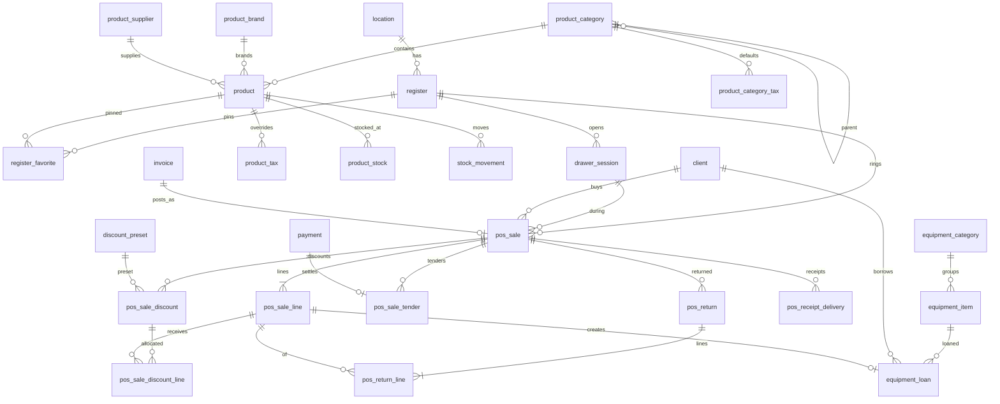
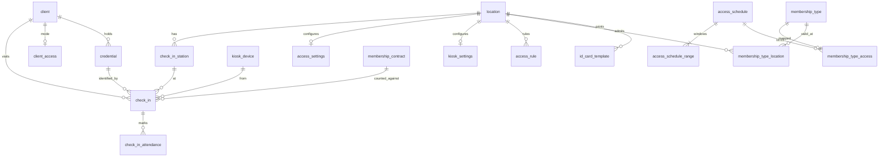
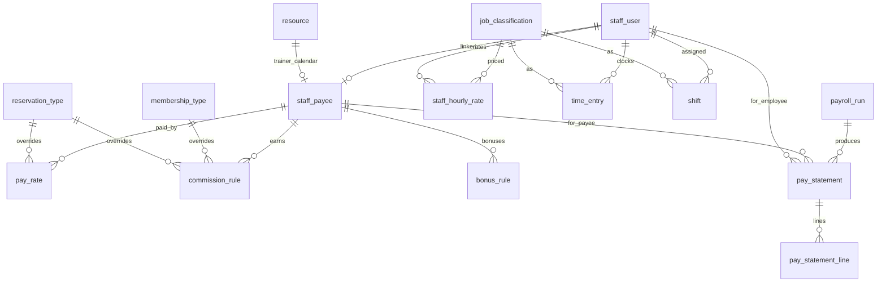
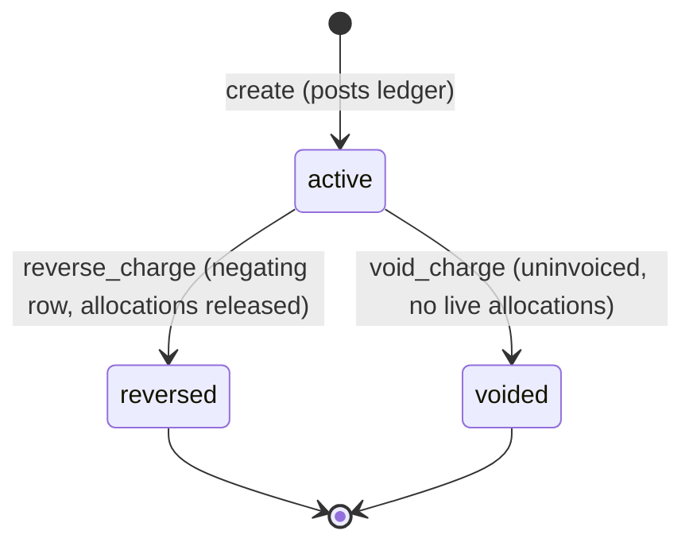
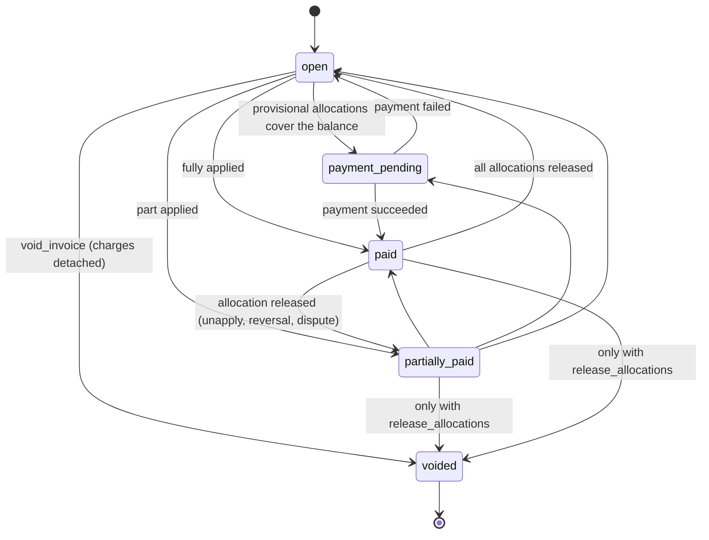
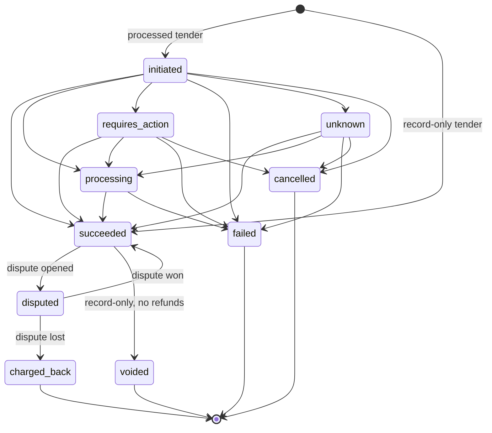
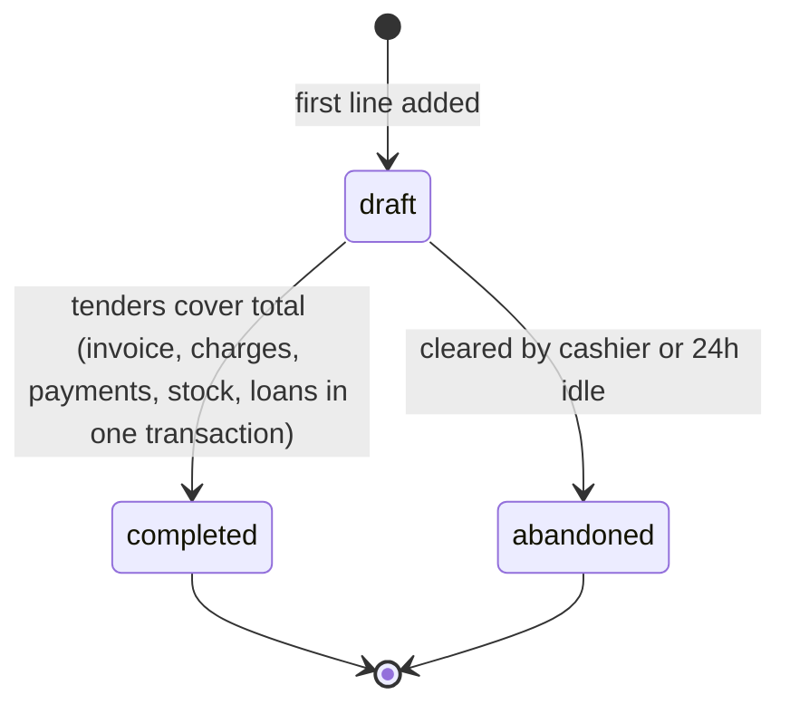

# FacilityHub Data Model: Money (billing, pos, access, staff)

Status: Phase 1 draft for GATE 1. Date: 2026-11-10. Physical model for four bounded contexts and the discovery
prefixes BIL, PAY, POS, CHK, STF. Conforms to `overview.md` (sections 2, 3) and to ADR 0001 (tenancy), 0003
(payments and ledger), 0005 (recurring billing), 0007 (audit), 0008 (jobs). Where this file and an ADR differ
the difference is listed in section 8 as a requested amendment; nothing here silently overrides them.
Migrations are generated from this document.

Clean-room: table and column names are ours. Reference labels appear only where a reader needs them to map a
discovery feature.

## 0. Notation and rules applied to every table below

To keep the column tables readable the following are **implied on every table** unless it is marked *global*
or *append-only*, and are not repeated:

- `id uuid NOT NULL DEFAULT app.uuid_v7()` (`pk_<table>`), `tenant_id uuid NOT NULL`, then the listed columns,
  then `created_at timestamptz NOT NULL DEFAULT now()`, `updated_at timestamptz NOT NULL DEFAULT now()`.
- `UNIQUE (tenant_id, id)` (`uq_<table>_tenant_id_id`), `enable_rls(<table>)` with the `tenant_isolation`
  policy, and `GRANT SELECT, INSERT, UPDATE, DELETE` to `fh_app`. *Append-only* tables get `SELECT, INSERT`
  only and their `updated_at` never changes.
- "FK -> x" means `FOREIGN KEY (tenant_id, <col>) REFERENCES x (tenant_id, id) ON DELETE RESTRICT`. "FK -> x
  (cascade)" is the only other form and is used only from an aggregate root to its own children.
- Every FK column has an index `ix_<table>_<col>` on `(tenant_id, <col>)`. Only additional indexes are listed.
- `Null` column: `no` = `NOT NULL`. Enumerations are `text` with a named `ck_<table>_<col>` check listing the
  values shown (overview 3.2). Money is `bigint` minor units in `_minor` columns; percentages are
  `numeric(5,2)` percent in `_pct`; tax rates are `numeric(7,6)` fractions.
- `*_by_staff_user_id` columns are "FK -> staff_user"; null means the actor was a client, a device, an API key
  or the system (the `audit_event` row carries the precise actor).
- Settings tables are one row per tenant with optional per-location override rows (ADR 0001 L4): `location_id`
  null is the tenant default, `UNIQUE NULLS NOT DISTINCT (tenant_id, location_id)`, readers resolve location
  then tenant. Every non-key column on an override row is nullable-as-inherit only where stated; otherwise an
  override row is a full copy.
- Weekdays are ISO: `smallint` 1 (Monday) to 7 (Sunday). `_time` values are location-local wall time.
- History panels (BIL-09 and every "View History") are filtered reads of `audit_event` (ADR 0007). No table in
  this document stores history; the ledger and the snapshot tables store money facts.

Tables owned elsewhere and referenced by id only: `tenant`, `location`, `location_network`, `staff_user`,
`kiosk_device`, `stored_file`, `tenant_counter`, `job_run` (platform); `client` (clients); `resource`
(resources); `booking`, `session`, `reservation_type` (scheduling); `membership_type`, `membership_contract`
(memberships); `package_plan`, `client_package` (packages); `enrollment` (programs); `message` (engagement).

---

## 1. billing (BIL, PAY)

Owns receivables and money. ADR 0003 fixed the ledger shape, the four undo operations, payment states and the
provider port; ADR 0005 fixed autopay runs and dunning columns. This section is the column-level elaboration
plus the catalogue, settings, delivery and reconciliation tables those ADRs left to the data model.

```mermaid
erDiagram
  revenue_category ||--o{ revenue_category : parent
  revenue_category ||--o{ revenue_category_tax : maps
  tax ||--o{ revenue_category_tax : maps
  tax ||--|{ tax_rate : dated
  revenue_category ||--o{ catalog_item : classifies
  catalog_item ||--o{ catalog_item_sale : sold_as
  catalog_item_sale ||--o{ charge : source
  client ||--o{ charge : owes
  revenue_category ||--o{ charge : classifies
  invoice ||--o{ charge : groups
  charge ||--o{ charge_tax : snapshot
  tax ||--o{ charge_tax : applied
  charge ||--o| charge : reverses
  coupon ||--o{ coupon_redemption : redeemed
  coupon ||--o{ charge : discounts
  client ||--o{ invoice : bill_to
  invoice ||--|{ payment_schedule : instalments
  client ||--o{ payment : pays
  tender_type ||--o{ payment : tender
  provider_account ||--o{ payment : processes
  payment_method ||--o{ payment : uses
  payment ||--o{ payment_allocation : applied
  charge ||--o{ payment_allocation : settles
  payment ||--o{ refund : returns
  payment ||--o{ dispute : contested
  ledger_transaction ||--|{ ledger_entry : lines
  client ||--o{ payment_method : stores
  provider_account ||--o{ payment_method : holds
  provider_account ||--o{ provider_customer : holds
  client ||--o{ provider_customer : mapped
  autopay_run ||--o{ autopay_attempt : contains
  invoice ||--o{ autopay_attempt : collects
  payment ||--o| autopay_attempt : result
  client ||--o| client_billing_profile : has
  client ||--o{ billing_notice : notified
  invoice ||--o{ billing_document_delivery : sent
  payment ||--o{ billing_document_delivery : receipt
  statement_batch ||--|{ statement_recipient : sends
  billing_bulk_action ||--|{ billing_bulk_action_item : items
  provider_account ||--o{ processor_payout : pays_out
  processor_payout ||--|{ processor_payout_line : lines
  package_billing_close ||--|{ package_billing_close_line : bills
```

### 1.1 Catalogue and configuration

#### `revenue_category` (BIL-13)

Accounting classification with default taxes. Referenced by every sellable thing in other contexts.

| Column | Type | Null | Default | Notes |
|---|---|---|---|---|
| code | citext | no | | Alphanumeric; may mirror a GL code. |
| label | text | no | | |
| remarks | text | yes | | |
| parent_id | uuid | yes | | FK -> revenue_category. Adjacency list; depth unbounded, cycle check in service. |
| is_active | boolean | no | true | Deactivated rows stay selectable in filters, hidden from pickers. |
| system_key | text | yes | | `surcharge`, `uncategorised`: seeded rows the service resolves by key. |

Constraints: `uq_revenue_category_code (tenant_id, code)`; `uq_revenue_category_system_key (tenant_id,
system_key) WHERE system_key IS NOT NULL`; `ck_revenue_category_not_self (parent_id <> id)`.
Trade-off: adjacency list, not closure table or ltree. Trees are tens of rows; rollups use a recursive CTE in
`rpt_revenue`. "Update revenue category in subgroups" is a programs-side cascade, not a billing column.

#### `tax` and `tax_rate` (BIL-12)

| `tax` column | Type | Null | Default | Notes |
|---|---|---|---|---|
| code | citext | no | | Free text: HST, GST, VAT. |
| label | text | no | | |
| remarks | text | yes | | |
| is_active | boolean | no | true | |
| deactivated_on | date | yes | | Tax stops applying to charges with `revenue_on >= deactivated_on`. |

| `tax_rate` column | Type | Null | Default | Notes |
|---|---|---|---|---|
| tax_id | uuid | no | | FK -> tax (cascade). |
| rate | numeric(7,6) | no | | Fraction; `ck_tax_rate_rate (rate >= 0 AND rate < 1)`. |
| effective_from_on | date | no | | Rate in force = greatest `effective_from_on <= charge.revenue_on`. |

Constraints: `uq_tax_code (tenant_id, code)`; `ck_tax_deactivated (is_active OR deactivated_on IS NOT NULL)`;
`uq_tax_rate_tax_id_effective_from_on (tenant_id, tax_id, effective_from_on)`. A rate row is immutable once any
`charge_tax` could have used it (service rule: only future-dated rows are editable). Taxes are non-compounding
and tax-exclusive in v1 (ADR 0003 section 10).

#### `revenue_category_tax` (BIL-12, BIL-13)

| Column | Type | Null | Default | Notes |
|---|---|---|---|---|
| revenue_category_id | uuid | no | | FK -> revenue_category (cascade). |
| tax_id | uuid | no | | FK -> tax. |

`uq_revenue_category_tax (tenant_id, revenue_category_id, tax_id)`. No rows for a category means untaxed.
Sub-categories do not inherit the parent's taxes (the reference ticks taxes per category).

#### `tender_type` (PAY-02)

Seeded per tenant at creation. `payment.tender_type_id` points here; the take-payment picker lists enabled rows.

| Column | Type | Null | Default | Notes |
|---|---|---|---|---|
| kind | text | no | | `card`, `bank_debit`, `cash`, `cheque`, `bank_transfer`, `gift_card`, `external`, `other`. |
| label | text | no | | Tenant-editable and locale-aware ("Check" / "Cheque", "PayPal"). |
| is_processed | boolean | no | | True only for `card` and `bank_debit` (`ck_tender_type_processed`). Never editable. |
| is_optional | boolean | no | true | False for `card`, `bank_debit`, `cash`: cannot be hidden. |
| is_enabled | boolean | no | true | Hidden from pickers when false; history keeps the row. |
| sort_order | integer | no | 0 | |

Constraints: `uq_tender_type_label (tenant_id, label)`; `uq_tender_type_kind_single (tenant_id, kind) WHERE
kind NOT IN ('external','other')` so tenants can add several labelled record-only tenders (PayPal, CashApp) but
exactly one of each built-in kind. Processed kinds are offered only while a `provider_account` is `active`
(service rule, PAY-11). Account credit is **not** a tender row: spending it creates allocations from existing
payments (ADR 0003 section 2). `gift_card` is a record-only tender in v1 (POS-12 lists it; no stored-value
product is evidenced). Rejected: a hard-coded tender enum on `payment` (tenants rename and add record-only
tenders).

#### `billing_settings` (BIL-16, BIL-17, BIL-22, PAY-07, PAY-08)

Settings table (tenant row plus optional location overrides, section 0).

| Column | Type | Null | Default | Notes |
|---|---|---|---|---|
| location_id | uuid | yes | | FK -> location. Null = tenant default. |
| is_membership_autopay_default_staff | boolean | no | false | Forces autopay on contracts sold in the facility (BIL-17). |
| is_membership_autopay_default_portal | boolean | no | true | Same for portal and mobile sales. |
| save_card_default | text | no | `ask` | `never`, `ask`, `always`. Applies to staff-keyed payments only (PAY-06). |
| card_expiry_notice_days | integer[] | no | `{60,30}` | Lead times before expiry; empty = off (PAY-07). |
| card_expiry_notice_scope | text | no | `autopay_methods` | `all_methods`, `autopay_methods`. |
| decline_notice_scope | text | no | `all_payments` | `off`, `all_payments`, `autopay_payments`: client-facing notice (PAY-08). |
| decline_alert_email | citext | yes | | Staff alert address for the location. |
| decline_alert_mode | text | no | `per_event` | `per_event`, `daily_digest`. |
| autopay_retry_offset_days | integer[] | no | `{3,5,7}` | Days after first decline (ADR 0005 section 8). |
| due_reminder_offset_days | integer[] | no | `{-3}` | Negative = before `due_on`, positive = after (BIL-22). |
| is_portal_blocked_when_past_due | boolean | no | false | Portal purchase and booking lock for past-due payers (BIL-22). |
| invoice_email_subject | text | no | `Invoice {invoice_number}` | Merge token `{invoice_number}`. |
| invoice_footer | text | yes | | |
| receipt_footer | text | yes | | Also printed on POS receipts (POS-14). |
| statement_email_subject | text | yes | | |
| statement_email_body | text | yes | | |
| statement_footer | text | yes | | |
| is_program_description_on_invoice | boolean | no | false | |
| program_description_source | text | no | `group` | `group`, `subgroup`. |
| bill_to_fields | text[] | no | `{name,address}` | Subset of `name`, `organization`, `address`, `email`, `phone`. |
| package_invoice_sessions | text | no | `all` | `all`, `attended`, `none`: which session dates print on a package invoice. Values are ours; the reference does not enumerate them. |

`uq_billing_settings_location (tenant_id, location_id) NULLS NOT DISTINCT`. Optional payment-method visibility
is `tender_type.is_enabled`, not an array here. "Booking out of range" (listed on the reference's billing
preferences page) belongs to `packages` settings; the settings screen composes both. The autopay run time is
`location.autopay_run_time` (RES-01, platform). `tenant.billing_locked_through_on` is the period lock (ADR
0003).

#### `catalog_item` and `catalog_item_sale` (BIL-14)

`catalog_item` is the reusable fee definition; `catalog_item_sale` is one sale of it to a client and is the
`source` of the charges it expands into, and the row the renewal job advances.

| `catalog_item` column | Type | Null | Default | Notes |
|---|---|---|---|---|
| location_id | uuid | no | | FK -> location. |
| kind | text | no | | `one_off`, `recurring`. |
| description | text | no | | |
| additional_description | text | yes | | Client-visible, prints on invoice. |
| internal_remarks | text | yes | | |
| start_mode | text | no | `sale_date` | `sale_date`, `fixed_date`. |
| starts_on | date | yes | | Required when `fixed_date`. |
| length_count | integer | yes | | `one_off` only. |
| length_unit | text | yes | | `day`, `week`, `month`, `year`. |
| recurrence_unit | text | yes | | `day`, `week`, `month`, `year`; `recurring` only. |
| recurrence_every | integer | yes | | >= 1. |
| recurrence_count | integer | yes | | Occurrences, 1..366. |
| fee_minor | bigint | no | | Per occurrence, pre-tax. `>= 0`. |
| discount_pct | numeric(5,2) | yes | | At most one of pct and minor. |
| discount_minor | bigint | yes | | |
| invoice_option | text | no | `single_invoice` | `single_invoice`, `invoice_per_occurrence`, `leave_uninvoiced`. |
| is_autopay | boolean | no | false | Default for invoices created from a sale. |
| is_auto_renew | boolean | no | false | |
| renew_lead_days | integer | no | 0 | Renewal is created this many days before the current term ends. |
| renews_as_catalog_item_id | uuid | yes | | FK -> catalog_item. Null with `is_auto_renew` = renews as a copy of the sale's own terms. |
| revenue_category_id | uuid | no | | FK -> revenue_category. |
| is_active | boolean | no | true | |

Checks: `ck_catalog_item_recurrence` (`kind = 'recurring'` iff all three recurrence columns are set);
`ck_catalog_item_start` (`start_mode <> 'fixed_date' OR starts_on IS NOT NULL`); `ck_catalog_item_discount`
(`num_nonnulls(discount_pct, discount_minor) <= 1`). Index `(tenant_id, location_id, is_active, description)`.

| `catalog_item_sale` column | Type | Null | Default | Notes |
|---|---|---|---|---|
| catalog_item_id | uuid | no | | FK -> catalog_item. |
| client_id | uuid | no | | FK -> client (beneficiary). |
| location_id | uuid | no | | FK -> location. |
| terms | jsonb | no | | Frozen copy of the item's pricing and recurrence columns after per-sale overrides. Schemaless on purpose: it is a snapshot, never filtered. |
| sold_on | date | no | | |
| starts_on | date | no | | |
| ends_on | date | yes | | Last covered day; null for a one-off with no length. |
| is_auto_renew | boolean | no | false | |
| renew_on | date | yes | | `ends_on + 1 - renew_lead_days`; the renewal job's due key. |
| renews_as_catalog_item_id | uuid | yes | | FK -> catalog_item. Null = renew from `terms`. |
| previous_sale_id | uuid | yes | | FK -> catalog_item_sale. `uq_catalog_item_sale_previous (tenant_id, previous_sale_id)`: renewal idempotency. |
| status | text | no | `active` | `active`, `renewed`, `ended`, `cancelled`. |
| sold_by_staff_user_id | uuid | yes | | |

Index `ix_catalog_item_sale_renew_due (tenant_id, renew_on) WHERE status = 'active' AND is_auto_renew`.
Decision (reference rule: renewing "as" a named item reverts to catalogue price): both paths are modelled;
null `renews_as_catalog_item_id` keeps the customised terms. Rejected: expanding all future renewals up front
(unbounded; price changes would need back-edits).

#### `coupon` and `coupon_redemption` (BIL-15, POS-11)

| `coupon` column | Type | Null | Default | Notes |
|---|---|---|---|---|
| name | text | no | | |
| code | citext | no | | `uq_coupon_code (tenant_id, code)`. |
| starts_at | timestamptz | no | | Minute precision (POS enforces to the minute). |
| ends_at | timestamptz | yes | | `ck_coupon_window (ends_at IS NULL OR ends_at > starts_at)`. |
| discount_pct | numeric(5,2) | yes | | Exactly one of pct and minor (`ck_coupon_discount`). |
| discount_minor | bigint | yes | | Amount off the sale, allocated across lines by largest remainder. |
| limit_per_client | integer | yes | | Null = unlimited. |
| is_portal_enabled | boolean | no | false | Usable in portal and mobile checkout. |
| is_active | boolean | no | true | |

| `coupon_redemption` column | Type | Null | Default | Notes |
|---|---|---|---|---|
| coupon_id | uuid | no | | FK -> coupon. |
| redeemer_client_id | uuid | yes | | FK -> client. The **purchasing** person: the cap counts here even when buying for a relative (fix 2023-08-31). Null only for walk-in POS sales, which cannot use a capped coupon. |
| redemption_key | text | no | | Caller's business key, `"<context>:<type>:<id>"`. |
| invoice_id | uuid | yes | | FK -> invoice. |
| discount_minor | bigint | no | | Total granted by this redemption. |
| redeemed_at | timestamptz | no | now() | |
| released_at | timestamptz | yes | | Set when the sale is abandoned, reversed or voided; released rows do not count toward the cap. |

Constraints: `uq_coupon_redemption_key (tenant_id, coupon_id, redemption_key)` (idempotent redeem). Cap
enforcement: `SELECT ... FOR UPDATE` on the `coupon` row, then count unreleased rows for `redeemer_client_id`;
a transactional counter per (coupon, client) was rejected as an extra table for a low-contention path. A
coupon delete is allowed only with zero redemptions; otherwise deactivate (reference delete is permanent;
ours must not orphan charges). No product scope and no stacking: one coupon per sale, applied after manual
discounts, before tax. Scope columns are deliberately absent because the evidence contradicts itself
(unknowns, BIL-15).

### 1.2 Receivables

#### `charge` (BIL-01, BIL-03, BIL-07, BIL-08, BIL-14, PAY-14)

Atomic receivable. Money columns are immutable once inserted; edits create adjustment rows (ADR 0003 section
3). Mutable in place: `invoice_id`, `status`, `applied_minor`, remarks, `reversed_at`, `voided_at`.

| Column | Type | Null | Default | Notes |
|---|---|---|---|---|
| client_id | uuid | yes | | FK -> client. Beneficiary. Null only for walk-in POS sales (`ck_charge_client`). |
| location_id | uuid | no | | FK -> location. |
| invoice_id | uuid | yes | | FK -> invoice. Null = uninvoiced (the reference's "cart"). |
| kind | text | no | `standard` | `standard`, `adjustment`, `reversal`, `surcharge`. |
| status | text | no | `active` | `active`, `reversed`, `voided`. |
| source_context | text | no | | Owning context, for example `memberships`, `pos`, `billing`. |
| source_type | text | no | | For example `billing_schedule_period`, `pos_sale_line`, `catalog_item_sale`, `manual`. |
| source_id | uuid | no | | Opaque to billing (overview section 2 rule 5). |
| source_line_no | integer | no | 0 | Occurrence or line ordinal within the source. |
| description | text | no | | Snapshot. |
| additional_description | text | yes | | Client-visible. |
| internal_remarks | text | yes | | Staff-only; never serialised to portal. |
| quantity | numeric(12,3) | no | 1 | `> 0`. Sign is carried by the price. |
| unit_price_minor | bigint | no | | Negative on reversal and downward adjustment rows. |
| discount_pct | numeric(5,2) | yes | | Display only; the money is `discount_minor`. |
| discount_minor | bigint | no | 0 | Manual plus coupon discount, already rounded. |
| coupon_id | uuid | yes | | FK -> coupon. |
| net_minor | bigint | no | | `round(quantity * unit_price) - discount_minor`. |
| tax_minor | bigint | no | 0 | Sum of non-excluded `charge_tax.amount_minor`. |
| total_minor | bigint | no | | `ck_charge_total (total_minor = net_minor + tax_minor)`. |
| applied_minor | bigint | no | 0 | Projection: sum of `applied` and `provisional` allocations. Maintained in the allocation transaction; never an input to the ledger. |
| bill_on | date | no | | Location-local creation date. |
| revenue_on | date | no | | Drives tax rate and `ledger_transaction.effective_on`. |
| service_starts_on | date | yes | | Optional service period for deferred-revenue reporting views. |
| service_ends_on | date | yes | | |
| revenue_category_id | uuid | no | | FK -> revenue_category. |
| reverses_charge_id | uuid | yes | | FK -> charge. Set on `reversal` rows. |
| adjusts_charge_id | uuid | yes | | FK -> charge. Set on `adjustment` rows. |
| reason | text | yes | | Required on `reversal` and for void (`ck_charge_reason`). |
| reversed_at | timestamptz | yes | | On the original. |
| voided_at | timestamptz | yes | | On both rows of a void. |
| voided_by_staff_user_id | uuid | yes | | |
| created_by_staff_user_id | uuid | yes | | Drives the per-user uninvoiced list (BIL-03). |

Constraints:

- `uq_charge_reverses_charge_id (tenant_id, reverses_charge_id) WHERE reverses_charge_id IS NOT NULL`: a charge
  is reversed at most once.
- `uq_charge_origin (tenant_id, source_context, source_type, source_id, source_line_no) WHERE kind =
  'standard'`: selling contexts and jobs are idempotent by business key (ADR 0005 "origin uniqueness").
- `ck_charge_client (client_id IS NOT NULL OR source_context = 'pos')`.
- `ck_charge_sign (kind IN ('adjustment','reversal') OR net_minor >= 0)`.
- `ck_charge_link` (`kind = 'reversal'` iff `reverses_charge_id IS NOT NULL`; `kind = 'adjustment'` iff
  `adjusts_charge_id IS NOT NULL`).
- `ck_charge_applied (applied_minor BETWEEN LEAST(total_minor, 0) AND GREATEST(total_minor, 0))`.
- `ck_charge_service_period (service_ends_on IS NULL OR service_ends_on >= service_starts_on)`.

Indexes: `(tenant_id, client_id, bill_on DESC, id DESC)` (client Items tab); `ix_charge_uninvoiced (tenant_id,
location_id, id) WHERE invoice_id IS NULL AND status = 'active'` (workbench, BIL-02; location "cart", BIL-03);
`ix_charge_uninvoiced_creator (tenant_id, created_by_staff_user_id, id) WHERE invoice_id IS NULL AND status =
'active'` (per-user "cart"); `(tenant_id, source_context, source_type, source_id)`; `(tenant_id, revenue_on,
revenue_category_id)`; `ix_charge_open (tenant_id, client_id, bill_on, id) WHERE status = 'active' AND
applied_minor < total_minor` (oldest-first allocation, PAY-01).

BIL-03 has no table: the two "carts" are these partial indexes. Trade-off: `applied_minor` duplicates what the
allocations say; kept because the workbench, allocation screen and AR views filter on "open" at list scale. A
property test asserts it equals the allocation sum after every operation. Rejected: computing it per row in
every list query.

#### `charge_tax` (BIL-01, BIL-12)

| Column | Type | Null | Default | Notes |
|---|---|---|---|---|
| charge_id | uuid | no | | FK -> charge (cascade). |
| tax_id | uuid | no | | FK -> tax. |
| rate | numeric(7,6) | no | | Snapshot of the rate in force on `revenue_on`. |
| amount_minor | bigint | no | | Half-up on `net_minor`; 0 when excluded; negated on reversal rows. |
| is_excluded | boolean | no | false | Staff or the selling context unticked this tax; the row stays so the exclusion survives invoicing (fix 2023-09-13). |

`uq_charge_tax (tenant_id, charge_id, tax_id)`. Insert-only in practice: toggling a tax on a posted charge is an
adjustment charge with its own `charge_tax` rows. Rejected: `excluded_tax_ids uuid[]` on `charge` (no FK, and
the UI needs the unticked taxes as rows).

#### `invoice` (BIL-02, BIL-04, BIL-05, BIL-08, BIL-17, BIL-23, PAY-09, PAY-18)

Grouping and collection document for one payer. Totals are projections of its charges.

| Column | Type | Null | Default | Notes |
|---|---|---|---|---|
| number | bigint | no | | From `tenant_counter('invoice')` under `FOR UPDATE`. `uq_invoice_number (tenant_id, number)`. |
| bill_to_client_id | uuid | yes | | FK -> client. Payer. Null only for walk-in POS (`ck_invoice_bill_to`: `bill_to_client_id IS NOT NULL OR origin = 'pos'`). |
| location_id | uuid | no | | FK -> location. |
| origin | text | no | | `staff`, `portal`, `pos`, `kiosk`, `api`, `system`. Feeds the autopay default resolution (BIL-17). |
| invoice_on | date | no | | Editable. |
| due_on | date | no | | `ck_invoice_due (due_on >= invoice_on)`. Equals the earliest uncovered `payment_schedule.due_on` once a schedule exists. |
| is_autopay | boolean | no | false | Resolved at sale: plan, then `billing_settings`, then channel; switchable at payment (BIL-17). |
| status | text | no | `open` | `open`, `payment_pending`, `partially_paid`, `paid`, `voided`. Cached derivation (ADR 0003 section 2). |
| total_minor | bigint | no | 0 | Projection: sum of its charges' `total_minor`. |
| balance_minor | bigint | no | 0 | Projection: `total_minor` minus applied allocations (provisional excluded). |
| past_due_since_on | date | yes | | Set once when the invoice enters past due; cleared when covered. `billing.invoice.past_due` fires on set. |
| dunning_state | text | no | `none` | `none`, `retrying`, `awaiting_method`, `exhausted` (ADR 0005). |
| attempt_count | integer | no | 0 | Autopay attempts made. |
| next_attempt_on | date | yes | | |
| comments | text | yes | | |
| organization_name | text | yes | | Printed and reportable. |
| created_by_staff_user_id | uuid | yes | | "Created By" (fix 2023-08-31). |
| voided_at | timestamptz | yes | | |
| voided_by_staff_user_id | uuid | yes | | |
| void_reason | text | yes | | Required when voided. |
| version | integer | no | 1 | Optimistic concurrency (overview 3.1). |

Indexes: `ix_invoice_payable (tenant_id, bill_to_client_id, due_on, id) WHERE status IN
('open','payment_pending','partially_paid')` (default "payable" list, portal pay screen PAY-18);
`(tenant_id, bill_to_client_id, invoice_on DESC, id DESC)`; `ix_invoice_voided (tenant_id, bill_to_client_id, id)
WHERE status = 'voided'`; `ix_invoice_autopay_due (tenant_id, location_id, due_on) WHERE is_autopay AND
balance_minor > 0 AND status <> 'voided'` (autopay selection; also published to the fan-out through the
`due_autopay_location` view); `ix_invoice_past_due (tenant_id, location_id, past_due_since_on) WHERE
past_due_since_on IS NOT NULL` (AR, collections, access rule read).

Rules: Bill To change (BIL-05) is an update of `bill_to_client_id` with an audit event, restricted by default
to clients related to a beneficiary of the invoice's charges, with a permission to override; refused while any
allocation is `applied` or `provisional` (the money belongs to the old payer's payments). Bulk invoicing of
mixed clients splits per payer (overview divergence 6). `move_charge` requires the same payer and location. The
signed pay link added to invoice emails is a stateless HMAC over `(invoice.id, expiry)` and needs no column.

#### `payment_schedule` (BIL-06, PAY-09)

Instalment plan over an invoice. A due-date plan, not an allocation target.

| Column | Type | Null | Default | Notes |
|---|---|---|---|---|
| invoice_id | uuid | no | | FK -> invoice (cascade). |
| seq | integer | no | | 1-based order by `due_on`. |
| due_on | date | no | | Not before `invoice.invoice_on` (trigger, below). |
| amount_minor | bigint | no | | `> 0`, except a single zero row on a zero-total invoice. |
| covered_minor | bigint | no | 0 | Projection: applied allocations on the invoice's charges, poured over rows in `due_on` order. `ck_payment_schedule_covered (covered_minor BETWEEN 0 AND amount_minor)`. |

Constraints: `uq_payment_schedule_seq (tenant_id, invoice_id, seq)`; `ix_payment_schedule_due (tenant_id,
due_on) WHERE covered_minor < amount_minor`. `ct_payment_schedule_balanced` is a `DEFERRABLE INITIALLY DEFERRED`
constraint trigger on `payment_schedule` and on `invoice (total_minor, invoice_on)`: for a non-voided invoice,
`sum(amount_minor) = total_minor` and `min(due_on) >= invoice_on`. Every invoice gets one default row
(`total_minor` on `due_on`). The generator (start date, every N `day|week|half_month|month|year`, count) is a
pure function using largest-remainder allocation (overview 3.6); its inputs are recorded in the audit event,
not stored. A total change rebalances in the same transaction (ADR 0003). Rejected: allocating payments to
instalments (PAY-01 allocates to items).

### 1.3 Money in and out

#### `payment` (PAY-01, PAY-03, PAY-04, PAY-09, PAY-10, PAY-15, PAY-18, BIL-21, BIL-23)

Money received from one payer in one tender. Its unallocated remainder is the client's account credit.

| Column | Type | Null | Default | Notes |
|---|---|---|---|---|
| receipt_number | bigint | no | | `tenant_counter('receipt')`. `uq_payment_receipt_number (tenant_id, receipt_number)`. |
| client_id | uuid | yes | | FK -> client. Payer. Null only when `origin = 'pos'` (`ck_payment_client`). |
| location_id | uuid | no | | FK -> location. Where it was taken (deposit reports); may differ from the client's home location, with a UI warning. |
| tender_type_id | uuid | no | | FK -> tender_type. |
| tender_kind | text | no | | Snapshot of `tender_type.kind`. |
| amount_minor | bigint | no | | `> 0`. |
| currency | char(3) | no | | Copy of `tenant.currency`. |
| status | text | no | `initiated` | `initiated`, `requires_action`, `processing`, `succeeded`, `failed`, `unknown`, `cancelled`, `disputed`, `charged_back`, `voided`. |
| origin | text | no | | `staff`, `portal`, `pos`, `kiosk`, `autopay`, `api`. |
| provider_account_id | uuid | yes | | FK -> provider_account. Required iff the tender is processed (`ck_payment_provider`). |
| provider_payment_ref | text | yes | | Provider object id. `uq_payment_provider_ref (tenant_id, provider_account_id, provider_payment_ref) WHERE provider_payment_ref IS NOT NULL`. |
| payment_method_id | uuid | yes | | FK -> payment_method. Stored method used, if any. |
| card_brand | text | yes | | Snapshot; serialised only to holders of `billing.payment.view_instrument` (the reference hides it without the refund permission). |
| card_last4 | text | yes | | Same masking. |
| card_funding | text | yes | | `credit`, `debit`, `prepaid`, `unknown`. Card-type revenue reporting; surcharge eligibility. |
| wallet | text | yes | | `apple_pay`, `google_pay` (PAY-15). |
| external_reference | text | yes | | Cheque number, bank transfer reference. |
| memo | text | yes | | |
| received_at | timestamptz | no | now() | When taken. |
| settled_at | timestamptz | yes | | When it became `succeeded`; the ledger posts here. |
| failure_category | text | yes | | Normalised (ADR 0003 section 5). |
| failure_message | text | yes | | Provider text, shown on AR report and autopay errors. |
| unapplied_minor | bigint | no | 0 | Projection of the remainder (ADR 0003 section 2); 0 until `succeeded`. |
| refunded_minor | bigint | no | 0 | Projection: succeeded plus pending refunds. |
| taken_by_staff_user_id | uuid | yes | | |
| voided_at | timestamptz | yes | | |
| voided_by_staff_user_id | uuid | yes | | |
| void_reason | text | yes | | Required when voided. |

Checks: `ck_payment_remainder (unapplied_minor >= 0 AND refunded_minor BETWEEN 0 AND amount_minor)`;
`ck_payment_void (status <> 'voided' OR (void_reason IS NOT NULL AND provider_account_id IS NULL))` (only
record-only payments can be voided). Indexes: `(tenant_id, client_id, received_at DESC, id DESC)` (client
Payments list with range and voided filter); `ix_payment_credit (tenant_id, client_id, received_at) WHERE
status = 'succeeded' AND unapplied_minor > 0` (credit spend oldest first, refund newest first);
`ix_payment_unsettled (tenant_id, status, received_at) WHERE status IN
('initiated','unknown','requires_action','processing')` (reconciliation sweep); `(tenant_id, location_id,
received_at)` (deposit report).

The API "mark paid" (BIL-23) inserts a record-only payment with `origin = 'api'` and allocates it. The payments
list projects refunds as negative lines (PAY-03); storage stays in `refund`.

#### `payment_allocation` (PAY-01, PAY-04, PAY-05, BIL-07, BIL-21)

| Column | Type | Null | Default | Notes |
|---|---|---|---|---|
| payment_id | uuid | no | | FK -> payment. |
| charge_id | uuid | no | | FK -> charge. |
| amount_minor | bigint | no | | `> 0`. |
| status | text | no | | `provisional`, `applied`, `released`. |
| applied_at | timestamptz | yes | | Set on `applied`; the "payments up to" cut for AR (BIL-19). |
| released_at | timestamptz | yes | | |
| release_reason | text | yes | | `unapplied`, `charge_reversed`, `charge_adjusted`, `payment_voided`, `payment_failed`, `dispute_opened`, `invoice_voided`. |
| created_by_staff_user_id | uuid | yes | | |

`ck_payment_allocation_release` (`status = 'released'` iff `released_at IS NOT NULL AND release_reason IS NOT
NULL`). Index `ix_payment_allocation_live (tenant_id, charge_id) WHERE status <> 'released'` and the same on
`payment_id`. A released row is never re-applied; re-applying inserts a new row, so each row maps to at most
two ledger transactions (applied, released). Sum guards (`<= payment remainder`, `<= charge balance`) are
enforced in the service under `FOR UPDATE` on the payment and the charge, in id order to avoid deadlocks, and
backstopped by `ck_charge_applied` and `ck_payment_remainder`.

#### `refund` (PAY-05, POS-16)

| Column | Type | Null | Default | Notes |
|---|---|---|---|---|
| payment_id | uuid | no | | FK -> payment. A refund returns the unapplied remainder of one payment. |
| client_id | uuid | yes | | FK -> client. Copy of the payer for list queries. |
| location_id | uuid | no | | FK -> location. Where it was issued. |
| amount_minor | bigint | no | | `> 0`. |
| currency | char(3) | no | | |
| method | text | no | | `original`, `external`. |
| status | text | no | `pending` | `pending`, `succeeded`, `failed`, `cancelled`. Record-only refunds are inserted `succeeded`. |
| provider_refund_ref | text | yes | | `uq_refund_provider_ref (tenant_id, provider_refund_ref) WHERE provider_refund_ref IS NOT NULL`. |
| refund_on | date | no | | Reporting date, editable until posted. |
| reason | text | no | | |
| comments | text | yes | | |
| refund_batch_id | uuid | yes | | Groups the per-payment refunds of one "refund account credit" or one POS return. Not an FK. |
| failure_message | text | yes | | |
| issued_by_staff_user_id | uuid | yes | | Requires `billing.payment.refund`. |

Index `(tenant_id, refund_batch_id) WHERE refund_batch_id IS NOT NULL`; `ix_refund_pending (tenant_id,
created_at) WHERE status = 'pending'`.

#### `dispute` (PAY-17)

| Column | Type | Null | Default | Notes |
|---|---|---|---|---|
| payment_id | uuid | no | | FK -> payment. |
| provider_dispute_ref | text | no | | `uq_dispute_provider_ref (tenant_id, provider_dispute_ref)`. |
| amount_minor | bigint | no | | |
| currency | char(3) | no | | |
| reason_code | text | yes | | |
| status | text | no | `open` | `open`, `won`, `lost`. |
| opened_at | timestamptz | no | | |
| evidence_due_at | timestamptz | yes | | |
| closed_at | timestamptz | yes | | |

#### `ledger_transaction` and `ledger_entry` (BIL-01, BIL-07, BIL-19, BIL-21) *append-only*

| `ledger_transaction` column | Type | Null | Default | Notes |
|---|---|---|---|---|
| kind | text | no | | `charge_posted`, `payment_settled`, `allocation_applied`, `allocation_released`, `refund_succeeded`, `refund_returned`, `payment_voided`, `dispute_opened`, `dispute_won`, `dispute_lost`, `correction`. |
| source_type | text | no | | `charge`, `payment`, `payment_allocation`, `refund`, `dispute`. |
| source_id | uuid | no | | |
| effective_on | date | no | | Location-local reporting date. Rejected with `period-locked` when `<= tenant.billing_locked_through_on`. |
| posted_at | timestamptz | no | now() | |
| reverses_transaction_id | uuid | yes | | FK -> ledger_transaction. |
| actor_type | text | no | | `staff`, `client`, `api_key`, `kiosk`, `system`. |
| actor_id | uuid | yes | | |

`uq_ledger_transaction_source (tenant_id, kind, source_type, source_id)`: the database idempotency guard.

| `ledger_entry` column | Type | Null | Default | Notes |
|---|---|---|---|---|
| ledger_transaction_id | uuid | no | | FK -> ledger_transaction. |
| account | text | no | | `receivable`, `revenue`, `tax_payable`, `funds_received`, `client_credit`, `disputed_funds`. |
| debit_minor | bigint | no | 0 | |
| credit_minor | bigint | no | 0 | `ck_ledger_entry_one_side (debit_minor >= 0 AND credit_minor >= 0 AND (debit_minor = 0) <> (credit_minor = 0))`. |
| currency | char(3) | no | | |
| effective_on | date | no | | Denormalised from the header; immutable, so safe. |
| location_id | uuid | no | | FK -> location. |
| client_id | uuid | yes | | FK -> client. Null for walk-in POS. |
| revenue_category_id | uuid | yes | | FK -> revenue_category. Required when `account = 'revenue'`. |
| tax_id | uuid | yes | | FK -> tax. Required when `account = 'tax_payable'`. |
| charge_id | uuid | yes | | FK -> charge. |
| payment_id | uuid | yes | | FK -> payment. |

`ck_ledger_entry_dimension` enforces the two "required when" rules. `ct_ledger_transaction_balanced` is a
deferred constraint trigger: per `ledger_transaction_id`, `sum(debit_minor) = sum(credit_minor)` and at least
two entries. Indexes: `(tenant_id, account, effective_on)`; `(tenant_id, client_id, account)`;
`(tenant_id, location_id, effective_on)`. A negative reversal charge posts with debit and credit swapped, never
with negative amounts.

### 1.4 Provider, stored methods, autopay

#### `provider_account` and `provider_account_lookup` (PAY-11)

| `provider_account` column | Type | Null | Default | Notes |
|---|---|---|---|---|
| location_id | uuid | yes | | FK -> location. Null = tenant-wide (v1: one per tenant). |
| provider | text | no | | `stripe`, `fake`. |
| provider_account_ref | text | no | | Connected-account id. |
| status | text | no | `pending` | `pending`, `restricted`, `active`, `disabled`. |
| has_card | boolean | no | false | Capability flags mirrored from the provider. |
| has_bank_debit | boolean | no | false | |
| has_wallets | boolean | no | false | PAY-15. |
| is_payouts_enabled | boolean | no | false | |
| requirements_due | jsonb | yes | | Provider onboarding to-do list, shown verbatim to the owner. |
| connected_at | timestamptz | yes | | |
| disabled_at | timestamptz | yes | | A `disabled` account stays for history (reports on "current or past processor"). |

`uq_provider_account_ref (tenant_id, provider, provider_account_ref)`; `uq_provider_account_scope (tenant_id,
location_id) NULLS NOT DISTINCT WHERE status <> 'disabled'`.

`provider_account_lookup` is *global* (allow-listed in overview 3.1; no `tenant_id` RLS; readable only by
`fh_platform`): `provider text`, `provider_account_ref text`, `tenant_id uuid NOT NULL`, `created_at`;
`PRIMARY KEY (provider, provider_account_ref)`. Written by a `SECURITY DEFINER` function called when a
`provider_account` is created. Used only to route inbound webhooks to a tenant.

#### `provider_customer` (PAY-06)

| Column | Type | Null | Default | Notes |
|---|---|---|---|---|
| client_id | uuid | no | | FK -> client. |
| provider_account_id | uuid | no | | FK -> provider_account. |
| provider_customer_ref | text | no | | |

`uq_provider_customer (tenant_id, provider_account_id, client_id)`. Client merge re-points methods to the
surviving client's customer; the losing customer is detached at the provider by a job.

#### `payment_method` (PAY-06, PAY-07, PAY-10, PAY-14)

Stored card or bank account. References and display data only; no card or bank numbers.

| Column | Type | Null | Default | Notes |
|---|---|---|---|---|
| client_id | uuid | no | | FK -> client. |
| provider_account_id | uuid | no | | FK -> provider_account. |
| provider_method_ref | text | no | | `uq_payment_method_ref (tenant_id, provider_account_id, provider_method_ref)`. |
| kind | text | no | | `card`, `bank_account`. |
| brand | text | yes | | Card brand or bank name. |
| last4 | text | no | | |
| exp_month | smallint | yes | | Card only; `ck_payment_method_expiry` (both set iff `kind = 'card'`, month 1..12). |
| exp_year | smallint | yes | | |
| funding | text | yes | | `credit`, `debit`, `prepaid`, `unknown`. |
| wallet | text | yes | | `apple_pay`, `google_pay` when tokenised from a wallet. |
| is_autopay | boolean | no | true | "Use for autopay". |
| status | text | no | | `pending_verification`, `active`, `suspended`, `removed`. |
| verified_at | timestamptz | yes | | Bank account verification. |
| suspended_on | date | yes | | Set with `suspended` (closed account, revoked mandate). |
| mandate_ref | text | yes | | Provider mandate for bank debits. |
| removed_at | timestamptz | yes | | |

`uq_payment_method_autopay (tenant_id, client_id) WHERE is_autopay AND status = 'active'`: one autopay method
per client; setting another clears the flag on the first in the same transaction. Index
`ix_payment_method_expiry (tenant_id, exp_year, exp_month) WHERE kind = 'card' AND status = 'active'`
(expiry notices and the expiring-cards report, PAY-07). A portal client may replace but not remove their last
method while they have an open autopay invoice (the reference never allows removal; ours allows it when
nothing depends on it).

#### `autopay_run` and `autopay_attempt` (PAY-09, PAY-06, PAY-08)

| `autopay_run` column | Type | Null | Default | Notes |
|---|---|---|---|---|
| location_id | uuid | no | | FK -> location. |
| business_on | date | no | | Location-local date. `uq_autopay_run (tenant_id, location_id, business_on)`. |
| status | text | no | `running` | `running`, `completed`, `completed_with_errors`. |
| selected_count | integer | no | 0 | |
| succeeded_count | integer | no | 0 | |
| failed_count | integer | no | 0 | |
| collected_minor | bigint | no | 0 | |
| started_at | timestamptz | no | now() | |
| finished_at | timestamptz | yes | | |

| `autopay_attempt` column | Type | Null | Default | Notes |
|---|---|---|---|---|
| autopay_run_id | uuid | no | | FK -> autopay_run. |
| invoice_id | uuid | no | | FK -> invoice. |
| attempt_no | integer | no | | `uq_autopay_attempt (tenant_id, invoice_id, attempt_no)`. |
| amount_minor | bigint | no | | Due amount selected (covered schedule rows up to `business_on`). |
| credit_applied_minor | bigint | no | 0 | Account credit allocated before charging. |
| payment_method_id | uuid | yes | | FK -> payment_method. Null = none on file (`awaiting_method`). |
| payment_id | uuid | yes | | FK -> payment. `uq_autopay_attempt_payment (tenant_id, payment_id) WHERE payment_id IS NOT NULL`. |
| status | text | no | `pending` | `pending`, `succeeded`, `processing`, `failed`, `skipped`. |
| failure_category | text | yes | | |
| failure_message | text | yes | | |
| error_cleared_at | timestamptz | yes | | Staff dismissed it from the autopay-errors list (PAY-06). |
| error_cleared_by_staff_user_id | uuid | yes | | |

Index `ix_autopay_attempt_errors (tenant_id, created_at DESC) WHERE status = 'failed' AND error_cleared_at IS
NULL`. The provider idempotency key is `"{tenant_id}:autopay:{autopay_attempt.id}"`. A direct-debit "batch" in
the reference is this run filtered to bank tenders; no separate batch table (rejected: `direct_debit_batch`,
which only exists for file-based processors we do not ship).

### 1.5 Client standing, notices, delivery, bulk work

#### `client_billing_profile` (BIL-20, BIL-21, BIL-22, CHK-21)

One row per client that has any billing activity, created lazily. Billing-owned so that `clients` carries no
money columns.

| Column | Type | Null | Default | Notes |
|---|---|---|---|---|
| client_id | uuid | no | | FK -> client. `uq_client_billing_profile_client (tenant_id, client_id)`. |
| collections_status | text | no | `normal` | `normal`, `tagged`, `in_collections` (BIL-20). |
| tagged_at | timestamptz | yes | | |
| placed_at | timestamptz | yes | | |
| placed_by_staff_user_id | uuid | yes | | |
| credit_minor | bigint | no | 0 | Projection: sum of `payment.unapplied_minor` (the "on account" balance, BIL-21). |
| open_balance_minor | bigint | no | 0 | Projection: sum of open invoice balances where the client is payer. |
| past_due_minor | bigint | no | 0 | Projection, refreshed by the allocation transaction and by the daily lifecycle job. |
| oldest_past_due_on | date | yes | | Read by access rules (CHK-08 past-due threshold) and check-in alerts (CHK-21). |

Index `(tenant_id, collections_status) WHERE collections_status <> 'normal'`. Nothing is transmitted to an
agency; the collections reports are `rpt_*` views over this table and `invoice`. Trade-off: four projection
columns versus aggregating invoices on every check-in. Chosen because check-in and kiosk are the hottest read
path in the system and must not scan billing tables. Rejected: columns on `client` (cross-context write).

#### `billing_notice` (BIL-22, PAY-07, PAY-08) *append-only*

Dedupe log of billing-triggered notices. Delivery, templates, channels and suppression are `engagement`.

| Column | Type | Null | Default | Notes |
|---|---|---|---|---|
| kind | text | no | | `due_reminder`, `past_due_reminder`, `final_notice`, `payment_declined`, `authentication_required`, `method_expiring`, `staff_decline_alert`, `staff_decline_digest`. |
| subject_type | text | no | | `invoice`, `payment`, `payment_method`, `location`. |
| subject_id | uuid | no | | |
| dedupe_key | text | no | | For example `offset:-3`, `attempt:2`, `lead:30`, `date:2026-11-10`. |
| client_id | uuid | yes | | FK -> client. |
| location_id | uuid | yes | | FK -> location. |
| sent_at | timestamptz | no | now() | When the event was handed to engagement. |

`uq_billing_notice (tenant_id, kind, subject_type, subject_id, dedupe_key)`: the daily job inserts first and
publishes only on success, so reruns and catch-up never double-notify.

#### `billing_document_delivery` (BIL-10, BIL-02, PAY-03)

| Column | Type | Null | Default | Notes |
|---|---|---|---|---|
| document_kind | text | no | | `invoice`, `receipt`. |
| invoice_id | uuid | yes | | FK -> invoice. |
| payment_id | uuid | yes | | FK -> payment. `ck_billing_document_delivery_subject` (exactly one, matching `document_kind`). |
| channel | text | no | | `email`, `print`, `download`. |
| to_email | citext | yes | | Required for `email`. An ad-hoc address is not written back to the client. |
| stored_file_id | uuid | yes | | FK -> stored_file. Rendered PDF. |
| status | text | no | `queued` | `queued`, `sent`, `failed`. |
| failure_message | text | yes | | |
| message_id | uuid | yes | | Engagement message, for delivery status. Not an FK (higher layer). |
| billing_bulk_action_id | uuid | yes | | FK -> billing_bulk_action. |
| requested_by_staff_user_id | uuid | yes | | |

#### `statement_batch` and `statement_recipient` (BIL-11)

| `statement_batch` column | Type | Null | Default | Notes |
|---|---|---|---|---|
| location_id | uuid | yes | | FK -> location. Null = all permitted locations. |
| period_from_on | date | yes | | Open-ended allowed; the service caps a bulk span at 366 days (resolves the unknown in favour of the stricter source). |
| period_to_on | date | yes | | |
| date_basis | text | no | | `invoice_date`, `due_date`. |
| is_open_only | boolean | no | false | Only clients with an open invoice. |
| client_filter | jsonb | no | `{}` | Client category, tags, saved filter, explicit ids. Opaque selection criteria. |
| status | text | no | `queued` | `queued`, `running`, `completed`, `failed`. |
| requested_by_staff_user_id | uuid | no | | Requires `billing.statement.send`. |
| finished_at | timestamptz | yes | | |

| `statement_recipient` column | Type | Null | Default | Notes |
|---|---|---|---|---|
| statement_batch_id | uuid | no | | FK -> statement_batch (cascade). |
| client_id | uuid | no | | FK -> client. `uq_statement_recipient (tenant_id, statement_batch_id, client_id)`. |
| to_email | citext | yes | | |
| status | text | no | `queued` | `queued`, `sent`, `failed`, `skipped_no_email`. |
| stored_file_id | uuid | yes | | FK -> stored_file. |
| message_id | uuid | yes | | |
| failure_message | text | yes | | |

A single-client statement (view, PDF, print) is a query plus render and writes nothing. Per-recipient status is
our addition (the reference gives no delivery confirmation).

#### `billing_bulk_action` and `billing_bulk_action_item` (BIL-02)

Resumable bulk work from the workbench with per-item results (overview divergence 8).

| `billing_bulk_action` column | Type | Null | Default | Notes |
|---|---|---|---|---|
| location_id | uuid | no | | FK -> location. |
| action | text | no | | `create_invoices`, `reverse_charges`, `email_invoices`, `render_invoices`, `add_catalog_item`. |
| params | jsonb | no | `{}` | Reason and revenue-date mode for reversal, `catalog_item_id` for add-item. |
| is_dry_run | boolean | no | false | Preview executes in a rolled-back transaction and stores only the item results. |
| status | text | no | `queued` | `queued`, `running`, `completed`, `completed_with_errors`. |
| requested_by_staff_user_id | uuid | no | | |
| finished_at | timestamptz | yes | | |

| `billing_bulk_action_item` column | Type | Null | Default | Notes |
|---|---|---|---|---|
| billing_bulk_action_id | uuid | no | | FK -> billing_bulk_action (cascade). |
| subject_type | text | no | | `charge`, `invoice`. |
| subject_id | uuid | no | | `uq_billing_bulk_action_item (tenant_id, billing_bulk_action_id, subject_type, subject_id)`. |
| status | text | no | `pending` | `pending`, `done`, `failed`, `skipped`. |
| result_type | text | yes | | For example `invoice`. |
| result_id | uuid | yes | | |
| error_code | text | yes | | Problem `code` (overview 3.13). |

Filter presets ("Open Invoices", "Invoice Lookup") are system-defined query presets plus `reporting.saved_report`
rows; no billing table.

### 1.6 Reconciliation and period close

#### `processor_payout` and `processor_payout_line` (PAY-16)

Reconciliation data ingested from the provider. Never posts to the ledger.

| `processor_payout` column | Type | Null | Default | Notes |
|---|---|---|---|---|
| provider_account_id | uuid | no | | FK -> provider_account. |
| provider_payout_ref | text | no | | `uq_processor_payout_ref (tenant_id, provider_account_id, provider_payout_ref)`. |
| status | text | no | | `pending`, `in_transit`, `paid`, `failed`, `cancelled`. |
| amount_minor | bigint | no | | |
| currency | char(3) | no | | |
| arrival_on | date | no | | Index `(tenant_id, arrival_on)`. |

| `processor_payout_line` column | Type | Null | Default | Notes |
|---|---|---|---|---|
| processor_payout_id | uuid | no | | FK -> processor_payout (cascade). |
| kind | text | no | | `payment`, `refund`, `dispute`, `fee`, `adjustment`. |
| provider_txn_ref | text | no | | `uq_processor_payout_line_txn (tenant_id, processor_payout_id, provider_txn_ref)`. |
| payment_id | uuid | yes | | FK -> payment. Card holder, brand and last four come from the join. |
| refund_id | uuid | yes | | FK -> refund. |
| dispute_id | uuid | yes | | FK -> dispute. |
| gross_minor | bigint | no | | Signed. |
| fee_minor | bigint | no | 0 | Processor fee; the tenant's cost, not on any client ledger. |
| net_minor | bigint | no | | |
| occurred_at | timestamptz | no | | |

#### `package_billing_close` and `package_billing_close_line` (BIL-18)

**Owned by `packages`, specified here because BIL-18 carries this document's prefix.** Billing cannot call
`packages` (layering), so the close command lives in `packages.service`, which reads its attended sessions and
calls `billing.create_charge` / `create_invoice`. The packages data model must reference, not redefine, these
two tables.

| `package_billing_close` column | Type | Null | Default | Notes |
|---|---|---|---|---|
| location_id | uuid | no | | FK -> location. |
| closing_on | date | no | | Sessions on or before this date are billed. |
| status | text | no | `running` | `running`, `completed`, `completed_with_errors`. |
| closed_by_staff_user_id | uuid | no | | |
| finished_at | timestamptz | yes | | |

| `package_billing_close_line` column | Type | Null | Default | Notes |
|---|---|---|---|---|
| package_billing_close_id | uuid | no | | FK -> package_billing_close (cascade). |
| client_package_id | uuid | no | | FK -> client_package. |
| closing_on | date | no | | Copy of the header's date, for the unique key below. |
| client_id | uuid | no | | FK -> client. |
| session_count | integer | no | | Attended sessions billed. |
| amount_minor | bigint | no | | |
| invoice_id | uuid | yes | | FK -> invoice. |
| status | text | no | `pending` | `pending`, `billed`, `failed`, `skipped_unmarked_attendance`. |

`uq_package_billing_close_line (tenant_id, client_package_id, closing_on)`: one bill per package per closing
date. The charge origin is `('packages',
'package_billing_close_line', line.id, 0)`, so a retried job cannot bill twice. "Review past closes" is a list
of these rows.

### 1.7 Features with no table of their own

| Feature | How it is served |
|---|---|
| BIL-03 uninvoiced "carts" | Partial indexes on `charge`; scope by `created_by_staff_user_id` or `location_id`. |
| BIL-09 billing history | `audit_event` filtered by entity (ADR 0007), 7-year retention class. |
| BIL-19 accounts receivable | `rpt_receivable` view over `invoice`, `payment_schedule`, `payment_allocation` (as-of cut on `applied_at` / `released_at`), `autopay_attempt` (last failure message), `client_billing_profile`. |
| BIL-21 account credit | `payment.unapplied_minor`, pooled in `client_billing_profile.credit_minor`; ledger account `client_credit`. |
| BIL-23 invoice API | `invoice` with embedded `payment` and `payment_allocation`; "mark paid" inserts a record-only payment. |
| PAY-08 decline alerts | `billing.payment.failed` event, `billing_settings` modes, `billing_notice` dedupe. `unknown` outcomes never notify. |
| PAY-10 failed direct debits | Query over `payment` (`tender_kind = 'bank_debit'`, `failed`) and lost `dispute` rows. |
| PAY-15 wallets | Provider-hosted element; `payment.wallet`, `payment_method.wallet`, `provider_account.has_wallets`. |
| PAY-18 portal payment | `ix_invoice_payable`; portal routes over `invoice`, `payment`, `payment_method`. |

---

## 2. pos (POS; also RNT-14, RNT-15, RNT-16)

Products, stock, registers, sales, returns and loanable equipment. A completed sale is an `invoice` plus
charges plus payments in `billing`; `pos` keeps the cart, the tender legs, the discount breakdown and the stock
and equipment side effects. `pos` calls `billing` and `packages`; it never writes their tables.

### 2.1 Registers and settings

#### `register` and `register_favorite` (POS-01, POS-02)

| `register` column | Type | Null | Default | Notes |
|---|---|---|---|---|
| location_id | uuid | no | | FK -> location. |
| name | text | no | | `uq_register_name (tenant_id, location_id, name)`. |
| is_favorites_enabled | boolean | no | false | Show the favourites grid first. |
| is_active | boolean | no | true | |

| `register_favorite` column | Type | Null | Default | Notes |
|---|---|---|---|---|
| register_id | uuid | no | | FK -> register (cascade). |
| product_id | uuid | no | | FK -> product. `uq_register_favorite (tenant_id, register_id, product_id)`. |
| sort_order | integer | no | 0 | |

The active register is client state sent with each sale; switching to another location's register is allowed
when the user has `pos.sale.create` there (`user_location_access`). POS access is the `pos.register.use`
permission; IP restriction is platform (`staff_user.ip_policy`, `location_network`), not a POS table.

#### `drawer_session` (POS-12 cash handling; covers the likely intent of POS-20)

| Column | Type | Null | Default | Notes |
|---|---|---|---|---|
| register_id | uuid | no | | FK -> register. |
| location_id | uuid | no | | FK -> location. |
| status | text | no | `open` | `open`, `closed`. |
| opened_by_staff_user_id | uuid | no | | |
| opened_at | timestamptz | no | now() | |
| opening_float_minor | bigint | no | 0 | |
| closed_by_staff_user_id | uuid | yes | | |
| closed_at | timestamptz | yes | | |
| expected_cash_minor | bigint | yes | | Float plus cash tenders minus cash refunds, computed at close. |
| counted_cash_minor | bigint | yes | | |
| note | text | yes | | |

`uq_drawer_session_open (tenant_id, register_id) WHERE status = 'open'`; `ck_drawer_session_closed` (closed
iff `closed_at`, `expected_cash_minor`, `counted_cash_minor` all set). Variance is derived. Optional per
location (`pos_settings.is_drawer_session_required`); the reference documents no drawer handling, so this is
ours and deliberately minimal. Rejected for v1: pay-in / pay-out movement rows (no evidence, POS-20 is P2).

#### `pos_settings` (POS-13, POS-14, POS-22)

Settings table (section 0).

| Column | Type | Null | Default | Notes |
|---|---|---|---|---|
| location_id | uuid | yes | | FK -> location. |
| is_email_receipt_enabled | boolean | no | true | |
| is_auto_print_receipt | boolean | no | false | With auto-print on, the UI preselects email only, avoiding the reference's double printout. |
| is_drawer_session_required | boolean | no | false | |
| low_stock_alert_email | citext | yes | | Recipient of the daily low-stock digest (POS-22). |

Receipt header comes from `location` (address, phone, website); receipt footer from
`billing_settings.receipt_footer` (POS-14). Price override is a permission (`pos.sale.override_price`), not a
setting (POS-09).

### 2.2 Products and stock

#### `product_category` and `product_category_tax` (POS-03)

| `product_category` column | Type | Null | Default | Notes |
|---|---|---|---|---|
| parent_id | uuid | yes | | FK -> product_category. `ck_product_category_not_self`. |
| name | text | no | | `uq_product_category_name (tenant_id, parent_id, name) NULLS NOT DISTINCT`. |
| revenue_category_id | uuid | yes | | FK -> revenue_category. |
| sort_order | integer | no | 0 | Drag-and-drop order. |
| is_active | boolean | no | true | |

`product_category_tax`: `product_category_id` (FK -> product_category, cascade), `tax_id` (FK -> tax),
`uq_product_category_tax (tenant_id, product_category_id, tax_id)`. Pre-filled in the UI from
`revenue_category_tax` when a revenue category is chosen.

#### `product_brand` and `product_supplier` (POS-04)

`product_brand`: `name text NOT NULL`, `is_active boolean NOT NULL DEFAULT true`, `uq_product_brand_name
(tenant_id, name)`.

| `product_supplier` column | Type | Null | Default | Notes |
|---|---|---|---|---|
| name | text | no | | `uq_product_supplier_name (tenant_id, name)`. |
| contact_name | text | yes | | |
| email | citext | yes | | |
| phone | text | yes | | |
| address | text | yes | | |
| account_reference | text | yes | | Our account number with the supplier. |
| notes | text | yes | | Free text; no contract tracking in v1. |
| is_active | boolean | no | true | |

#### `product`, `product_tax`, `product_stock` (POS-05, POS-06, POS-22)

| `product` column | Type | Null | Default | Notes |
|---|---|---|---|---|
| product_category_id | uuid | no | | FK -> product_category. |
| product_brand_id | uuid | yes | | FK -> product_brand. |
| product_supplier_id | uuid | yes | | FK -> product_supplier. |
| name | text | no | | Register button label. |
| product_code | citext | no | | `uq_product_code (tenant_id, product_code)`. |
| sku | citext | yes | | Barcode value. `uq_product_sku (tenant_id, sku) WHERE sku IS NOT NULL`: one scan, one product. |
| description | text | yes | | Admin-facing. |
| unit_price_minor | bigint | no | | Pre-tax, pre-discount; `>= 0`. |
| cost_minor | bigint | yes | | Buying price; margin reports. |
| units_per_sale | integer | no | 1 | Stock units consumed per unit sold (the reference's ambiguous "Qty per Unit", read as pack size). `>= 1`. |
| default_discount_pct | numeric(5,2) | yes | | Applied as a `product_default` discount line. |
| reorder_level | integer | yes | | Null = never on the reorder report (reference uses -1). |
| revenue_category_id | uuid | yes | | FK -> revenue_category. Null = inherit from category. |
| is_tax_inherited | boolean | no | true | False = use `product_tax` rows. |
| is_stock_tracked | boolean | no | true | False for services and fees: no movements. |
| is_active | boolean | no | true | |

`product_tax`: `product_id` (FK -> product, cascade), `tax_id` (FK -> tax), `uq_product_tax (tenant_id,
product_id, tax_id)`. Index `ix_product_search` GIN `pg_trgm` on `name`. Tax resolution at sale: product
override, else category taxes, else revenue-category taxes; the result is passed to billing as the charge's tax
set (billing snapshots it in `charge_tax`). Products are tenant-wide; stock is per location:

| `product_stock` column | Type | Null | Default | Notes |
|---|---|---|---|---|
| product_id | uuid | no | | FK -> product. |
| location_id | uuid | no | | FK -> location. `uq_product_stock (tenant_id, product_id, location_id)`. |
| on_hand_count | integer | no | 0 | Cache of the movement sum; may go negative (selling unreceived stock is allowed, flagged on the reorder report). |
| low_stock_notified_at | timestamptz | yes | | Set when `pos.stock.low` fires on crossing `reorder_level`; cleared when stock rises above it. |

#### `stock_movement` (POS-06, POS-16) *append-only*

| Column | Type | Null | Default | Notes |
|---|---|---|---|---|
| product_id | uuid | no | | FK -> product. |
| location_id | uuid | no | | FK -> location. |
| kind | text | no | | `adjustment`, `set`, `sale`, `return`. |
| quantity_delta | integer | no | | Signed stock units. For `set` it is `set_to_count` minus the on-hand count read under lock. |
| set_to_count | integer | yes | | Required iff `kind = 'set'` (`ck_stock_movement_set`). |
| resulting_count | integer | no | | On-hand after this movement. |
| reason | text | no | | `other`, `discrepancy`, `new_stock`, `sale`, `return`. |
| effective_at | timestamptz | no | now() | Back-datable for manual adjustments; ordering for the on-hand cache is insertion order, not this. |
| comment | text | yes | | |
| pos_sale_line_id | uuid | yes | | FK -> pos_sale_line. |
| pos_return_line_id | uuid | yes | | FK -> pos_return_line. |
| created_by_staff_user_id | uuid | yes | | |

`uq_stock_movement_sale_line (tenant_id, pos_sale_line_id) WHERE kind = 'sale'` and the same for
`pos_return_line_id WHERE kind = 'return'` (idempotent side effects). Index `(tenant_id, product_id,
location_id, id)`. Written in one transaction with `product_stock` under `SELECT ... FOR UPDATE` on the stock
row. Rejected: deriving on-hand by summing movements at read time (register grid shows stock on every tile).

### 2.3 Sales

#### `discount_preset` (POS-10)

| Column | Type | Null | Default | Notes |
|---|---|---|---|---|
| name | text | no | | `uq_discount_preset_name (tenant_id, name)`. |
| discount_pct | numeric(5,2) | yes | | Exactly one of pct and minor (`ck_discount_preset_value`). |
| discount_minor | bigint | yes | | |
| sort_order | integer | no | 0 | |
| is_active | boolean | no | true | |

#### `pos_sale` (POS-07, POS-08, POS-12, POS-16)

| Column | Type | Null | Default | Notes |
|---|---|---|---|---|
| location_id | uuid | no | | FK -> location. |
| register_id | uuid | no | | FK -> register. |
| drawer_session_id | uuid | yes | | FK -> drawer_session. |
| cashier_staff_user_id | uuid | no | | FK -> staff_user. Sales-by-employee attribution. |
| client_id | uuid | yes | | FK -> client. Null = walk-in. Required for pay-later, account credit, card on file, equipment and package lines (service rule plus `ck` on tender, below). |
| status | text | no | `draft` | `draft`, `completed`, `abandoned`. |
| return_state | text | no | `none` | `none`, `partial`, `full`. Cache over `pos_return_line`. |
| invoice_id | uuid | yes | | FK -> invoice. Set at completion. `uq_pos_sale_invoice (tenant_id, invoice_id) WHERE invoice_id IS NOT NULL`. The invoice number is the transaction search key. |
| client_discount_pct | numeric(5,2) | yes | | Snapshot of the client-level discount at attach time (POS-10). |
| note | text | yes | | |
| subtotal_minor | bigint | no | 0 | Sum of line `quantity * unit_price_minor`. |
| discount_minor | bigint | no | 0 | |
| tax_minor | bigint | no | 0 | |
| total_minor | bigint | no | 0 | `ck_pos_sale_total (total_minor = subtotal_minor - discount_minor + tax_minor)`. |
| completed_at | timestamptz | yes | | `ck_pos_sale_completed` (`status = 'completed'` iff `completed_at` and `invoice_id` set). |
| version | integer | no | 1 | Draft carts are edited from one device, but tablets get handed over. |

Indexes: `(tenant_id, location_id, completed_at DESC, id DESC) WHERE status = 'completed'` (Transactions tab,
daily register report); `(tenant_id, client_id, completed_at DESC)`; `ix_pos_sale_draft (tenant_id,
register_id) WHERE status = 'draft'`. Drafts untouched for 24 hours are marked `abandoned` by a job, releasing
any coupon redemption.

Walk-in decision: a sale with no client produces an invoice, charges and payments whose client columns are
null (permitted only for `pos` origin, section 1.2). Rejected: a per-tenant system "walk-in" client (the
reference's 2013 approach), because it pollutes client counts, search, merge and statements.

#### `pos_sale_line` (POS-07, POS-09, POS-18, POS-19)

| Column | Type | Null | Default | Notes |
|---|---|---|---|---|
| pos_sale_id | uuid | no | | FK -> pos_sale (cascade). |
| line_no | integer | no | | `uq_pos_sale_line_no (tenant_id, pos_sale_id, line_no)`. |
| line_kind | text | no | | `product`, `equipment`, `package`. |
| product_id | uuid | yes | | FK -> product. |
| equipment_item_id | uuid | yes | | FK -> equipment_item. |
| package_plan_id | uuid | yes | | FK -> package_plan. `ck_pos_sale_line_target`: exactly the column matching `line_kind` is set. |
| description | text | no | | Snapshot. |
| quantity | integer | no | 1 | `> 0`. |
| list_unit_price_minor | bigint | no | | Catalogue price at add time. |
| unit_price_minor | bigint | no | | After override. A difference from list is itemised on the receipt as a discount (POS-09). |
| price_overridden_by_staff_user_id | uuid | yes | | Set iff price differs from list; requires `pos.sale.override_price`. |
| discount_minor | bigint | no | 0 | Sum of this line's `pos_sale_discount_line.amount_minor`. |
| net_minor | bigint | no | | |
| tax_minor | bigint | no | 0 | |
| total_minor | bigint | no | | |
| revenue_category_id | uuid | no | | FK -> revenue_category. Resolved snapshot. |
| charge_id | uuid | yes | | FK -> charge. Set at completion; origin `('pos','pos_sale_line', id, 0)`. |
| returned_quantity | integer | no | 0 | `ck_pos_sale_line_returned (returned_quantity BETWEEN 0 AND quantity)`. |
| fulfilment_id | uuid | yes | | Result of the side effect: `client_package.id` for a package line. Not an FK. |

Package lines (POS-19) call `packages.sell_package` at completion with `pos_sale_line.id` as the idempotency
key; packages creates the entitlement and returns the charge it created through billing, which `pos` attaches
to the sale's invoice. Equipment lines create an `equipment_loan` (2.5).

#### `pos_sale_discount` and `pos_sale_discount_line` (POS-10, POS-11)

| `pos_sale_discount` column | Type | Null | Default | Notes |
|---|---|---|---|---|
| pos_sale_id | uuid | no | | FK -> pos_sale (cascade). |
| source | text | no | | `preset`, `custom`, `coupon`, `client_default`, `product_default`. |
| discount_preset_id | uuid | yes | | FK -> discount_preset. |
| coupon_id | uuid | yes | | FK -> coupon. `uq_pos_sale_discount_coupon (tenant_id, pos_sale_id) WHERE source = 'coupon'`: one coupon per sale. |
| discount_pct | numeric(5,2) | yes | | Exactly one of pct and minor. |
| discount_minor | bigint | yes | | Entered flat amount. |
| scope | text | no | | `sale`, `lines`. |
| applied_minor | bigint | no | 0 | Resolved total. |
| seq | integer | no | | Application order: product_default, client_default, preset and custom in entry order, coupon last. |

| `pos_sale_discount_line` column | Type | Null | Default | Notes |
|---|---|---|---|---|
| pos_sale_discount_id | uuid | no | | FK -> pos_sale_discount (cascade). |
| pos_sale_line_id | uuid | no | | FK -> pos_sale_line (cascade). |
| amount_minor | bigint | no | | Largest-remainder share; rows sum to `applied_minor` exactly (fix 2025-04-09 parity). |

`uq_pos_sale_discount_line (tenant_id, pos_sale_discount_id, pos_sale_line_id)`. For `scope = 'lines'` the rows
also define which lines were ticked. The coupon is validated and redeemed through `billing.redeem_coupon`
(`redemption_key = 'pos:pos_sale:<id>'`), so POS and online share window, cap and the "sales by coupon" report.

#### `pos_sale_tender` (POS-12)

| Column | Type | Null | Default | Notes |
|---|---|---|---|---|
| pos_sale_id | uuid | no | | FK -> pos_sale (cascade). |
| seq | integer | no | | `uq_pos_sale_tender_seq (tenant_id, pos_sale_id, seq)`. Several rows = split tender. |
| tender | text | no | | `payment`, `account_credit`, `pay_later`. |
| tender_type_id | uuid | yes | | FK -> tender_type. Required iff `tender = 'payment'` (card, card on file, cash, cheque, gift card, external). |
| payment_method_id | uuid | yes | | FK -> payment_method. Card on file. |
| amount_minor | bigint | no | | `> 0`. |
| payment_id | uuid | yes | | FK -> payment. Set when the leg is captured; null for `account_credit` (allocations from existing payments) and `pay_later` (invoice left open). |
| status | text | no | `pending` | `pending`, `captured`, `failed`. |

`ck_pos_sale_tender_shape` (tender type and payment only for `payment`). Completion: all legs captured and the
sum equals `pos_sale.total_minor`, else the sale stays `draft` with captured legs kept (a failed card leg does
not undo a taken cash leg; the cashier retries the remainder). Cash change due is UI-only (ADR 0003 section
11). Card-present terminals (POS-21) will add `terminal_ref`; not in v1.

#### `pos_return` and `pos_return_line` (POS-16)

| `pos_return` column | Type | Null | Default | Notes |
|---|---|---|---|---|
| pos_sale_id | uuid | no | | FK -> pos_sale. |
| location_id | uuid | no | | FK -> location. |
| register_id | uuid | yes | | FK -> register. |
| drawer_session_id | uuid | yes | | FK -> drawer_session. |
| refund_mode | text | no | | `original_tenders`, `cash`, `external`, `account_credit`. |
| amount_minor | bigint | no | | Total returned, tax included. |
| refund_batch_id | uuid | yes | | Matches `refund.refund_batch_id`; null for `account_credit` (money stays as credit). |
| reason | text | yes | | |
| processed_by_staff_user_id | uuid | no | | Requires `pos.sale.return` and, when money leaves, `billing.payment.refund`. |
| processed_at | timestamptz | no | now() | |

| `pos_return_line` column | Type | Null | Default | Notes |
|---|---|---|---|---|
| pos_return_id | uuid | no | | FK -> pos_return (cascade). |
| pos_sale_line_id | uuid | no | | FK -> pos_sale_line. |
| quantity | integer | no | | `> 0`; sum per sale line bounded by `ck_pos_sale_line_returned`. |
| amount_minor | bigint | no | | Pro-rata of the line total by largest remainder. |
| is_restocked | boolean | no | true | Writes a `return` stock movement when true. |
| adjustment_charge_id | uuid | yes | | FK -> charge. The reversal (full line) or negative adjustment (partial quantity) billing created. |

A return is: reverse or adjust the line's charge (releasing its allocations to credit), then refund that
credit per `refund_mode`. This is the billing two-step (price change, then refund) executed as one command.
Decisions where the reference is silent: line-level returns are supported; restock is a per-line choice
defaulting to yes; refund tender defaults to the original legs, newest first.

#### `pos_receipt_delivery` (POS-13)

| Column | Type | Null | Default | Notes |
|---|---|---|---|---|
| pos_sale_id | uuid | no | | FK -> pos_sale. |
| pos_return_id | uuid | yes | | FK -> pos_return. Set for a return receipt. |
| channel | text | no | | `print`, `email`. |
| to_email | citext | yes | | Required for `email`; never written back to the client profile. |
| status | text | no | `queued` | `queued`, `sent`, `failed`. `print` rows are inserted `sent`. |
| message_id | uuid | yes | | |
| sent_by_staff_user_id | uuid | yes | | |

Receipts are rendered from the sale snapshot (lines, discount rows, tenders), so a re-send from history is
identical to the original. Rejected: reusing `billing_document_delivery` (the POS receipt itemises discounts
and tenders that billing does not know).

### 2.4 Features with no table of their own

| Feature | How it is served |
|---|---|
| POS-01 launch and access | Route group in the staff shell; `pos.register.use`; platform IP policy. |
| POS-07 browse, scan | Indexed lookups on `product.sku`, `product_code`, trigram on `name`; scanner handling is front-end. |
| POS-08 attach client | `clients` search and quick-create services; `pos_sale.client_id`. |
| POS-14 receipt content | `location` contact columns, `billing_settings.receipt_footer`, `pos_sale_discount` rows. |
| POS-22 reorder and reports | `rpt_pos_sale_line`, `rpt_stock_on_hand`, `rpt_stock_reorder`, `rpt_equipment_loan` views; `pos.stock.low` event plus daily digest to `pos_settings.low_stock_alert_email`. |

### 2.5 Equipment

#### `equipment_category` and `equipment_item` (POS-17, RNT-14)

`equipment_category`: `name text NOT NULL`, `revenue_category_id uuid NULL` (FK -> revenue_category),
`sort_order integer NOT NULL DEFAULT 0`, `is_active boolean NOT NULL DEFAULT true`; `uq_equipment_category_name
(tenant_id, name)`. "Show deleted categories" is an `is_active = false` filter (overview 3.9: catalogue rows
are deactivated, not soft-deleted).

| `equipment_item` column | Type | Null | Default | Notes |
|---|---|---|---|---|
| equipment_category_id | uuid | no | | FK -> equipment_category. |
| location_id | uuid | no | | FK -> location. |
| name | text | no | | POS label. |
| asset_code | citext | no | | `uq_equipment_item_asset_code (tenant_id, asset_code)`. Searchable, scannable. |
| description | text | yes | | Printed on the invoice. |
| rental_fee_minor | bigint | no | 0 | Pre-tax, per loan per unit. |
| rental_days | integer | no | 0 | Allowed duration; 0 = due the same day. |
| return_time | time | yes | | Due time of day; null = location closing time. |
| late_fee_minor | bigint | no | 0 | |
| replacement_fee_minor | bigint | no | 0 | |
| revenue_category_id | uuid | yes | | FK -> revenue_category. Null = inherit from category. Taxes follow the revenue category. |
| unit_count | integer | no | 1 | Interchangeable units of this item. |
| on_loan_count | integer | no | 0 | `ck_equipment_item_on_loan (on_loan_count BETWEEN 0 AND unit_count)`; guarded by row lock. |
| sort_order | integer | no | 0 | |
| is_active | boolean | no | true | |

Decision on the "single asset or quantity" ambiguity: one row with `unit_count`. A serialised asset is
`unit_count = 1`; a bin of identical bats is `unit_count = 12`. Availability is `unit_count - on_loan_count`,
the same counter-under-lock pattern as session capacity. Rejected: a partial unique index "one open loan per
item" (cannot express quantity, and the reference lets the cashier edit quantity).

#### `equipment_loan` (POS-18, RNT-15, RNT-16)

| Column | Type | Null | Default | Notes |
|---|---|---|---|---|
| equipment_item_id | uuid | no | | FK -> equipment_item. |
| client_id | uuid | no | | FK -> client. Mandatory. |
| location_id | uuid | no | | FK -> location. |
| pos_sale_line_id | uuid | yes | | FK -> pos_sale_line. `uq_equipment_loan_sale_line (tenant_id, pos_sale_line_id) WHERE pos_sale_line_id IS NOT NULL`. |
| quantity | integer | no | 1 | `> 0`. |
| checked_out_at | timestamptz | no | now() | |
| due_at | timestamptz | no | | Local checkout date plus `rental_days` at `return_time`, converted with the location zone. Copied, never recomputed. |
| status | text | no | `open` | `open`, `returned`, `lost`. |
| returned_at | timestamptz | yes | | |
| returned_by_staff_user_id | uuid | yes | | |
| return_condition | text | yes | | `good`, `damaged`. |
| late_fee_charge_id | uuid | yes | | FK -> charge. |
| replacement_fee_charge_id | uuid | yes | | FK -> charge. |
| note | text | yes | | |

Index `ix_equipment_loan_open (tenant_id, location_id, due_at) WHERE status = 'open'` (checked-out report,
client profile list). Return is an action in the back office, the client profile and POS. Fees: the Classic
and New sources conflict (informational versus charged). Ours: at return the service **proposes** the late fee
(when `returned_at > due_at`) and the replacement fee (when `lost` or `damaged`) and staff confirm; confirmed
fees are ordinary uninvoiced charges with origin `('pos','equipment_loan', id, 1|2)`. Rejected: automatic fee
posting by a job (no evidence, and it would bill clients without a human decision).

---

## 3. access (CHK)

Check-in decisions and their log, stations and occupancy, kiosk configuration, access rules and schedules,
credentials and card templates. One pure evaluator, `access.domain.evaluate(client, location, at)`, is shared
by the staff window, the client profile button, the kiosk, POS check-in and the door port (CHK-08). It reads
other contexts through their services (`memberships`, `billing`, `documents`, `packages`, `programs`,
`scheduling`) and writes only the tables below.

#### `check_in_station` (CHK-07)

| Column | Type | Null | Default | Notes |
|---|---|---|---|---|
| location_id | uuid | no | | FK -> location. |
| name | text | no | | `uq_check_in_station_name (tenant_id, location_id, name)`. |
| tier | text | no | `main` | `main` (facility entrance), `secondary` (a zone inside). |
| mode | text | no | `staff` | `staff`, `self`. |
| max_capacity | integer | yes | | Secondary stations; the location maximum is on `access_settings`. |
| kiosk_device_id | uuid | yes | | FK -> kiosk_device. The enrolled device serving a `self` station. `uq_check_in_station_device (tenant_id, kiosk_device_id) WHERE kiosk_device_id IS NOT NULL`; `ck_check_in_station_device (kiosk_device_id IS NULL OR mode = 'self')`. |
| is_active | boolean | no | true | |

A kiosk check-in resolves its station from the device token; the device's `location_id` must equal the
station's (service rule).

#### `check_in` (CHK-01, CHK-03, CHK-05, CHK-07, CHK-08, CHK-18, CHK-19, CHK-20, CHK-21)

One identification attempt for a known client, granted or denied, with optional check-out.

| Column | Type | Null | Default | Notes |
|---|---|---|---|---|
| client_id | uuid | no | | FK -> client. |
| location_id | uuid | no | | FK -> location. May differ from the client's home location (shared clients). |
| check_in_station_id | uuid | yes | | FK -> check_in_station. |
| kiosk_device_id | uuid | yes | | FK -> kiosk_device. |
| channel | text | no | | `staff_window`, `client_profile`, `kiosk`, `pos`, `door`, `api`. |
| identified_by | text | no | | `credential`, `name_search`, `client_record`. |
| credential_id | uuid | yes | | FK -> credential. Set when `identified_by = 'credential'`. |
| checked_in_at | timestamptz | no | now() | |
| local_on | date | no | | `checked_in_at` in the location zone. The "day" for the one-visit-per-day rule and for reports. |
| result | text | no | | `granted`, `denied`, `granted_override`. |
| denial_reason | text | yes | | `expired`, `cancelled`, `suspended`, `frozen`, `depleted`, `past_due`, `over_daily_limit`, `outside_schedule`, `wrong_location`, `access_mode_deny`, `client_disabled`, `at_capacity`. Set unless `result = 'granted'` (`ck_check_in_denial`). |
| override_by_staff_user_id | uuid | yes | | Required iff `granted_override` (rule or capacity override, CHK-07). |
| membership_contract_id | uuid | yes | | FK -> membership_contract. The contract the visit counted against; null for non-members. |
| is_visit_consumed | boolean | no | false | True only when a visit-limited contract was decremented. `ck_check_in_visit (NOT is_visit_consumed OR result <> 'denied')`. |
| alert_codes | text[] | no | `{}` | Alerts shown, in priority order (CHK-21 snapshot). |
| checked_out_at | timestamptz | yes | | Editable by staff with `access.check_in.check_out`. `ck_check_in_out (checked_out_at >= checked_in_at)`. |
| check_out_source | text | yes | | `staff`, `self`, `main_station_exit`, `auto_close`. |
| created_by_staff_user_id | uuid | yes | | Null for kiosk and door. |

Indexes: `(tenant_id, location_id, checked_in_at DESC, id DESC)` (recent list CHK-18, dashboard);
`(tenant_id, client_id, checked_in_at DESC)` (client history CHK-19, "last visit");
`ix_check_in_daily (tenant_id, client_id, local_on) WHERE result <> 'denied'` (daily-limit rule);
`ix_check_in_open (tenant_id, location_id, check_in_station_id) WHERE checked_out_at IS NULL AND result <>
'denied'` (occupancy CHK-07); `(tenant_id, location_id, local_on)` (summary report CHK-20).

Rules: a denied attempt consumes no visit and raises the staff alert (CHK-02, CHK-08). Visit consumption is
`memberships.consume_visit(contract_id, check_in.id)`, idempotent on the check-in id. Occupancy: a `main`
grant adds one to the location count; a main check-out closes every open secondary row for that client at that
location in the same transaction; a nightly job at location closing time sets `check_out_source =
'auto_close'` on rows still open. Occupancy counts are queries over `ix_check_in_open`; no counter column
(rejected: a counter per station, which drifts when check-out is optional and rarely used).
`rpt_check_in` joins this table to client category, gender and membership type for CHK-20.

#### `check_in_attendance` (CHK-01, CHK-04, CHK-05)

| Column | Type | Null | Default | Notes |
|---|---|---|---|---|
| check_in_id | uuid | no | | FK -> check_in (cascade). |
| target_type | text | no | | `enrollment`, `booking`. |
| target_id | uuid | no | | The row marked attended. Not an FK (two owners). |
| was_auto_booked | boolean | no | false | Kiosk auto-book or staff "book from check-in" created it. |

`uq_check_in_attendance (tenant_id, check_in_id, target_type, target_id)`. Attendance is marked through
`programs.service.mark_attended` (attendance is a `programs.attendance` row for every seat-counted session; scheduling only counts seats) for sessions starting from 3 hours before to 5 hours
after the staff or default check-in time, or inside the kiosk's early and late windows (CHK-06). Booking from
check-in offers sessions from 1 hour before to 4 hours after (CHK-04); constants live in `access.domain`.

#### `access_settings` (CHK-02, CHK-07, CHK-08)

Settings table (section 0). Software check-in behaviour for a location.

| Column | Type | Null | Default | Notes |
|---|---|---|---|---|
| location_id | uuid | yes | | FK -> location. |
| is_rules_applied_to_check_in | boolean | no | false | Enforce `access_rule` in software check-in; door adapters always enforce. |
| default_access_mode | text | no | `allow` | `allow`, `deny`, `rules`. Copied to `client_access` for newly created clients only. |
| hidden_detail_fields | text[] | no | `{}` | Subset of `date_of_birth`, `membership_dates`, `balance_due`, `relationships`, `packages`, `sessions`, `notes`, `photo`. Stripped server-side unless the user holds `access.check_in.view_full_details`. |
| is_free_booking_shown | boolean | no | false | List free-booking reservations at check-in (CHK-04). |
| is_check_out_enabled | boolean | no | false | Changeable only with `access.settings.manage_check_out`. |
| max_capacity | integer | yes | | Location occupancy threshold. |
| capacity_warning_pct | numeric(5,2) | no | 90 | Tile colour change threshold. |

#### `access_rule` (CHK-08)

| Column | Type | Null | Default | Notes |
|---|---|---|---|---|
| location_id | uuid | no | | FK -> location. |
| condition | text | no | | `expired`, `cancelled`, `suspended`, `frozen`, `depleted`, `past_due`, `over_daily_limit`. |
| outcome | text | no | | `allow`, `deny`. |
| threshold_days | integer | yes | | `past_due` only: days overdue before the rule bites; `ck_access_rule_threshold`. |

`uq_access_rule (tenant_id, location_id, condition)`. Seven rows are seeded per location (`deny` for cancelled,
suspended, frozen; `allow` otherwise). Rows, not seven columns, because door adapters and the rule editor
iterate conditions, and a new condition is a data migration plus a check change. `over_daily_limit` applies
only to active visit-limited contracts, day = `check_in.local_on`. `past_due` reads
`client_billing_profile.oldest_past_due_on`.

#### `client_access` (CHK-08)

| Column | Type | Null | Default | Notes |
|---|---|---|---|---|
| client_id | uuid | no | | FK -> client. `uq_client_access_client (tenant_id, client_id)`. |
| access_mode | text | no | | `allow`, `deny`, `rules`. |

Created by the `clients.client.created` handler from the home location's `default_access_mode`; a missing row
evaluates as the current default. Access-owned so `clients` holds no access columns.

#### `access_schedule` and `access_schedule_range` (CHK-09)

`access_schedule`: `name text NOT NULL`, `is_active boolean NOT NULL DEFAULT true`, `uq_access_schedule_name
(tenant_id, name)`.

| `access_schedule_range` column | Type | Null | Default | Notes |
|---|---|---|---|---|
| access_schedule_id | uuid | no | | FK -> access_schedule (cascade). |
| weekday | smallint | no | | 1..7. |
| starts_time | time | no | | |
| ends_time | time | no | | `ck_access_schedule_range_order (ends_time > starts_time)`; `24:00` allowed. A window across midnight is two rows. |

Evaluated in the zone of the location being entered. A weekday with no rows means no entry that day.

#### `membership_type_access` and `membership_type_location` (CHK-09, CHK-10)

`membership_type_access`: `membership_type_id uuid NOT NULL` (FK -> membership_type,
`uq_membership_type_access (tenant_id, membership_type_id)`), `access_schedule_id uuid NULL` (FK ->
access_schedule; null or no row = unrestricted hours).

`membership_type_location`: `membership_type_id` (FK -> membership_type), `location_id` (FK -> location),
`uq_membership_type_location (tenant_id, membership_type_id, location_id)`. Decision for the unstated default:
**no rows for a type means it admits only at the contract's own location**; ticking locations adds rows.
Rejected: "no rows = everywhere" (silently widens access when a tenant adds a location).

#### `credential` (CHK-11, CHK-13, CHK-14; kinds for CHK-15)

Anything that resolves to a client at check-in, POS or a door.

| Column | Type | Null | Default | Notes |
|---|---|---|---|---|
| client_id | uuid | no | | FK -> client. |
| kind | text | no | | `membership_number`, `barcode`, `app_card`, `wallet_pass`, `rfid`, `biometric_ref`. |
| value | citext | no | | Alphanumeric. For `app_card` an opaque card id; for `biometric_ref` the partner's reference (no template is ever stored). |
| status | text | no | `active` | `active`, `revoked`. |
| is_primary | boolean | no | false | The membership number shown on the profile and printed on ID cards. |
| source | text | no | | `generated`, `scanned`, `typed`, `imported`, `app_issued`. |
| secret_ciphertext | bytea | yes | | `app_card` only: per-card signing secret, envelope-encrypted with the tenant data key. |
| device_label | text | yes | | `app_card` only: the device it was issued to. |
| issued_at | timestamptz | no | now() | Admin console filters by this (CHK-13). |
| revoked_at | timestamptz | yes | | |
| revoked_by_staff_user_id | uuid | yes | | |

Constraints: `uq_credential_value (tenant_id, value) WHERE status = 'active'` (a scan resolves to exactly one
client across all kinds; resolves the "uniqueness scope" unknown as per tenant); `uq_credential_primary
(tenant_id, client_id) WHERE is_primary AND status = 'active'`; `ck_credential_secret (kind = 'app_card') =
(secret_ciphertext IS NOT NULL)`.

- **One owner for the member number (MEM-19): `clients.client.member_number`.** The primary credential row
  (`kind = 'membership_number'`, `is_primary`) is a projection of it: `access` subscribes to
  `clients.client.created` / `.updated` and upserts or revokes the row when the number changes, and
  `POST /clients/{id}/credentials` rejects `kind = 'membership_number'` (the only writer of the number is
  `PUT /clients/{id}/member-number`, which also covers "generate" from `tenant_counter('member_number')` and
  "scan a key tag into the field"). On a resolve miss `access` falls back to
  `clients.service.find_by_member_number`, so the projection lagging by one relay tick never denies a
  check-in. Uniqueness holds on both sides (`uq_client_tenant_id_member_number`, `uq_credential_value`); the
  handler treats a `uq_credential_value` clash with another client's barcode as a conflict surfaced on the
  client profile. Rejected: the credential row as the system of record (an earlier draft of this section):
  `access` ships at module 10 but search, settings and the member card need the number from module 4, and two
  documents plus the API already had the column on `client`. Non-members may hold one. Check-in from the
  profile is offered when a primary credential exists (CHK-03).
- App card (CHK-13, overview divergence 17): the server issues an `app_card` credential per client per device;
  the app renders a QR of `card id + time step + HMAC(secret, time step)` that verifies offline on the phone
  and is checked by the server at scan (accepts the current and previous step; state is always server-side).
  A guardian's device holds one card per dependent it can act for. Members cannot self-register arbitrary
  numbers. Admin clear = revoke one or all rows of kind `app_card`. Wallet passes are `wallet_pass` rows issued
  by a later job; the kind exists now.
- Barcode scanners (CHK-14) are keyboard wedges handled in the front end; the lookup is this unique index.

#### `kiosk_settings` (CHK-06)

One row per location (`uq_kiosk_settings_location (tenant_id, location_id)`, `location_id NOT NULL`).

| Column | Type | Null | Default | Notes |
|---|---|---|---|---|
| location_id | uuid | no | | FK -> location. |
| lookup_method | text | no | `both` | `name`, `membership_number`, `both`. A scan always works. |
| visible_range_minutes | integer | no | 240 | Sessions starting within this window are listed. |
| early_window_minutes | integer | no | 60 | Check-in allowed this long before a session start. |
| late_window_minutes | integer | no | 30 | And this long after. |
| is_auto_book | boolean | no | false | Book the closest eligible reservation. |
| is_package_purchase_enabled | boolean | no | false | Package page at the kiosk. |
| is_client_photo_shown | boolean | no | true | |
| default_view | text | no | `card` | `card`, `row`. |
| welcome_message | text | yes | | |
| theme | jsonb | no | `{}` | Colours. Presentation only. |
| displayed_alert_codes | text[] | no | `{balance_due,membership_expired,visits_depleted}` | Subset of the alert catalogue below. |
| reservation_timeout_seconds | integer | no | 60 | |
| package_timeout_seconds | integer | no | 60 | |
| confirmation_timeout_seconds | integer | no | 10 | |

Delivered to the kiosk at boot. Kiosk search excludes disabled clients and returns only name, photo and a
masked identifier (minimal PII). Alert catalogue (code order is priority, fixed in `access.domain`):
`client_disabled`, `access_denied`, `membership_suspended`, `membership_frozen`, `membership_expired`,
`visits_depleted`, `balance_due`, `waiver_unsigned`, `payment_method_expired`, `staff_note`, `birthday`,
`photo_missing`, `over_daily_limit` (lowest, as documented). `waiver_unsigned` is computed from `documents`
(required and not accepted), not from a manual tick box.

#### `id_card_template` (CHK-12)

| Column | Type | Null | Default | Notes |
|---|---|---|---|---|
| location_id | uuid | yes | | FK -> location. Null = all locations. |
| name | text | no | | |
| has_photo | boolean | no | true | |
| shown_fields | text[] | no | `{name,membership_number}` | Subset of `name`, `membership_number`, `membership_type`, `date_of_birth`, `expires_on`, `organization`, `team`. |
| code_format | text | no | `qr` | `qr`, `code128`. Encodes the primary credential value. |
| colors | jsonb | no | `{}` | |
| logo_file_id | uuid | yes | | FK -> stored_file. |
| is_default | boolean | no | false | `uq_id_card_template_default (tenant_id, location_id) NULLS NOT DISTINCT WHERE is_default`. |

Cards are rendered on demand to a CR80 PDF; nothing is stored per printed card. The client photo is owned by
`clients`.

#### Features with no table of their own

| Feature | How it is served |
|---|---|
| CHK-04 booking from check-in | `scheduling` / `programs` booking services; result recorded in `check_in_attendance`. |
| CHK-14 scanner input | Front-end hook; `uq_credential_value`, `uq_product_sku`. |
| CHK-18, CHK-19 lists | Indexes on `check_in`. |
| CHK-20 summary analytics | `rpt_check_in` view (weekday and hour in the location zone, distinct and total counts). |
| CHK-21 alerts and remediation | Evaluator output; `check_in.alert_codes`; deep links into billing take-payment and membership renewal. |
| CHK-15, CHK-16 (v2-adapter) | `CredentialReader` and `DoorController` ports; `credential.kind` values and `check_in.channel = 'door'` exist; no adapter tables in v1. |

---

## 4. staff (STF)

Pay data for trainers and salespeople, time clock, shifts and payroll runs. The product reports pay; it never
disburses it (STF-09).

#### `staff_payee` (STF-01, STF-05, STF-11, STF-12)

One table for trainers and salespeople, so "Sold By" on a sale is a single FK and a trainer is implicitly a
seller. **This replaces the `trainer` and `salesperson` roots named in overview section 2** (amendment 1,
section 8). Rejected: two tables (polymorphic seller reference on every sale; a trainer would need a second
record to sell).

| Column | Type | Null | Default | Notes |
|---|---|---|---|---|
| kind | text | no | | `trainer`, `salesperson`. |
| display_name | text | no | | Calendar column label and "Sold By" label. |
| location_id | uuid | no | | FK -> location. Trainers are defined per location. |
| resource_id | uuid | yes | | FK -> resource (`kind = 'trainer'`). `ck_staff_payee_resource ((kind = 'trainer') = (resource_id IS NOT NULL))`; `uq_staff_payee_resource (tenant_id, resource_id) WHERE resource_id IS NOT NULL`. |
| staff_user_id | uuid | yes | | FK -> staff_user. `uq_staff_payee_staff_user (tenant_id, staff_user_id) WHERE staff_user_id IS NOT NULL`. Required for sellers: `ck_staff_payee_salesperson_user (kind <> 'salesperson' OR staff_user_id IS NOT NULL)`, because sale rows carry `sold_by_staff_user_id` and commission resolves the payee through this column (STF-05). A seller with no login is a `staff_user` whose identity is never invited. Drives own-data report scoping (STF-11) and must equal the user whose `linked_resource_id` is this resource (service-enforced). |
| is_booking_alert_enabled | boolean | no | false | Notify on client booking and cancellation (STF-12). |
| is_reminder_copy_enabled | boolean | no | false | Trainer copy of session reminders. |
| is_active | boolean | no | true | |

Creating a trainer calls `resources.create_resource(kind='trainer')` first and stores the id, then emits
`staff.trainer.created`. Trainer count against the plan limit is an entitlement check (overview divergence
15). Calendar sync (STF-13) is a `calendar_feed` row in `integrations` keyed to `staff_user`; no staff table.

#### `pay_rate` (STF-02, STF-03)

Trainer session pay. One default row per trainer (`reservation_type_id` null) plus override rows.

| Column | Type | Null | Default | Notes |
|---|---|---|---|---|
| staff_payee_id | uuid | no | | FK -> staff_payee (cascade). Trainer payees only (service rule). |
| reservation_type_id | uuid | yes | | FK -> reservation_type. Null = default profile. |
| pay_basis | text | no | | `per_attendee`, `per_session`. |
| rate_60_minor | bigint | no | 0 | Per attendee or per session by basis; other lengths prorate from the nearest of the three anchors. |
| rate_45_minor | bigint | no | 0 | |
| rate_30_minor | bigint | no | 0 | |
| comp_session_rate_minor | bigint | no | 0 | Flat hourly per complimentary entitlement present. |
| session_commission_pct | numeric(5,2) | no | 0 | Percent of consumed package value; ignored when `per_session`. |
| program_instruction_rate_minor | bigint | yes | | Flat per hour; default row only (`ck_pay_rate_flat_default`). |
| non_training_rate_minor | bigint | yes | | Sessions with no attendees; default row only. |
| floor_rate_minor | bigint | yes | | Default row only. |

`uq_pay_rate (tenant_id, staff_payee_id, reservation_type_id) NULLS NOT DISTINCT`. Resolution is
most-specific-first. No effective dating: the reference reads rates at run time, and reproducibility comes from
the `pay_statement_line` snapshot instead. Rejected: effective-dated pay rates (more UI for a need the
snapshot already meets).

#### `commission_rule` (STF-02, STF-03, STF-05, STF-10)

| Column | Type | Null | Default | Notes |
|---|---|---|---|---|
| staff_payee_id | uuid | no | | FK -> staff_payee (cascade). |
| applies_to | text | no | | `package_sale`, `session_completion`, `membership_sale`. |
| reservation_type_id | uuid | yes | | FK -> reservation_type. Override for one service type (`package_sale`, `session_completion`). |
| membership_type_id | uuid | yes | | FK -> membership_type. Override for one type (`membership_sale`). |
| commission_pct | numeric(5,2) | no | 0 | Of the invoiced or paid value, per `payroll_run.commission_basis`. |
| flat_minor | bigint | no | 0 | Per sale or per completed session. |
| is_first_invoice_only | boolean | no | false | `membership_sale` only: pay on the first bill of a first-time contract, never on renewals or later periods. |

`uq_commission_rule (tenant_id, staff_payee_id, applies_to, reservation_type_id, membership_type_id) NULLS NOT
DISTINCT`; `ck_commission_rule_target` (`membership_type_id` only with `membership_sale`; `reservation_type_id`
never with it). The reference's salesperson overrides are keyed by "program type"; in our single service
vocabulary that is `reservation_type` (open question 6). A trainer has no default `membership_sale` rule
unless a row is added (the reference cannot set one at the default level; ours can, harmlessly).

#### `bonus_rule` (STF-04)

| Column | Type | Null | Default | Notes |
|---|---|---|---|---|
| staff_payee_id | uuid | no | | FK -> staff_payee (cascade). |
| kind | text | no | | `trained_hours`, `off_hours`. |
| name | text | yes | | |
| amount_minor | bigint | no | | Per hour. |
| min_hours | numeric(6,2) | yes | | `trained_hours`: threshold within the run's period. |
| is_extra_hours_only | boolean | no | false | Pay only on hours above the threshold. |
| weekday | smallint | yes | | `off_hours`: 1..7. |
| starts_time | time | yes | | `off_hours`: location-local window. |
| ends_time | time | yes | | |

`ck_bonus_rule_shape` (threshold columns iff `trained_hours`; weekday and both times iff `off_hours`, with
`ends_time > starts_time`). Decisions for the unstated parts: the bonus amount is per hour, and the threshold
is evaluated over the payroll run's period.

#### `job_classification` and `staff_hourly_rate` (STF-06)

`job_classification`: `name text NOT NULL`, `is_active boolean NOT NULL DEFAULT true`,
`uq_job_classification_name (tenant_id, name)`.

| `staff_hourly_rate` column | Type | Null | Default | Notes |
|---|---|---|---|---|
| staff_user_id | uuid | no | | FK -> staff_user. |
| job_classification_id | uuid | no | | FK -> job_classification. |
| rate_minor | bigint | no | | Per hour. |
| effective_from_on | date | no | | `uq_staff_hourly_rate (tenant_id, staff_user_id, job_classification_id, effective_from_on)`. |

A user can clock into a classification only if a rate row exists for it. Effective-dated here (unlike
`pay_rate`) because hourly pay is recomputed from raw time entries in every report, not only in snapshots.

#### `staff_settings` (STF-06, STF-09)

Settings table (section 0).

| Column | Type | Null | Default | Notes |
|---|---|---|---|---|
| location_id | uuid | yes | | FK -> location. |
| is_time_clock_network_restricted | boolean | no | false | When true, punches are accepted only from the punch location's `location_network` CIDRs (ADR 0002). |
| default_commission_basis | text | no | `paid` | `invoiced`, `paid`. |
| pay_period | text | no | `biweekly` | `weekly`, `biweekly`, `semi_monthly`, `monthly`: pre-fills run dates only. |
| pay_period_anchor_on | date | yes | | |

#### `time_entry` (STF-07, STF-08)

| Column | Type | Null | Default | Notes |
|---|---|---|---|---|
| staff_user_id | uuid | no | | FK -> staff_user. |
| location_id | uuid | no | | FK -> location. |
| job_classification_id | uuid | no | | FK -> job_classification. |
| clock_in_at | timestamptz | no | | |
| clock_out_at | timestamptz | yes | | Null while open. `ck_time_entry_order (clock_out_at > clock_in_at)`. |
| source | text | no | `self` | `self`, `manager`. |
| source_ip | inet | yes | | Recorded on self punches. |
| edited_by_staff_user_id | uuid | yes | | Last manager edit; the diff is in `audit_event`. |
| edit_reason | text | yes | | Required on manager add, edit and void. |
| voided_at | timestamptz | yes | | Manager "delete" is a void (overview 3.9). |

Constraints: `ex_time_entry_overlap EXCLUDE USING gist (tenant_id WITH =, staff_user_id WITH =,
tstzrange(clock_in_at, COALESCE(clock_out_at, 'infinity'), '[)') WITH &&) WHERE (voided_at IS NULL)`. An open
entry extends to infinity, so the same constraint also guarantees one open entry per user; mapped to
`already-clocked-in`. Indexes: `ix_time_entry_open (tenant_id, staff_user_id) WHERE clock_out_at IS NULL AND
voided_at IS NULL`; `(tenant_id, location_id, clock_in_at)`. Clock in and out re-authenticate the user (their
own credentials); staff-level users cannot edit entries.

#### `shift` (STF-15)

Brief-driven; no reference screen exists.

| Column | Type | Null | Default | Notes |
|---|---|---|---|---|
| staff_user_id | uuid | no | | FK -> staff_user. |
| location_id | uuid | no | | FK -> location. |
| job_classification_id | uuid | yes | | FK -> job_classification. |
| starts_at | timestamptz | no | | |
| ends_at | timestamptz | no | | `ck_shift_order (ends_at > starts_at)`. |
| status | text | no | `draft` | `draft`, `published`, `cancelled`. |
| note | text | yes | | |

`ex_shift_overlap EXCLUDE USING gist (tenant_id WITH =, staff_user_id WITH =, tstzrange(starts_at, ends_at,
'[)') WITH &&) WHERE (status <> 'cancelled')`. Index `(tenant_id, location_id, starts_at)`. Variance against
`time_entry` is a report (`rpt_shift_variance`), not stored. Shifts do not write `resource_hold` rows: a shift
is availability for work, not a booking. Rejected: recurrence on shifts in v1 (copy-week in the UI is enough).

#### `payroll_run`, `pay_statement`, `pay_statement_line` (STF-08, STF-09, STF-10, STF-11)

A run computes and freezes what the reference's payroll and commission reports show for a date range.

| `payroll_run` column | Type | Null | Default | Notes |
|---|---|---|---|---|
| location_id | uuid | yes | | FK -> location. Null = all permitted locations. |
| period_starts_on | date | no | | |
| period_ends_on | date | no | | `ck_payroll_run_period (period_ends_on >= period_starts_on)`. |
| commission_basis | text | no | | `invoiced`, `paid` ("calculate commission from"). |
| includes | text[] | no | `{sessions,commissions,hourly}` | Sections to compute. |
| scope_staff_payee_id | uuid | yes | | FK -> staff_payee. Set when one payee runs or is shown only their own data (STF-11). |
| status | text | no | `draft` | `draft`, `calculating`, `calculated`, `finalized`, `voided`. |
| calculated_at | timestamptz | yes | | |
| finalized_at | timestamptz | yes | | |
| finalized_by_staff_user_id | uuid | yes | | |
| export_file_id | uuid | yes | | FK -> stored_file. |
| requested_by_staff_user_id | uuid | no | | |

| `pay_statement` column | Type | Null | Default | Notes |
|---|---|---|---|---|
| payroll_run_id | uuid | no | | FK -> payroll_run (cascade). |
| staff_payee_id | uuid | yes | | FK -> staff_payee. |
| staff_user_id | uuid | yes | | FK -> staff_user. Hourly-only employees have no payee. `ck_pay_statement_subject (num_nonnulls(staff_payee_id, staff_user_id) >= 1)`. |
| session_pay_minor | bigint | no | 0 | Section totals, sums of lines. |
| commission_minor | bigint | no | 0 | |
| bonus_minor | bigint | no | 0 | |
| hourly_pay_minor | bigint | no | 0 | |
| additional_income_minor | bigint | no | 0 | Manual add-on. |
| additional_income_note | text | yes | | |
| total_minor | bigint | no | 0 | `ck_pay_statement_total` (sum of the five). |

`uq_pay_statement_payee (tenant_id, payroll_run_id, staff_payee_id) WHERE staff_payee_id IS NOT NULL`;
`uq_pay_statement_user (tenant_id, payroll_run_id, staff_user_id) WHERE staff_payee_id IS NULL`.

| `pay_statement_line` column | Type | Null | Default | Notes |
|---|---|---|---|---|
| pay_statement_id | uuid | no | | FK -> pay_statement (cascade). |
| kind | text | no | | `session`, `comp_session`, `session_commission`, `program_instruction`, `non_training`, `floor`, `trained_hours_bonus`, `off_hours_bonus`, `package_sale_commission`, `membership_sale_commission`, `session_completion_commission`, `hourly`. |
| occurred_on | date | no | | Session, sale or work date (location-local). |
| source_type | text | no | | `session`, `booking`, `enrollment`, `client_package`, `membership_contract`, `charge`, `time_entry`, `bonus_rule`. |
| source_id | uuid | no | | Not an FK (several owners). |
| client_id | uuid | yes | | FK -> client. For the "by client" grouping of per-attendee trainers. |
| reservation_type_id | uuid | yes | | FK -> reservation_type. |
| description | text | no | | |
| quantity | numeric(10,2) | no | 1 | Attendees, hours or units. |
| rate_minor | bigint | yes | | Rate applied (snapshot). |
| commission_pct | numeric(5,2) | yes | | Percent applied (snapshot). |
| base_minor | bigint | yes | | Value the percent applied to. |
| amount_minor | bigint | no | | |
| was_paid_before | boolean | no | false | The same source already appears in a finalized run; shown as a warning. |

Index `(tenant_id, kind, source_type, source_id)`. Lines are deleted and rebuilt while the run is `draft` or
`calculated`; after `finalized` the run, statements and lines are immutable (service rule; the audit class is
7 years, ADR 0007). Only completed sessions count. Session-completion commission uses the billed package value
and the session date regardless of basis (STF-10). Rejected: a database unique key preventing a source from
being paid twice (legitimate re-runs and voided runs make it a warning, not a constraint).

Inputs: trainer sessions and attendance from `scheduling` and `programs`; consumed package value and seller
from `packages`; contract seller, type and first-invoice facts from `memberships`; invoiced and paid amounts
by charge origin from `billing`. See amendment 2 (section 8) for the call permissions this needs.

#### Features with no table of their own

| Feature | How it is served |
|---|---|
| STF-11 performance report and scoping | `rpt_trainer_session` view; service-layer scoping by `staff_payee.staff_user_id` (not an RLS dimension, overview 3.16). |
| STF-12 booking alerts | Handler on `scheduling.booking.created` / `.cancelled` publishes to engagement for payees with the flag. |
| STF-13 calendar sync | `integrations.calendar_feed` (signed ICS per staff user). |

---

## 5. Cross-context references relied on

Foreign keys out of these four contexts (always composite with `tenant_id`, always to the root id, never
joined through in ORM code):

| Referenced table (owner) | Referenced from |
|---|---|
| `location` (platform) | Every location-partitioned table and every settings table in this document. |
| `staff_user` (platform) | All `*_by_staff_user_id` columns; `pos_sale.cashier_staff_user_id`; `staff_payee.staff_user_id`; `staff_hourly_rate`, `time_entry`, `shift`, `pay_statement`. |
| `kiosk_device` (platform) | `check_in.kiosk_device_id`, `check_in_station.kiosk_device_id`. |
| `stored_file` (platform) | `billing_document_delivery`, `statement_recipient`, `id_card_template.logo_file_id`, `payroll_run.export_file_id`. |
| `client` (clients) | `charge`, `invoice.bill_to_client_id`, `payment`, `refund`, `ledger_entry`, `payment_method`, `provider_customer`, `client_billing_profile`, `billing_notice`, `coupon_redemption`, `catalog_item_sale`, `statement_recipient`, `package_billing_close_line`, `pos_sale`, `equipment_loan`, `check_in`, `client_access`, `credential`, `pay_statement_line`. |
| `resource` (resources) | `staff_payee.resource_id`. |
| `reservation_type` (scheduling) | `pay_rate`, `commission_rule`, `pay_statement_line`. |
| `membership_type` (memberships) | `membership_type_access`, `membership_type_location`, `commission_rule`. |
| `membership_contract` (memberships) | `check_in.membership_contract_id`. |
| `package_plan`, `client_package` (packages) | `pos_sale_line.package_plan_id`; `package_billing_close_line.client_package_id`. |
| billing tables from `pos` | `revenue_category`, `tax`, `coupon`, `invoice`, `charge`, `payment`, `payment_method`, `tender_type`. |
| billing tables from `pos` (equipment) | `equipment_loan.late_fee_charge_id`, `replacement_fee_charge_id`. |

Inbound references other data-model documents must honour:

- Selling contexts point at `revenue_category.id` and pass tax exclusions to `billing.create_charge`; they
  never store tax rows.
- `membership_contract`, `client_package`, `rental_plan_purchase` and `catalog_item_sale` carry
  `sold_by_staff_user_id` -> `staff_user.id` (STF-05), and `pos_sale.cashier_staff_user_id` is the POS
  attribution. `staff` resolves the payee by `staff_payee.staff_user_id` and never stores sale attribution
  itself. Rejected: `sold_by_staff_payee_id` on the sale rows (an FK from L3 selling contexts up to L4 `staff`,
  and three documents already carried the staff-user column).
- The member number (MEM-19) is `client.member_number`, owned by `clients`; `access` mirrors it as the primary
  `credential` row so a scan resolves in one index (see `credential`). `memberships` adds no column.
- `package_billing_close*` (section 1.6) belongs to `packages`.

Platform objects assumed to exist: `tenant.currency`, `tenant.billing_locked_through_on`,
`tenant_counter` keys `invoice`, `receipt` (`member_number` is drawn by `clients`); `location.time_zone`,
`location.autopay_run_time`, `location` contact columns (address, phone, website); `location_network`; `staff_user.ip_policy` and
`linked_resource_id`; `job_run`; `audit_event`; `outbox_event`; `idempotency_key`; `inbound_webhook_event`.

Service calls (not FKs) these contexts make: `clients` (search, quick-create, relationship check for Bill To,
client discount percent, home location); `memberships` (contract state for the evaluator, `consume_visit`);
`documents` (required-and-unsigned check); `packages` (`sell_package`, usable packages, consumed value);
`programs` (eligible sessions, `mark_attended`) and `scheduling` (trainer sessions); `resources`
(`create_resource`); `engagement` only through events.

Client merge handlers (`clients.client.merged`, overview section 2) are required for every table in the
`client` row above. `ledger_entry` is append-only, so its rows stay on the merged-away client and reports
resolve the survivor through `client.merged_into_id`; the alternative (a definer function rewriting
`client_id`) is open question 3.

## 6. State machines

Transitions are applied by one service function per aggregate under `SELECT ... FOR UPDATE`; anything not
listed is `409 invalid-state-transition`. Terminal states are marked with `[*]`.

### 6.1 charge

Edits to money fields never change state: they add an `adjustment` row that is itself `active`.

### 6.2 invoice (cached derivation) and dunning

`dunning_state` (autopay invoices only): `none -> retrying` (soft decline, `next_attempt_on` set) `->
retrying` (next offset) `-> exhausted` (offsets used up); `none | retrying -> awaiting_method` (hard decline or
no method on file); `retrying | awaiting_method | exhausted -> none` (paid, or a new default method triggers
an immediate retry which then sets the next state). A zero-total invoice with charges is `paid` at once.
`past_due_since_on` is set when `balance_minor > 0`,
`due_on` is before the location's today and no provisional allocation covers it; cleared when covered.

### 6.3 payment

Ledger posts only on entering `succeeded`. `unknown` never notifies and never retries under a new key.

### 6.4 payment_allocation, refund, dispute, payment_method

| Aggregate | Transitions |
|---|---|
| `payment_allocation` | `provisional -> applied` (payment succeeded) or `-> released` (payment failed); created `applied` directly for settled payments and credit spend; `applied -> released` (unapply, charge reversed or adjusted down, payment voided, dispute opened, invoice voided with release). `released` is terminal. |
| `refund` | `pending -> succeeded | failed | cancelled`; record-only refunds are created `succeeded`. A provider-reported return after success posts a `refund_returned` transaction; the row stays `succeeded` and a new credit appears on the payment. |
| `dispute` | `open -> won | lost`. Bank-debit disputes are created and closed `lost` in one step. |
| `payment_method` | `pending_verification -> active` (bank verification) or `-> removed`; cards are created `active`; `active -> suspended` (closed account, revoked mandate) `-> active` (re-verified) ; `active | suspended -> removed`. `removed` is terminal. |
| `provider_account` | `pending -> restricted | active`; `restricted <-> active` (capability changes); `any -> disabled` (deauthorised). `disabled` is terminal; reconnecting creates a new row. |

### 6.5 autopay_run, autopay_attempt, catalog_item_sale, bulk and batch jobs

| Aggregate | Transitions |
|---|---|
| `autopay_run` | `running -> completed | completed_with_errors`. Unique per location and business date; a rerun resumes pending attempts. |
| `autopay_attempt` | `pending -> succeeded | processing | failed | skipped`; `processing -> succeeded | failed`. `skipped` = nothing left to collect after credit, or no method. |
| `catalog_item_sale` | `active -> renewed` (successor created) `| ended` (term over, no auto-renew) `| cancelled` (staff; unposted future charges reversed). |
| `billing_bulk_action`, `statement_batch`, `package_billing_close` | `queued -> running -> completed | completed_with_errors | failed`; items `pending -> done | failed | skipped` (`billed`, `sent` for the specific tables). |
| `processor_payout` | Mirrors the provider: `pending -> in_transit -> paid | failed`; `pending -> cancelled`. |

### 6.6 pos_sale, drawer_session, equipment_loan

A completed sale never changes status. Pay-later is `completed` with an open invoice. Returns move
`return_state` `none -> partial -> full`. `pos_sale_tender`: `pending -> captured | failed` (a failed leg can
be replaced by a new row). `drawer_session`: `open -> closed`. `equipment_loan`: `open -> returned | lost`;
both terminal; `on_loan_count` is decremented on either.

### 6.7 check_in, credential

`check_in` is written once with its `result`; the only later change is check-out: open (`checked_out_at`
null) to closed, by staff, by the client at a self station, by a main-station exit, or by the nightly
auto-close. Check-out time stays editable by permitted staff. `credential`: `active -> revoked` (terminal); a
replacement is a new row.

### 6.8 time_entry, shift, payroll_run

| Aggregate | Transitions |
|---|---|
| `time_entry` | open (`clock_out_at` null) `->` closed (clock out, or manager sets the time) `->` voided (manager). Managers may also insert closed entries. Emits `staff.time_entry.closed`. |
| `shift` | `draft -> published -> cancelled`; `draft -> cancelled`. Editing a published shift keeps it published and notifies the assignee. |
| `payroll_run` | `draft -> calculating -> calculated -> finalized`; `calculated -> calculating` (recalculate); `draft | calculated -> voided`; `finalized -> voided` (privileged; statements stay readable, flagged void). Emits `staff.payroll_run.finalized`. |

## 7. Coverage: P0 and P1 features to tables

Every P0 and P1 row of the five prefixes in `parity-matrix.md` (39 BIL/PAY, 19 POS, 18 CHK, 14 STF = 90). P2
and v2-adapter rows (BIL-24, PAY-12, PAY-13, PAY-19, POS-15, POS-20, POS-21, POS-23, CHK-15, CHK-16, CHK-17,
STF-14) are out of scope here; where a column already provisions for one it is noted in its section.

| Feature | Pri | Tables | Note |
|---|---|---|---|
| BIL-01 | P0 | `charge`, `charge_tax`, `ledger_transaction`, `ledger_entry` | Edits to money fields are adjustment charges. |
| BIL-02 | P0 | `charge`, `invoice`, `billing_bulk_action`, `billing_bulk_action_item`, `billing_document_delivery` | Mixed-payer selection splits per payer. |
| BIL-03 | P1 | `charge` (partial indexes) | No cart table. |
| BIL-04 | P0 | `invoice`, `charge`, `payment_schedule` | Status is a cached derivation. |
| BIL-05 | P1 | `invoice.bill_to_client_id` | Relationship check via `clients`. |
| BIL-06 | P0 | `payment_schedule`, `invoice` | Deferred balance trigger. |
| BIL-07 | P0 | `charge` (reversal row), `charge_tax`, `payment_allocation`, ledger | |
| BIL-08 | P0 | `invoice`, `charge` | Invoice void posts nothing; item void negates. |
| BIL-09 | P0 | `audit_event` (platform) | By ADR 0007; no billing table. |
| BIL-10 | P0 | `billing_document_delivery`, `billing_settings`, `stored_file` | Signed pay link is stateless. |
| BIL-11 | P1 | `statement_batch`, `statement_recipient`, `billing_settings` | |
| BIL-12 | P0 | `tax`, `tax_rate`, `charge_tax`, `revenue_category_tax` | |
| BIL-13 | P0 | `revenue_category`, `revenue_category_tax` | |
| BIL-14 | P0 | `catalog_item`, `catalog_item_sale`, `charge` | |
| BIL-15 | P0 | `coupon`, `coupon_redemption`, `charge.coupon_id` | |
| BIL-16 | P0 | `billing_settings`, `tender_type` | One setting ("booking out of range") belongs to `packages`. |
| BIL-17 | P0 | `billing_settings`, `invoice.is_autopay`, `invoice.origin`, `catalog_item.is_autopay` | Plan-level defaults live on the plans' own tables. |
| BIL-18 | P1 | `package_billing_close`, `package_billing_close_line`, `charge`, `invoice` | Tables owned by `packages` (layering). |
| BIL-19 | P1 | `invoice`, `payment_schedule`, `payment_allocation`, `autopay_attempt`, `client_billing_profile` | `rpt_receivable` view. |
| BIL-20 | P1 | `client_billing_profile` | Report variants are views. |
| BIL-21 | P0 | `payment.unapplied_minor`, `payment_allocation`, `client_billing_profile.credit_minor`, ledger `client_credit` | |
| BIL-22 | P0 | `billing_settings`, `billing_notice`, `invoice` dunning columns | Delivery in `engagement`; SMS is the no-op port. |
| BIL-23 | P1 | `invoice`, `payment`, `payment_allocation` | Mark-paid = record-only payment. |
| PAY-01 | P0 | `payment`, `payment_allocation`, `charge` | |
| PAY-02 | P0 | `tender_type` | |
| PAY-03 | P0 | `payment`, `refund`, `billing_document_delivery` | Refunds projected as negative lines. |
| PAY-04 | P0 | `payment`, `payment_allocation`, ledger | Record-only tenders only. |
| PAY-05 | P0 | `refund`, `payment`, `payment_allocation` | |
| PAY-06 | P0 | `payment_method`, `provider_customer`, `autopay_attempt` (errors list), `billing_settings.save_card_default` | |
| PAY-07 | P1 | `payment_method`, `billing_settings`, `billing_notice` | |
| PAY-08 | P0 | `billing_settings`, `billing_notice`, `payment` | |
| PAY-09 | P0 | `autopay_run`, `autopay_attempt`, `invoice`, `payment_schedule`, `payment` | |
| PAY-10 | P0 | `payment` (`bank_debit`), `payment_method` (mandate, verification, suspension), `dispute` | No batch table. |
| PAY-11 | P0 | `provider_account`, `provider_account_lookup`, `provider_customer` | |
| PAY-14 | P1 | `charge.kind = 'surcharge'`, `payment.card_funding`, `payment_method.funding`, `revenue_category.system_key` | **Not fully modelled.** Jurisdiction rules and rate configuration are deferred by ADR 0003 section 9 pending legal sign-off; no schema change to payments will be needed. |
| PAY-15 | P1 | `payment.wallet`, `payment_method.wallet`, `provider_account.has_wallets` | Online only; tap-to-pay arrives with terminals. |
| PAY-16 | P1 | `processor_payout`, `processor_payout_line` | |
| PAY-17 | P1 | `dispute`, `payment`, `payment_allocation`, ledger `disputed_funds` | |
| PAY-18 | P0 | `invoice`, `payment`, `payment_method` | Portal routes. |
| POS-01 | P0 | `register`; platform RBAC and IP policy | |
| POS-02 | P0 | `register`, `register_favorite` | |
| POS-03 | P0 | `product_category`, `product_category_tax` | |
| POS-04 | P1 | `product_brand`, `product_supplier` | |
| POS-05 | P0 | `product`, `product_tax`, `product_stock` | |
| POS-06 | P0 | `stock_movement`, `product_stock` | |
| POS-07 | P0 | `pos_sale`, `pos_sale_line`, `product` | |
| POS-08 | P0 | `pos_sale.client_id` | Quick-create in `clients`. |
| POS-09 | P0 | `pos_sale_line` | |
| POS-10 | P0 | `discount_preset`, `pos_sale_discount`, `pos_sale_discount_line`, `pos_sale.client_discount_pct`, `product.default_discount_pct` | |
| POS-11 | P1 | `pos_sale_discount` (`coupon`), `coupon`, `coupon_redemption` | |
| POS-12 | P0 | `pos_sale`, `pos_sale_tender`, `drawer_session`, `invoice`, `charge`, `payment`, `payment_allocation` | |
| POS-13 | P0 | `pos_receipt_delivery`, `pos_settings` | |
| POS-14 | P1 | `billing_settings.receipt_footer`, `location`, `pos_sale_discount` | |
| POS-16 | P0 | `pos_return`, `pos_return_line`, `refund`, `charge`, `stock_movement` | |
| POS-17 | P0 | `equipment_category`, `equipment_item` | Also RNT-14. |
| POS-18 | P0 | `equipment_loan`, `pos_sale_line` | Also RNT-15, RNT-16. |
| POS-19 | P1 | `pos_sale_line` (`package`) | Fulfilment in `packages`. Reference detail is title-only (unknowns). |
| POS-22 | P1 | `product.reorder_level`, `product_stock`, `pos_settings.low_stock_alert_email` | Report views. |
| CHK-01 | P0 | `check_in`, `check_in_attendance`, `credential` | |
| CHK-02 | P1 | `access_settings` | |
| CHK-03 | P0 | `check_in` (`client_profile`) | |
| CHK-04 | P1 | `check_in_attendance`, `access_settings.is_free_booking_shown` | Booking via `scheduling` / `programs`. |
| CHK-05 | P0 | `check_in` (`kiosk`), `check_in_station`, `kiosk_device` | |
| CHK-06 | P0 | `kiosk_settings` | |
| CHK-07 | P1 | `check_in_station`, `check_in`, `access_settings` | Occupancy is a query. |
| CHK-08 | P1 | `access_rule`, `access_settings`, `client_access`, `check_in` | |
| CHK-09 | P1 | `access_schedule`, `access_schedule_range`, `membership_type_access` | |
| CHK-10 | P1 | `membership_type_location` | |
| CHK-11 | P0 | `credential` | |
| CHK-12 | P1 | `id_card_template` | Photo owned by `clients`. |
| CHK-13 | P0 | `credential` (`app_card`, `wallet_pass`) | Wallet pass issuance job is later; rows are modelled. |
| CHK-14 | P0 | `credential`, `product` (unique scan keys) | Front-end behaviour. |
| CHK-18 | P0 | `check_in` | |
| CHK-19 | P0 | `check_in` | |
| CHK-20 | P1 | `check_in` | `rpt_check_in` view. |
| CHK-21 | P1 | `check_in.alert_codes`, `client_billing_profile`, `kiosk_settings.displayed_alert_codes` | Computed from other contexts' services. |
| STF-01 | P0 | `staff_payee`, `resource` | |
| STF-02 | P0 | `pay_rate`, `commission_rule` | |
| STF-03 | P1 | `pay_rate` (override rows), `commission_rule` | |
| STF-04 | P1 | `bonus_rule` | |
| STF-05 | P0 | `staff_payee` (`salesperson`), `commission_rule` | Seller FK lives on the sale rows of other contexts. |
| STF-06 | P0 | `job_classification`, `staff_hourly_rate`, `staff_settings`, `location_network` | |
| STF-07 | P0 | `time_entry` | |
| STF-08 | P0 | `time_entry`, `audit_event`, `payroll_run` (`hourly`) | |
| STF-09 | P0 | `payroll_run`, `pay_statement`, `pay_statement_line` | |
| STF-10 | P0 | `payroll_run`, `pay_statement`, `pay_statement_line`, `commission_rule` | |
| STF-11 | P1 | `staff_payee.staff_user_id`, `payroll_run.scope_staff_payee_id` | `rpt_trainer_session` view. |
| STF-12 | P1 | `staff_payee` flags | Delivery in `engagement`. |
| STF-13 | P1 | `integrations.calendar_feed` | No staff table. |
| STF-15 | P0 | `shift` | Brief-driven. |

Could not model, and why: **PAY-14** (surcharge rules) only, as above. Everything else in scope has a home.
Modelled on thin evidence, so expect change: POS-19 (title only), STF-15 (one marketing phrase), BIL-22
(offsets and channels are ours), `billing_settings.package_invoice_sessions` (values not published).

## 8. Requested amendments and open questions for the lead

**Status after the Phase 1 review** (`docs/architecture/README.md`): amendments 1 to 4 are accepted and written
into `overview.md` section 2. Open question 2 is closed (the member number is `client.member_number`; the
primary `credential` is its projection, so nothing ships early). Open question 3 is closed as proposed (ledger
rows stay on the tombstone). Questions 1 and 4 to 9 stand as product defaults; 1, 7 and 8 are listed for the
owner in the README.

Amendments to `overview.md` section 2 (it wins until changed; nothing below is assumed by other documents
until accepted):

1. **staff roots**: replace `trainer`, `salesperson`, `pay_rate`, `commission_rule`, `shift`, `time_entry`,
   `payroll_run` with `staff_payee`, `pay_rate`, `commission_rule`, `bonus_rule`, `job_classification`,
   `staff_hourly_rate`, `time_entry`, `shift`, `payroll_run`. One payee table gives every sale a single
   seller lookup by `staff_payee.staff_user_id` (sale rows keep `sold_by_staff_user_id`).
2. **staff may call** `memberships`, `packages`, `programs` (read functions only; layer-legal, L4 over L3).
   Payroll needs seller, first-invoice and consumed-package facts. Rejected alternative: staff-owned
   projections fed by wider event payloads (duplicate data, eventually consistent pay figures).
3. **billing child tables** to list: `charge_tax`, `payment_schedule`, `ledger_transaction`, `tax_rate`,
   `revenue_category_tax`, `tender_type`, `billing_settings`, `catalog_item`, `catalog_item_sale`,
   `coupon_redemption`, `provider_customer`, `autopay_attempt`, `client_billing_profile`, `billing_notice`,
   `billing_document_delivery`, `statement_batch`, `billing_bulk_action`, `processor_payout`. **access**:
   `access_settings`, `kiosk_settings`, `client_access`, `membership_type_access`, `membership_type_location`,
   `check_in_attendance`, `id_card_template`. **pos**: `product_stock`, `product_brand`, `product_supplier`,
   `discount_preset`, `pos_settings`, `pos_return`, `pos_receipt_delivery`, `equipment_category`.
4. **packages owns** `package_billing_close` and `package_billing_close_line` (BIL-18).

Open questions:

1. **Walk-in POS sales**: nullable `client_id` on `charge`, `invoice.bill_to_client_id`, `payment`, guarded by
   checks to `pos` origin. This touches ADR 0003's column list. Alternative is a hidden system client per
   tenant. Confirm nullable.
2. **Membership number ownership**: it is the primary `credential` row in `access`, numbered from
   `tenant_counter`. `access` builds at module 10 but memberships (module 5) needs the number: either the
   `credential` table ships early with module 5, or memberships holds a column that access later adopts.
   Recommended: ship `credential` with module 5.
3. **Ledger rows on client merge**: this document leaves rows on the tombstone and resolves through
   `merged_into_id` in views, keeping the ledger untouched. The alternative is a definer function updating
   `ledger_entry.client_id` (breaks pure append-only for one column). Confirm.
4. **`membership_type_location` default**: no rows = contract's own location only. Confirm, since it decides
   whether adding a location silently widens access.
5. **Equipment fees**: late and replacement fees are proposed at return and confirmed by staff, never posted
   automatically (sources conflict). Confirm.
6. **Commission override key**: the reference keys salesperson overrides by "program type" and trainer
   overrides by reservation type; both map to `reservation_type` here. If programs keeps a separate program
   type vocabulary, `commission_rule` needs a second nullable key.
7. **Projection columns** (`charge.applied_minor`, `invoice.total_minor` / `balance_minor`,
   `payment.unapplied_minor`, `client_billing_profile.*`, `product_stock.on_hand_count`): accepted cost is a
   property test per projection. ADR 0003 sanctions only the invoice ones explicitly; confirm the rest.
8. **Gift card tender** is record-only with no stored-value ledger. If gift cards must hold a balance, that is
   a new aggregate (`gift_card`, `gift_card_entry`) not designed here.
9. **Half-month instalments, retry offsets, statement span cap (366 days)** are product defaults with no
   reference evidence, inherited from ADR 0003 and 0005 or set here.
