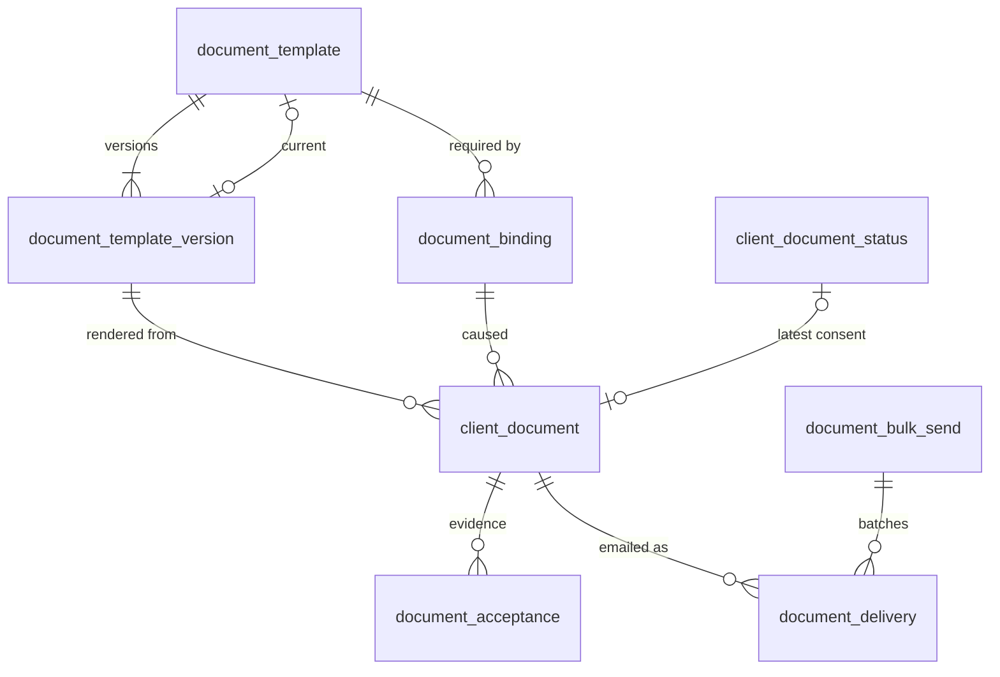
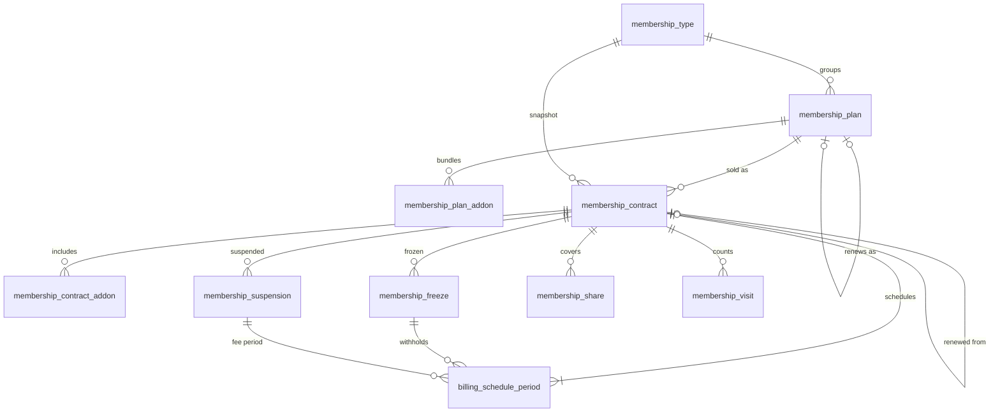
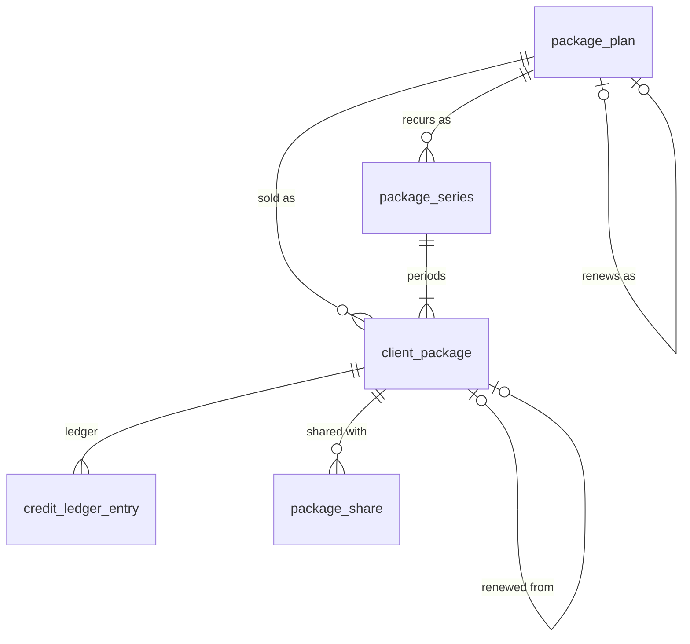
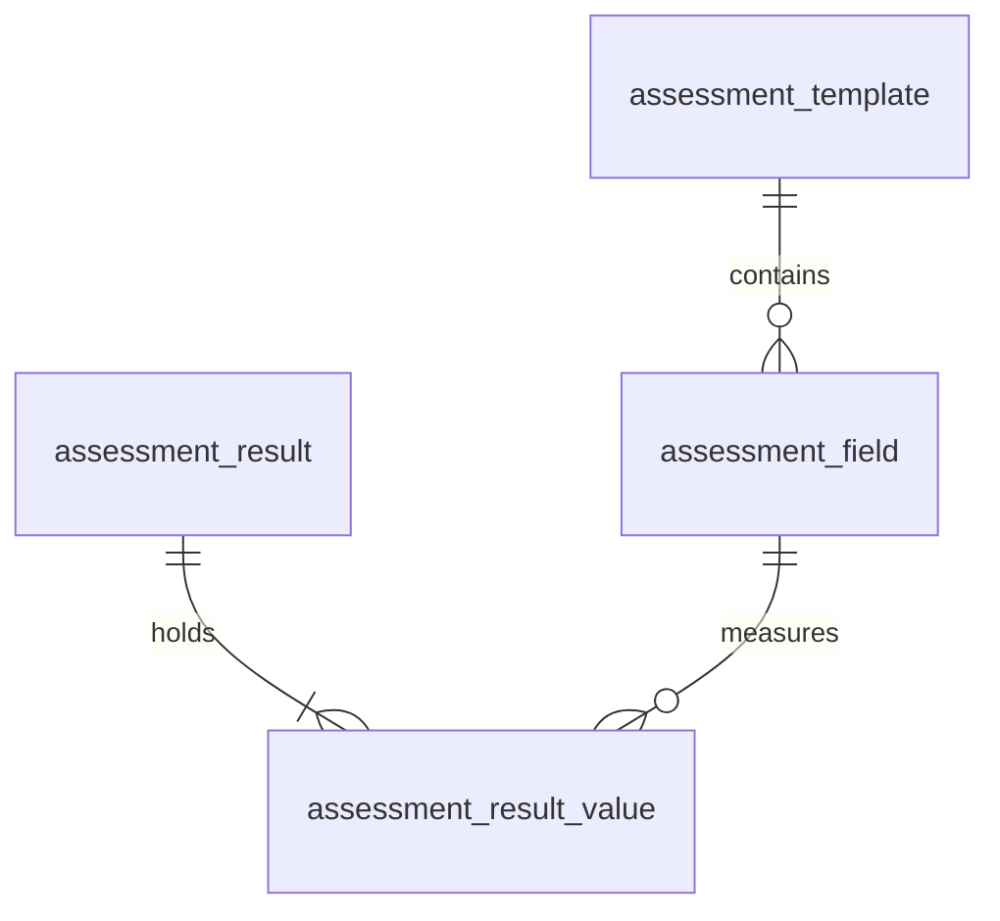
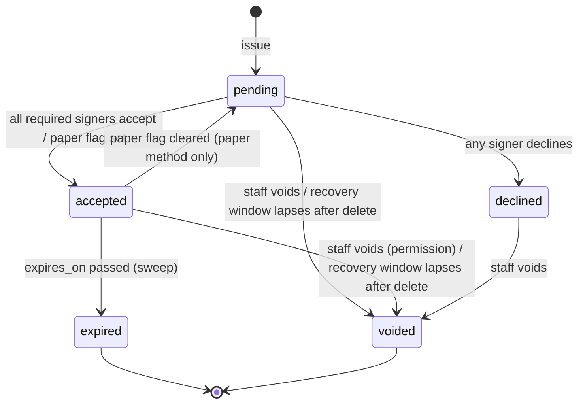
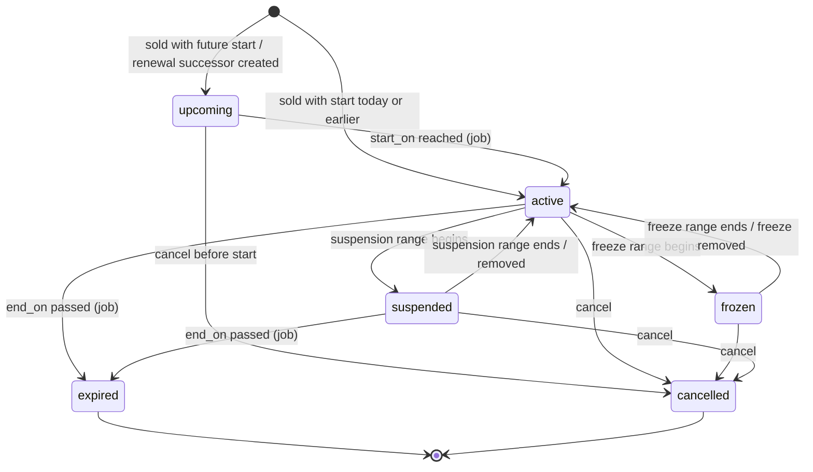
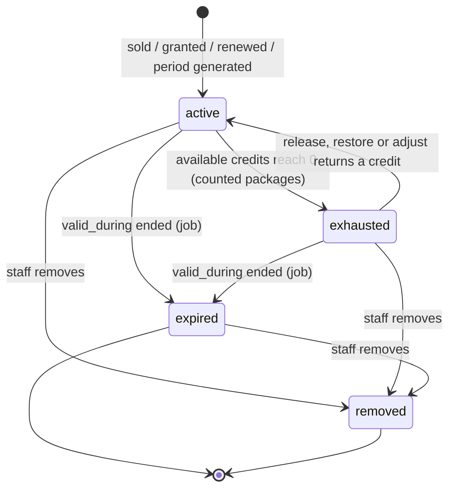

# Data Model: People (clients, documents, memberships, packages, assessments)

Status: Phase 1 draft for GATE 1. Date: 2026-11-10. Conforms to `docs/architecture/overview.md` (cited as OV
plus section). Covers discovery prefixes CLI, FAM, DOC, FIT, MEM, PKG. Migrations are generated from this file.
Names are ours (clean-room); the reference product's labels appear only where needed to trace a feature ID.

## 0. Reading rules for this document

These apply to **every** table below and are not repeated per table.

- **Standard columns** (OV 3.1), in this order: `id uuid NOT NULL DEFAULT app.uuid_v7()`, `tenant_id uuid NOT
  NULL`, the domain columns listed, `created_at timestamptz NOT NULL DEFAULT now()`, `updated_at timestamptz NOT
  NULL DEFAULT now()`. Column tables list domain columns only.
- **Keys** (OV 3.3): `pk_<table> PRIMARY KEY (id)`, `uq_<table>_tenant_id_id UNIQUE (tenant_id, id)`,
  `fk_<table>_tenant_id_tenant FOREIGN KEY (tenant_id) REFERENCES tenant (id)`.
- **FK notation**: `-> client` in the notes column means the composite
  `FOREIGN KEY (tenant_id, <column>) REFERENCES client (tenant_id, id) ON DELETE RESTRICT`. `(cascade)` marks the
  only exceptions: aggregate root to its own child rows. Every FK column is covered by an index leading with
  `tenant_id`; where no explicit index is listed, `ix_<table>_<column> (tenant_id, <column>)` is implied.
- **RLS**: `enable_rls(table)` on every table (OV 3.4). Grants are `SELECT, INSERT, UPDATE, DELETE` to `fh_app`
  unless the table is marked **append-only** (`SELECT, INSERT` only).
- **Enums** are `text` + named `CHECK` (OV 3.2); the allowed values are in the notes column as `{a, b}` and the
  constraint is `ck_<table>_<column>`.
- **Types**: money `bigint` minor units (`_minor`); percentages `numeric(5,2)`; `_on` is a location-local `date`;
  `_at` is `timestamptz` UTC; ranges are half-open `[)`.
- **Durations** are stored as `<x>_count integer` + `<x>_unit text {day, week, month, year}`, never `interval`.
  Calendar arithmetic (month-end clamping, DST) is done in one Python function on location-local dates; rejected
  `interval` because `'1 month'` arithmetic in SQL and in Python would have to agree bit for bit.
- **Tables owned by other contexts** are referenced by name only: `tenant`, `location`, `staff_user`,
  `identity`, `stored_file` (platform); `resource`, `reservation_type`, `session`, `booking` (resources,
  scheduling); `charge`, `coupon`, `revenue_category`, `payment_method`, `catalog_item` (billing);
  `enrollment` (programs); `check_in` (access). Section 6 lists every one relied on.
- `version integer NOT NULL DEFAULT 1` marks optimistic-concurrency aggregates (OV 3.1).

Table inventory (52 tables): clients 20, documents 10, memberships 11, packages 6, assessments 5; plus the 8
`rpt_*` views named in section 8.

---

## 1. Context `clients` (CLI, FAM)

Reconciliation of the inferred entities: `Client` + "simple membership block" + `MemberNumber` +
`ClientCollectionsState` collapse to `client` (member number is a person identifier, MEM-19; the record-only
membership is a zero-fee contract in `memberships`, MEM-06; collections state stays in `billing`).
`PortalAccount` + `PortalInvitation` become `client_portal_access` over platform `identity`. `EntitlementShare`
is **not** a polymorphic table here: each selling context owns its share rows (`membership_share`,
`package_share`, rentals' own) so FKs stay real and merge handlers stay local (OV divergence 11).
`ContactEmail`/`ClientEmail` become `client_email`; consent flags move to `engagement` (CLI-16).

```mermaid
erDiagram
  client ||--o{ client_email : has
  client ||--o{ client_emergency_contact : has
  client }o--o| client_category : "classified as"
  client }o--o| referral_category : "referred via"
  client ||--o{ client_tag : tagged
  tag ||--o{ client_tag : applied
  client ||--o{ client_relationship : "from"
  client ||--o{ client_relationship : "to"
  relationship_type ||--o{ client_relationship : types
  relationship_type |o--o| relationship_type : inverse
  client ||--o{ client_portal_access : "fronted by identity"
  client ||--o{ client_note : has
  client ||--o{ client_task : has
  note_subject ||--o{ client_note : labels
  note_subject ||--o{ client_task : labels
  client ||--o{ client_alert : has
  client ||--o{ client_merge : survivor
  client ||--o{ client_recent_view : viewed
  client |o--o| client : merged_into
  custom_field ||--o{ client_field_policy : "policy by key"
```

### 1.1 `client`

One row per person, never per family (CLI-01). Shared across a tenant's locations (CLI-19). Module 2 ships the
skeleton (`first_name`, `last_name`, `status`, `home_location_id`, `primary_email`, `phone_mobile`); module 4
adds the remaining columns without renames (OV 6).

| column | type | null | default | notes |
|---|---|---|---|---|
| first_name | text | no | | Always required, policy-locked (CLI-04). `ck_client_first_name CHECK (btrim(first_name) <> '')` |
| last_name | text | no | | Same check |
| preferred_name | text | yes | | Ours |
| gender | text | yes | | `{female, male, non_binary, undisclosed}`; visibility and requirement via `client_field_policy`; tenant default in `client_settings` |
| birth_on | date | yes | | Birthday views, minor detection (DOC-03) |
| organization_name | text | yes | | Company captured at POS (CLI-01) |
| phone_mobile | text | yes | | E.164; `ck_client_phone_mobile CHECK (phone_mobile ~ '^\+[1-9][0-9]{6,14}$')`, same on the two below |
| phone_home | text | yes | | |
| phone_work | text | yes | | |
| address_line1 | text | yes | | |
| address_line2 | text | yes | | |
| city | text | yes | | |
| region | text | yes | | State or province |
| postal_code | text | yes | | |
| country_code | char(2) | yes | | ISO 3166-1 alpha-2 |
| home_location_id | uuid | no | | -> location. Attribute for defaults and the non-home payment warning, not a partition (CLI-19) |
| client_category_id | uuid | yes | | -> client_category. Single-valued (CLI-06) |
| referral_category_id | uuid | yes | | -> referral_category (CLI-07) |
| referral_source | text | yes | | Free text (CLI-07) |
| default_trainer_staff_user_id | uuid | yes | | -> staff_user (CLI-17). See trade-off T-C2 |
| default_salesperson_staff_user_id | uuid | yes | | -> staff_user (CLI-17) |
| primary_email | citext | yes | | Denormalised copy of the primary `client_email.email`, written only by `clients.service`; exists so search and list sort need no join |
| custom_values | jsonb | no | `'{}'` | `{<custom_field.key>: value}` (CLI-05). `ck_client_custom_values CHECK (jsonb_typeof(custom_values) = 'object')` |
| photo_file_id | uuid | yes | | -> stored_file (CLI-12) |
| discount_pct | numeric(5,2) | no | `0` | Client-level standing discount carried into POS (CLI-01). `CHECK (discount_pct BETWEEN 0 AND 100)` |
| member_number | citext | yes | | Alphanumeric, may exist without any membership (MEM-19) |
| member_number_source | text | yes | | `{generated, manual, scanned}`; `ck_client_member_number_source CHECK ((member_number IS NULL) = (member_number_source IS NULL))` |
| comments | text | yes | | Staff notes; registration notes are appended tagged with the program name (CLI-01) |
| medical_notes | text | yes | | Listed PII: audit stores changed-flag only (OV 3.10) |
| status | text | no | `'active'` | `{active, disabled}` (CLI-14) |
| disabled_at | timestamptz | yes | | `ck_client_disabled CHECK ((status = 'disabled') = (disabled_at IS NOT NULL))` |
| disabled_by_staff_user_id | uuid | yes | | -> staff_user |
| merged_into_id | uuid | yes | | -> client (self). Tombstone pointer (CLI-13). `ck_client_merged CHECK (merged_into_id IS NULL OR (status = 'disabled' AND merged_into_id <> id))` |
| merged_at | timestamptz | yes | | |
| erased_at | timestamptz | yes | | Set by the data-subject erasure workflow (IMP-04); profile columns are nulled and names replaced |
| created_via | text | no | `'staff'` | `{staff, portal, registration, kiosk, api, import, provider}` |
| created_by_staff_user_id | uuid | yes | | -> staff_user; null for self-service and system (profile stamps, CLI-01) |
| updated_by_staff_user_id | uuid | yes | | -> staff_user |
| phone_digits | text | | generated | `GENERATED ALWAYS AS (regexp_replace(coalesce(phone_mobile,'') \|\| ' ' \|\| coalesce(phone_home,'') \|\| ' ' \|\| coalesce(phone_work,''), '[^0-9 ]', '', 'g')) STORED` |
| search_text | text | | generated | `GENERATED ALWAYS AS (lower(first_name \|\| ' ' \|\| last_name \|\| ' ' \|\| coalesce(preferred_name,'') \|\| ' ' \|\| coalesce(primary_email::text,'') \|\| ' ' \|\| coalesce(member_number::text,''))) STORED` |
| version | integer | no | `1` | |

Unique: `uq_client_tenant_id_member_number UNIQUE (tenant_id, member_number) WHERE member_number IS NOT NULL`.

Indexes:
- `ix_client_search_text USING gin (search_text gin_trgm_ops)` and `ix_client_phone_digits USING gin
  (phone_digits gin_trgm_ops)`: partial-match search over name, email, phone, member number (CLI-03).
- `ix_client_name (tenant_id, lower(last_name), lower(first_name), id)`: default list sort, initial paging.
- `ix_client_status (tenant_id, status, id)`; `ix_client_category (tenant_id, client_category_id, id)`.
- `ix_client_birthday (tenant_id, (extract(month FROM birth_on)), (extract(day FROM birth_on)))` (birthday views).
- `ix_client_default_trainer (tenant_id, default_trainer_staff_user_id) WHERE default_trainer_staff_user_id IS NOT
  NULL`; same for salesperson (list filters and own-clients-only scope, CLI-17).
- `ix_client_duplicate_key (tenant_id, lower(last_name), birth_on)`: duplicate candidates (CLI-13).
- `ix_client_merged_into (tenant_id, merged_into_id) WHERE merged_into_id IS NOT NULL`.

Serves: CLI-01, CLI-02, CLI-03, CLI-05, CLI-06, CLI-07, CLI-12, CLI-13, CLI-14, CLI-17, CLI-19, CLI-21, MEM-19.

Notes:
- "Recently created" is `ORDER BY id DESC` (UUIDv7). "All members" asks `memberships.service`; the client list
  never joins membership tables (OV rule 1). "Last session" and balance in the profile header are composed by
  the web client from the scheduling and billing endpoints.
- Member number generation: `tenant_counter` key `member_number` taken `FOR UPDATE` (OV 3.5), formatted
  with `client_settings.member_number_prefix`. This column is the system of record (MEM-19); `access` mirrors it
  as the primary `credential` row from `clients.client.created` / `.updated`, and RFID, barcode and app-card media
  are further `access.credential` rows pointing at the client, not columns here.

### 1.2 `client_email`

Several addresses per client; the same address may appear on several clients (parent and child, FAM-02).

| column | type | null | default | notes |
|---|---|---|---|---|
| client_id | uuid | no | | -> client (cascade) |
| email | citext | no | | `CHECK (email ~ '^[^@\s]+@[^@\s]+\.[^@\s]+$')` |
| is_primary | boolean | no | `false` | |
| label | text | yes | | |
| verification_sent_at | timestamptz | yes | | Verification mail queued on create (CLI-02) |
| verified_at | timestamptz | yes | | Emailed documents and bulk sends require it (DOC-04, DOC-07) |

Unique: `uq_client_email_client_email (tenant_id, client_id, email)`; `uq_client_email_primary (tenant_id,
client_id) WHERE is_primary`. Indexes: `ix_client_email_email (tenant_id, email)`; `ix_client_email_trgm USING gin
((email::text) gin_trgm_ops)`. Serves: CLI-01, CLI-02, CLI-03, CLI-16.

The API accepts the whole email list in the client payload and writes it atomically, which removes the reference
product's "typed but not committed address is lost" behaviour (CLI-02).

### 1.3 `client_emergency_contact`

| column | type | null | default | notes |
|---|---|---|---|---|
| client_id | uuid | no | | -> client (cascade) |
| position | smallint | no | | `CHECK (position >= 1)`; the UI offers two (CLI-18), the schema does not cap |
| name | text | no | | |
| relationship_label | text | yes | | Free text; not a `client_relationship` |
| phone | text | yes | | |
| phone_alt | text | yes | | |
| email | citext | yes | | |
| notes | text | yes | | |

Unique: `(tenant_id, client_id, position)`. Serves: CLI-18.

### 1.4 `client_category` and `referral_category`

Identical shape, two tables (different meaning, different pickers, different report dimensions; rejected one
`lookup(kind)` table because the FK from `client` would lose its target type).

| column | type | null | default | notes |
|---|---|---|---|---|
| name | text | no | | |
| sort_order | integer | no | `0` | |
| is_active | boolean | no | `true` | Deactivate instead of delete once referenced (OV 3.9); deleting an unreferenced row is allowed |

Unique: `uq_client_category_name (tenant_id, lower(name))`, `uq_referral_category_name (tenant_id, lower(name))`.
Serves: `client_category` CLI-06; `referral_category` CLI-07.

### 1.5 `tag` and `client_tag`

`tag`:

| column | type | null | default | notes |
|---|---|---|---|---|
| kind | text | no | | `{sport, season, custom}` (CLI-08). Sport and season rows are seeded per tenant |
| label | text | no | | |
| is_active | boolean | no | `true` | |

Unique: `uq_tag_kind_label (tenant_id, kind, lower(label))`.

`client_tag`:

| column | type | null | default | notes |
|---|---|---|---|---|
| client_id | uuid | no | | -> client (cascade) |
| tag_id | uuid | no | | -> tag |

Unique: `(tenant_id, client_id, tag_id)`. Index: `ix_client_tag_tag (tenant_id, tag_id, client_id)` (segment
predicate for campaigns). Serves: CLI-08.

### 1.6 `custom_field`

Tenant-defined client fields. Uncapped in the schema (the reference has six text slots, CLI-05); typed because
a jsonb value store costs nothing extra to type.

| column | type | null | default | notes |
|---|---|---|---|---|
| key | text | no | | Stable slug, `CHECK (key ~ '^[a-z][a-z0-9_]{0,39}$')`; the key in `client.custom_values` and in `client_field_policy.field_key` as `custom.<key>` |
| label | text | no | | |
| data_type | text | no | `'text'` | `{text, number, date, boolean, choice}` |
| choices | jsonb | yes | | Array of strings; `CHECK ((data_type = 'choice') = (choices IS NOT NULL))` |
| sort_order | integer | no | `0` | |
| is_active | boolean | no | `true` | Deactivating hides the field; stored values are kept |

Unique: `(tenant_id, key)`. Serves: CLI-05.

### 1.7 `client_field_policy`

Per field, per capture context: hidden, optional or required (CLI-04). Compiled into Pydantic validators shared
by the staff API, registration forms and portal completion.

| column | type | null | default | notes |
|---|---|---|---|---|
| field_key | text | no | | A built-in field name from the code catalogue (`birth_on`, `phone_mobile`, ...) or `custom.<key>` |
| capture_context | text | no | | `{staff, registration, portal}` |
| requirement | text | no | | `{hidden, optional, required}` |

Unique: `(tenant_id, field_key, capture_context)`. A missing row means the code default. Locked fields
(first and last name everywhere; email and birth date in `registration`) are a constant in code and the service
rejects rows for them; "locked" is therefore not a stored state. Trade-off: a `registration`-context policy is
tenant-wide as in the reference; per-program questions belong to the `programs` form builder (REG-15), not here.

### 1.8 `client_settings` (one row per tenant) and `client_location_settings` (one row per location)

`client_settings`:

| column | type | null | default | notes |
|---|---|---|---|---|
| default_gender | text | yes | | Same value set as `client.gender` (CLI-04) |
| is_member_number_auto_generated | boolean | no | `false` | MEM-05, MEM-19 |
| member_number_trigger | text | no | `'membership_sold'` | `{client_created, membership_sold}` |
| member_number_prefix | text | no | `''` | |
| is_verification_email_enabled | boolean | no | `true` | CLI-02 |
| is_own_clients_scope_enabled | boolean | no | `false` | Turns on the default-trainer/salesperson visibility rule for roles that carry it (CLI-17) |

Unique: `uq_client_settings_tenant (tenant_id)`.

`client_location_settings`:

| column | type | null | default | notes |
|---|---|---|---|---|
| location_id | uuid | no | | -> location |
| is_portal_photo_edit_enabled | boolean | no | `true` | CLI-12 |

Unique: `(tenant_id, location_id)`. Serves: CLI-04, CLI-12, MEM-05, MEM-19.

### 1.9 `relationship_type`

Tenant-configurable vocabulary, seeded: `parent_of` / `child_of`, `guardian_of` / `ward_of`, `spouse_of`
(symmetric), `sibling_of` (symmetric), `other` (symmetric).

| column | type | null | default | notes |
|---|---|---|---|---|
| code | text | no | | |
| label | text | no | | Read from the `from` side: "from is `<label>` to" |
| inverse_type_id | uuid | yes | | -> relationship_type (self). Null means symmetric (its own inverse) |
| grants_acting_rights | boolean | no | `false` | The `from` side may act for the `to` side in the portal (FAM-03) |
| is_guardianship | boolean | no | `false` | The `from` side may sign as guardian for a minor `to` side (DOC-03) |
| is_portal_selectable | boolean | no | `true` | Offered in self-service "add a person" (FAM-02) |
| is_system | boolean | no | `false` | Seeded rows cannot be deleted |
| is_active | boolean | no | `true` | |

Unique: `(tenant_id, code)`. Seed flags: `parent_of` and `guardian_of` grant acting rights and guardianship;
`spouse_of` grants acting rights (the reference demo buys for a spouse); `sibling_of`, `child_of`, `ward_of`,
`other` grant nothing. Serves: FAM-01, FAM-03.

### 1.10 `client_relationship`

One row per unordered pair; the inverse is rendered from `relationship_type.inverse_type_id`, never duplicated
(FAM-01). Pairwise and non-transitive. A relationship confers acting rights only, never an entitlement
(FAM-04, FAM-05).

| column | type | null | default | notes |
|---|---|---|---|---|
| from_client_id | uuid | no | | -> client |
| to_client_id | uuid | no | | -> client. `ck_client_relationship_distinct CHECK (from_client_id <> to_client_id)` |
| relationship_type_id | uuid | no | | -> relationship_type |
| status | text | no | `'active'` | `{pending, active, declined, ended}` |
| created_via | text | no | `'staff'` | `{staff, portal, registration, provider, import}` |
| requested_by_identity_id | uuid | yes | | -> identity. Portal-initiated links (FAM-02) |
| confirmation_token_hash | text | yes | | SHA-256 of the single-use token mailed to the other adult |
| confirmation_expires_at | timestamptz | yes | | |
| confirmed_at | timestamptz | yes | | |
| ended_at | timestamptz | yes | | |

Unique: `uq_client_relationship_pair ON (tenant_id, least(from_client_id, to_client_id),
greatest(from_client_id, to_client_id)) WHERE status IN ('pending','active')`; `uq_client_relationship_token
(confirmation_token_hash) WHERE confirmation_token_hash IS NOT NULL`. Indexes: `(tenant_id, from_client_id,
status)`, `(tenant_id, to_client_id, status)`. Serves: FAM-01, FAM-02, FAM-03, and the share candidate lists of
FAM-04, FAM-05, FAM-06.

Rules: `can_act_for(identity, B)` is true when B is one of the identity's own clients (1.11), or an `active`
row exists with (from = own client A, to = B, type grants acting rights), or with (from = B, to = A, and the
type's inverse grants acting rights). Creating a dependent in the portal inserts the client and an `active` row;
linking to an existing account holder inserts `pending` and mails the token (FAM-02). Trade-off: one row per pair
plus an expression unique index, instead of two mirrored rows (rejected: every write becomes two and they drift).

### 1.11 `client_portal_access`

Which client records a client-kind `identity` signs in as. Email is not an identity key in this domain
(CLI-15, OV divergence 3).

| column | type | null | default | notes |
|---|---|---|---|---|
| identity_id | uuid | no | | -> identity (platform; kind `client`) |
| client_id | uuid | no | | -> client |
| is_primary | boolean | no | `true` | The identity "is" this person. False rows are managed profiles without their own login (a dependent created in the portal) |
| status | text | no | `'invited'` | `{invited, active, revoked}` |
| invited_at | timestamptz | yes | | Shown to staff (CLI-15) |
| invited_by_staff_user_id | uuid | yes | | -> staff_user; null when self-registered |
| activated_at | timestamptz | yes | | |
| revoked_at | timestamptz | yes | | |

Unique: `(tenant_id, identity_id, client_id)`; `uq_client_portal_access_primary (tenant_id, client_id) WHERE
is_primary AND status <> 'revoked'` (one login per person). Serves: CLI-15, FAM-02, FAM-03.

Staff enabling access requires at least one `client_email`; the service asks `platform` to create the identity
and send a single-use set-credential link. No staff-typed passwords (OV divergence 14).

### 1.12 `note_subject`

Reusable subject vocabulary shared by notes and tasks, with inline create (CLI-10).

| column | type | null | default | notes |
|---|---|---|---|---|
| label | text | no | | |
| is_active | boolean | no | `true` | |

Unique: `(tenant_id, lower(label))`.

### 1.13 `client_note`

Logged interaction with an optional staff-only attachment (CLI-09). Never exposed on the portal surface.

| column | type | null | default | notes |
|---|---|---|---|---|
| client_id | uuid | no | | -> client |
| kind | text | no | | `{call, email, task, other}` |
| note_subject_id | uuid | yes | | -> note_subject |
| subject_text | text | yes | | Free subject when no list entry is used; `CHECK (num_nonnulls(note_subject_id, subject_text) = 1)` |
| body | text | yes | | |
| occurred_at | timestamptz | no | `now()` | |
| staff_user_id | uuid | no | | -> staff_user (who performed it) |
| location_id | uuid | yes | | -> location |
| attachment_file_id | uuid | yes | | -> stored_file; private, signed URL after permission check (OV 3.17) |

Index: `ix_client_note_client (tenant_id, client_id, occurred_at DESC)`. Serves: CLI-09, CLI-11 (report).

### 1.14 `client_task`

| column | type | null | default | notes |
|---|---|---|---|---|
| client_id | uuid | no | | -> client |
| note_subject_id | uuid | yes | | -> note_subject |
| subject_text | text | yes | | Same one-of check as `client_note` |
| body | text | yes | | |
| assignee_staff_user_id | uuid | no | | -> staff_user |
| status | text | no | `'open'` | `{open, in_progress, done, cancelled}` (the reference's value list is unpublished; ours) |
| due_on | date | yes | | |
| completed_at | timestamptz | yes | | `CHECK ((status = 'done') = (completed_at IS NOT NULL))` |
| completed_by_staff_user_id | uuid | yes | | -> staff_user |
| attachment_file_id | uuid | yes | | -> stored_file |
| has_email_reminder | boolean | no | `false` | Reminder to the assignee on `due_on` (CLI-11) |
| reminder_sent_at | timestamptz | yes | | |

Indexes: `ix_client_task_assignee_open (tenant_id, assignee_staff_user_id, due_on) WHERE status IN
('open','in_progress')` (header badge count and reminder job); `(tenant_id, client_id, id)`. Serves: CLI-11.
The Task/Activity report is `rpt_client_activity` (union of 1.13 and 1.14).

### 1.15 `client_alert`

Staff-authored alerts shown when a profile opens, at check-in or while booking (CLI-20). System alerts (birthday,
past due, expired or frozen membership, missing waiver) are **derived** by the consuming context (`access`) from
the owning services and are never stored here.

| column | type | null | default | notes |
|---|---|---|---|---|
| client_id | uuid | no | | -> client |
| kind | text | no | `'general'` | `{general, medical, injury, conduct}` |
| severity | text | no | `'info'` | `{info, warning, critical}` |
| message | text | no | | |
| shows_on_profile | boolean | no | `true` | |
| shows_on_check_in | boolean | no | `true` | |
| shows_on_booking | boolean | no | `false` | |
| starts_on | date | yes | | |
| ends_on | date | yes | | `CHECK (ends_on IS NULL OR starts_on IS NULL OR ends_on >= starts_on)` |
| is_active | boolean | no | `true` | |
| created_by_staff_user_id | uuid | no | | -> staff_user |

Index: `ix_client_alert_client_active (tenant_id, client_id) WHERE is_active`. Serves: CLI-20.

### 1.16 `client_merge`

One row per losing record (CLI-13). The merge itself: `clients.service.merge` re-points this context's rows,
back-fills blank survivor fields (never payment data), tombstones the loser (`status = 'disabled'`,
`merged_into_id`), emits `clients.client.merged`; every other context re-points in its own handler (OV 2).

| column | type | null | default | notes |
|---|---|---|---|---|
| survivor_client_id | uuid | no | | -> client |
| merged_client_id | uuid | no | | -> client |
| performed_by_staff_user_id | uuid | no | | -> staff_user |
| performed_at | timestamptz | no | `now()` | |
| backfilled_fields | jsonb | no | `'{}'` | `{field: true}`; values are not copied into the log |
| precheck | jsonb | no | `'{}'` | Blocking findings returned by other contexts' pre-merge checks at the time of merge (kept for support) |

Unique: `uq_client_merge_merged (tenant_id, merged_client_id)`. Append-only. Serves: CLI-13.

Pre-merge rule (ours, following the reference's newer behaviour): the merge is refused when it would violate
`ex_membership_contract_term_overlap` (2 live memberships on one owner) or duplicate an `enrollment`; the API
returns the blockers so staff cancel one first. Candidate detection is a query (same last name and one of: birth
date, a shared email, a trigram-similar first name with a shared phone), not a table.

### 1.17 `client_recent_view`

Per staff user "recently accessed" list (CLI-03). Upserted on profile open, pruned to 50 rows per user by the
same statement.

| column | type | null | default | notes |
|---|---|---|---|---|
| staff_user_id | uuid | no | | -> staff_user |
| client_id | uuid | no | | -> client (cascade) |
| viewed_at | timestamptz | no | `now()` | |

Unique: `(tenant_id, staff_user_id, client_id)`. Index: `(tenant_id, staff_user_id, viewed_at DESC)`.

### 1.18 Clients trade-offs

- **T-C1 Consent rows are not here.** Per-channel, per-purpose subscription state (CLI-16) is
  `engagement.communication_preference` keyed by `client_id` and, for email, by address; `clients` only owns the
  addresses, their verification, and the mobile number. No carrier column: SMS goes through a provider port.
  Rejected: flags on `client_email` (engagement would have to read another context's table to send).
- **T-C2 Default trainer and salesperson point at `staff_user`**, not at `staff.trainer` / `staff.salesperson` or
  a trainer `resource`. `clients` is L1 and those are L4/L1 records created later; every trainer and salesperson
  has a `staff_user`. Cost: the staff context resolves `staff_user -> trainer` when it needs pay data.
- **T-C3 Client list views are code, not rows.** The reference's view selector (recent, created, birthdays,
  members, disabled, duplicates, per category) is a fixed set of named server-side filters over the indexes
  above; user-defined saved filters are `reporting.saved_report` (OV divergence 18). Rejected: a second
  saved-view table in this context.
- **T-C4 Search** is trigram over two generated columns rather than `tsvector`: the queries are partial-token
  ("smi", "555-01", "ann@") and three characters is the documented type-ahead threshold (CLI-03).

---

## 2. Context `documents` (DOC)

Reconciliation: `DocumentTemplate` splits into `document_template` + immutable `document_template_version`
(the reference has no versioning; ours, OV divergence 9). `ClientDocument` keeps the instance and its state;
the evidence moves to append-only `document_acceptance`. `ContractAcceptance` (memberships cluster) disappears:
a contract simply references its `client_document`. `ServiceDocumentBinding` becomes `document_binding`.
`LocationPrivacySettings` splits by owner (photo flag to `clients`, consent switch here). `AgreementTemplate` and
`MembershipAgreement` (DOC-10, DOC-11, P2) are not built; a multi-signer agreement is a template with several
`document_acceptance` rows. `WaiverProviderConnection` (DOC-13) is an `integrations` connection; this context
only reserves the `external_provider` origin.

### 2.1 `document_template`

| column | type | null | default | notes |
|---|---|---|---|---|
| name | text | no | | Shown in binding pickers |
| kind | text | no | `'agreement'` | `{agreement, consent}`; `consent` is the privacy-consent type (DOC-09) |
| is_waiver | boolean | no | `false` | An accepted, unexpired instance makes the client "waiver on file" (DOC-15). Ours: the reference keys this off one global registration document |
| description | varchar(240) | yes | | Doubles as the email subject (DOC-01) |
| signature_validity_days | integer | yes | | Null = never expires. Ours; lets a waiver lapse yearly. `CHECK (signature_validity_days > 0)` |
| requires_guardian_for_minors | boolean | no | `true` | Minor = age below `minor_age_years` on the acceptance date |
| minor_age_years | smallint | no | `18` | `CHECK (minor_age_years BETWEEN 1 AND 25)` |
| current_version_id | uuid | yes | | -> document_template_version, `DEFERRABLE INITIALLY DEFERRED` (circular with 2.2). Null until first publish |
| status | text | no | `'draft'` | `{draft, active, archived}`. Archive, never delete, once issued (DOC-01) |
| last_used_at | timestamptz | yes | | "Recent" list |

Unique: `uq_document_template_name (tenant_id, lower(name)) WHERE status <> 'archived'`;
`uq_document_template_active_consent (tenant_id) WHERE kind = 'consent' AND status = 'active'` (exactly one
consent template at a time, DOC-09). Serves: DOC-01, DOC-09, DOC-15.

### 2.2 `document_template_version`

Editing a published template creates a new version; published rows are immutable (service-enforced, and a
trigger-free guarantee is not needed because evidence is hashed per acceptance).

| column | type | null | default | notes |
|---|---|---|---|---|
| template_id | uuid | no | | -> document_template (cascade) |
| version_number | integer | no | | 1-based |
| body_html | text | no | | Sanitised on write (allow-list: headings, lists, emphasis, links incl. `mailto:`) |
| acceptance_text | varchar(1000) | no | | The statement the signer agrees to (DOC-01 limit) |
| body_sha256 | text | no | | Hex SHA-256 over `body_html \|\| E'\n' \|\| acceptance_text` |
| published_at | timestamptz | yes | | Null = editable draft |
| published_by_staff_user_id | uuid | yes | | -> staff_user |
| change_note | text | yes | | |

Unique: `(tenant_id, template_id, version_number)`; `uq_document_template_version_draft (tenant_id, template_id)
WHERE published_at IS NULL` (one open draft). Serves: DOC-01.

### 2.3 `document_binding`

Which document a sale or sign-up must have accepted (DOC-08, DOC-14). Consulted by the selling context through
`documents.service.requirements_for(scope_type, scope_id, client_id)`.

| column | type | null | default | notes |
|---|---|---|---|---|
| scope_type | text | no | | `{membership_plan, package_plan, program_group, program_default, rental_plan, portal_terms}` |
| scope_id | uuid | yes | | Opaque id of the plan or program (no FK: the owner is a higher layer). Null for `program_default` and `portal_terms`; `ck_document_binding_scope CHECK ((scope_type IN ('program_default','portal_terms')) = (scope_id IS NULL))` |
| template_id | uuid | yes | | -> document_template |
| custom_text | text | yes | | Plain terms text instead of a template (DOC-14). `CHECK (num_nonnulls(template_id, custom_text) = 1)` |
| frequency | text | no | `'every_purchase'` | `{first_purchase, every_purchase}` |
| is_enforced_online | boolean | no | `true` | Blocking step at portal/app checkout |
| is_enforced_at_desk | boolean | no | `true` | Prompted and blocking in the staff sale; a permission allows "collect later", leaving the document pending |
| is_active | boolean | no | `true` | |

Unique: `uq_document_binding_scope ON (tenant_id, scope_type, coalesce(scope_id,
'00000000-0000-0000-0000-000000000000'::uuid)) WHERE is_active`. Serves: DOC-08, DOC-14, MEM-08.

Divergences recorded: bindings exist **per program** (`program_group`) with `program_default` as the fallback,
where the reference has one account-wide registration document; package-plan documents are enforced online too
(the reference leaves them pending after an online purchase); `rental_plan` and `portal_terms` reuse the same
mechanism. A `custom_text` binding still produces a `client_document` (with `template_version_id` null and the
text in the rendered snapshot), so every acknowledgment has evidence.

### 2.4 `client_document`

An issued instance for one client. Carries state; evidence is in 2.5.

| column | type | null | default | notes |
|---|---|---|---|---|
| client_id | uuid | no | | -> client (the subject; a minor's waiver belongs to the minor) |
| location_id | uuid | no | | -> location. History filter only; documents are visible across locations (CLI-19, DOC-06) |
| template_id | uuid | yes | | -> document_template. Null for `custom_text` bindings and external or imported documents |
| template_version_id | uuid | yes | | -> document_template_version. Pinned at issue |
| title | text | no | | Copied from the template name |
| description | text | yes | | Copied from the template |
| origin | text | no | `'manual'` | `{manual, sale, registration, bulk_send, consent, external_provider, import}` |
| binding_id | uuid | yes | | -> document_binding |
| source_context | text | yes | | Opaque origin, e.g. `memberships` |
| source_type | text | yes | | e.g. `membership_contract`, `client_package`, `enrollment` |
| source_id | uuid | yes | | `CHECK (num_nonnulls(source_context, source_type, source_id) IN (0, 3))` |
| acceptance_method | text | no | | `{paper, checkbox, drawn_signature, email_link}` (DOC-02) |
| status | text | no | `'pending'` | `{pending, accepted, declined, expired, voided}` |
| issued_by_staff_user_id | uuid | yes | | -> staff_user; null when self-service |
| issued_at | timestamptz | no | `now()` | |
| decided_at | timestamptz | yes | | Acceptance or decline time. `CHECK ((status IN ('accepted','declined')) <= (decided_at IS NOT NULL))` |
| expires_on | date | yes | | `decided date + signature_validity_days`, or the provider's expiry for external waivers |
| requires_guardian | boolean | no | `false` | Computed at issue from `client.birth_on` and the template |
| rendered_file_id | uuid | yes | | -> stored_file. PDF snapshot of exactly what was presented, generated at issue, re-generated with signatures at acceptance |
| content_sha256 | text | no | | Hash of the presented body + acceptance text (equals the version's hash for unmodified templates) |
| paper_scan_file_id | uuid | yes | | -> stored_file. PDF or image upload (DOC-05) |
| is_paper_signed | boolean | no | `false` | Set on upload, manually clearable (DOC-05) |
| external_provider | text | yes | | Reserved for DOC-13 (`smartwaiver`) |
| external_ref | text | yes | | Provider waiver id; `uq_client_document_external (tenant_id, external_provider, external_ref) WHERE external_ref IS NOT NULL` |
| deleted_at | timestamptz | yes | | Soft delete with restore window (DOC-06). See amendment A1 |
| deleted_by_staff_user_id | uuid | yes | | -> staff_user |
| version | integer | no | `1` | |

Unique: `uq_client_document_source ON (tenant_id, source_context, source_type, source_id, coalesce(template_id,
'00000000-0000-0000-0000-000000000000'::uuid)) WHERE source_id IS NOT NULL AND status <> 'voided' AND deleted_at IS
NULL` (a retried sale cannot issue the document twice).

Indexes: `ix_client_document_client (tenant_id, client_id, id)`; `ix_client_document_history (tenant_id,
location_id, issued_at DESC)`; `ix_client_document_pending (tenant_id, issued_at) WHERE status = 'pending' AND
deleted_at IS NULL`; `ix_client_document_template_client (tenant_id, template_id, client_id)` (missing-document
anti-join, DOC-07); `ix_client_document_expiry (tenant_id, expires_on) WHERE status = 'accepted' AND expires_on IS
NOT NULL` (expiry sweep); `ix_client_document_deleted (tenant_id, deleted_at) WHERE deleted_at IS NOT NULL`.

Serves: DOC-02, DOC-03, DOC-04, DOC-05, DOC-06, DOC-07, DOC-08, DOC-09, DOC-14, DOC-15, MEM-08.

Mapping to the reference's history statuses: Pending = `pending`, Signed = `accepted`, Declined = `declined`,
Deleted = `deleted_at IS NOT NULL`. After `document_settings.deleted_recovery_days` the purge job sets `status =
'voided'` and keeps the row and its acceptances (the reference removes it; we keep evidence, OV divergence 9).

### 2.5 `document_acceptance` (append-only)

Immutable evidence, one row per signer per decision (OV 3.4 lists this table as append-only).

| column | type | null | default | notes |
|---|---|---|---|---|
| client_document_id | uuid | no | | -> client_document |
| decision | text | no | | `{accepted, declined}` |
| signer_role | text | no | | `{client, guardian, co_signer}` |
| signer_client_id | uuid | yes | | -> client. The guardian's own client record when one exists (structured guardian signing, OV divergence 9) |
| signer_name | text | no | | Printed name; for a free-text co-signer this is all we have (DOC-03) |
| method | text | no | | `{paper, checkbox, drawn_signature, typed_name}`; `typed_name` is the emailed path (DOC-04) |
| typed_signature | text | yes | | |
| signature_file_id | uuid | yes | | -> stored_file (drawn signature PNG). `CHECK (method <> 'drawn_signature' OR signature_file_id IS NOT NULL)` |
| delivery_id | uuid | yes | | -> document_delivery, when decided through an emailed link |
| witnessed_by_staff_user_id | uuid | yes | | -> staff_user, for in-person and paper |
| ip | inet | yes | | |
| user_agent | text | yes | | |
| content_sha256 | text | no | | Must equal `client_document.content_sha256` at insert (service assertion) |
| decided_at | timestamptz | no | `now()` | |

Unique: `(tenant_id, client_document_id, signer_role)`. Serves: DOC-03, DOC-04, DOC-05, DOC-09.

The document becomes `accepted` when every required role has an `accepted` row (client, plus guardian when
`requires_guardian`); any `declined` row makes it `declined`. A minor's own signature is optional and recorded as
role `client`; the guardian row is the binding one.

### 2.6 `document_delivery`

One emailed link (DOC-04). Re-send creates a new row and supersedes the previous one.

| column | type | null | default | notes |
|---|---|---|---|---|
| client_document_id | uuid | no | | -> client_document (cascade) |
| bulk_send_id | uuid | yes | | -> document_bulk_send |
| recipient_emails | citext[] | no | | Chosen from the client's verified addresses; `CHECK (cardinality(recipient_emails) >= 1)` |
| token_hash | text | no | | SHA-256 of the single-use token; `uq_document_delivery_token (token_hash)` |
| sent_by_staff_user_id | uuid | yes | | -> staff_user |
| sent_at | timestamptz | no | `now()` | |
| expires_at | timestamptz | no | | `sent_at + document_settings.email_link_ttl_hours` (sources say 24 h and 48 h; configurable, default 48) |
| opened_at | timestamptz | yes | | |
| outcome | text | no | `'pending'` | `{pending, accepted, declined, expired, superseded}` |

Index: `ix_document_delivery_expiry (tenant_id, expires_at) WHERE outcome = 'pending'`. Serves: DOC-04, DOC-07,
DOC-09. The public accept/decline page resolves the tenant from the host (OV 3.4) and the row from the hash.

### 2.7 `document_bulk_send`

The "who has never received template X" audit and send (DOC-07) as a resumable job.

| column | type | null | default | notes |
|---|---|---|---|---|
| template_id | uuid | no | | -> document_template |
| filters | jsonb | no | `'{}'` | Segment predicates: category, tag, location, membership status (the reference cannot filter; ours) |
| mode | text | no | `'never_received'` | `{never_received, no_valid_acceptance, selected_clients}` |
| requested_by_staff_user_id | uuid | no | | -> staff_user |
| status | text | no | `'queued'` | `{queued, running, completed, failed}` |
| total_count | integer | no | `0` | |
| sent_count | integer | no | `0` | |
| skipped_count | integer | no | `0` | No verified email |
| completed_at | timestamptz | yes | | |

Serves: DOC-07.

### 2.8 `client_document_status`

Stored projection, one row per client that has ever had a waiver or consent event, plus the manual override
(DOC-15, DOC-09). Maintained by `documents.service` in the same transaction as acceptance, void, delete,
restore and the expiry sweep.

| column | type | null | default | notes |
|---|---|---|---|---|
| client_id | uuid | no | | -> client. `uq_client_document_status_client (tenant_id, client_id)` |
| has_waiver | boolean | no | `false` | True when at least one `accepted`, undeleted document of an `is_waiver` template exists and `waiver_valid_until_on` is null or not past |
| waiver_valid_until_on | date | yes | | Latest `expires_on` among qualifying documents; null = no expiry |
| waiver_override | text | yes | | `{on_file, not_on_file}`; a staff tick or un-tick that wins over the derived value |
| waiver_override_by_staff_user_id | uuid | yes | | -> staff_user |
| waiver_override_at | timestamptz | yes | | |
| waiver_override_note | text | yes | | |
| consent_document_id | uuid | yes | | -> client_document (latest accepted `consent`) |
| consent_accepted_at | timestamptz | yes | | Null with `document_location_settings.is_consent_required` = "consent missing" banner |

Effective indicator = `waiver_override = 'on_file' OR (waiver_override IS NULL AND has_waiver AND
(waiver_valid_until_on IS NULL OR waiver_valid_until_on >= today))`. Readers must apply the date test; the nightly
sweep only flips `has_waiver` for housekeeping. Serves: DOC-15, DOC-09.

Trade-off: stored projection instead of "derived, not stored" (the parity-matrix position). Check-in, rosters and
the client list need it for hundreds of clients per request and those callers may not join `client_document`
(OV rule 1); a one-row-per-client table read through `documents.service.status_for(client_ids)` is the cheap
form. Because `clients` (L1) cannot call `documents` (L2), the client list's waiver column is fetched by the web
client from `GET /api/v1/client-document-statuses?client_id[in]=...` for the visible page; rejected: a copy of
the flag on `client` maintained by an upward event (two sources of truth for a legal indicator).

### 2.9 `document_settings` (one row per tenant) and `document_location_settings` (one row per location)

`document_settings`:

| column | type | null | default | notes |
|---|---|---|---|---|
| email_link_ttl_hours | integer | no | `48` | `CHECK (email_link_ttl_hours BETWEEN 1 AND 720)` (DOC-04) |
| deleted_recovery_days | integer | no | `30` | DOC-06 |
| is_staff_notified_on_decision | boolean | no | `true` | Emits to engagement; the reference sends nothing (DOC-04 gap) |
| is_waiver_required_for_check_in | boolean | no | `false` | Read by `access`; informational only in the reference (DOC-15 unknown) |
| is_waiver_required_for_booking | boolean | no | `false` | Read by `programs` and `rentals` |

Unique: `(tenant_id)`.

`document_location_settings`:

| column | type | null | default | notes |
|---|---|---|---|---|
| location_id | uuid | no | | -> location; `UNIQUE (tenant_id, location_id)` |
| is_consent_required | boolean | no | `false` | Privacy-consent switch (DOC-09). Enabling requires an active `consent` template (service check) |

Serves: DOC-04, DOC-06, DOC-09, DOC-15.

---

## 3. Context `memberships` (MEM, FAM-04)

Reconciliation: `MembershipPlan` + `MembershipPlanAddOn` keep their shape. `MembershipContract` snapshots plan
terms. `ContractBillingPeriod` is `billing_schedule_period` (OV name). `ContractStatusEvent` splits into
`membership_freeze` and `membership_suspension` (different effects: a freeze withholds billing and moves the end
date, a suspension blocks access, bills a fee and moves nothing; a cancellation is terminal state on the
contract, not an event row). `ContractCoverage` + the membership half of `EntitlementShare` become
`membership_share`. `ContractAcceptance` is replaced by `membership_contract.client_document_id`.
`MemberNumber` moved to `client`. `SimpleMembership` (MEM-06, P2) is not a table: it is a contract with zero
fees and `invoice_mode = 'none'`, so "is a member" is one query. `MembershipSettings` keeps tenant policy.

### 3.1 `membership_type`

| column | type | null | default | notes |
|---|---|---|---|---|
| name | text | no | | |
| revenue_category_id | uuid | no | | -> revenue_category (billing). Required even for non-taxing tenants (MEM-01) |
| sort_order | integer | no | `0` | Manual ordering |
| is_active | boolean | no | `true` | |

Unique: `(tenant_id, lower(name))`. Serves: MEM-01. The reporting dimension for all membership reports (MEM-21).

### 3.2 `membership_plan`

Sellable template. Edits affect only later sales and renewals because contracts snapshot (MEM-02).

| column | type | null | default | notes |
|---|---|---|---|---|
| membership_type_id | uuid | no | | -> membership_type |
| name | text | no | | Display name |
| invoice_description | varchar(100) | yes | | Customer-facing extra line on invoices (MEM-02 limit) |
| fixed_start_on | date | yes | | Forces every contract's start date |
| billing_interval_unit | text | no | `'month'` | `{day, week, month, year}` |
| billing_interval_count | integer | no | `1` | `CHECK (billing_interval_count >= 1)` |
| billing_occurrences_count | integer | no | | Number of billings; `CHECK (>= 1)`. Term length = interval x count x occurrences |
| auto_renew_lead_count | integer | yes | | Null (with unit null) = never renews. `CHECK ((auto_renew_lead_count IS NULL) = (auto_renew_lead_unit IS NULL))`, `CHECK (auto_renew_lead_count >= 0)` |
| auto_renew_lead_unit | text | yes | | `{day, week, month, year}` |
| renewal_target | text | no | `'same_terms'` | `{same_terms, plan}`. `same_terms` copies the contract as sold (price lock); `plan` reads the named plan at renewal time (MEM-11) |
| renews_as_plan_id | uuid | yes | | -> membership_plan (self; may equal `id`). `CHECK ((renewal_target = 'plan') = (renews_as_plan_id IS NOT NULL))` |
| max_visits_count | integer | yes | | Per term; null = unlimited (MEM-20) |
| initiation_fee_minor | bigint | no | `0` | First invoice only. `CHECK (>= 0)` |
| term_fee_minor | bigint | no | | Fee billed each period. `CHECK (>= 0)` |
| payment_due_day | smallint | yes | | 1..31, clamped to month end; also the autopay day. Null = anniversary of the start day |
| discount_pct | numeric(5,2) | yes | | `CHECK (num_nonnulls(discount_pct, discount_minor) <= 1)` |
| discount_minor | bigint | yes | | Flat discount per period |
| revenue_category_id | uuid | yes | | -> revenue_category. Overrides the type's category |
| default_invoice_mode | text | no | `'ask'` | `{ask, per_period, single}` (reference: no default / multiple invoices / single invoice) |
| is_autopay_default | boolean | no | `false` | Must carry to the sale and its charges (MEM-07) |
| is_sold_online | boolean | no | `false` | MEM-09 |
| proration_mode | text | no | `'none'` | `{none, to_month_start, seller_choice}` (MEM-03) |
| proration_tail | text | yes | | `{extend_last, drop_last, prorate_last}`; `CHECK ((proration_mode = 'to_month_start') = (proration_tail IS NOT NULL))` |
| sort_order | integer | no | `0` | |
| is_active | boolean | no | `true` | |
| version | integer | no | `1` | |

Indexes: `(tenant_id, membership_type_id, sort_order)`; `ix_membership_plan_online (tenant_id) WHERE
is_sold_online AND is_active`. Serves: MEM-02, MEM-03, MEM-09, MEM-11, MEM-20. The plan's document is a
`document_binding` (`scope_type = 'membership_plan'`), not a column (DOC-08, MEM-08). "Duplicate plan" is a
service copy.

### 3.3 `membership_plan_addon`

| column | type | null | default | notes |
|---|---|---|---|---|
| membership_plan_id | uuid | no | | -> membership_plan (cascade) |
| addon_kind | text | no | | `{package_plan, catalog_item}` |
| package_plan_id | uuid | yes | | -> package_plan (packages) |
| catalog_item_id | uuid | yes | | -> catalog_item (billing pre-defined item, BIL-14). `CHECK ((addon_kind = 'package_plan') = (package_plan_id IS NOT NULL) AND (addon_kind = 'catalog_item') = (catalog_item_id IS NOT NULL))` |
| quantity | integer | no | `1` | `CHECK (quantity >= 1)` |
| sort_order | integer | no | `0` | |

Serves: MEM-04.

### 3.4 `membership_settings` (one row per tenant)

| column | type | null | default | notes |
|---|---|---|---|---|
| is_remark_required_on_freeze | boolean | no | `false` | The reference has one switch for all three; three columns cost nothing (MEM-05) |
| is_remark_required_on_suspend | boolean | no | `false` | |
| is_remark_required_on_cancel | boolean | no | `false` | |
| payment_method_capture | text | no | `'optional'` | `{hidden, optional, required}` at staff sale (MEM-05) |
| online_card_save_mode | text | no | `'ask'` | `{always, when_nothing_due, ask}` (MEM-09) |
| billing_lead_days | integer | no | `0` | Days before `due_on` that a period's charge and invoice are created. `CHECK (billing_lead_days BETWEEN 0 AND 60)` |
| is_daily_visit_limit_enabled | boolean | no | `false` | One counted entry per location-local day for visit-limited contracts (MEM-20) |
| freeze_resume_invoice_mode | text | no | `'per_period'` | `{per_period, single, deferred}`; default answer when a freeze ends (MEM-13) |
| is_addon_package_cancelled_with_contract | boolean | no | `true` | Default answer to "also remove the bundled package" on cancel (MEM-04, MEM-15; unknowns conflict, version B) |

Unique: `(tenant_id)`. Serves: MEM-05, MEM-09, MEM-13, MEM-20. Member-number auto-generation lives in
`client_settings` (1.8) because the number is a client attribute.

### 3.5 `membership_contract`

One sold term for one owning (billed) client. A renewal is a new row linked by `previous_contract_id`.

| column | type | null | default | notes |
|---|---|---|---|---|
| owner_client_id | uuid | no | | -> client. The billed party and primary member |
| location_id | uuid | no | | -> location. Sale location; drives time zone for due dates and visit days |
| membership_plan_id | uuid | yes | | -> membership_plan. Null for ad-hoc contracts keyed manually |
| membership_type_id | uuid | no | | -> membership_type (snapshot) |
| name | text | no | | Snapshot |
| invoice_description | varchar(100) | yes | | Snapshot |
| revenue_category_id | uuid | no | | -> revenue_category, resolved at sale (plan override, else type) |
| start_on | date | no | | |
| end_on | date | no | | Last day of the term, inclusive. `CHECK (end_on >= start_on)` |
| original_end_on | date | no | | `end_on` as sold, before freeze extensions |
| billing_interval_unit | text | no | | Snapshot; editing the end date at sale rewrites this to `day` x N with occurrences 1 (MEM-07) |
| billing_interval_count | integer | no | | |
| billing_occurrences_count | integer | no | | |
| term_fee_minor | bigint | no | | Snapshot after per-sale override. `CHECK (>= 0)` |
| initiation_fee_minor | bigint | no | `0` | |
| discount_pct | numeric(5,2) | yes | | Per-period discount applied when the schedule is generated; at most one of the two |
| discount_minor | bigint | yes | | |
| coupon_id | uuid | yes | | -> coupon (billing, BIL-15) |
| payment_due_day | smallint | yes | | |
| revenue_on | date | yes | | Editable only when `billing_occurrences_count = 1` (service rule); otherwise each period's own date |
| max_visits_count | integer | yes | | Editable while active (MEM-10) |
| visits_used_count | integer | no | `0` | Cached count of non-voided `membership_visit` rows; written under the contract row lock |
| is_autopay | boolean | no | `false` | |
| payment_method_id | uuid | yes | | -> payment_method (billing). Preferred stored method for autopay |
| invoice_mode | text | no | | `{per_period, single, deferred, none}`. See 3.7. `none` = record-only contract (MEM-06) |
| is_prorated | boolean | no | `false` | |
| proration_tail | text | yes | | Snapshot of the tail rule actually applied |
| is_auto_renew | boolean | no | `false` | |
| auto_renew_lead_count | integer | yes | | Snapshot, editable (MEM-10) |
| auto_renew_lead_unit | text | yes | | |
| renew_on | date | yes | | `end_on - lead`; recomputed by the service whenever `end_on` or the lead changes |
| renewal_target | text | no | `'same_terms'` | `{same_terms, plan}` |
| renews_as_plan_id | uuid | yes | | -> membership_plan |
| renewal_discount_pct | numeric(5,2) | yes | | Applied to the successor (MEM-11); at most one of the two |
| renewal_discount_minor | bigint | yes | | |
| renewal_description | text | yes | | Successor's `invoice_description` |
| renewal_remark | text | yes | | Internal |
| auto_renew_disabled_by | text | yes | | `{staff, client, freeze}` (MEM-18, MEM-12) |
| auto_renew_disabled_at | timestamptz | yes | | |
| previous_contract_id | uuid | yes | | -> membership_contract (self) |
| sold_by_staff_user_id | uuid | yes | | -> staff_user (salesperson attribution; commissions resolve through `staff`) |
| referred_by_client_id | uuid | yes | | -> client. Must already exist (MEM-10) |
| sales_channel | text | no | `'staff'` | `{staff, portal, mobile, pos, api, renewal, import}` |
| internal_notes | text | yes | | |
| client_document_id | uuid | yes | | -> client_document. The agreement issued for this sale (MEM-08) |
| status | text | no | | `{upcoming, active, frozen, suspended, expired, cancelled}` |
| activated_at | timestamptz | yes | | |
| cancelled_on | date | yes | | Effective date; `CHECK (cancelled_on BETWEEN start_on AND end_on)` evaluated before `end_on` is cut back, so enforced in the service, and `CHECK ((status = 'cancelled') = (cancelled_on IS NOT NULL))` in the table |
| cancel_reason | text | yes | | `{voluntary, upgrade, downgrade, administrative_error, other}`; `administrative_error` is excluded from attrition (MEM-15) |
| cancel_remarks | text | yes | | |
| cancelled_by_staff_user_id | uuid | yes | | -> staff_user |
| cancelled_at | timestamptz | yes | | |
| version | integer | no | `1` | |

Constraints:
- `ex_membership_contract_term_overlap EXCLUDE USING gist (tenant_id WITH =, owner_client_id WITH =,
  daterange(start_on, end_on, '[]') WITH &&) WHERE (status IN ('upcoming','active','frozen','suspended'))
  DEFERRABLE INITIALLY DEFERRED`. One live membership per owner at a time; a future-dated successor may queue
  behind it (MEM-07, MEM-11). Mapped to problem code `membership-overlap` (OV 3.13).
- `uq_membership_contract_previous UNIQUE (tenant_id, previous_contract_id) WHERE previous_contract_id IS NOT
  NULL`: a contract is renewed at most once, so a double-clicked manual renew or a retried job cannot create two
  successors (MEM-11).
- `ck_membership_contract_discount CHECK (num_nonnulls(discount_pct, discount_minor) <= 1)`, same for renewal.
- `ck_membership_contract_visits CHECK (visits_used_count >= 0)`. The cap is **not** a check: the reference
  alerts "depleted" and the access rule decides (MEM-20).

Indexes: `ix_membership_contract_owner (tenant_id, owner_client_id, start_on DESC)`;
`ix_membership_contract_status (tenant_id, status, end_on)`; `ix_membership_contract_location (tenant_id,
location_id, status, id)`; `ix_membership_contract_type (tenant_id, membership_type_id, status)`;
`ix_membership_contract_renew_due (tenant_id, renew_on) WHERE is_auto_renew AND status IN
('active','frozen','suspended')` (renewal work queue); `ix_membership_contract_start_due (tenant_id, start_on)
WHERE status = 'upcoming'`; `ix_membership_contract_end_due (tenant_id, end_on) WHERE status IN
('active','suspended')`.

Serves: MEM-07, MEM-08, MEM-09, MEM-10, MEM-11, MEM-15, MEM-16, MEM-17, MEM-18, MEM-20, MEM-22, FAM-04.

Trade-offs:
- **Stored status, date-guarded.** The parity matrix proposed deriving status in SQL. We store it because the
  exclusion predicate, the work-queue indexes and the `memberships.contract.*` events all need a transition
  moment. The transition job runs per location at local midnight; eligibility (`memberships.service.eligibility`)
  additionally tests `start_on <= today <= end_on` and the freeze and suspension ranges, so a late job can never
  grant access. Rejected: pure derivation (no place to hang the events, unindexable predicates).
- **Successor shift on freeze.** A freeze extends `end_on` (3.8). If an `upcoming` successor exists, its
  `start_on`, `end_on` and unbilled schedule shift by the same number of days in the same transaction (hence the
  deferrable constraint). The reference leaves this to staff ("check the pending renewed term"); ours is a rule.
- **No upgrade/downgrade command** in v1 (parity: MEM-11). Plan change = disable renewal and sell a future-dated
  contract, or cancel with reason `upgrade`/`downgrade` and sell anew. The schema needs nothing extra.

### 3.6 `membership_contract_addon`

Per-sale copy of the plan's add-ons so they can be added or removed on one sale (MEM-04).

| column | type | null | default | notes |
|---|---|---|---|---|
| membership_contract_id | uuid | no | | -> membership_contract (cascade) |
| addon_kind | text | no | | `{package_plan, catalog_item}` |
| package_plan_id | uuid | yes | | -> package_plan |
| catalog_item_id | uuid | yes | | -> catalog_item. Same one-of check as 3.3 |
| quantity | integer | no | `1` | |

A `catalog_item` add-on becomes a `billing_schedule_period` of kind `addon_item` on sequence 1. A `package_plan`
add-on is granted by `packages` on `memberships.contract.activated` as a zero-priced `client_package` with
`source_contract_id` set (4.3); on `memberships.contract.renewed` the package is re-granted only if its own plan
auto-renews (reference rule, MEM-04) and is then priced normally. Serves: MEM-04.

### 3.7 `billing_schedule_period`

The pre-generated receivable schedule of a contract (the reference's un-invoiced billing items). Generated in
full at sale by the pure proration function (MEM-03).

| column | type | null | default | notes |
|---|---|---|---|---|
| membership_contract_id | uuid | no | | -> membership_contract (cascade) |
| kind | text | no | | `{dues, initiation, suspension_fee, addon_item}` |
| sequence_number | integer | no | | 1..n within (contract, kind) |
| service_during | daterange | yes | | Period covered, for `dues`; `CHECK ((kind = 'dues') <= (service_during IS NOT NULL))` |
| due_on | date | no | | |
| bill_on | date | no | | `due_on - membership_settings.billing_lead_days`, never before the sale date |
| revenue_on | date | no | | Drives recognised vs deferred (MEM-21); defaults to the period start |
| list_amount_minor | bigint | no | | Before proration and discount |
| amount_minor | bigint | no | | What will be charged; `CHECK (amount_minor >= 0)` |
| is_prorated | boolean | no | `false` | |
| description | text | no | | Charge line text |
| catalog_item_id | uuid | yes | | -> catalog_item, for `addon_item` |
| suspension_id | uuid | yes | | -> membership_suspension, for `suspension_fee` |
| status | text | no | `'scheduled'` | `{scheduled, billed, withheld, cancelled}` |
| charge_id | uuid | yes | | -> charge (billing). `CHECK (status <> 'billed' OR charge_id IS NOT NULL)` |
| billed_at | timestamptz | yes | | |
| withheld_by_freeze_id | uuid | yes | | -> membership_freeze. `CHECK ((status = 'withheld') = (withheld_by_freeze_id IS NOT NULL))` |

Unique: `(tenant_id, membership_contract_id, kind, sequence_number)`; `uq_billing_schedule_period_charge
(tenant_id, charge_id) WHERE charge_id IS NOT NULL`. Indexes: `ix_billing_schedule_period_bill_due (tenant_id,
bill_on) WHERE status = 'scheduled'` (billing-run work queue); `(tenant_id, membership_contract_id, due_on)`;
`ix_billing_schedule_period_revenue (tenant_id, revenue_on)`.

Serves: MEM-03, MEM-07, MEM-11, MEM-12, MEM-13, MEM-14, MEM-15, MEM-16, MEM-21.

How `invoice_mode` uses the schedule (all charges are created through `billing.service.create_charges` with
`source_context = 'memberships'`, `source_type = 'billing_schedule_period'`, `source_id = id`, so the run is
idempotent on the period id, OV 3.4):
- `per_period`: the daily billing run (fan-out per location at its run time) bills every `scheduled` row with
  `bill_on <= today` into its own invoice; autopay collects on `due_on`. Sale bills whatever is already due.
- `single`: every row is billed at sale onto one invoice; billing holds the instalment plan
  (`payment_schedule`) with one instalment per `due_on`.
- `deferred`: rows stay `scheduled` and are excluded from the run until staff invoice them (the reference's
  "invoice later" and the unbilled queue of OV divergence 13).
- `none`: no rows.

Trade-off: charges are created lazily per period instead of the reference's "create every invoice at sale".
Freeze, cancel and reprice then touch only `scheduled` rows; nothing has to be un-invoiced (MEM-12, MEM-13).
Rejected: eager charges (every status change becomes a batch of reversals on the ledger).

Proration (MEM-03, OV 3.6): first `dues` row covers sale date to month end at `term_fee * days / days_in_month`,
half-up; following rows are due on the 1st. The tail rule decides the last row (`extend_last` lengthens it to a
full month and moves `end_on`; `drop_last` removes it and shortens `end_on`; `prorate_last` bills the remaining
days). "Collect prorated part only vs plus first full month" at payment is a payment-time choice of which billed
rows to pay; no column.

### 3.8 `membership_freeze`

| column | type | null | default | notes |
|---|---|---|---|---|
| membership_contract_id | uuid | no | | -> membership_contract (cascade) |
| during | daterange | no | | `[first_day, last_day + 1)`; upper bound unbounded for an open-ended freeze. `CHECK (NOT isempty(during) AND lower(during) IS NOT NULL)` |
| remarks | text | yes | | Required when settings say so (service) |
| extended_days_count | integer | no | `0` | Days already added to the contract's `end_on` for this freeze; makes end-date edits idempotent |
| resume_invoice_mode | text | yes | | `{per_period, single, deferred}`; chosen when the end date is saved (MEM-13) |
| created_by_staff_user_id | uuid | yes | | -> staff_user |
| removed_at | timestamptz | yes | | Removing a freeze keeps the row for history |
| removed_by_staff_user_id | uuid | yes | | -> staff_user |
| removal_remarks | text | yes | | |

Constraint: `ex_membership_freeze_overlap EXCLUDE USING gist (tenant_id WITH =, membership_contract_id WITH =,
during WITH &&) WHERE (removed_at IS NULL)`. Index: `ix_membership_freeze_end_due (tenant_id, (upper(during)))
WHERE removed_at IS NULL`. Serves: MEM-12, MEM-13.

Effects, all in the freeze command's transaction under the contract row lock:
1. `scheduled` periods whose `due_on` falls inside `during` become `withheld` (not billed, kept as history).
   Already billed, unpaid periods inside the range are reversed through `billing` (their rule: "removes
   not-yet-due invoices").
2. `end_on` moves out by the frozen day count; periods after the range shift by the same days and billing
   resumes on the exact freeze end date, not realigned to the 1st (MEM-13).
3. `is_autopay` and `is_auto_renew` are **not** cleared. Ours: the withheld state is what pauses money, so
   nothing has to be re-enabled by hand when the freeze ends (the reference turns both off and leaves staff to
   restore them, MEM-13). `renew_on` moves with `end_on`.
4. Open-ended freeze: periods are withheld as they come due; `extended_days_count` is settled when an end date
   is saved or the freeze is ended.
5. Ending or shortening: remaining periods are regenerated from the end date and treated per
   `resume_invoice_mode`. No freeze fee exists (parity).

### 3.9 `membership_suspension`

| column | type | null | default | notes |
|---|---|---|---|---|
| membership_contract_id | uuid | no | | -> membership_contract (cascade) |
| during | daterange | no | | Same shape and check as the freeze |
| fee_minor | bigint | yes | | Optional; `CHECK (fee_minor > 0)` |
| remarks | text | yes | | |
| created_by_staff_user_id | uuid | yes | | -> staff_user |
| removed_at | timestamptz | yes | | |
| removed_by_staff_user_id | uuid | yes | | -> staff_user |
| removal_remarks | text | yes | | |

Constraint: `ex_membership_suspension_overlap`, same form as the freeze. Freeze-versus-suspension overlap is
rejected in the service under the contract row lock (two tables, one lock site). Serves: MEM-14.

Semantics (unknowns conflict resolved to version B): dues keep billing, access is denied, no dates move. The
fee is one `billing_schedule_period` of kind `suspension_fee` per dues period that falls inside the range. A
contract still suspended at renewal produces a successor priced at dues **plus** fee (default; open question 3).
Rejected: one `membership_hold(kind)` table with a single exclusion constraint. It is one table fewer, but the
fee, the date-shift bookkeeping and the resume choice would all be nullable-by-kind columns.

### 3.10 `membership_share`

Additional clients covered by a contract (MEM-17, FAM-04). Evaluated at use time by check-in and booking
eligibility; billing stays on the owner.

| column | type | null | default | notes |
|---|---|---|---|---|
| membership_contract_id | uuid | no | | -> membership_contract (cascade) |
| client_id | uuid | no | | -> client. Related or unrelated; must not be the owner (service) |
| origin | text | no | `'manual'` | `{manual, carried_from_previous}` |
| added_by_staff_user_id | uuid | yes | | -> staff_user |
| revoked_at | timestamptz | yes | | |
| revoked_by_staff_user_id | uuid | yes | | -> staff_user |

Unique: `uq_membership_share_active (tenant_id, membership_contract_id, client_id) WHERE revoked_at IS NULL`.
Index: `ix_membership_share_client (tenant_id, client_id) WHERE revoked_at IS NULL`. Renewal copies active shares
to the successor (`carried_from_previous`). API fields "owning client, covered-client count, total billed"
(MEM-22, CLI-21) are computed from this table, the contract and the schedule.

### 3.11 `membership_visit`

A check-in counted against a contract (MEM-20). Written by `memberships.service.record_visit`, called by
`access` after a granted check-in; `memberships` never reads `check_in`.

| column | type | null | default | notes |
|---|---|---|---|---|
| membership_contract_id | uuid | no | | -> membership_contract. The resolved covering contract |
| client_id | uuid | no | | -> client. Who entered (owner or sharer) |
| check_in_id | uuid | no | | -> check_in (access). `uq_membership_visit_check_in (tenant_id, check_in_id)` makes the call idempotent |
| location_id | uuid | no | | -> location |
| visited_at | timestamptz | no | | |
| local_on | date | no | | Location-local day, for the daily rule |
| is_counted | boolean | no | `true` | False when the daily rule found an earlier counted visit that day, or the check-in was voided |

Index: `ix_membership_visit_contract_day (tenant_id, membership_contract_id, local_on)`. Insert and the
`visits_used_count` increment happen under the contract row lock. Eligibility returns `depleted` when
`max_visits_count IS NOT NULL AND visits_used_count >= max_visits_count`, and `daily_limit_reached` when the
tenant rule is on and a counted row exists for today; `access` owns alert priority (MEM-20).

---

## 4. Context `packages` (PKG, FAM-05)

Reconciliation: `PackagePlan` keeps its shape; `PostBilledRate` and post-billed instances (PKG-11, P2) are not
built in v1 and reserve nothing. `ClientPackage` keeps the sold instance with cached counters;
`SessionCreditEntry` is `credit_ledger_entry` (OV name). `PackageShare` + the package half of `EntitlementShare`
are `package_share`. `SessionRegistration` is **not** in this context: a seat in a capacity session is
`programs.enrollment`, a one-to-one appointment is a `scheduling.booking`; both consume credits through
`packages.service` and are referenced opaquely from the ledger (PKG-12; OV "one enrolment engine").
Recurring plans add `package_series`.

### 4.1 `package_plan`

| column | type | null | default | notes |
|---|---|---|---|---|
| kind | text | no | `'standard'` | `{standard, recurring}` (PKG-01, PKG-03) |
| reservation_type_id | uuid | no | | -> reservation_type (scheduling, SCH-02). What the credits can be spent on |
| name | text | no | | |
| invoice_description | text | yes | | Customer-facing |
| internal_remarks | text | yes | | |
| session_mode | text | no | | `{single, fixed, range, unlimited}` |
| session_count | integer | yes | | For `fixed` (per period when recurring) |
| min_session_count | integer | yes | | For `range` (buyer chooses quantity) |
| max_session_count | integer | yes | | |
| pricing_category | text | no | `'paid'` | `{paid, free}` (PKG-02) |
| is_complimentary | boolean | no | `false` | Reporting marker only |
| fee_minor | bigint | yes | | Null when free |
| fee_basis | text | yes | | `{per_session, per_package}` |
| start_rule | text | no | `'sale_date'` | `{sale_date, fixed_date}` (PKG-04) |
| fixed_start_on | date | yes | | `CHECK ((start_rule = 'fixed_date') = (fixed_start_on IS NOT NULL))` |
| validity_count | integer | yes | | Package length; null = no expiry. For recurring plans the period length is the recurrence step |
| validity_unit | text | yes | | `{day, week, month, year}`; both null or both set |
| allows_booking_after_expiry | boolean | no | `false` | "Booking out of range" (PKG-04) |
| auto_renew_lead_count | integer | yes | | Null pair = no time-based renewal (PKG-05). Service validates lead <= validity |
| auto_renew_lead_unit | text | yes | | |
| renewal_target | text | no | `'same_terms'` | `{same_terms, plan}` |
| renews_as_plan_id | uuid | yes | | -> package_plan (self) |
| renewal_threshold_count | integer | yes | | Sessions remaining at which the package is flagged for renewal |
| is_auto_renew_on_threshold | boolean | no | `false` | Renew when the threshold is reached instead of only flagging (the reference mentions it without detail) |
| share_mode | text | no | `'none'` | `{none, all_related}`: auto-share with related clients at sale (PKG-06, FAM-05) |
| recurrence_unit | text | yes | | `{day, week, month, year}`; recurring only |
| recurrence_interval_count | integer | yes | | |
| recurrence_occurrences_count | integer | yes | | Number of consecutive periods |
| is_series_auto_renew | boolean | no | `false` | Start a new series when the last period ends |
| default_invoice_mode | text | no | `'ask'` | `{ask, single, per_period, deferred}`; `per_period` only for recurring |
| is_autopay_default | boolean | no | `false` | |
| online_sale_mode | text | no | `'off'` | `{off, balance_allowed, paid_in_full}` (PKG-09) |
| is_members_only_online | boolean | no | `false` | PKG-10 |
| is_members_only_at_desk | boolean | no | `false` | Ours; the reference enforces online only |
| discount_pct | numeric(5,2) | yes | | At most one of the two |
| discount_minor | bigint | yes | | |
| revenue_category_id | uuid | yes | | -> revenue_category. Required when paid (check below) |
| sort_order | integer | no | `0` | |
| is_active | boolean | no | `true` | |
| version | integer | no | `1` | |

Checks:
- `ck_package_plan_sessions CHECK ((session_mode = 'fixed') = (session_count IS NOT NULL) AND (session_mode =
  'range') = (min_session_count IS NOT NULL AND max_session_count IS NOT NULL) AND (session_count IS NULL OR
  session_count >= 1) AND (min_session_count IS NULL OR (min_session_count >= 1 AND max_session_count >=
  min_session_count)))`.
- `ck_package_plan_pricing CHECK ((pricing_category = 'free' AND fee_minor IS NULL AND fee_basis IS NULL) OR
  (pricing_category = 'paid' AND fee_minor >= 0 AND fee_basis IS NOT NULL AND revenue_category_id IS NOT NULL))`.
- `ck_package_plan_single_basis CHECK (session_mode <> 'single' OR fee_basis IS NULL OR fee_basis =
  'per_session')` (PKG-01).
- `ck_package_plan_recurrence CHECK ((kind = 'recurring') = (recurrence_unit IS NOT NULL AND
  recurrence_interval_count >= 1 AND recurrence_occurrences_count >= 1))`, and `kind = 'recurring'` excludes
  `session_mode = 'range'` (PKG-03).
- `ck_package_plan_renewal CHECK ((renewal_target = 'plan') = (renews_as_plan_id IS NOT NULL))`.

Indexes: `(tenant_id, reservation_type_id, is_active)`; `ix_package_plan_online (tenant_id) WHERE
online_sale_mode <> 'off' AND is_active`. Serves: PKG-01, PKG-02, PKG-03, PKG-04, PKG-05, PKG-06, PKG-09,
PKG-10, FAM-05. The plan's document is a `document_binding` (`scope_type = 'package_plan'`).

### 4.2 `package_series`

One sold recurring plan (PKG-03). The next period's package and charge are materialised by a job shortly before
the period starts, not pre-created (parity-matrix position; keeps freeze-like edits cheap).

| column | type | null | default | notes |
|---|---|---|---|---|
| owner_client_id | uuid | no | | -> client |
| package_plan_id | uuid | no | | -> package_plan |
| location_id | uuid | no | | -> location |
| occurrences_total_count | integer | no | | Snapshot |
| occurrences_generated_count | integer | no | `0` | `CHECK (occurrences_generated_count <= occurrences_total_count)` |
| next_period_start_on | date | yes | | Null when complete |
| invoice_mode | text | no | | `{single, per_period, deferred}` |
| is_auto_renew | boolean | no | `false` | Member can switch off (MEM-18) |
| status | text | no | `'active'` | `{active, completed, cancelled}` |

Index: `ix_package_series_due (tenant_id, next_period_start_on) WHERE status = 'active'`. Each generated
`client_package` copies its terms from the previous period's row (the per-sale snapshot), so the series needs no
terms of its own. Serves: PKG-03.

### 4.3 `client_package`

A sold package: snapshot of terms, validity and cached balance.

| column | type | null | default | notes |
|---|---|---|---|---|
| owner_client_id | uuid | no | | -> client |
| location_id | uuid | no | | -> location (sale location) |
| package_plan_id | uuid | yes | | -> package_plan. Null for an ad-hoc package built at sale (PKG-07) |
| package_series_id | uuid | yes | | -> package_series |
| series_sequence_number | integer | yes | | `UNIQUE (tenant_id, package_series_id, series_sequence_number)` makes period generation idempotent |
| reservation_type_id | uuid | no | | -> reservation_type (snapshot) |
| name | text | no | | Snapshot |
| invoice_description | text | yes | | |
| internal_remarks | text | yes | | |
| is_unlimited | boolean | no | `false` | |
| sessions_granted_count | integer | no | `0` | "Purchased" |
| sessions_reserved_count | integer | no | `0` | "Scheduled" |
| sessions_consumed_count | integer | no | `0` | "Completed" |
| sessions_forfeited_count | integer | no | `0` | Expired or revoked credits |
| valid_during | daterange | no | | `[start, end + 1)`; unbounded upper = no expiry |
| allows_booking_after_expiry | boolean | no | `false` | Snapshot |
| price_minor | bigint | no | `0` | Total after per-sale customisation and discount, before tax |
| fee_basis | text | yes | | `{per_session, per_package}` |
| unit_price_minor | bigint | yes | | Per-session value; used for "unused session value" and commission |
| coupon_id | uuid | yes | | -> coupon |
| is_complimentary | boolean | no | `false` | |
| revenue_category_id | uuid | yes | | -> revenue_category |
| invoice_mode | text | no | `'single'` | `{single, deferred, none}`; `none` for free and add-on grants |
| charge_id | uuid | yes | | -> charge. The sale charge, when one exists |
| is_autopay | boolean | no | `false` | |
| share_mode | text | no | `'none'` | `{none, all_related, explicit}`; `all_related` snapshot at sale creates `package_share` rows then, later relatives are added by staff |
| is_auto_renew | boolean | no | `false` | |
| auto_renew_lead_count | integer | yes | | |
| auto_renew_lead_unit | text | yes | | |
| renew_on | date | yes | | `upper(valid_during) - 1 - lead` |
| renewal_target | text | no | `'same_terms'` | `{same_terms, plan}` |
| renews_as_plan_id | uuid | yes | | -> package_plan |
| renewal_threshold_count | integer | yes | | |
| is_auto_renew_on_threshold | boolean | no | `false` | |
| renewal_flagged_at | timestamptz | yes | | Set when available credits fall to the threshold (renewal icon, PKG-05) |
| auto_renew_disabled_by | text | yes | | `{staff, client}` (MEM-18) |
| previous_package_id | uuid | yes | | -> client_package (self). `uq_client_package_previous (tenant_id, previous_package_id) WHERE previous_package_id IS NOT NULL` |
| source_contract_id | uuid | yes | | -> membership_contract. Set when granted as a membership add-on (MEM-04) |
| source_contract_addon_id | uuid | yes | | -> membership_contract_addon. `uq_client_package_contract_addon (tenant_id, source_contract_addon_id) WHERE source_contract_addon_id IS NOT NULL` makes the grant handler idempotent |
| sold_by_staff_user_id | uuid | yes | | -> staff_user |
| sales_channel | text | no | `'staff'` | `{staff, portal, mobile, pos, api, renewal, membership_addon, import}` (PKG-07, PKG-08, PKG-09) |
| client_document_id | uuid | yes | | -> client_document |
| status | text | no | `'active'` | `{active, exhausted, expired, removed}` |
| removed_at | timestamptz | yes | | `CHECK ((status = 'removed') = (removed_at IS NOT NULL))` |
| removal_mode | text | yes | | `{billing_reversed, billing_kept}` (PKG-13) |
| removed_by_staff_user_id | uuid | yes | | -> staff_user |
| version | integer | no | `1` | |

Constraints:
- `ck_client_package_balance CHECK (sessions_reserved_count >= 0 AND sessions_consumed_count >= 0 AND
  sessions_forfeited_count >= 0 AND (is_unlimited OR sessions_granted_count - sessions_reserved_count -
  sessions_consumed_count - sessions_forfeited_count >= 0))`. Mapped to problem code `package-exhausted`.
  Available ("remaining") = that expression; it is computed, not stored.
- `ck_client_package_valid CHECK (NOT isempty(valid_during) AND lower(valid_during) IS NOT NULL)`.

Indexes: `ix_client_package_owner (tenant_id, owner_client_id, status, id)`; `ix_client_package_spendable
(tenant_id, owner_client_id, reservation_type_id) WHERE status = 'active'` (which package can pay this session);
`ix_client_package_expiry_due (tenant_id, (upper(valid_during))) WHERE status IN ('active','exhausted')`;
`ix_client_package_renew_due (tenant_id, renew_on) WHERE is_auto_renew AND status IN ('active','exhausted')`;
`ix_client_package_contract (tenant_id, source_contract_id) WHERE source_contract_id IS NOT NULL`;
`(tenant_id, location_id, id)`.

Serves: PKG-02, PKG-04, PKG-05, PKG-07, PKG-08, PKG-09, PKG-13, PKG-14, PKG-16, MEM-04, MEM-18.

### 4.4 `credit_ledger_entry` (append-only)

Every movement of session credits (OV 3.4 lists this table as append-only). The four counters on
`client_package` are a cache of this ledger, updated in the same transaction under `SELECT ... FOR UPDATE` on
the package row; a nightly reconciliation asserts cache = ledger sums.

| column | type | null | default | notes |
|---|---|---|---|---|
| client_package_id | uuid | no | | -> client_package |
| client_id | uuid | no | | -> client. Who used or received the credit (owner or sharer) |
| entry_type | text | no | | `{grant, reserve, release, consume, restore, forfeit, adjust}` |
| granted_delta | integer | no | `0` | |
| reserved_delta | integer | no | `0` | |
| consumed_delta | integer | no | `0` | |
| forfeited_delta | integer | no | `0` | |
| reason | text | no | | `{purchase, addon, renewal, booking, cancellation_early, cancellation_late, attendance, no_show, expiry, removal, staff_adjustment, merge}` |
| source_type | text | yes | | `{enrollment, booking}`; opaque, no FK (the owner is a peer or higher context) |
| source_id | uuid | yes | | `CHECK ((source_type IS NULL) = (source_id IS NULL))` |
| idempotency_key | text | no | | Built by the caller from its business key, e.g. `enrollment:<id>:reserve:1`; `uq_credit_ledger_entry_key (tenant_id, idempotency_key)` |
| actor_type | text | no | | `{staff, client, system}` |
| actor_id | uuid | yes | | |
| note | text | yes | | Required for `adjust` (service) |
| occurred_at | timestamptz | no | `now()` | |

Check: `ck_credit_ledger_entry_shape` pins the deltas per type: `grant` (granted > 0, others 0); `reserve`
(reserved = +1); `release` (reserved = -1); `consume` (reserved = -1, consumed = +1); `restore` (consumed = -1);
`forfeit` (forfeited > 0); `adjust` (granted <> 0, others 0). Indexes: `ix_credit_ledger_entry_package
(tenant_id, client_package_id, occurred_at)`; `ix_credit_ledger_entry_source (tenant_id, source_type, source_id)
WHERE source_id IS NOT NULL`.

Serves: PKG-07, PKG-12, PKG-13, PKG-14, PKG-16.

Credit life cycle (PKG-12): registering reserves (`reserve`); marking attended consumes (`consume`); an early
cancel returns the credit (`release`); late cancel and no-show consume or release per `package_settings`;
correcting a mark posts `restore`. Unlimited packages write the same entries (for scheduled and completed
counts) with the balance check bypassed. A waitlist promotion for a sharer is just a `reserve` by `programs`
with that sharer's `client_id` (FAM-05). Eligibility to spend: package `active`, reservation type matches,
session date inside `valid_during` unless `allows_booking_after_expiry`, and the spender is the owner or an
active `package_share`.

### 4.5 `package_share`

| column | type | null | default | notes |
|---|---|---|---|---|
| client_package_id | uuid | no | | -> client_package (cascade) |
| client_id | uuid | no | | -> client. Related or unrelated (PKG-06) |
| origin | text | no | `'manual'` | `{manual, plan_preset, carried_from_previous}` |
| added_by_staff_user_id | uuid | yes | | -> staff_user |
| revoked_at | timestamptz | yes | | |

Unique: `uq_package_share_active (tenant_id, client_package_id, client_id) WHERE revoked_at IS NULL`. Index:
`ix_package_share_client (tenant_id, client_id) WHERE revoked_at IS NULL`. Serves: PKG-06, FAM-05.

`plan_preset` rows are created at sale from the owner's `active` relationships (asked from
`clients.service.related_clients`). Divergence (OV 11): sharing is evaluated from these rows at use time; a
relative added after the sale is shared by adding a row, not by re-selling.

### 4.6 `package_settings` (one row per tenant)

| column | type | null | default | notes |
|---|---|---|---|---|
| is_late_cancel_charged | boolean | no | `true` | Late cancel consumes the credit (the reference confirms only "attended consumes, early cancel returns") |
| is_no_show_charged | boolean | no | `true` | |
| is_account_credit_applied_by_default | boolean | no | `true` | New sales pre-apply the client's account credit (PKG-07) |
| expiry_notice_days | integer | no | `7` | Lead for the expiring-package notification |

Unique: `(tenant_id)`. Serves: PKG-07, PKG-12.

---

## 5. Context `assessments` (FIT)

Reconciliation: the reference has categories holding numeric fields, with no template level. Our
`assessment_template` **is** that grouping (OV names it as the root); `AssessmentCategory` and it are the same
thing. `AssessmentEntry` / `AssessmentValue` are `assessment_result` / `assessment_result_value`. A result is
not bound to one template: one dated entry may carry values for any subset of fields (FIT-02).

### 5.1 `assessment_template`

| column | type | null | default | notes |
|---|---|---|---|---|
| name | text | no | | The category name (FIT-01) |
| sort_order | integer | no | `0` | |
| is_active | boolean | no | `true` | Archive instead of delete; history survives |

Unique: `(tenant_id, lower(name)) WHERE is_active`.

### 5.2 `assessment_field`

| column | type | null | default | notes |
|---|---|---|---|---|
| assessment_template_id | uuid | no | | -> assessment_template. Exactly one (FIT-01) |
| name | text | no | | |
| decimal_places | smallint | no | `0` | `CHECK (decimal_places BETWEEN 0 AND 6)` |
| unit_label | text | yes | | Ours (kg, s, cm) |
| better_direction | text | no | `'none'` | `{higher, lower, none}`; needed for personal bests (FIT-05) |
| is_client_visible | boolean | no | `true` | Shown on the portal when sharing is enabled |
| sort_order | integer | no | `0` | |
| is_active | boolean | no | `true` | |

Unique: `(tenant_id, assessment_template_id, lower(name)) WHERE is_active`. Serves: FIT-01. Numeric only, as in
the reference; a scoring hook is a service interface, not a column.

### 5.3 `assessment_result`

| column | type | null | default | notes |
|---|---|---|---|---|
| client_id | uuid | no | | -> client |
| recorded_at | timestamptz | no | | The assessment date and time (editable, FIT-02) |
| recorded_by_staff_user_id | uuid | yes | | -> staff_user. Ours |
| location_id | uuid | yes | | -> location |
| note | text | yes | | |

Index: `ix_assessment_result_client (tenant_id, client_id, recorded_at DESC)`. Editable and deletable (hard
delete; audit keeps the trail). Serves: FIT-02, FIT-03.

### 5.4 `assessment_result_value`

| column | type | null | default | notes |
|---|---|---|---|---|
| assessment_result_id | uuid | no | | -> assessment_result (cascade) |
| assessment_field_id | uuid | no | | -> assessment_field |
| client_id | uuid | no | | -> client. Denormalised from the result for the indexes below |
| recorded_at | timestamptz | no | | Denormalised from the result; the service keeps both in step |
| value | numeric(18,6) | no | | Rounded half-up to the field's `decimal_places` on write |

Unique: `(tenant_id, assessment_result_id, assessment_field_id)`. Indexes: `ix_assessment_result_value_series
(tenant_id, client_id, assessment_field_id, recorded_at DESC) INCLUDE (value)` (per-client history and latest
value, FIT-03); `ix_assessment_result_value_cohort (tenant_id, assessment_field_id, recorded_at DESC, client_id)
INCLUDE (value)` (cohort summary, FIT-04). Serves: FIT-02, FIT-03, FIT-04, FIT-05.

FIT-04 is `DISTINCT ON (client_id) ... WHERE recorded_at <= :start AND recorded_at >= :start - :max_age ORDER BY
client_id, recorded_at DESC` joined to the same at `:end`, then per field: client count, mean at start, mean at
end (the reference does not say sum or mean; we report mean and expose both). Personal best (FIT-05) is `max` or
`min` by `better_direction` over the series index.

Trade-off: `client_id` and `recorded_at` are copied onto value rows. It makes both report shapes index-only;
the cost is a two-row update when a result's time is edited, done in one service function. Rejected: a wide
jsonb of values on the result (cannot be window-queried or indexed per field).

### 5.5 `assessment_settings` (one row per tenant)

| column | type | null | default | notes |
|---|---|---|---|---|
| is_portal_sharing_enabled | boolean | no | `false` | Clients see their own results and personal bests (FIT-05) |
| summary_max_age_days_default | integer | no | `90` | Default for the summary report input (FIT-04) |

Unique: `(tenant_id)`.

---

## 6. Cross-context references relied on

Columns in these five contexts that point at tables owned elsewhere. Each is a composite FK to the root id
(OV rule 4); the referencing service never joins through it.

| Owner | Table | Referenced from | Why |
|---|---|---|---|
| platform | `tenant.id` | every table | Tenancy. Also `tenant.currency`, `tenant.default_time_zone` |
| platform | `location.id` | `client.home_location_id`, `client_location_settings`, `client_note`, `client_document`, `document_location_settings`, `membership_contract`, `membership_visit`, `package_series`, `client_package`, `assessment_result` | Soft partition and time zone (`location.time_zone`) |
| platform | `staff_user.id` | every `*_staff_user_id` column | Attribution, assignment, default trainer and salesperson |
| platform | `identity.id` | `client_portal_access.identity_id`, `client_relationship.requested_by_identity_id` | Client login principal. Requires an `invited` (credential-less) identity state |
| platform | `stored_file.id` | `client.photo_file_id`, note and task attachments, `client_document.rendered_file_id`, `.paper_scan_file_id`, `document_acceptance.signature_file_id` | Private object storage |
| platform | `tenant_counter` | member number generation | OV 3.5 |
| platform | `audit_event` | all mutating services | Status-change history on contracts (MEM-10) is a filtered read of audit plus the freeze and suspension rows |
| billing | `revenue_category.id` | `membership_type`, `membership_plan`, `membership_contract`, `package_plan`, `client_package` | BIL-13 |
| billing | `charge.id` | `billing_schedule_period.charge_id`, `client_package.charge_id` | The receivable created for the row |
| billing | `coupon.id` | `membership_contract.coupon_id`, `client_package.coupon_id` | BIL-15 |
| billing | `payment_method.id` | `membership_contract.payment_method_id` | PAY-06 |
| billing | `catalog_item.id` | `membership_plan_addon`, `membership_contract_addon`, `billing_schedule_period` | Pre-defined billable item (BIL-14). **Not in the OV aggregate list for `billing`: see amendment A4** |
| scheduling | `reservation_type.id` | `package_plan`, `client_package` | SCH-02 |
| access | `check_in.id` | `membership_visit.check_in_id` | Idempotency key for visit counting |
| programs / scheduling | `enrollment.id`, `booking.id` | `credit_ledger_entry.source_id` (opaque, no FK) | What reserved or consumed a credit |
| engagement | `communication_preference` | none (by `client_id`, owned there) | CLI-16 consent state |
| clients | `client.id` | documents, memberships, packages, assessments tables | Each registers a `clients.client.merged` handler and an erasure handler (OV 2, IMP-04) |
| documents | `client_document.id`, `document_template.id` | `membership_contract.client_document_id`, `client_package.client_document_id` | Agreement issued for a sale |
| memberships | `membership_contract.id`, `membership_contract_addon.id` | `client_package.source_contract_id`, `.source_contract_addon_id` | Add-on grant |
| packages | `package_plan.id` | `membership_plan_addon.package_plan_id`, `membership_contract_addon.package_plan_id` | Add-on definition (FK only; `memberships` never calls `packages`) |

Service calls across contexts (direction per OV 2): `documents` -> `clients`; `memberships` -> `clients`,
`billing`, `documents`; `packages` -> `clients`, `billing`, `memberships` (member-only check, PKG-10);
`assessments` -> `clients`. Inbound: `access` -> `memberships.eligibility`, `.record_visit`,
`documents.status_for`; `programs`, `scheduling`-driven flows -> `packages.reserve/release/consume`; `pos` ->
`packages.sell_package` (PKG-08); `rentals` owns rental-plan share rows itself (FAM-06).

Events consumed here: `clients.client.merged` (all four downstream contexts), `billing.invoice.paid` and
`.past_due`, `billing.payment.refunded` (memberships, packages), `documents.document.accepted` (memberships),
`platform.data_subject_request.completed` (clients), and, new, `memberships.contract.activated`, `.renewed`,
`.cancelled` (packages; amendment A2).

Merge handlers (`clients.client.merged`), idempotent, loser -> survivor:

| Context | Re-pointed columns | Conflict rule |
|---|---|---|
| clients | `client_email`, `client_tag`, `client_emergency_contact`, `client_relationship` (both ends), `client_portal_access`, `client_note`, `client_task`, `client_alert` | Duplicate emails and tags are dropped; a relationship that becomes self-referential is ended; a second primary portal access is revoked |
| documents | `client_document.client_id`, `document_acceptance.signer_client_id`; `client_document_status` recomputed for the survivor, loser row deleted | none |
| memberships | `membership_contract.owner_client_id`, `.referred_by_client_id`, `membership_share.client_id`, `membership_visit.client_id` | Overlap is blocked by the pre-merge check (1.16); a share that points at the survivor's own contract is revoked |
| packages | `client_package.owner_client_id`, `package_series.owner_client_id`, `package_share.client_id`, `credit_ledger_entry.client_id` (a re-point of an append-only table is done by `fh_owner`-defined `SECURITY DEFINER` function `app.repoint_client(...)`, the single sanctioned exception) | Share to self is revoked |
| assessments | `assessment_result.client_id`, `assessment_result_value.client_id` | none |

---

## 7. State machines

### 7.1 `client.status`

| From | Event | To | Notes |
|---|---|---|---|
| (new) | create | active | Verification email queued |
| active | disable | disabled | Excluded from pickers, registration search and kiosk (CLI-14). Emits `clients.client.disabled` |
| disabled | enable | active | Ours; the reference documents no re-enable path. Not allowed when `merged_into_id` or `erased_at` is set |
| active or disabled | merge (as loser) | disabled + `merged_into_id` | Terminal tombstone |
| any | erase (IMP-04) | disabled + `erased_at` | Terminal |

### 7.2 `client_relationship.status`

`pending -> active` (other adult confirms by token), `pending -> declined` (declines or token expires),
`active -> ended` (either side or staff removes). Staff-created and dependent-created rows start `active`.
`declined` and `ended` are terminal; a new link is a new row.

### 7.3 `client_portal_access.status`

`invited -> active` (credential set), `invited -> revoked`, `active -> revoked` (staff disables access or merge).
Re-enabling inserts or re-activates through a fresh invite (`revoked -> invited`).

### 7.4 `client_task.status`

`open -> in_progress -> done`; `open | in_progress -> cancelled`; `done -> open` (reopen clears `completed_at`).

### 7.5 `document_template.status`

`draft -> active` (first version published), `active -> archived`, `archived -> active` (restore; blocked for a
`consent` template when another is active). Versions: draft (`published_at IS NULL`) -> published, immutable.

### 7.6 `client_document.status`

Soft delete is orthogonal: `deleted_at` may be set in any non-voided state and cleared within the recovery
window (DOC-06). Events: `documents.document.sent` (delivery created), `.accepted`, `.declined`, `.expired`.
A `declined` document stays reachable from the owning contract (MEM-08 fix note); re-issuing is a new row.

`document_delivery.outcome`: `pending -> accepted | declined | expired | superseded`; all four terminal.

### 7.7 `membership_contract.status`

| Transition | Guard and side effects | Event |
|---|---|---|
| sell | Overlap exclusion; schedule generated; add-ons copied; document issued when bound; shares none; first due periods billed | `memberships.contract.activated` when it lands in `active` |
| upcoming -> active | Job, location-local midnight; bills due periods | `.activated` |
| renew (job at `renew_on`, or manual) | Guards: `is_auto_renew` (job only), no successor (`uq_membership_contract_previous`), status not cancelled. Creates successor `upcoming` from `same_terms` (copy of this contract) or the named plan read now; applies renewal discount, description, remark; copies shares; adds the suspension fee when suspended at renewal | `.renewed` |
| freeze begin / end | 3.8 effects | `.frozen` / `.unfrozen` |
| suspend begin / end | 3.9; access denied while in range | `.suspended` (end emits `.activated`) |
| -> expired | No successor needed; if a successor exists it becomes `active` in the same job run. `frozen` contracts do not expire: an open-ended freeze holds the contract (the end date keeps moving) | `.expired` |
| cancel | `cancelled_on` within the term; `scheduled` and `withheld` periods after the date -> `cancelled`; when `cancelled_on = start_on`, billed periods are reversed through `billing` and any payment becomes account credit (MEM-15); otherwise no automatic credit, staff adjust or refund in `billing` (MEM-16); `end_on` is cut to `cancelled_on`; an `upcoming` successor is cancelled too; bundled package handled per the cancel dialog answer | `.cancelled` |
| undo cancel | Ours, admin permission, only while no overlapping live contract exists; restores `end_on` and regenerates the remaining schedule | `.activated` |
| member opt-out | Portal sets `is_auto_renew = false`, `auto_renew_disabled_by = 'client'`; no status change, access runs to `end_on` (MEM-18) | none |

Billing-driven effects: `billing.invoice.past_due` does not change contract status (the reference has no
automatic dunning suspension); it feeds the access alert. Consumed only to refresh the membership read model.

`billing_schedule_period.status`: `scheduled -> billed` (run or sale), `scheduled -> withheld` (freeze),
`withheld -> scheduled` (freeze shortened or removed before its date), `scheduled | withheld -> cancelled`
(contract cancelled, tail dropped, repriced and replaced), `billed -> cancelled` (charge reversed by cancel-to-
start or freeze of an unpaid billed period; `charge_id` is kept for traceability).

### 7.8 `client_package.status`

- `expired` with `allows_booking_after_expiry = true` keeps its credits spendable; otherwise the expiry job
  posts a `forfeit` entry for the available balance. Reserved credits for sessions dated after expiry are left
  in place (they were valid when booked).
- Renewal: time-based at `renew_on`, or when the threshold is reached and `is_auto_renew_on_threshold`. Creates
  the successor (`previous_package_id`, unique), charges through `billing` with the stored method when
  `is_autopay`. Events `packages.package.renewed`, `.exhausted`, `.expired`, `.sold`.
- Remove (PKG-13): staff choose `billing_reversed` (reverse the charge; payments become account credit, refund
  is a `billing` action) or `billing_kept`. Open reservations are released first; removal is refused while
  consumed credits exist unless the staff member holds the override permission. A package granted as a
  membership add-on is removed by the `memberships.contract.cancelled` handler when the event says so.

`package_series.status`: `active -> completed` (all occurrences generated and the last period ended; starts a
new series when `is_series_auto_renew`), `active -> cancelled` (staff, or member opt-out sets `is_auto_renew =
false` only).

### 7.9 Others

`document_bulk_send.status`: `queued -> running -> completed | failed`; a failed run resumes (deliveries are
keyed by client and template through `uq_client_document_source` with `source_type = 'document_bulk_send'`).
`membership_freeze` and `membership_suspension` have no status column: scheduled, in effect and ended are
functions of `during` and today; `removed_at` is the only stored state.

---

## 8. Reporting views published by these contexts

Declared in each context's `views.sql`, read only by `reporting` (OV rule 1).

| View | Owner | Feeds |
|---|---|---|
| `rpt_client` | clients | Client lists, category and referral reports (CLI-06, CLI-07), segment source |
| `rpt_client_activity` | clients | Task/Activity report (CLI-11) |
| `rpt_client_document` | documents | Document history export (DOC-06), missing-document audit (DOC-07) |
| `rpt_membership_contract` | memberships | Memberships by status, new, expiring, attrition (excludes `administrative_error`), actions (MEM-21) |
| `rpt_membership_schedule` | memberships | Revenue by month and deferred revenue: periods with `revenue_on`, `amount_minor`, `charge_id`; `reporting` joins billing's allocation view for paid and recognised (MEM-21) |
| `rpt_client_package` | packages | Package sales, client package summary, unused session value = available x `unit_price_minor` (PKG-15) |
| `rpt_credit_ledger` | packages | Usage by reservation type and trainer performance inputs (PKG-15) |
| `rpt_assessment_value` | assessments | Per-client report and cohort summary (FIT-03, FIT-04) |

---

## 9. Coverage: every P0 and P1 feature of CLI, FAM, DOC, FIT, MEM, PKG

Status: **full** = modelled here; **partial** = the data is here but part of the feature is owned by another
context or is a port; **ref** = satisfied by another context's model, named.

| Feature | Pri | Tables | Status / note |
|---|---|---|---|
| CLI-01 Client profile record | P0 | `client`, `client_email`, `client_emergency_contact`, `client_tag`, `client_settings` | full. Profile tabs are compositions of other contexts' endpoints; the record-only membership block is a `membership_contract` with `invoice_mode = 'none'` |
| CLI-02 Manual client creation | P0 | `client`, `client_email`, `client_field_policy` | full. Idempotency via platform `idempotency_key` |
| CLI-03 Client list, search, views | P0 | `client` (generated search columns, indexes), `client_email`, `client_recent_view` | full. Views are named filters in code (T-C3); "all members" asks `memberships`; waiver column via `client_document_status` |
| CLI-04 Field requirement policy | P0 | `client_field_policy`, `client_settings` | full |
| CLI-05 Custom client fields | P1 | `custom_field`, `client.custom_values` | full; uncapped and typed (divergence) |
| CLI-06 Client categories | P0 | `client_category`, `client.client_category_id` | full |
| CLI-07 Referral categories and source | P1 | `referral_category`, `client.referral_category_id`, `.referral_source` | full |
| CLI-08 Tags | P0 | `tag`, `client_tag` | full |
| CLI-09 Activity log with attachments | P1 | `client_note`, `note_subject` | full |
| CLI-10 Activity/task subject list | P1 | `note_subject` | full |
| CLI-11 Client tasks and report | P1 | `client_task`, `rpt_client_activity` | full |
| CLI-12 Client photo | P0 | `client.photo_file_id`, `client_location_settings` | full; resize in the storage service |
| CLI-13 Duplicate detection and merge | P1 | `client.merged_into_id`, `client_merge`, `ix_client_duplicate_key` | full; other contexts via merge handlers (section 6) |
| CLI-14 Disable a client | P0 | `client.status`, `.disabled_at` | full |
| CLI-15 Portal access provisioning | P0 | `client_portal_access` | partial: credential, invite token and reset live on platform `identity` |
| CLI-16 Communication subscriptions | P0 | `client_email` (address, verification), `client.phone_mobile` | **ref**: consent rows are `engagement.communication_preference` (T-C1). Not modelled in this file; the engagement data model must carry per-channel, per-purpose, per-address state with source and timestamp |
| CLI-17 Default trainer / salesperson | P1 | `client.default_trainer_staff_user_id`, `.default_salesperson_staff_user_id`, `client_settings.is_own_clients_scope_enabled` | full; the scope predicate is applied by `scope_query` (OV 3.16) |
| CLI-18 Emergency contacts | P0 | `client_emergency_contact` | full |
| CLI-19 Cross-location shared record | P0 | `client.home_location_id` (no `location_id` partition) | full |
| CLI-20 Staff-facing alerts | P1 | `client_alert` | full for authored alerts; system alerts derived in `access` |
| CLI-21 Client API surface | P1 | `client` and children | full; membership fields in the payload come from `memberships.service` (MEM-22) |
| FAM-01 Typed relationships | P0 | `relationship_type`, `client_relationship` | full |
| FAM-02 Self-service relationship management | P0 | `client_relationship` (pending, token), `client_portal_access` (`is_primary = false`) | full |
| FAM-03 Act on behalf | P0 | `relationship_type.grants_acting_rights`, `client_relationship`, `client_portal_access` | full; enforcement is `can_act_for` (OV 3.16) |
| FAM-04 Membership sharing | P0 | `membership_share` | full |
| FAM-05 Package sharing | P0 | `package_share`, `package_plan.share_mode`, `client_package.share_mode` | full |
| FAM-06 Rental plan sharing | P1 | `client_relationship` (candidates) | **ref**: share rows belong to `rentals` (rental-plan purchase share table, same shape as `package_share`). Not modelled here |
| DOC-01 Document templates | P0 | `document_template`, `document_template_version` | full |
| DOC-02 Generate a document | P0 | `client_document` | full |
| DOC-03 In-person digital acceptance | P0 | `document_acceptance` | full; guardian structured, free-text co-signer kept |
| DOC-04 Remote acceptance by email | P0 | `document_delivery`, `document_acceptance`, `document_settings` | full |
| DOC-05 Paper acceptance with scan | P1 | `client_document.paper_scan_file_id`, `.is_paper_signed`, `document_acceptance` (method `paper`) | full; PDF and images accepted |
| DOC-06 Document history | P0 | `client_document` (indexes, `deleted_at`) | full |
| DOC-07 Missing-document audit and bulk email | P1 | `document_bulk_send`, `document_delivery`, `ix_client_document_template_client` | full |
| DOC-08 Documents bound to services | P0 | `document_binding`, `client_document.binding_id` and source columns | full |
| DOC-09 Consent document | P1 | `document_template.kind = 'consent'`, `document_location_settings`, `client_document_status` | full; data export and erasure are platform (IMP-04) |
| DOC-14 Self-service terms acknowledgment | P1 | `document_binding` (`rental_plan`, `portal_terms`, `custom_text`, `frequency`) | full |
| DOC-15 Waiver-signed indicator | P0 | `client_document_status`, `document_template.is_waiver`, `document_settings` | full |
| FIT-01 Assessment categories and fields | P0 | `assessment_template`, `assessment_field` | full |
| FIT-02 Record assessment values | P0 | `assessment_result`, `assessment_result_value` | full |
| FIT-03 History and per-client report | P0 | `assessment_result_value` (series index), `rpt_assessment_value` | full; export through `reporting` |
| FIT-04 Assessment summary report | P1 | `assessment_result_value` (cohort index), `assessment_settings` | full |
| FIT-05 Client-facing progress sharing | P1 | `assessment_settings`, `assessment_field.is_client_visible`, `.better_direction` | full; reference behaviour is a marketing claim, ours is a read-only portal view |
| MEM-01 Membership types | P0 | `membership_type` | full |
| MEM-02 Membership plans | P0 | `membership_plan` | full |
| MEM-03 Proration rules | P1 | `membership_plan.proration_*`, `membership_contract.is_prorated`, `billing_schedule_period` | full; arithmetic is our rule (OV 3.6) |
| MEM-04 Plan add-ons | P1 | `membership_plan_addon`, `membership_contract_addon`, `client_package.source_contract_*` | full, with amendments A2 and A4 |
| MEM-05 Membership preferences | P0 | `membership_settings`, `client_settings` | full |
| MEM-07 Staff sale of a contract | P0 | `membership_contract`, `billing_schedule_period`, `membership_contract_addon` | full; "customise contract" is a permission |
| MEM-08 Document acceptance at sale | P1 | `document_binding`, `client_document`, `membership_contract.client_document_id` | full |
| MEM-09 Online membership sales | P1 | `membership_plan.is_sold_online`, `membership_settings.online_card_save_mode`, `membership_contract.sales_channel` | full; checkout hold and payment are billing |
| MEM-10 Contract list, status views, edit | P0 | `membership_contract` (status, indexes, `version`), platform `audit_event` | full |
| MEM-11 Contract renewal | P0 | `membership_contract` renewal columns, `uq_membership_contract_previous`, `ix_membership_contract_renew_due` | full |
| MEM-12 Freeze | P0 | `membership_freeze`, `billing_schedule_period.status = 'withheld'` | full |
| MEM-13 Edit or remove a freeze, re-bill | P1 | `membership_freeze` (`extended_days_count`, `resume_invoice_mode`, `removed_at`), `billing_schedule_period` | full |
| MEM-14 Suspend and unsuspend | P1 | `membership_suspension`, `billing_schedule_period` (kind `suspension_fee`) | full; renewal pricing rule is open question 3 |
| MEM-15 Cancel a contract | P0 | `membership_contract` cancel columns, `billing_schedule_period` | full |
| MEM-16 Cancel with refund | P1 | same, plus billing `refund` and account credit | partial: the credit and refund records are billing's |
| MEM-17 Shared membership | P1 | `membership_share` | full |
| MEM-18 Member auto-renew opt-out | P1 | `membership_contract.is_auto_renew`, `.auto_renew_disabled_by`; same on `client_package`, `package_series` | full |
| MEM-19 Membership number and card | P0 | `client.member_number`, `client_settings` | partial: QR/barcode rendering and RFID/print media are `access.credential` (ports for hardware) |
| MEM-20 Visit limits and counting | P0/P1 | `membership_visit`, `membership_contract.max_visits_count`, `.visits_used_count`, `membership_settings.is_daily_visit_limit_enabled` | full; alert display and priority are `access` |
| MEM-21 Membership reports | P1 | `rpt_membership_contract`, `rpt_membership_schedule` | full as views; report centre is module 15 |
| MEM-22 Membership data in the API | P1 | `membership_contract`, `membership_share`, `client.member_number` | full |
| PKG-01 Package plan definition | P0 | `package_plan` | full |
| PKG-02 Free and complimentary plans | P1 | `package_plan.pricing_category`, `.is_complimentary` | full |
| PKG-03 Recurring package plans | P1 | `package_plan` recurrence columns, `package_series`, `client_package.package_series_id` | full |
| PKG-04 Validity window and expiry | P0 | `client_package.valid_during`, `.allows_booking_after_expiry`, `package_plan` validity columns | full |
| PKG-05 Auto-renewal and prompts | P1 | `client_package` renewal columns, `.renewal_flagged_at`, `uq_client_package_previous` | full |
| PKG-06 Package sharing | P1 | `package_share`, `package_plan.share_mode` | full |
| PKG-07 Staff sale of a package | P0 | `client_package`, `credit_ledger_entry` (`grant`), `package_settings` | full |
| PKG-08 Package sale through POS | P1 | `client_package.sales_channel = 'pos'` | partial: the cart line is `pos`; it calls `packages.sell_package`. Reference behaviour known from titles only |
| PKG-09 Online package sales | P1 | `package_plan.online_sale_mode`, `client_package.sales_channel` | full |
| PKG-10 Member-only plans | P1 | `package_plan.is_members_only_online`, `.is_members_only_at_desk` | full |
| PKG-12 Session registration, roster, attendance | P0 | `credit_ledger_entry`, `client_package` counters | partial: roster, capacity, waitlist and attendance marks are `programs.enrollment` and `scheduling.session`; this context supplies the credit side only |
| PKG-13 Remove a sold package | P1 | `client_package.status = 'removed'`, `.removal_mode`, `credit_ledger_entry` (`forfeit`) | full; reversal and refund are billing |
| PKG-14 Package ledger and balance views | P0 | `client_package` counters, `credit_ledger_entry` | full; reserved and waitlist drill-downs join `programs` in the web client |
| PKG-15 Package reports | P1 | `rpt_client_package`, `rpt_credit_ledger` | full as views |
| PKG-16 Package data in APIs | P1 | `package_plan`, `client_package` | full |

Not modelled, by priority: MEM-06 (P2; expressible as a zero-fee contract, no table), MEM-23 (P2; no data),
PKG-11 (P2; post-billed packages, no columns reserved), DOC-10 and DOC-11 (P2; superseded by DOC-08), DOC-12
(v2-adapter; `drawn_signature` is the only capture path), DOC-13 (v2-adapter; `client_document.origin =
'external_provider'`, `external_ref` and `expires_on` are the only provision).

Features that could not be modelled in this file: **CLI-16** (consent state, owned by `engagement`) and
**FAM-06** (share rows, owned by `rentals`). Both are referenced, not missing; each owner's data model must
include them.

---

## 10. Amendments to `overview.md` this model requires

**Status after the Phase 1 review** (`docs/architecture/README.md`): A1 to A7 are accepted and written into
`overview.md` (sections 2, 3.4, 3.9 and 3.13) and, for A6, `data-model-core.md` already carries the `invited`
identity state. Column names in this document are the schema of record where they differ from ADR 0005 (the
mapping is in that ADR's reconciliation section). Seller attribution stays `sold_by_staff_user_id`; `staff`
resolves the payee (data-model-money section 5).

| # | Amendment | Reason |
|---|---|---|
| A1 | Add `client_document` to the soft-delete allow-list (OV 3.9) | The reference shows a restore path: deleted documents are recoverable for 30 days (DOC-06) |
| A2 | `packages` consumes `memberships.contract.activated`, `.renewed`, `.cancelled` | Add-on packages (MEM-04). `memberships` may not call `packages` (same layer, and `packages` already calls `memberships`), so the grant is an event. Cost: the bundled package appears about a second after the sale instead of in the same transaction; the sale response reports it as pending. Rejected: reversing the call direction (breaks PKG-10's member-only check) |
| A3 | Non-root tables added to OV section 2: clients `client_email`, `client_emergency_contact`, `client_category`, `referral_category`, `tag`, `client_field_policy`, `client_settings`, `client_location_settings`, `relationship_type`, `note_subject`, `client_merge`, `client_recent_view`; documents `document_delivery`, `document_bulk_send`, `client_document_status`, `document_settings`, `document_location_settings`; memberships `membership_plan_addon`, `membership_contract_addon`, `membership_settings`, `membership_suspension`, `membership_visit`; packages `package_series`, `package_settings`; assessments `assessment_field`, `assessment_result_value`, `assessment_settings` | Completeness of the per-context ownership list and the RLS meta-test |
| A4 | `billing` must own a `catalog_item` root (pre-defined billable items, BIL-14) | Referenced by membership add-ons; absent from the OV aggregate list |
| A5 | Problem codes `membership-overlap` (`ex_membership_contract_term_overlap`), `freeze-overlap` (`ex_membership_freeze_overlap`, `ex_membership_suspension_overlap`), `package-exhausted` (`ck_client_package_balance`) | OV 3.13 maps errors by constraint name |
| A6 | Platform `identity` needs a credential-less `invited` state | Staff-initiated portal invitations (CLI-15) |
| A7 | One sanctioned `SECURITY DEFINER` function to re-point `client_id` on append-only tables during merge | `credit_ledger_entry` and `document_acceptance` grant no `UPDATE` (OV 3.4), yet merge must re-point them (CLI-13) |

## 11. Open questions for the lead

1. **One live membership per owner, enforced by exclusion constraint.** The evidence is a training video, and the
   merge notes imply the reference can hold two. Enforced here because it closes a class of double-billing bugs;
   relaxing it later is dropping one constraint. Confirm.
2. **Freeze keeps autopay and auto-renew on** (billing is paused by withholding periods), instead of copying the
   reference's "turn both off and restore by hand". Confirm the divergence.
3. **Suspended at renewal**: successor priced at dues plus suspension fee (unknowns default) or fee only.
4. **Late cancel and no-show consume a credit by default** (`package_settings`); the reference only confirms
   "attended consumes, early cancel returns".
5. **Waiver indicator is a stored projection in `documents`** read by batch, with the client list fetching it
   separately; the alternative is a denormalised flag on `client` fed by events.
