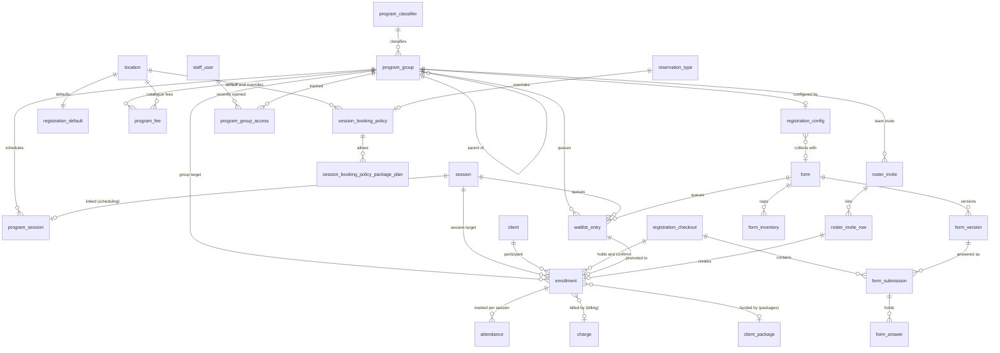
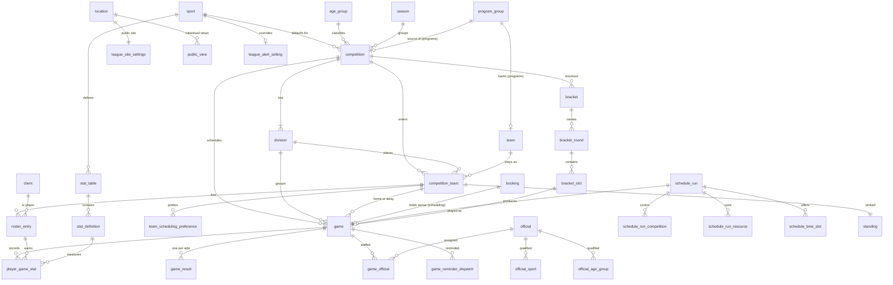
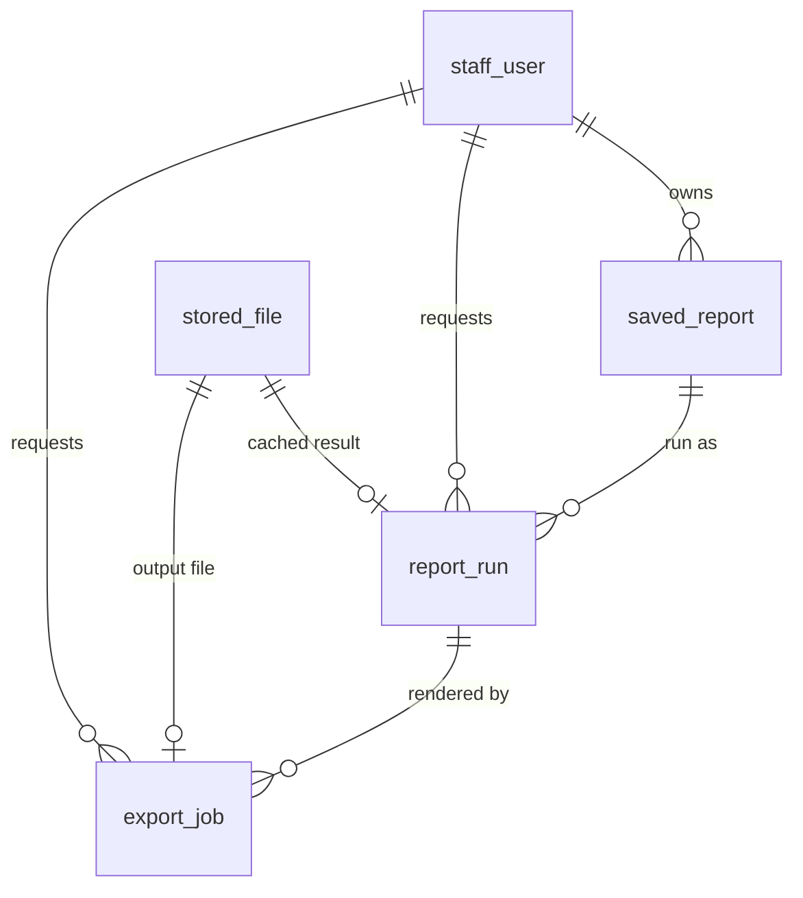
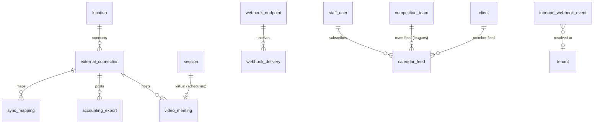
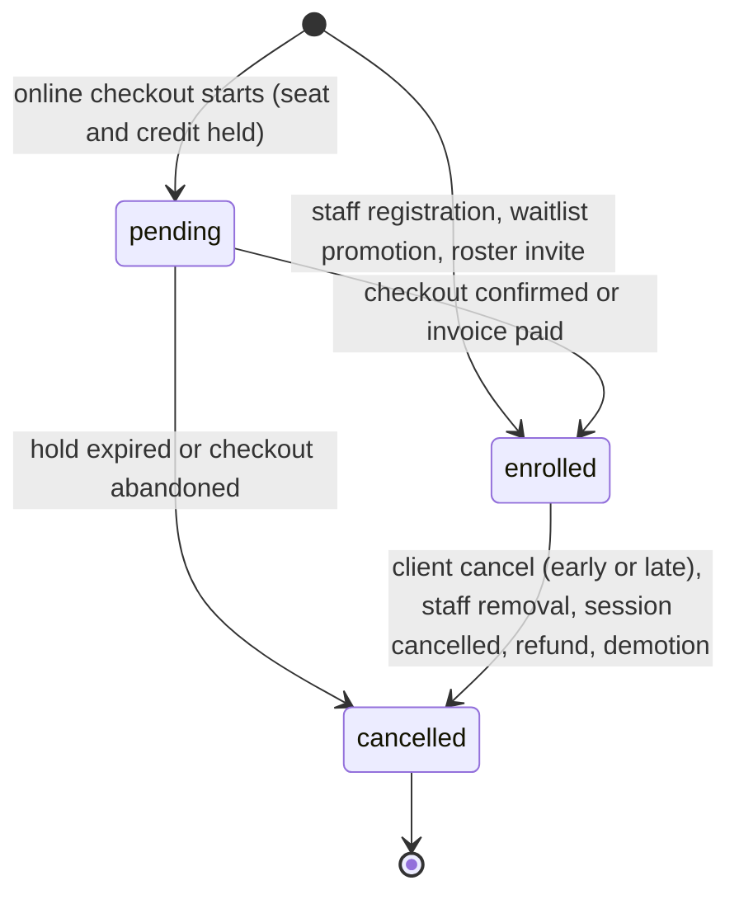
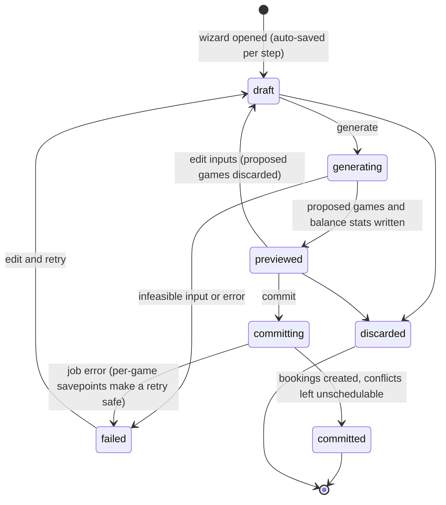
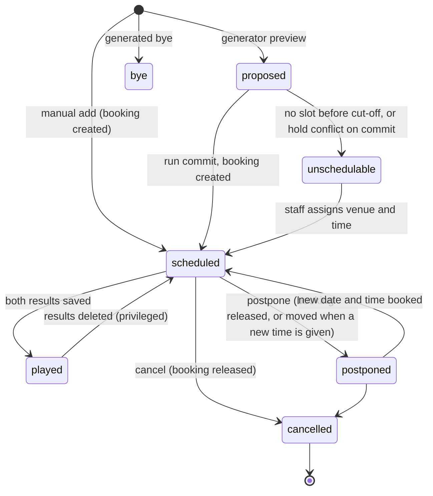
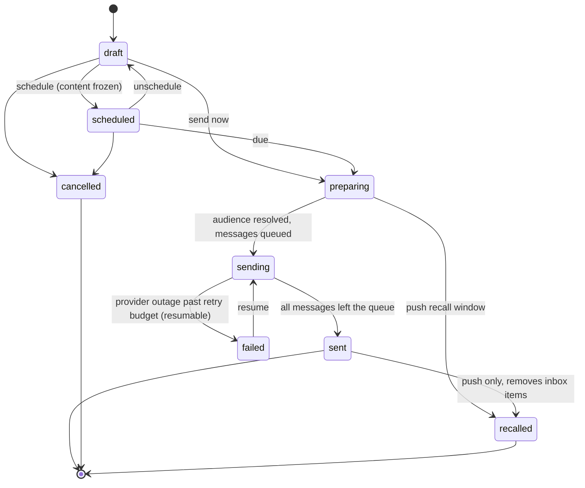

# FacilityHub Data Model: programs, leagues, engagement, reporting, integrations

Status: Phase 1 draft for GATE 1. Date: 2026-11-10. Conforms to `docs/architecture/overview.md` (the spine);
where the two disagree the overview wins and section 9 lists every place this document asks for an amendment.
Discovery prefixes covered: REG, CLS (enrolment side), LGE, MKT, SSP, APP, RPT, INT. Feature IDs refer to
`docs/discovery/feature-inventory.md`. Names are ours (clean-room); no reference-product label is a table or
column name.

Contents: 0 notation, 1 programs, 2 leagues, 3 engagement, 4 reporting, 5 integrations, 6 cross-context
references, 7 state machines, 8 coverage table, 9 open questions.

## 0. Notation (applies to every table below)

To keep 80-odd tables readable the following are **implied on every table and not repeated**:

| Implied | Definition (overview section) |
|---|---|
| `id uuid NOT NULL DEFAULT app.uuid_v7()` | primary key `pk_<table>` (3.3, 3.5) |
| `tenant_id uuid NOT NULL` | `fk_<table>_tenant_id_tenant`, plus `uq_<table>_tenant_id_id UNIQUE (tenant_id, id)` (3.3) |
| `created_at`, `updated_at` | `timestamptz NOT NULL DEFAULT now()`, last two columns (3.1) |
| RLS | `enable_rls('<table>')`: enabled, forced, `tenant_isolation` policy, DML grant to `fh_app` (3.4) |

Column tables list **domain columns only**, in physical order between `tenant_id` and `created_at`.

- **FK notation.** `→ client` in the notes column means the composite
  `FOREIGN KEY (tenant_id, <column>) REFERENCES client (tenant_id, id) ON DELETE RESTRICT`, named
  `fk_<table>_<column>_client`. Nullable FK columns use the default `MATCH SIMPLE` (a null column skips the
  check). `→ x CASCADE` marks the only cascades: aggregate root to its own child rows.
- **Indexes.** Every FK column has `ix_<table>_<column>` on `(tenant_id, <column>)`; these are implied. Only
  additional indexes (list sorts, partial work queues, uniques, GIN/GiST) are listed.
- **Enums** are `text` with `CONSTRAINT ck_<table>_<column> CHECK (<column> IN (...))` (3.2). Values are listed
  in the notes column in single quotes; the first value is the default when the default column says `first`.
- **Money** is `bigint` minor units, suffix `_minor`; currency is `tenant.currency` (3.6).
- **Tokens** (public links, feeds, invites) are never stored: `token_hash text` is SHA-256 of the secret,
  `token_prefix text` is the first 8 characters for support lookup.
- **Append-only** tables (`GRANT SELECT, INSERT` only) are marked *append-only*.
- `Owner` after a table name is the context package; all tables in a section belong to that section's context.
- "Serves" lists the P0/P1 discovery features the table exists for.

Two modelling rules used throughout, stated once:

1. **Nullable means inherit** on override rows (`registration_config`, `session_booking_policy`,
   `league_alert_setting`): the effective value is resolved at read time from the default row. Rejected:
   copy-defaults-on-create (the parity-matrix first position for REG-11), because a later change to the
   default would silently not reach existing programs and "which groups differ from the default" becomes
   unanswerable.
2. **Counters, not counts, guard capacity.** Every capacity is an integer column incremented under
   `SELECT ... FOR UPDATE` with a `CHECK (count <= cap)` (overview section 2, REG-17). Rejected: `COUNT(*)`
   at check time (race), range constraints (cannot count).

---

## 1. Context `programs`

One enrolment engine for two shapes of product (overview section 2):

- **Fee-based**: a client is enrolled in a `program_group` node (program, camp, clinic, league, team) and a
  `charge` is raised (REG-07, REG-12, CLS-10).
- **Entitlement-based**: a client is enrolled in one `session` (a capacity occurrence owned by `scheduling`)
  and a package credit is consumed, or nothing when free booking is allowed (CLS-01, CLS-05).

Both are rows of `enrollment`. Capacity for a session is `scheduling.reserve_seat(session_id)`; capacity for a
group node is the counter on `program_group`. Trade-off: one table with a `target_kind` discriminator and two
partial unique indexes instead of two tables; chosen because rosters, attendance, waitlists, portal "my
schedule", merge handling and reporting then have one code path. Cost: two nullable target columns and a check.

### 1.1 `program_classifier`

Tenant-defined pick-lists that classify groups (REG-03). One table with a `kind` instead of three lookups.

| column | type | null | default | notes |
|---|---|---|---|---|
| kind | text | no | | 'season', 'sport', 'age_division' |
| title | text | no | | |
| sort_order | integer | no | 0 | |
| is_active | boolean | no | true | hide from pickers without deleting |

- Unique: `uq_program_classifier_kind_title` on `(tenant_id, kind, lower(title))`.
- Delete is a real delete and is blocked by the RESTRICT FKs from `program_group` (REG-03 "delete blocked while
  referenced" maps to problem code `in-use`).
- Serves: REG-03, REG-04 (filters).

### 1.2 `program_group`

The registerable container and its tree: a program, camp, clinic, class series, league container, or a child
node such as a team or session block (REG-01, REG-02). Soft-deletable (overview 3.9; REG-05).

| column | type | null | default | notes |
|---|---|---|---|---|
| location_id | uuid | no | | → location |
| parent_id | uuid | yes | | → program_group; null = root |
| root_id | uuid | no | | → program_group; self for roots. Denormalised for subtree queries and lock ordering |
| depth | smallint | no | 0 | 0 = root; `CHECK (depth BETWEEN 0 AND 5)` |
| kind | text | no | 'program' | 'program', 'camp', 'clinic', 'class_series', 'competition', 'team', 'other'. Display and filtering only; behaviour is driven by fees, sessions and config, not by kind |
| name | text | no | | |
| description | text | yes | | staff-facing |
| child_label | text | no | 'Team' | what child nodes are called in UI ("Team", "Session", "Division") (REG-02) |
| season_classifier_id | uuid | yes | | → program_classifier (kind season) |
| sport_classifier_id | uuid | yes | | → program_classifier (kind sport) |
| age_division_classifier_id | uuid | yes | | → program_classifier (kind age_division) |
| revenue_category_id | uuid | yes | | → revenue_category. Resolved at write time: when the location default `subgroups_inherit_revenue_category` is on and this is null, the parent's value is copied in (REG-02) |
| capacity | integer | yes | | max individuals in this node's subtree; null = unlimited (we do not use 0 as a sentinel) |
| max_children | integer | yes | | cap on direct child nodes (teams); null = unlimited |
| enrolled_count | integer | no | 0 | enrolments with status pending or enrolled in this node **and its descendants** |
| child_count | integer | no | 0 | non-deleted direct children |
| price_minor | bigint | yes | | headline price for listings; charging uses `program_fee` |
| contact_name | text | yes | | shown on the portal page only |
| contact_email | citext | yes | | |
| starts_on | date | yes | | informational span shown publicly (SSP-17) |
| ends_on | date | yes | | `CHECK (ends_on >= starts_on)` |
| status | text | no | 'active' | 'active', 'completed', 'archived' |
| auto_archive_on | date | yes | | location-local date; nightly job completes and archives (REG-05) |
| completed_at | timestamptz | yes | | |
| waitlist_mode | text | yes | | null = inherit; 'disabled', 'manual', 'auto_promote' (REG-09) |
| copied_from_id | uuid | yes | | → program_group (REG-13) |
| deleted_at | timestamptz | yes | | soft delete (REG-05) |
| deleted_by_staff_user_id | uuid | yes | | → staff_user |

- Checks: `ck_program_group_capacity CHECK (capacity IS NULL OR enrolled_count <= capacity)`;
  `ck_program_group_children CHECK (max_children IS NULL OR child_count <= max_children)`;
  `enrolled_count >= 0`, `child_count >= 0`; `(parent_id IS NULL) = (depth = 0)`.
- Unique: `uq_program_group_sibling_name` on `(tenant_id, parent_id, lower(name)) WHERE parent_id IS NOT NULL
  AND deleted_at IS NULL` (team names unique inside a league; roots may repeat across seasons).
- Indexes: `ix_program_group_list (tenant_id, location_id, status, id) WHERE deleted_at IS NULL`;
  `ix_program_group_tree (tenant_id, root_id, depth)`; `ix_program_group_name_trgm USING gin (name
  gin_trgm_ops)` (REG-04); `ix_program_group_auto_archive (auto_archive_on) WHERE status = 'active' AND
  auto_archive_on IS NOT NULL AND deleted_at IS NULL` (fan-out job, read through a due-work view).
- **Capacity roll-up.** Enrolling into a node locks that node and every ancestor `FOR UPDATE` in root-first
  order (`ORDER BY depth`) and increments each `enrolled_count`; any check violation is `409 capacity-full`
  naming the node. A league with `capacity = 120` and teams with `capacity = 12` therefore enforces both.
  Rejected: counting only the node itself (the reference's "max individuals" on a parent would then mean
  nothing for team-based registration, REG-10 "display openings").
- Lowering `capacity` below `enrolled_count` is rejected by the check (`409 capacity-below-enrolled`), the same
  guard CLS-04 requires for sessions.
- A league or tournament built from a group is linked from the leagues side only
  (`competition.source_program_group_id`); `programs` (L3) holds no reference to `leagues` (L4) (REG-14).
- Serves: REG-01, REG-02, REG-04, REG-05, REG-09, REG-13, REG-14, CLS-10, SSP-17.

### 1.3 `program_group_access`

Per-user "recently opened" list (REG-04). Upserted on open; pruned to the newest 150 per user.

| column | type | null | default | notes |
|---|---|---|---|---|
| staff_user_id | uuid | no | | → staff_user |
| program_group_id | uuid | no | | → program_group CASCADE |
| last_accessed_at | timestamptz | no | now() | |

- Unique: `uq_program_group_access_user_group (tenant_id, staff_user_id, program_group_id)`.
- Index: `ix_program_group_access_recent (tenant_id, staff_user_id, last_accessed_at DESC)`.
- Serves: REG-04.

### 1.4 `program_session`

Links a group node to the `session` rows `scheduling` created for it (camp days, clinic meetings). `programs`
never writes `session`; it calls `scheduling.create_session(...)` and stores the returned id (CLS-10).

| column | type | null | default | notes |
|---|---|---|---|---|
| program_group_id | uuid | no | | → program_group CASCADE |
| session_id | uuid | no | | → session (scheduling) |
| sequence_no | integer | no | | 1-based order inside the group |

- Unique: `uq_program_session_session (tenant_id, session_id)` (a session belongs to at most one group);
  `uq_program_session_group_seq (tenant_id, program_group_id, sequence_no)`.
- Seats: a session linked here has its seats taken by the group enrolment (one `reserve_seat` per linked
  session when the participant is enrolled in the group), so a camp day and a drop-in booking of the same
  session share one counter.
- Serves: CLS-10, CLS-03 (roster of a program session), RPT-21.

### 1.5 `program_fee`

One table for both fee sources: the location's staff-side fee catalogue (`program_group_id IS NULL`, REG-07)
and a group's online fees (REG-10). Rejected: two tables with identical columns.

| column | type | null | default | notes |
|---|---|---|---|---|
| location_id | uuid | no | | → location |
| program_group_id | uuid | yes | | → program_group CASCADE; null = catalogue fee |
| fee_kind | text | no | 'individual' | 'individual', 'join_subgroup' (registrant picks an existing child node), 'new_subgroup' (registrant creates a child node and becomes captain) |
| description | text | no | | printed on the charge when the location default says so |
| amount_minor | bigint | no | | `CHECK (amount_minor >= 0)` |
| deposit_minor | bigint | yes | | `CHECK (deposit_minor IS NULL OR deposit_minor BETWEEN 0 AND amount_minor)` |
| revenue_category_id | uuid | yes | | → revenue_category; null = the group's |
| instalment_first_due_on | date | yes | | first auto-draft date |
| instalment_frequency | text | yes | | 'weekly', 'biweekly', 'monthly' |
| instalment_count | integer | yes | | `CHECK (instalment_count BETWEEN 1 AND 60)` |
| is_autopay_remainder | boolean | no | false | remainder after deposit goes onto a billing `payment_schedule` on the stored method |
| is_online | boolean | no | true | offered in public checkout; false = staff only |
| is_active | boolean | no | true | |
| sort_order | integer | no | 0 | |

- Check: `ck_program_fee_instalment`: the three `instalment_*` columns are all null or all non-null.
- Rule (REG-10): a group is registerable online only while it has at least one active online fee. The balance
  after the deposit is split with largest-remainder allocation (overview 3.6) into `instalment_count` parts; the
  schedule rows themselves are billing's `payment_schedule`, created by `billing.service`.
- Rule: "disallow partial payment" (config) overrides `deposit_minor` at checkout.
- No member vs non-member price column: the reference does not detect membership online (REG-10); member
  pricing is a coupon. Recorded as a known gap, not built.
- Serves: REG-07, REG-10, REG-12, REG-26.

### 1.6 `registration_config`

Per-group online registration settings and portal publication, 1:1 with a group node (REG-10, SSP-17).
Nullable policy columns inherit from `registration_default` (rule 1 in section 0).

| column | type | null | default | notes |
|---|---|---|---|---|
| program_group_id | uuid | no | | → program_group CASCADE |
| is_enabled | boolean | no | false | master switch; effective only with an active online fee |
| opens_on | date | yes | | effective 00:00 location time; null = open now |
| closes_on | date | yes | | closed from 00:00 of the day **after**; `CHECK (closes_on >= opens_on)` |
| payment_requirement | text | yes | | null = inherit; 'pay_later_allowed', 'immediate_card_payment', 'card_required_charge_optional', 'card_required_no_charge' |
| is_card_storage_forced | boolean | yes | | null = inherit |
| allows_coupons | boolean | yes | | null = inherit |
| is_partial_payment_disallowed | boolean | yes | | null = inherit |
| displays_openings | boolean | yes | | null = inherit; live "spots left" from the counters |
| roster_entry_mode | text | yes | | null = inherit; 'none', 'captain_assigns_payment', 'captain_no_payment' (REG-26) |
| document_template_id | uuid | yes | | → document_template; at most one agreement per group (REG-12); null = inherit |
| form_id | uuid | yes | | → form; extra questions and priced options collected at checkout (REG-15) |
| notification_emails | citext[] | no | '{}' | staff recipients of registration notices; empty = location default (MKT-14) |
| join_label | text | yes | | custom label for the join-a-child-node option |
| online_description_html | text | yes | | sanitised; `CHECK (char_length(online_description_html) <= 800000)` |
| closed_message | text | yes | | shown after close |
| confirmation_message | text | yes | | null = inherit |
| public_slug | text | no | | registration link segment |
| is_portal_visible | boolean | no | false | listed under portal registrations (SSP-17) |
| portal_publish_name | text | yes | | public name; null = group name |
| portal_published_at | timestamptz | yes | | |

- Unique: `uq_registration_config_program_group (tenant_id, program_group_id)`;
  `uq_registration_config_public_slug (tenant_id, public_slug)`.
- Index: `ix_registration_config_portal (tenant_id, is_portal_visible) WHERE is_portal_visible`.
- Open/close is evaluated at request time in the location zone; no scheduler (REG-20 pattern).
- Trade-off: publication (SSP-17) is three columns here, not a separate `program_publication` table as the
  entity catalogue inferred; it is 1:1 with the config and has no lifecycle of its own.
- Serves: REG-10, REG-12, REG-26, SSP-17, MKT-14.

### 1.7 `registration_default`

Location-wide defaults for online registration (REG-11). One row per location, created with the location.

| column | type | null | default | notes |
|---|---|---|---|---|
| location_id | uuid | no | | → location |
| payment_requirement | text | no | 'immediate_card_payment' | same values as 1.6 |
| is_card_storage_allowed | boolean | no | true | |
| is_card_storage_forced | boolean | no | false | |
| allows_coupons | boolean | no | true | |
| is_partial_payment_disallowed | boolean | no | true | |
| is_autopay_for_waitlisted | boolean | no | false | store a method while waitlisted and charge on promotion |
| subgroups_inherit_revenue_category | boolean | no | true | REG-02 |
| includes_fee_description_on_charge | boolean | no | true | |
| uses_revenue_category_taxes | boolean | no | true | tax by the charge's revenue category |
| gender_field_mode | text | no | 'optional' | 'hidden', 'optional', 'required' |
| waitlist_mode | text | no | 'manual' | 'disabled', 'manual', 'auto_promote' (REG-09) |
| roster_entry_mode | text | no | 'none' | as 1.6 |
| displays_openings | boolean | no | false | |
| remembers_form_fields | boolean | no | true | |
| document_template_id | uuid | yes | | → document_template |
| confirmation_message | text | yes | | |
| notification_emails | citext[] | no | '{}' | |
| checkout_hold_minutes | integer | no | 15 | lifetime of pending enrolments; `CHECK (checkout_hold_minutes BETWEEN 1 AND 120)` |
| waitlist_offer_minutes | integer | no | 1440 | lifetime of an open offer |
| header_file_id | uuid | yes | | → stored_file |
| header_alignment | text | no | 'left' | 'left', 'center', 'right' |
| background_color | text | yes | | `CHECK (background_color ~ '^#[0-9a-fA-F]{6}$')` |

- Unique: `uq_registration_default_location (tenant_id, location_id)`.
- Which personal fields a registrant sees and must fill is the `clients` context's field policy (account-wide
  in the reference, REG-12); not duplicated here.
- Serves: REG-11, REG-09, REG-10.

### 1.8 `registration_checkout`

One public or portal checkout attempt: the cart. It groups the pending enrolments and form submissions of
several participants and programs, carries the coupon, and ends in one invoice for the payer (REG-12, REG-23).
Staff-side registration (REG-07) uses the same row with `channel = 'staff'` so there is one confirm path.

| column | type | null | default | notes |
|---|---|---|---|---|
| location_id | uuid | no | | → location |
| channel | text | no | | 'staff', 'portal', 'public_link', 'mobile', 'api' |
| identity_id | uuid | yes | | → identity; null for guest checkout |
| payer_client_id | uuid | yes | | → client; set at the latest before payment (guest checkout creates the client) |
| guest_email | citext | yes | | until a client exists |
| status | text | no | 'open' | 'open', 'awaiting_payment', 'completed', 'expired', 'abandoned' |
| coupon_id | uuid | yes | | → coupon (billing) (SSP-11, REG-24) |
| invoice_id | uuid | yes | | → invoice; set on confirm |
| terms_acceptance_id | uuid | yes | | → document_acceptance (payment terms, SSP-14) |
| comment | text | yes | | registrant note; copied to the staff notice and to a client note |
| expires_at | timestamptz | no | | now + `checkout_hold_minutes`; extended on activity |
| completed_at | timestamptz | yes | | |

- Index: `ix_registration_checkout_expiry (expires_at) WHERE status IN ('open', 'awaiting_payment')`.
- Confirm is one transaction: validate holds, `billing.create_charges`, `billing.issue_invoice`, optional
  in-request payment through the provider port, flip enrolments `pending → enrolled`, emit
  `programs.enrollment.created` per enrolment. The endpoint requires `Idempotency-Key` (overview 3.12). When
  payment confirmation arrives asynchronously (`billing.invoice.paid`), the handler finishes the same
  transition idempotently.
- Captcha, cross-domain analytics and "remember my details" are web concerns with no storage.
- Serves: REG-07, REG-12, REG-23, SSP-08, SSP-11, APP-19.

### 1.9 `enrollment`

A client's place in a group node or in a single session. The roster row.

| column | type | null | default | notes |
|---|---|---|---|---|
| location_id | uuid | no | | → location |
| client_id | uuid | no | | → client (the participant) |
| target_kind | text | no | | 'group', 'session' |
| program_group_id | uuid | yes | | → program_group |
| session_id | uuid | yes | | → session (scheduling) |
| status | text | no | 'enrolled' | 'pending' (checkout hold), 'enrolled', 'cancelled' |
| pricing | text | no | | 'fee', 'entitlement', 'free' |
| program_fee_id | uuid | yes | | → program_fee (pricing fee) |
| client_package_id | uuid | yes | | → client_package (pricing entitlement); may be a package shared to this client (FAM-05) |
| charge_id | uuid | yes | | → charge; the fee line. Null while pending, when free, or when waitlist-promoted without "bill now" |
| revenue_category_id | uuid | yes | | → revenue_category; copied at enrolment, optionally rewritten on move (REG-08) |
| payer_client_id | uuid | yes | | → client; guardian or captain who is invoiced; null = participant |
| checkout_id | uuid | yes | | → registration_checkout |
| form_submission_id | uuid | yes | | → form_submission |
| batch_id | uuid | yes | | groups the enrolments of one multi-session action (CLS-02); not an FK |
| booked_scope | text | no | 'single' | 'single', 'all_linked', 'custom' (audit of the CLS-02 choice) |
| channel | text | no | | 'staff', 'portal', 'mobile', 'public_link', 'kiosk', 'api', 'waitlist', 'roster_invite' |
| is_captain | boolean | no | false | created the child node (fee_kind new_subgroup) (REG-26) |
| registrant_comment | text | yes | | |
| hold_expires_at | timestamptz | yes | | pending only |
| enrolled_at | timestamptz | yes | | |
| cancelled_at | timestamptz | yes | | |
| cancel_kind | text | yes | | 'early', 'late', 'staff_removed', 'session_cancelled', 'hold_expired', 'demoted_to_waitlist', 'payment_refunded', 'client_merged' |
| cancel_reason | text | yes | | free text |
| billing_disposition | text | yes | | on removal: 'reversed', 'kept', 'none' (REG-07 four-way choice) |
| cancelled_by_actor_type | text | yes | | 'staff', 'client', 'system' |
| cancelled_by_actor_id | uuid | yes | | not an FK (staff_user or identity) |

- Checks: `ck_enrollment_target`: `(target_kind = 'group' AND program_group_id IS NOT NULL AND session_id IS
  NULL) OR (target_kind = 'session' AND session_id IS NOT NULL AND program_group_id IS NULL)`;
  `ck_enrollment_pricing`: `pricing <> 'entitlement' OR client_package_id IS NOT NULL`;
  `ck_enrollment_cancel`: `(status = 'cancelled') = (cancelled_at IS NOT NULL)`;
  `ck_enrollment_hold`: `status <> 'pending' OR hold_expires_at IS NOT NULL`.
- Unique: `uq_enrollment_group_client (tenant_id, program_group_id, client_id) WHERE status IN ('pending',
  'enrolled') AND target_kind = 'group'`; `uq_enrollment_session_client (tenant_id, session_id, client_id) WHERE
  status IN ('pending', 'enrolled') AND target_kind = 'session'`. These give the reference rule "at most one
  registration per node" (REG-07) and produce the per-row failures of a bulk move (REG-08) as `already-exists`.
- Indexes: `ix_enrollment_client (tenant_id, client_id, status, id)`; `ix_enrollment_group_roster (tenant_id,
  program_group_id, status, id)`; `ix_enrollment_session_roster (tenant_id, session_id, status, id)`;
  `ix_enrollment_hold_expiry (hold_expires_at) WHERE status = 'pending'`; `ix_enrollment_batch (tenant_id,
  batch_id) WHERE batch_id IS NOT NULL`.
- **Seats and credits are taken in the same transaction as the insert**: group target increments the
  `program_group` counters (1.2) and reserves a seat in each linked session; session target calls
  `scheduling.reserve_seat`; pricing entitlement calls `packages.consume_credit(client_package_id,
  source=enrollment)`. Cancellation releases the seat and, by `cancel_kind` and policy, restores the credit
  (`early` restores, `late` and no-show do not; PKG-12 owns the rule).
- Move between nodes (REG-08) updates `program_group_id` in place inside a savepoint per row, adjusts both
  counter chains, optionally rewrites `revenue_category_id`, and records one audit event per row. Destination
  must be `active`. Rejected: cancel-and-recreate (loses the charge link and enrolment date).
- A group enrolment with `fee_kind = 'join_subgroup'` targets the chosen child node; `new_subgroup` first
  inserts the child `program_group` (subject to `max_children`) and enrols the captain into it.
- Disabled clients cannot be enrolled (CLS-01 fix); enforced in the service through `clients.service`.
- Serves: CLS-01, CLS-02, CLS-03, CLS-05, CLS-09, CLS-10, REG-07, REG-08, REG-09, REG-12, REG-26, SSP-08,
  SSP-09, RPT-21, RPT-27, INT-04.

### 1.10 `attendance`

Attendance mark for one participant at one session. For a session-target enrolment the session is the
enrolment's own; for a group-target enrolment it is any session linked through `program_session`. A missing
row means "scheduled, not yet marked". Rejected: an `attendance_status` column on `enrollment` (cannot express
a camp with ten days) and eager rows for every participant-session pair (write amplification for nothing).

| column | type | null | default | notes |
|---|---|---|---|---|
| enrollment_id | uuid | no | | → enrollment CASCADE |
| session_id | uuid | no | | → session |
| client_id | uuid | no | | → client; denormalised for reporting and merge |
| status | text | no | | 'attended', 'no_show', 'excused' |
| source | text | no | 'staff' | 'staff', 'check_in', 'kiosk', 'video_join', 'api' |
| marked_at | timestamptz | no | now() | |
| marked_by_staff_user_id | uuid | yes | | → staff_user; null for system sources |

- Unique: `uq_attendance_enrollment_session (tenant_id, enrollment_id, session_id)`.
- Index: `ix_attendance_session (tenant_id, session_id, status)`; `ix_attendance_client (tenant_id, client_id,
  marked_at)`.
- Early and late cancellation are states of the enrolment (`cancel_kind`), not attendance marks; the report
  view `rpt_attendance` presents one status vocabulary (`scheduled`, `attended`, `no_show`, `excused`,
  `early_cancel`, `late_cancel`) by combining both (RPT-21, RPT-10, RPT-22).
- First transition to `attended` emits `programs.enrollment.attended` (consumed by `staff` for pay and by
  `packages` rules); the unique key makes re-marking idempotent.
- Serves: CLS-03, RPT-21, RPT-10, RPT-22, INT-09 (video join marks attendance).

### 1.11 `waitlist_entry`

FIFO queue for a full group node, session or form. Not a status of `enrollment`: a waitlisted person holds no
seat, no credit and no charge (REG-09 "billing happens at enrolment"). Rejected: `enrollment.status =
'waitlisted'` (complicates the partial uniques and every roster count).

| column | type | null | default | notes |
|---|---|---|---|---|
| location_id | uuid | no | | → location |
| client_id | uuid | no | | → client |
| target_kind | text | no | | 'group', 'session', 'form' |
| program_group_id | uuid | yes | | → program_group |
| session_id | uuid | yes | | → session |
| form_id | uuid | yes | | → form |
| status | text | no | 'waiting' | 'waiting', 'offered', 'promoted', 'expired', 'removed' |
| mode | text | no | | snapshot at join: 'manual', 'auto_promote', 'open_offer' |
| queued_at | timestamptz | no | now() | FIFO key with `id` as tiebreak; position is derived, never stored |
| program_fee_id | uuid | yes | | → program_fee intended on promotion |
| client_package_id | uuid | yes | | → client_package intended on promotion (not reserved while waiting) |
| payer_client_id | uuid | yes | | → client |
| channel | text | no | | as `enrollment.channel` |
| offer_token_hash | text | yes | | open-offer claim link |
| offered_at | timestamptz | yes | | |
| offer_expires_at | timestamptz | yes | | |
| promoted_enrollment_id | uuid | yes | | → enrollment |
| removed_reason | text | yes | | |

- Check: `ck_waitlist_entry_target`: exactly the column matching `target_kind` is non-null.
- Unique (three partial indexes): `uq_waitlist_entry_group_client (tenant_id, program_group_id, client_id)
  WHERE status IN ('waiting', 'offered')`, and the same for `session_id` and `form_id`.
- Indexes: `ix_waitlist_entry_session_queue (tenant_id, session_id, status, queued_at, id)`;
  `ix_waitlist_entry_group_queue (tenant_id, program_group_id, status, queued_at, id)`;
  `ix_waitlist_entry_offer_expiry (offer_expires_at) WHERE status = 'offered'`.
- Promotion is driven by the seat-released path (enrolment cancelled, capacity raised), handled in a job keyed
  by target: `auto_promote` enrols the head of the queue (funding re-checked; a failure skips to the next and
  notifies the skipped client); `open_offer` moves every waiting entry to `offered` and the first claim wins
  under the capacity lock (CLS-06 two app modes); `manual` only flags staff. Each promotion emits
  `programs.waitlist.promoted`, which `engagement` turns into email, push and SMS (overview divergence 12).
  "Bill now" on promotion (REG-09) is a parameter of the promote command.
- "Set as waitlisted" on an enrolled member (REG-09) is: cancel the enrolment with `cancel_kind =
  'demoted_to_waitlist'` and the chosen `billing_disposition`, insert an entry at the tail.
- Serves: CLS-06, REG-09, REG-24, SSP-02, RPT-28.

### 1.12 `session_booking_policy` and `session_booking_policy_package_plan`

Self-service rules for booking sessions: one location default row (`reservation_type_id IS NULL`) and optional
per-reservation-type override rows whose null columns inherit (SSP-02, SSP-03). Evaluated by one eligibility
function used by portal, mobile, kiosk and public API (CLS-09, APP-18, INT-04).

Placement: in `programs`, not `scheduling`, because eligibility needs `packages` and `memberships`, which
`scheduling` (L2) may not call. See open question 3 for the overlap with SCH-03.

| column | type | null | default | notes |
|---|---|---|---|---|
| location_id | uuid | no | | → location |
| reservation_type_id | uuid | yes | | → reservation_type; null = location default |
| listing_mode | text | yes | | 'bookable', 'list_only', 'unlisted' (reachable only by signed direct link, SSP-09), 'hidden' |
| requires_active_membership | boolean | yes | | paid-to-date membership |
| requires_paid_package | boolean | yes | | package paid through the current invoice date |
| allows_post_billed_packages | boolean | yes | | default row only |
| visible_range_days | integer | yes | | default row only; `CHECK (visible_range_days BETWEEN 1 AND 730)` |
| hides_full_sessions | boolean | yes | | APP-18 |
| booking_cutoff_minutes | integer | yes | | before start; `>= 0` |
| allows_self_cancel | boolean | yes | | |
| cancel_notice_minutes | integer | yes | | boundary between early and late cancel |
| adjacency_mode | text | yes | | 'none', 'show_but_block', 'hide_non_adjacent' |
| waitlist_mode | text | yes | | 'disabled', 'auto_promote', 'open_offer' (CLS-06) |
| sends_instant_staff_alert | boolean | yes | | override rows; routed by `notification_route` kind `instant_booking` (MKT-14) |
| max_participants | integer | yes | | override rows; cap per booking party |
| online_description | text | yes | | override rows |

- Unique: `uq_session_booking_policy_location_type UNIQUE NULLS NOT DISTINCT (tenant_id, location_id,
  reservation_type_id)` (PostgreSQL 15+).
- Check `ck_session_booking_policy_default_complete`: when `reservation_type_id IS NULL`, `listing_mode`,
  `requires_active_membership`, `requires_paid_package`, `allows_post_billed_packages`, `visible_range_days`,
  `hides_full_sessions`, `booking_cutoff_minutes`, `allows_self_cancel`, `cancel_notice_minutes`,
  `adjacency_mode`, `waitlist_mode` are all non-null.

`session_booking_policy_package_plan` (allowed plans for an override row; no rows = all plans):

| column | type | null | default | notes |
|---|---|---|---|---|
| session_booking_policy_id | uuid | no | | → session_booking_policy CASCADE |
| package_plan_id | uuid | no | | → package_plan (packages) |

- Unique: `uq_sbp_package_plan (tenant_id, session_booking_policy_id, package_plan_id)`.
- Serves: SSP-02, SSP-03, SSP-08, SSP-09, SSP-12, CLS-05, CLS-09, APP-18.

### 1.13 `roster_invite` and `roster_invite_row`

Captain roster entry and team-fee split (REG-26). The invite is a signed link for one team node.

`roster_invite`:

| column | type | null | default | notes |
|---|---|---|---|---|
| program_group_id | uuid | no | | → program_group (the team node) |
| captain_client_id | uuid | no | | → client |
| captain_enrollment_id | uuid | no | | → enrollment |
| mode | text | no | | 'captain_assigns_payment', 'captain_no_payment' (snapshot of the effective config) |
| team_charge_id | uuid | yes | | → charge; the team fee being split |
| token_hash | text | no | | |
| token_prefix | text | no | | |
| status | text | no | 'open' | 'open', 'submitted', 'revoked' |
| last_sent_at | timestamptz | yes | | staff may resend |
| submitted_at | timestamptz | yes | | |

- Unique: `uq_roster_invite_program_group (tenant_id, program_group_id) WHERE status <> 'revoked'`;
  `uq_roster_invite_token_hash (token_hash)`.

`roster_invite_row`:

| column | type | null | default | notes |
|---|---|---|---|---|
| roster_invite_id | uuid | no | | → roster_invite CASCADE |
| first_name | text | no | | |
| last_name | text | no | | |
| email | citext | yes | | |
| home_phone | text | yes | | |
| birth_on | date | yes | | same name as `client.birth_on` |
| assigned_minor | bigint | no | 0 | share of the team fee; `>= 0` |
| client_id | uuid | yes | | → client; matched or created on submit |
| enrollment_id | uuid | yes | | → enrollment into the team node |
| charge_id | uuid | yes | | → charge; the player's share |
| status | text | no | 'draft' | 'draft', 'applied', 'failed' |
| failure_code | text | yes | | per-row outcome |

- Rule: `SUM(assigned_minor) <= team fee`. On submit the team charge is reversed and re-raised as one charge
  per assigned player plus a remainder charge on the captain (immutable ledger, overview divergence 5); each
  player gets their own invoice and pay link. The sum of the new charges equals the original (asserted).
- Each applied row also yields a `roster_entry` when the group backs a competition (the `leagues` handler of
  `programs.enrollment.created`).
- Serves: REG-26.

### 1.14 `form`

A registration form: standalone event form or a question set attached to a program through
`registration_config.form_id` (REG-15). Templates are forms with `is_template = true`.

| column | type | null | default | notes |
|---|---|---|---|---|
| location_id | uuid | no | | → location |
| public_no | integer | no | | per-tenant sequence from `tenant_counter` (their "Form ID") |
| name | text | no | | internal name |
| event_name | text | yes | | public title |
| event_text | text | yes | | free-text date and place line |
| event_starts_on | date | yes | | the event, not the registration window |
| event_ends_on | date | yes | | |
| status | text | no | 'draft' | 'draft', 'open', 'closed' |
| opens_at | timestamptz | yes | | |
| auto_close_at | timestamptz | yes | | evaluated at request time (REG-20) |
| closed_message | text | yes | | |
| confirmation_message_html | text | yes | | sanitised |
| is_template | boolean | no | false | |
| template_event_type | text | yes | | label for the template gallery ("Triathlon") |
| copied_from_form_id | uuid | yes | | → form |
| published_version_id | uuid | yes | | → form_version; what registrants see |
| revenue_category_id | uuid | yes | | → revenue_category for priced items |
| allows_coupons | boolean | no | true | uses billing `coupon` (REG-24) |
| has_waitlist | boolean | no | false | uses `waitlist_entry` target form (REG-24) |
| capacity | integer | yes | | total registrations; null = unlimited |
| submitted_count | integer | no | 0 | `CHECK (capacity IS NULL OR submitted_count <= capacity)` |
| notification_emails | citext[] | no | '{}' | |
| header_file_id | uuid | yes | | → stored_file (REG-19) |
| theme | jsonb | no | '{}' | accent colour, font, max width; unset keys inherit the tenant theme |
| public_slug | text | no | | |

- Unique: `uq_form_public_no (tenant_id, public_no)`; `uq_form_public_slug (tenant_id, public_slug)`.
- Index: `ix_form_list (tenant_id, location_id, status, id) WHERE NOT is_template`.
- Effective state at request time: `open` iff `status = 'open'` and `now()` is within `[opens_at,
  auto_close_at)`. No job flips the status (REG-20).
- Serves: REG-15, REG-18, REG-19, REG-20, REG-23, REG-24.

### 1.15 `form_version`

Immutable snapshot of a form's questions and information topics. Editing happens on the single draft version;
publishing freezes it and makes a new draft on next edit. Answers reference the version they were given
against, so deleting a question never erases or orphans captured answers (overview divergence 10).

| column | type | null | default | notes |
|---|---|---|---|---|
| form_id | uuid | no | | → form CASCADE |
| version_no | integer | no | | 1-based |
| state | text | no | 'draft' | 'draft', 'published', 'superseded' |
| schema | jsonb | no | | see below; validated by a Pydantic model before write |
| published_at | timestamptz | yes | | |
| published_by_staff_user_id | uuid | yes | | → staff_user |

- Unique: `uq_form_version_form_no (tenant_id, form_id, version_no)`; `uq_form_version_one_draft (tenant_id,
  form_id) WHERE state = 'draft'`.
- Rows with `state <> 'draft'` are never updated except `state` itself (service rule plus a test).
- `schema` shape (REG-16, REG-18): `{"items": [...]}` in display order, each item one of
  - question: `{"key", "type": "question", "question_type": "text_box" | "drop_down" | "radio" | "checkbox" |
    "purchase_amount" | "purchase_quantity", "text", "hint", "help", "visibility": "shown" | "hidden",
    "required", "expires_on", "max_length", "default_answer", "default_checked", "price_minor",
    "unit_price_minor", "choices": [{"key", "text", "price_minor", "audience": "all" | "members_only"}],
    "depends_on": {"question_key", "choice_key"}}`
  - topic: `{"key", "type": "topic", "title", "body_html"}` (sanitised rich text).
  Keys are stable UUID strings minted by the builder and survive across versions; that is what `form_answer`
  and `form_inventory` reference.
- Trade-off: questions live in versioned JSON, not `form_question` and `form_answer_choice` tables. The builder
  saves the whole document, ordering is shared between questions and topics, and versioning rows across four
  tables would be heavy. Cost: no FK from an answer to a question; mitigated by validating every submission
  against the version's schema and by storing priced answers as rows with amounts (1.18). Rejected: tables.
- Serves: REG-15, REG-16, REG-18.

### 1.16 `form_inventory`

Stock cap on a purchasable option, outside the versions so counts survive republishing (REG-17).

| column | type | null | default | notes |
|---|---|---|---|---|
| form_id | uuid | no | | → form CASCADE |
| item_key | text | no | | question key (quantity questions) or `<question_key>.<choice_key>` |
| is_enabled | boolean | no | true | |
| limit_count | integer | no | | `>= 0` |
| sold_count | integer | no | 0 | |
| sold_out_memo | text | yes | | not offered for multiple-choice in the reference; allowed here |
| shows_count_publicly | boolean | no | false | |

- Unique: `uq_form_inventory_form_item (tenant_id, form_id, item_key)`.
- Check: `ck_form_inventory_sold CHECK (sold_count BETWEEN 0 AND limit_count)`.
- Decremented under `FOR UPDATE` in the checkout transaction, rows locked in `item_key` order; violation is
  `409 sold-out` with the item. Cancelled submissions give stock back.
- Serves: REG-17.

### 1.17 `form_submission`

One registrant's answers to one form version (REG-21, REG-23).

| column | type | null | default | notes |
|---|---|---|---|---|
| form_id | uuid | no | | → form |
| form_version_id | uuid | no | | → form_version |
| location_id | uuid | no | | → location |
| confirmation_no | text | no | | human-facing, from `tenant_counter` |
| account_client_id | uuid | no | | → client who registered (payer) |
| registrant_client_id | uuid | no | | → client the registration is for (self or household member) |
| checkout_id | uuid | yes | | → registration_checkout |
| status | text | no | 'pending' | 'pending', 'confirmed', 'cancelled' |
| total_minor | bigint | no | 0 | sum of `form_answer.amount_minor` |
| invoice_id | uuid | yes | | → invoice; null when total is zero |
| channel | text | no | | 'staff', 'portal', 'public_link', 'mobile' |
| submitted_at | timestamptz | yes | | |
| last_edited_at | timestamptz | yes | | admin edit (REG-21) |
| last_edited_by_staff_user_id | uuid | yes | | → staff_user |

- Unique: `uq_form_submission_confirmation_no (tenant_id, confirmation_no)`.
- Indexes: `ix_form_submission_form (tenant_id, form_id, status, id)`; search by registrant name and email
  goes through `clients.service` and joins on `registrant_client_id`.
- Emits `programs.form.submitted` on confirm.
- Serves: REG-21, REG-22, REG-23, MKT-12.

### 1.18 `form_answer`

One row per answered item (and per chosen option for multi-select). Rows, not JSON, because the summaries
(REG-22) count, group and sum them.

| column | type | null | default | notes |
|---|---|---|---|---|
| form_submission_id | uuid | no | | → form_submission CASCADE |
| form_id | uuid | no | | → form; denormalised for summary indexes |
| item_key | text | no | | question key in the version schema |
| choice_key | text | yes | | chosen option |
| question_type | text | no | | snapshot: values as in 1.15 |
| text_value | text | yes | | |
| is_checked | boolean | yes | | checkbox |
| quantity | integer | yes | | purchase_quantity; `> 0` |
| unit_price_minor | bigint | yes | | snapshot |
| amount_minor | bigint | no | 0 | line value |
| charge_id | uuid | yes | | → charge when priced |

- Indexes: `ix_form_answer_summary (tenant_id, form_id, item_key, choice_key)`.
- Serves: REG-16, REG-21, REG-22.

### 1.19 Events, jobs and report views of `programs`

- Emits: `programs.enrollment.created`, `.cancelled`, `.attended`, `.moved`; `programs.waitlist.joined`,
  `.promoted`, `.offered`; `programs.group.completed`; `programs.form.submitted`. Payloads carry
  `location_id`, `client_id`, target ids and, for session targets, `session_starts_at` (needed by `engagement`
  reminders, which may not call `scheduling`; see open question 5).
- Consumes: `billing.invoice.paid` (finish an `awaiting_payment` checkout), `billing.payment.refunded`
  (cancel with `payment_refunded` when policy says so), `scheduling.session.cancelled` (cancel enrolments with
  `session_cancelled`, restore credits, notify), `documents.document.accepted` (unblock a checkout waiting on
  the agreement), `clients.client.merged` (re-point `enrollment`, `attendance`, `waitlist_entry`,
  `form_submission`, `roster_invite*`, `registration_checkout`; a merge that would break a partial unique
  cancels the loser's duplicate with `client_merged`).
- Jobs (`@tenant_actor`, fan-out by due-work view): expire pending holds; expire waitlist offers; promote
  waitlists; auto-archive groups at the location's local date; copy a group tree (REG-13: nodes, fees, config,
  optional members; never schedule or league games) as a job when the tree exceeds 50 nodes.
- Publishes: `rpt_enrollment`, `rpt_attendance` (RPT-21, RPT-10 input), `rpt_program_roster` (RPT-27),
  `rpt_waitlist` (RPT-28), `rpt_form_registration`, `rpt_form_answer` (REG-22).

---

## 2. Context `leagues`

Leagues and tournaments share the client, program and booking model (overview divergence 2). A player is a
`client`; a team may be backed by a `program_group` node; every scheduled game is a `booking` written through
`scheduling.service`, so the hold exclusion constraint is the final conflict guard for generated and manual
games alike (LGE-08, LGE-31; overview divergence 4).

### 2.1 `sport`

Per-tenant sport with defaults copied into a competition at creation (LGE-05). Seeded with common sports.

| column | type | null | default | notes |
|---|---|---|---|---|
| name | text | no | | |
| default_game_length_min | integer | no | 60 | slot spacing; includes turnaround by convention (LGE-08) |
| default_team_fee_minor | bigint | yes | | display defaults only; charging is `program_fee` |
| default_player_fee_minor | bigint | yes | | |
| fees_text | text | yes | | shown publicly |
| more_info | text | yes | | |
| rules_text | text | yes | | |
| points_win | numeric(5,2) | no | 2 | league points per outcome (LGE-06) |
| points_tie | numeric(5,2) | no | 1 | |
| points_loss | numeric(5,2) | no | 0 | |
| points_overtime_loss | numeric(5,2) | no | 0 | |
| points_forfeit_win | numeric(5,2) | no | 2 | awarded to the opponent of a forfeiting or defaulting side |
| points_forfeit_loss | numeric(5,2) | no | 0 | |
| points_default_loss | numeric(5,2) | no | 0 | |
| forfeit_score_for | integer | no | 0 | score credited to the non-forfeiting side |
| tracks_sportsmanship | boolean | no | false | shows the rating field on result entry |
| standings_columns | jsonb | no | see note | ordered `[{"metric", "heading"}]`; metrics 'GP','W','L','T','GF','GA','PTS','GD','WP','OTL','FF','BP','SPT' |
| standings_sort | jsonb | no | see note | ordered tie-breaks `[{"metric", "direction"}]` with direction 'asc' or 'desc'; extra metric 'H2H' |
| is_active | boolean | no | true | |

- Defaults: columns `GP, W, L, T, GF, GA, PTS, GD, WP`; sort `PTS desc, WP desc, GD desc, GF desc`.
- Unique: `uq_sport_name (tenant_id, lower(name))`.
- Trade-off: the outcome list is not enumerated publicly, so points are typed columns for the outcomes we
  define (anything computed is a column), while column layout and sort order are small ordered JSON lists
  (pure presentation config). Rejected: a `standings_column` child table for both sport and competition.
- Serves: LGE-05, LGE-06.

### 2.2 `age_group`

| column | type | null | default | notes |
|---|---|---|---|---|
| name | text | no | | "U10", "Adult", "Over 35" |
| min_age | smallint | yes | | informational; used to suggest matches |
| max_age | smallint | yes | | |
| sort_order | integer | no | 0 | |
| is_active | boolean | no | true | |

- Unique: `uq_age_group_name (tenant_id, lower(name))`. Seeded with a starter list.
- Serves: LGE-01, LGE-15, LGE-17.

### 2.3 `season`

Optional label for grouping and filtering competitions (LGE-01, LGE-17).

| column | type | null | default | notes |
|---|---|---|---|---|
| name | text | no | | "Winter 2027" |
| starts_on | date | yes | | |
| ends_on | date | yes | | |
| is_active | boolean | no | true | |

- Unique: `uq_season_name (tenant_id, lower(name))`.
- Trade-off: a table rather than the reference's free-text season, so public filters and "copy for next
  season" have a stable key. `program_classifier` kind `season` is the programs-side list; a competition created
  from a group matches or creates the season by name. Rejected: sharing one table across contexts.

### 2.4 `competition`

One league or tournament (LGE-01, LGE-02).

| column | type | null | default | notes |
|---|---|---|---|---|
| location_id | uuid | no | | → location |
| kind | text | no | | 'league', 'tournament'; immutable once `source_program_group_id` is set |
| format | text | no | | 'round_robin', 'pool_play', 'single_elimination', 'double_elimination', 'three_games_guaranteed' |
| name | text | no | | |
| sport_id | uuid | no | | → sport |
| age_group_id | uuid | yes | | → age_group |
| season_id | uuid | yes | | → season |
| division_label | text | yes | | free text level ("Recreational", "A") shown and filterable |
| starts_on | date | no | | generation starts here |
| ends_on | date | yes | | |
| game_length_min | integer | no | | copied from sport; `> 0` |
| status | text | no | 'draft' | 'draft', 'active', 'completed', 'archived' |
| is_public | boolean | no | true | listed on the public site |
| shows_roster_publicly | boolean | no | true | team-level flag can narrow it |
| max_defaults | integer | yes | | per team per season; reported, not auto-enforced (LGE-14) |
| max_forfeits | integer | yes | | |
| min_sportsmanship | numeric(4,2) | yes | | |
| team_fee_text | text | yes | | display only |
| player_fee_text | text | yes | | |
| fee_comments | text | yes | | |
| more_info | text | yes | | |
| rules_text | text | yes | | |
| registration_url | text | yes | | derived from the source group's `public_slug` when linked |
| source_program_group_id | uuid | yes | | → program_group (REG-14) |
| color | text | yes | | calendar colour for multi-competition runs |
| points_win, points_tie, points_loss, points_overtime_loss, points_forfeit_win, points_forfeit_loss, points_default_loss | numeric(5,2) | no | | seven columns, same names and types as `sport`, snapshotted at creation |
| forfeit_score_for | integer | no | | snapshot |
| tracks_sportsmanship | boolean | no | | snapshot |
| standings_columns | jsonb | no | | snapshot |
| standings_sort | jsonb | no | | snapshot |
| public_display | jsonb | no | '{}' | per-item visibility toggles on the public page |

- Checks: `ck_competition_league_format CHECK (kind <> 'league' OR format = 'round_robin')`;
  `ends_on >= starts_on`.
- Unique: `uq_competition_source_program_group (tenant_id, source_program_group_id) WHERE
  source_program_group_id IS NOT NULL`.
- Index: `ix_competition_list (tenant_id, location_id, kind, status, id)`.
- "Create from program group" (REG-14) replaces the reference's publish step: child nodes become `team` and
  `competition_team` rows, enrolments become `roster_entry` rows, and the `programs.enrollment.created`
  handler keeps rosters current afterwards. No copy of people is made.
- Serves: LGE-01, LGE-02, LGE-05, LGE-06, LGE-14, LGE-17, LGE-18, LGE-27, REG-14.

### 2.5 `division`

A subdivision of a competition: a real division or a tournament pool (LGE-11). Every competition has at least
one (created as "Main"). Standings and round-robin generation run per division.

| column | type | null | default | notes |
|---|---|---|---|---|
| competition_id | uuid | no | | → competition CASCADE |
| name | text | no | | |
| kind | text | no | 'division' | 'division', 'pool' |
| sort_order | integer | no | 0 | |

- Unique: `uq_division_competition_name (tenant_id, competition_id, lower(name))`.
- Reconciles the catalogue's `CompetitionTeam.pool` text and "division" label into one FK.
- Serves: LGE-11, LGE-06.

### 2.6 `team`

A team identity that can enter several competitions over time (LGE-03 "copy teams from earlier leagues").

| column | type | null | default | notes |
|---|---|---|---|---|
| location_id | uuid | no | | → location |
| name | text | no | | |
| program_group_id | uuid | yes | | → program_group; the node whose enrolments feed the roster |
| captain_client_id | uuid | yes | | → client |
| color | text | yes | | |
| is_placeholder | boolean | no | false | generated "Team 1..N" awaiting a real name |
| is_active | boolean | no | true | |

- Unique: `uq_team_program_group (tenant_id, program_group_id) WHERE program_group_id IS NOT NULL`.
- Index: `ix_team_name_trgm USING gin (name gin_trgm_ops)`.
- Serves: LGE-03, REG-14.

### 2.7 `competition_team`

A team's entry in a competition, with division and seed.

| column | type | null | default | notes |
|---|---|---|---|---|
| competition_id | uuid | no | | → competition CASCADE |
| division_id | uuid | no | | → division |
| team_id | uuid | no | | → team |
| seed | integer | yes | | bracket seeding and display order; `> 0` |
| display_name | text | yes | | per-competition override of the team name |
| shows_roster_publicly | boolean | yes | | null = competition setting |
| status | text | no | 'active' | 'active', 'withdrawn' |

- Unique: `uq_competition_team_team (tenant_id, competition_id, team_id)`; `uq_competition_team_seed UNIQUE
  (tenant_id, competition_id, seed) DEFERRABLE INITIALLY DEFERRED` (reordering seeds swaps values inside one
  transaction).
- Team creation modes (LGE-03) are service commands, not stored: none, generate N placeholders, copy from one
  or more earlier competitions (re-uses `team` rows, optional roster copy), materialise from program nodes.
  Blind draw assigns random seeds.
- Serves: LGE-03, LGE-11, LGE-12, LGE-25.

### 2.8 `roster_entry`

A person on a team for one competition. Normally a `client`; a walk-on without a client record is allowed with
names only (LGE-04).

| column | type | null | default | notes |
|---|---|---|---|---|
| competition_team_id | uuid | no | | → competition_team CASCADE |
| client_id | uuid | yes | | → client |
| first_name | text | yes | | unlinked player only |
| last_name | text | yes | | unlinked player only |
| role | text | no | 'player' | 'player', 'captain', 'coach', 'manager' |
| jersey_number | text | yes | | |
| origin | text | no | | 'enrollment', 'roster_invite', 'manual', 'copied' |
| enrollment_id | uuid | yes | | → enrollment (programs) that produced it |
| status | text | no | 'active' | 'active', 'removed' |
| extra | jsonb | no | '{}' | unspecified optional attributes |

- Check: `ck_roster_entry_person CHECK (client_id IS NOT NULL OR (first_name IS NOT NULL AND last_name IS NOT
  NULL))`.
- Unique: `uq_roster_entry_team_client (tenant_id, competition_team_id, client_id) WHERE client_id IS NOT NULL
  AND status = 'active'`.
- An unlinked entry can later be linked to a client (sets `client_id`, clears names). Captains and coaches are
  the recipients of game-change alerts (LGE-30).
- Serves: LGE-04, LGE-07, LGE-16, LGE-30, LGE-32.

### 2.9 `official`, `official_sport`, `official_age_group`, `game_official`

`official` (LGE-15):

| column | type | null | default | notes |
|---|---|---|---|---|
| first_name | text | no | | |
| last_name | text | no | | |
| email | citext | yes | | |
| phone | text | yes | | |
| staff_user_id | uuid | yes | | → staff_user; lets an official sign in and see assignments |
| is_active | boolean | no | true | |

- Unique: `uq_official_staff_user (tenant_id, staff_user_id) WHERE staff_user_id IS NOT NULL`.
- Trade-off: officials are their own rows with an optional staff link, not necessarily staff users as the
  parity matrix first proposed; most referees never log in and should not consume a staff seat (PLT-14).

`official_sport` and `official_age_group` (qualifications; two independent lists as in the reference):

| table | columns | unique |
|---|---|---|
| `official_sport` | `official_id uuid NOT NULL → official CASCADE`, `sport_id uuid NOT NULL → sport` | `(tenant_id, official_id, sport_id)` |
| `official_age_group` | `official_id uuid NOT NULL → official CASCADE`, `age_group_id uuid NOT NULL → age_group` | `(tenant_id, official_id, age_group_id)` |

`game_official`:

| column | type | null | default | notes |
|---|---|---|---|---|
| game_id | uuid | no | | → game CASCADE |
| official_id | uuid | no | | → official |
| role | text | no | 'referee' | 'referee', 'assistant', 'scorekeeper', 'other' |
| during | tstzrange | no | | copied from the game's `[starts_at, ends_at)`; rewritten when the game moves |

- Unique: `uq_game_official_game_official (tenant_id, game_id, official_id)`.
- Exclusion: `ex_game_official_overlap EXCLUDE USING gist (tenant_id WITH =, official_id WITH =, during WITH
  &&)` mapped to problem code `official-conflict`. An official cannot be double-booked, by the same mechanism
  as venues. Cost: `during` must be rewritten in the reschedule service function (one statement).
- Qualification is validated in the service (official must hold the competition's sport, and its age group
  when set); an override permission allows an unqualified assignment with an audit event. The reference does
  not say whether it restricts (LGE-15); we warn-and-allow for privileged users.
- Serves: LGE-15, LGE-32.

### 2.10 `schedule_run` and children

A persisted generator run: inputs, preview and outcome, so the wizard can be resumed, audited and re-run
mid-season (LGE-08). Kinds: round robin, pool play, bracket.

`schedule_run`:

| column | type | null | default | notes |
|---|---|---|---|---|
| location_id | uuid | no | | → location |
| kind | text | no | | 'round_robin', 'pool_play', 'bracket' |
| state | text | no | 'draft' | 'draft', 'generating', 'previewed', 'committing', 'committed', 'failed', 'discarded' |
| wizard_step | smallint | no | 1 | resume point |
| starts_on | date | no | | |
| ends_on | date | yes | | |
| cutoff_on | date | yes | | games needing slots after this stay unschedulable |
| weekdays | smallint[] | no | '{}' | ISO weekday numbers 1-7 |
| excluded_dates | date[] | no | '{}' | blackout dates removed from the pattern |
| moved_dates | jsonb | no | '{}' | `{"2027-01-18": "2027-01-20"}` (LGE-08 "move scheduled date") |
| game_length_min | integer | no | | |
| games_per_week | integer | yes | | per team |
| games_total | integer | yes | | per team, includes byes |
| games_per_team | integer | yes | | pool play cap |
| begin_pairings_at_game | integer | yes | | mid-season regeneration without repeating matchups |
| removes_previous_games | boolean | no | false | deletes this competition's unplayed generated games on commit |
| removes_unschedulable | boolean | no | false | |
| allows_back_to_back_doubleheaders | boolean | no | false | |
| bye_mode | text | no | 'hidden' | 'hidden' (no opponent, no slot), 'occupy_slot', 'fold_last_round', 'rotate_extra_game' (LGE-09) |
| rotation_strategy | text | no | 'fewest_time_slots' | 'fewest_time_slots', 'fewest_venues', 'rotate' |
| rotation_venue_shift | smallint | no | 0 | spots left through venues per game |
| rotation_slot_shift | smallint | no | 0 | spots down through time rows per game |
| keeps_winners_on_same_field | boolean | no | false | bracket |
| lower_bracket_mode | text | no | 'cross' | 'cross' (loser crosses halves), 'straight' |
| predicted_completion_on | date | yes | | derived, shown live on the settings step |
| result_stats | jsonb | yes | | balance report: home/away per team, per venue, per slot, per weekday; unschedulable list |
| error | text | yes | | |
| created_by_staff_user_id | uuid | no | | → staff_user |
| committed_at | timestamptz | yes | | |

- Index: `ix_schedule_run_open (tenant_id, location_id, state, id) WHERE state NOT IN ('committed',
  'discarded')`.
- The reference's "avoid double booking facilities" toggle is not stored: we always enforce (divergence 4).
- Generation and commit are jobs. Preview writes proposed games to `schedule_run.result_stats` plus
  `game` rows in `status = 'proposed'` (no booking yet). Commit creates one booking per game through
  `scheduling.service`, each in its own savepoint; SQLSTATE `23P01` leaves that game `unschedulable` with the
  conflicting resource and range in `game.conflict_note` (overview 3.8). Emits `leagues.schedule.generated`.

`schedule_run_competition` and `schedule_run_resource`:

| table | columns | unique |
|---|---|---|
| `schedule_run_competition` | `schedule_run_id uuid NOT NULL → schedule_run CASCADE`, `competition_id uuid NOT NULL → competition`, `division_id uuid NULL → division` (null = all) | `UNIQUE NULLS NOT DISTINCT (tenant_id, schedule_run_id, competition_id, division_id)` |
| `schedule_run_resource` | `schedule_run_id uuid NOT NULL → schedule_run CASCADE`, `resource_id uuid NOT NULL → resource`, `sort_order integer NOT NULL DEFAULT 0` (column order for rotation) | `(tenant_id, schedule_run_id, resource_id)` |

`schedule_time_slot`:

| column | type | null | default | notes |
|---|---|---|---|---|
| schedule_run_id | uuid | no | | → schedule_run CASCADE |
| slot_on | date | yes | | null = applies to every generated date (round robin); brackets need a row per date |
| start_time | time | no | | location-local wall time; auto-incremented by game length in the builder |
| resource_id | uuid | yes | | → resource; null = any run resource, mapped at finalize |
| is_removed | boolean | no | false | a slot deleted to leave a break |

- Unique: `uq_schedule_time_slot UNIQUE NULLS NOT DISTINCT (tenant_id, schedule_run_id, slot_on, start_time,
  resource_id)`.
- Serves (all four tables): LGE-08, LGE-09, LGE-10, LGE-11, LGE-12, LGE-13.

### 2.11 `team_scheduling_preference`

Soft constraints weighted in the generator's cost function (LGE-10). Belongs to the team entry, so it survives
re-runs.

| column | type | null | default | notes |
|---|---|---|---|---|
| competition_team_id | uuid | no | | → competition_team CASCADE |
| preference_kind | text | no | | 'date', 'weekday', 'time_slot', 'home_venue', 'away_venue' |
| target_on | date | yes | | kind date |
| target_weekday | smallint | yes | | kind weekday, 1-7 |
| target_time | time | yes | | kind time_slot |
| target_resource_id | uuid | yes | | → resource; venue kinds |
| disposition | text | no | 'prefer' | 'prefer', 'avoid' |
| is_priority | boolean | no | false | priority outweighs plain preference |

- Check `ck_team_scheduling_preference_target`: exactly the target column for `preference_kind` is non-null.
- Serves: LGE-10.

### 2.12 `game`

A fixture. Scheduled games own a booking; byes, proposed and unschedulable games do not.

| column | type | null | default | notes |
|---|---|---|---|---|
| location_id | uuid | no | | → location |
| competition_id | uuid | no | | → competition |
| division_id | uuid | yes | | → division; null for cross-division or bracket games |
| schedule_run_id | uuid | yes | | → schedule_run; null = manual (LGE-31) |
| home_team_id | uuid | yes | | → competition_team |
| away_team_id | uuid | yes | | → competition_team; null with `is_bye` or an undetermined bracket side |
| home_label | text | yes | | placeholder opponent ("1st place"); never auto-resolved for league games |
| away_label | text | yes | | |
| booking_id | uuid | yes | | → booking (scheduling) |
| resource_id | uuid | yes | | → resource; denormalised from the booking for listings |
| starts_at | timestamptz | yes | | |
| ends_at | timestamptz | yes | | `starts_at + length_min` |
| length_min | integer | no | | editable per game |
| status | text | no | | 'proposed', 'scheduled', 'played', 'postponed', 'cancelled', 'unschedulable', 'bye' |
| game_type | text | no | 'regular' | 'regular', 'post_season' |
| round_no | integer | yes | | |
| week_no | integer | yes | | |
| round_label | text | yes | | free text for post-season ("Quarterfinal"), shown publicly |
| is_bye | boolean | no | false | |
| doubleheader_of_game_id | uuid | yes | | → game |
| conflict_note | jsonb | yes | | why unschedulable: resource and range of the blocking hold |
| notes | text | yes | | |
| version | integer | no | 1 | optimistic concurrency (scores and reschedules race) |

- Checks: `ck_game_scheduled CHECK (status NOT IN ('scheduled', 'played') OR (booking_id IS NOT NULL AND
  starts_at IS NOT NULL AND resource_id IS NOT NULL))`; `ck_game_sides CHECK (home_team_id IS DISTINCT FROM
  away_team_id OR home_team_id IS NULL)`; `ck_game_bye CHECK (NOT is_bye OR status = 'bye')`.
- Unique: `uq_game_booking (tenant_id, booking_id) WHERE booking_id IS NOT NULL`.
- Indexes: `ix_game_competition_time (tenant_id, competition_id, starts_at, id)`; `ix_game_day (tenant_id,
  location_id, starts_at) WHERE status IN ('scheduled', 'played', 'postponed')` (display board, LGE-24);
  `ix_game_resource_time (tenant_id, resource_id, starts_at)` (games-by-venue report, LGE-32);
  `ix_game_home_team (tenant_id, home_team_id, starts_at)`, `ix_game_away_team (tenant_id, away_team_id,
  starts_at)` (team feed, LGE-25).
- Postpone keeps the row, cancels or moves the booking and sets a new time when given; cancel releases the
  booking. Both emit `leagues.game.rescheduled` or `.cancelled`, which refresh standings and drive
  game-change alerts. A reschedule made on the calendar arrives as `scheduling.booking.rescheduled` and is
  applied to the game and its `game_official.during`.
- Serves: LGE-08, LGE-09, LGE-12, LGE-14, LGE-16, LGE-18, LGE-24, LGE-25, LGE-27, LGE-31, LGE-32, INT-06.

### 2.13 `game_result`

One row per side of a played game (LGE-14). Per-side rows make standings a single grouped query.

| column | type | null | default | notes |
|---|---|---|---|---|
| game_id | uuid | no | | → game CASCADE |
| competition_team_id | uuid | no | | → competition_team |
| side | text | no | | 'home', 'away' |
| score | integer | yes | | null allowed for a double forfeit |
| overtime_score | integer | yes | | extra-time part of the score when recorded |
| went_to_overtime | boolean | no | false | selects `points_overtime_loss` for the loser |
| participation | text | no | 'full' | 'full', 'default', 'forfeit' |
| sportsmanship | numeric(4,2) | yes | | only when the competition tracks it |
| bonus_points | numeric(5,2) | no | 0 | added to league points |
| recorded_by_staff_user_id | uuid | no | | → staff_user |
| recorded_at | timestamptz | no | now() | |

- Unique: `uq_game_result_game_side (tenant_id, game_id, side)`; `uq_game_result_game_team (tenant_id,
  game_id, competition_team_id)`.
- Saving both sides sets `game.status = 'played'`, emits `leagues.game.result_recorded`, recomputes
  `standing` for the division, and advances the bracket when the game belongs to a slot (2.16). Editing a
  result repeats all three idempotently.
- Serves: LGE-06, LGE-12, LGE-14.

### 2.14 `stat_table`, `stat_definition`, `player_game_stat`

Player statistics per sport (LGE-07).

`stat_table`:

| column | type | null | default | notes |
|---|---|---|---|---|
| sport_id | uuid | no | | → sport CASCADE |
| name | text | no | | "Batting", "Goalkeeping" |
| sort_order | integer | no | 0 | |

`stat_definition`:

| column | type | null | default | notes |
|---|---|---|---|---|
| stat_table_id | uuid | no | | → stat_table CASCADE |
| name | text | no | | |
| code | text | no | | identifier used in formulas; `CHECK (code ~ '^[A-Z][A-Z0-9_]{0,15}$')` |
| stat_kind | text | no | 'entry' | 'entry', 'formula' |
| formula | text | yes | | arithmetic over codes of the same table: `+ - * / ( )` and numeric literals only |
| decimal_places | smallint | no | 0 | 0-4 |
| sort_order | integer | no | 0 | |

- Unique: `uq_stat_definition_table_code (tenant_id, stat_table_id, code)`.
- Check: `(stat_kind = 'formula') = (formula IS NOT NULL)`.
- Formulas are parsed to an AST by our own evaluator (no `eval`), validated on save (known codes, no cycles),
  and computed at read time over summed entry stats; division by zero yields null. The reference grammar is
  unknown, so this is our rule.

`player_game_stat`:

| column | type | null | default | notes |
|---|---|---|---|---|
| game_id | uuid | no | | → game CASCADE |
| roster_entry_id | uuid | no | | → roster_entry |
| stat_definition_id | uuid | no | | → stat_definition (entry kind only) |
| value | numeric(12,4) | no | | |

- Unique: `uq_player_game_stat (tenant_id, game_id, roster_entry_id, stat_definition_id)`.
- Index: `ix_player_game_stat_leaders (tenant_id, stat_definition_id, roster_entry_id)`.
- Serves: LGE-07, LGE-16 (score sheet with stats).

### 2.15 `standing`

Materialised standings row per team entry, rebuilt for a whole division inside the transaction that records or
edits a result (competition row locked `FOR UPDATE` first). Derived data: safe to truncate and rebuild.
Trade-off: a table rather than a view so the public site, display board and API read one indexed row per team
and `rank` (which needs the configured multi-key sort and head-to-head) is computed once in Python
(`leagues/domain/standings.py`). Rejected: a SQL view (the tie-break chain is tenant-configured).

| column | type | null | default | notes |
|---|---|---|---|---|
| competition_id | uuid | no | | → competition CASCADE |
| division_id | uuid | no | | → division |
| competition_team_id | uuid | no | | → competition_team |
| games_played | integer | no | 0 | cancelled games excluded (LGE-06) |
| wins | integer | no | 0 | |
| losses | integer | no | 0 | |
| ties | integer | no | 0 | |
| overtime_losses | integer | no | 0 | |
| forfeits | integer | no | 0 | compared with `max_forfeits` |
| defaults | integer | no | 0 | compared with `max_defaults` |
| goals_for | integer | no | 0 | |
| goals_against | integer | no | 0 | |
| bonus_points | numeric(7,2) | no | 0 | |
| points | numeric(8,2) | no | 0 | |
| sportsmanship_avg | numeric(4,2) | yes | | |
| rank | integer | no | | 1-based within the division |
| is_over_discipline_cap | boolean | no | false | flag only; action is manual |
| computed_at | timestamptz | no | now() | |

- Unique: `uq_standing_competition_team (tenant_id, competition_team_id)`.
- Index: `ix_standing_division_rank (tenant_id, division_id, rank)`.
- GD and WP are derived at read. Emits `leagues.standings.updated`.
- Serves: LGE-06, LGE-18, LGE-24, LGE-27, INT-06.

### 2.16 `bracket`, `bracket_round`, `bracket_slot`

Elimination structure (LGE-12, LGE-13). A slot is one match node; its game is created when the bracket is
committed, with placeholder labels until feeders finish.

`bracket`:

| column | type | null | default | notes |
|---|---|---|---|---|
| competition_id | uuid | no | | → competition CASCADE |
| division_id | uuid | yes | | → division; a bracket per pool or one for all |
| bracket_type | text | no | | 'single_elimination', 'double_elimination', 'three_games_guaranteed' |
| size | integer | no | | next power of two at or above the team count; 8 exactly for three_games_guaranteed |
| lower_bracket_mode | text | no | 'cross' | 'cross', 'straight' |
| keeps_winners_on_same_field | boolean | no | false | |
| region_names | text[] | no | '{}' | renamable |
| schedule_run_id | uuid | yes | | → schedule_run |
| status | text | no | 'draft' | 'draft', 'published', 'completed' |

- Check: `ck_bracket_size CHECK (size IN (2, 4, 8, 16, 32, 64, 128) AND (bracket_type <>
  'three_games_guaranteed' OR size = 8))`. Other team counts for the 8-team format are rejected (LGE-13);
  non-power-of-two fields get byes for the top seeds (LGE-12).

`bracket_round`:

| column | type | null | default | notes |
|---|---|---|---|---|
| bracket_id | uuid | no | | → bracket CASCADE |
| side | text | no | | 'winners', 'losers', 'final', 'consolation' |
| round_no | integer | no | | |
| name | text | no | | renamable ("Semi-final") |

- Unique: `uq_bracket_round (tenant_id, bracket_id, side, round_no)`.

`bracket_slot`:

| column | type | null | default | notes |
|---|---|---|---|---|
| bracket_id | uuid | no | | → bracket CASCADE |
| bracket_round_id | uuid | no | | → bracket_round |
| position | integer | no | | order within the round |
| region_no | smallint | yes | | index into `region_names` |
| game_id | uuid | yes | | → game |
| home_seed | integer | yes | | first-round slots |
| away_seed | integer | yes | | null with a bye |
| home_source_slot_id | uuid | yes | | → bracket_slot |
| home_source_outcome | text | yes | | 'winner', 'loser' |
| away_source_slot_id | uuid | yes | | → bracket_slot |
| away_source_outcome | text | yes | | 'winner', 'loser' |
| is_bye | boolean | no | false | the present seed advances without a game |
| winner_competition_team_id | uuid | yes | | → competition_team |
| is_if_necessary | boolean | no | false | double-elimination reset final |

- Unique: `uq_bracket_slot_position (tenant_id, bracket_round_id, position)`; `uq_bracket_slot_game
  (tenant_id, game_id) WHERE game_id IS NOT NULL`.
- Check: each side has either a seed or a source (slot and outcome together), not both.
- Advancement: when a slot's game result is saved, the winner (and loser where a slot consumes it) is written
  into the dependent slots' games (`home_team_id` or `away_team_id`), replacing the placeholder label.
  Changing a result after dependants have been played is `409 invalid-state-transition` unless forced.
- A league never spawns a bracket automatically (LGE-12): playoffs are a new tournament seeded from standings
  by a "create playoff from standings" command, or hand-made post-season games (LGE-31).
- Serves: LGE-12, LGE-13, LGE-18.

### 2.17 `league_site_settings`

Public league site options per location (LGE-18, LGE-19, PLT-12). Branding base (logo, colours) comes from
platform location branding; this row holds only league-site specifics.

| column | type | null | default | notes |
|---|---|---|---|---|
| location_id | uuid | no | | → location |
| is_enabled | boolean | no | true | |
| logo_file_id | uuid | yes | | → stored_file; overrides the location logo |
| menu | jsonb | no | '{}' | item key → visible; keys: 'leagues', 'tournaments', 'schedule', 'standings', 'brackets', 'news', 'programs', 'facility' |
| colors | jsonb | no | '{}' | 'primary', 'link' hex tokens; contrast validated on save (WCAG AA) |
| leagues_page_defaults | jsonb | no | '{}' | default filters and sort: status, sport, season, age group, division |
| tournaments_page_defaults | jsonb | no | '{}' | |
| default_schedule_view | text | no | 'list' | 'list', 'grid' |
| allows_indexing | boolean | no | true | robots meta |
| facility_info | jsonb | no | '{}' | contact block fields |
| about_html | text | yes | | sanitised |
| embed_allowed_origins | text[] | no | '{}' | `frame-ancestors` for iframe embeds (LGE-17) |

- Unique: `uq_league_site_settings_location (tenant_id, location_id)`.
- Serves: LGE-17, LGE-18, LGE-19, LGE-24.

### 2.18 `public_view`

Tokenised, unauthenticated views: a saved filtered competition list for sharing and embedding (LGE-17) and the
lobby display board (LGE-24). One table because both are "a token that opens a read-only public route with
stored parameters".

| column | type | null | default | notes |
|---|---|---|---|---|
| location_id | uuid | no | | → location |
| kind | text | no | | 'competition_list', 'display_board' |
| name | text | no | | |
| filters | jsonb | no | '{}' | status, sport, season, age group, division, sort; for the board: competitions shown |
| settings | jsonb | no | '{}' | board: `page_size` (default 4), `rotate_seconds` (default 5), panels (games, standings) |
| token_hash | text | no | | |
| token_prefix | text | no | | |
| is_enabled | boolean | no | true | revocation |
| last_accessed_at | timestamptz | yes | | |

- Unique: `uq_public_view_token_hash (token_hash)`.
- The route resolves the tenant from the host (overview 3.4) and then looks the token up under RLS.
- Serves: LGE-17, LGE-24.

### 2.19 `league_alert_setting` and `game_reminder_dispatch`

Game reminders and game-change alerts (LGE-30). The tenant default row has `sport_id IS NULL`; a sport row
overrides it (the sources disagree on the scope, so both are supported).

`league_alert_setting`:

| column | type | null | default | notes |
|---|---|---|---|---|
| sport_id | uuid | yes | | → sport; null = tenant default |
| first_reminder_minutes | integer | yes | | before start; `CHECK (first_reminder_minutes BETWEEN 15 AND 2880)`; null = off |
| second_reminder_minutes | integer | yes | | same range |
| sends_game_change_alerts | boolean | yes | | postpone, cancel, reschedule, venue or matchup change; null inherits on sport rows |

- Unique: `uq_league_alert_setting_sport UNIQUE NULLS NOT DISTINCT (tenant_id, sport_id)`.

`game_reminder_dispatch` (idempotency of the reminder job; *append-only*):

| column | type | null | default | notes |
|---|---|---|---|---|
| game_id | uuid | no | | → game CASCADE |
| reminder_no | smallint | no | | 1, 2 |
| game_starts_at | timestamptz | no | | snapshot; a rescheduled game is reminded again |
| dispatched_at | timestamptz | no | now() | |

- Unique: `uq_game_reminder_dispatch (tenant_id, game_id, reminder_no, game_starts_at)`.
- The leagues reminder job selects games entering an offset window, inserts the dispatch row (conflict =
  skip), resolves recipients from both rosters at fire time, and emits `leagues.game.reminder_due` with the
  client ids. `engagement` delivers it (email first; SMS and push through the same routing). Leagues owns the
  timing because rosters change until kick-off and `engagement` may not call `leagues`.
- Serves: LGE-30.

### 2.20 Events, jobs and report views of `leagues`

- Emits: `leagues.schedule.generated`, `leagues.game.rescheduled`, `.cancelled`, `.result_recorded`,
  `.reminder_due`, `leagues.standings.updated`.
- Consumes: `scheduling.booking.rescheduled` and `.cancelled` (calendar-side changes), 
  `programs.enrollment.created`, `.cancelled`, `.moved` (roster sync for group-backed teams),
  `clients.client.merged` (re-point `roster_entry.client_id`, `team.captain_client_id`; a duplicate on the same
  team is marked removed).
- Jobs: generate and commit a schedule run; render game cards (PDF per game, batch by sport and date range,
  or ad hoc for two named teams: LGE-16, RPT-36) through reporting's `export_job`; game reminders.
- Publishes: `rpt_game` (games by venue), `rpt_game_official` (assignments by official), `rpt_roster_entry`
  (participant demographics by gender, ranking, team: LGE-32), `rpt_standing`.
- Roles (LGE-26, PLT-11) are platform RBAC: League Admin and Scorekeeper system roles; no league user table.
- Team calendar subscription (LGE-25) is an `integrations.calendar_feed` row with `subject_kind =
  'competition_team'`. News stories on the league site (MKT-18) are `engagement.news_story`.

---

## 3. Context `engagement`

Three jobs: (a) outbound communication with consent (email, push, SMS port; campaigns and event-driven
notifications), (b) configuration and content of the member portal, (c) configuration and content of the
mobile app. Portal and app **flows** (booking, paying, registering) live in the owning contexts'
`portal_router`s (overview section 6); nothing here stores a booking or a payment.

Every outbound item, whatever its origin, is one `message` row, so the per-client communication audit
(MKT-09), campaign analytics (MKT-07) and suppression (MKT-08) have one source.

```mermaid
erDiagram
  client ||--o{ email_verification : "proves address"
  client ||--o{ communication_preference : "opts in or out"
  message_template ||--o{ campaign : "body of"
  segment ||--o{ campaign : "audience of"
  campaign ||--o{ campaign_location : targets
  campaign ||--o{ message : "fans out to"
  client ||--o{ message : receives
  message_template ||--o{ message : renders
  message ||--o{ delivery_event : tracked
  device_registration ||--o{ message : "push target"
  client ||--o{ device_registration : owns
  campaign ||--o{ inbox_item : "listed as"
  client ||--o{ inbox_item : "addressed to"
  location ||--o{ notification_route : routes
  notification_route ||--o{ notification_route_recipient : notifies
  location ||--o| reminder_rule : reminds
  automation_rule ||--o{ scheduled_notification : schedules
  reminder_rule ||--o{ scheduled_notification : schedules
  scheduled_notification ||--o| message : "sent as"
  news_story ||--o{ news_story_competition : "about (leagues)"
  location ||--|| portal_settings : configures
  client ||--o{ portal_invitation : invited
  location ||--o{ video : shows
  portal_content_category ||--o{ portal_content : groups
  location ||--o{ portal_content : publishes
  tenant ||--|| app_config : "app identity"
  tenant ||--o{ home_screen : "draft and live"
  location ||--|| app_location_content : "contact and terms"
  location ||--o{ trial_request : receives
  client ||--o{ favorite : marks
  device_registration ||--o{ app_event : emits
  location ||--o{ app_analytics_daily : "aggregated"
```

### 3.1 `email_verification`

Double opt-in state and consent proof for one address of one client (MKT-01, MKT-09). The address itself is
the `clients` context's data; this table is keyed by `(client_id, address)` and holds only the proof.

| column | type | null | default | notes |
|---|---|---|---|---|
| client_id | uuid | no | | → client |
| address | citext | no | | |
| status | text | no | 'pending' | 'pending', 'verified' |
| method | text | yes | | 'client_link', 'staff_manual', 'sign_in' (a magic-link or OIDC sign-in with this address proves control) |
| consent_basis | text | no | 'implied_inquiry' | 'express', 'implied_purchase', 'implied_inquiry' |
| verified_at | timestamptz | yes | | |
| verified_by_staff_user_id | uuid | yes | | → staff_user; manual verification records who (the reference stores nothing) |
| opt_in_ip | inet | yes | | client verification only |
| token_hash | text | yes | | single use |
| token_expires_at | timestamptz | yes | | 7 days |
| last_sent_at | timestamptz | yes | | resend throttle |
| send_count | integer | no | 0 | |

- Unique: `uq_email_verification_client_address (tenant_id, client_id, address)`; `uq_email_verification_token
  (token_hash) WHERE token_hash IS NOT NULL`.
- Check: `(status = 'verified') = (verified_at IS NOT NULL)`.
- Created (and the verification message sent) on `clients.client.created` / `.updated` when an address is new
  or changed. Send gate: an unverified address receives only verification and account-security messages
  (sign-in link, password reset, receipts for a payment just made); everything else is skipped with
  `skip_reason = 'unverified'`. The reference blocks all mail; receipts are our deliberate exception.
- Serves: MKT-01, MKT-09, SSP-05, SSP-06.

### 3.2 `communication_preference`

Topic opt-in per client, channel and address (MKT-02). Absence of a row means the topic default.

| column | type | null | default | notes |
|---|---|---|---|---|
| client_id | uuid | no | | → client |
| channel | text | no | | 'email', 'sms', 'push' |
| address | citext | yes | | email address or E.164 number; null for push (client-level) |
| topic | text | no | | 'session_reminders', 'card_expiration', 'email_campaigns', 'sms_marketing', 'push_announcements', 'league_alerts' |
| is_subscribed | boolean | no | | |
| source | text | no | | 'verification_step', 'preference_center', 'one_click', 'staff', 'sms_keyword', 'import' |
| changed_by_actor_type | text | no | | 'client', 'staff', 'system' |
| changed_by_actor_id | uuid | yes | | |
| changed_at | timestamptz | no | now() | |
| consent_event_id | uuid | yes | | → consent_event; the proof row behind the current state (null while the topic default applies) |

- Unique: `uq_communication_preference UNIQUE NULLS NOT DISTINCT (tenant_id, client_id, channel, address,
  topic)`.
- Defaults when no row exists: `session_reminders` on, `card_expiration` on, `league_alerts` on,
  `email_campaigns` off, `sms_marketing` off, `push_announcements` on (device permission is the consent).
- Staff may change a toggle only for a verified address, and every change is audited (who opted whom in).
- The preference centre and RFC 8058 one-click unsubscribe use a signed, non-expiring link carrying
  `(client_id, address, topic)`; no login. The unsubscribe footer is injected by the renderer and cannot be
  removed from a template (MKT-09).
- Serves: MKT-02, MKT-09, MKT-13.

### 3.2a `consent_event`

*Append-only.* The consent proof (ADR 0011 section 4; MKT-01, MKT-02, MKT-09). `communication_preference` is
the current-state projection the send gate reads; every change to it inserts one row here in the same
transaction. The ADR's "contact point" is the tuple `(client_id, channel, address)`; it has no table of its
own because the address is `clients` data and its verification state is `email_verification`.

| column | type | null | default | notes |
|---|---|---|---|---|
| client_id | uuid | no | | → client |
| channel | text | no | | 'email', 'sms', 'push' |
| address | citext | yes | | null for push |
| topic | text | no | | same vocabulary as `communication_preference.topic` |
| kind | text | no | | 'opt_in', 'opt_out' |
| basis | text | no | | 'express', 'express_written', 'express_verbal', 'implied_purchase', 'implied_inquiry'; staff may record only the last four, each with a note |
| source | text | no | | 'verification_step', 'preference_center', 'one_click', 'staff', 'sms_keyword', 'import', 'portal' |
| actor_type | text | no | | 'client', 'staff', 'system' |
| actor_id | uuid | yes | | |
| ip | inet | yes | | client actions only |
| expires_at | timestamptz | yes | | implied consent: 24 months after the last purchase or contract end, 6 months after an inquiry; an expired opt-in fails the gate |
| note | text | yes | | required when `actor_type = 'staff'` |
| occurred_at | timestamptz | no | now() | |

- Index: `ix_consent_event_subject (tenant_id, client_id, channel, address, topic, occurred_at DESC)`.
- No `updated_at`; `GRANT SELECT, INSERT` only. Merge re-points `client_id` through `app.repoint_client`
  (data-model-people amendment A7). Erasure deletes rows for the client except opt-outs, which are kept with
  the address hashed so a suppression keeps being honoured.
- Retention: life of the address plus 24 months (ADR 0011 section 10).
- `email_verification.consent_basis` remains as the basis captured at verification time; the authoritative
  basis for a marketing send is the latest unexpired `opt_in` row here.
- Serves: MKT-01, MKT-02, MKT-09, CLI-16.

### 3.3 `message_template`

Reusable content for campaigns, direct messages and system notifications (MKT-05).

| column | type | null | default | notes |
|---|---|---|---|---|
| channel | text | no | 'email' | 'email', 'push', 'sms' |
| kind | text | no | 'full' | 'full', 'subject_only' (saved subject line for direct email, MKT-10) |
| origin | text | no | 'saved' | 'preset' (seeded, read-only; editing copies), 'saved', 'system' (transactional, keyed) |
| system_key | text | yes | | origin system: 'booking_confirmation', 'session_reminder', 'waitlist_promoted', 'payment_failed', 'card_expiring', 'registration_confirmation', 'portal_invitation', 'email_verification', 'game_reminder', 'game_changed', ... (catalogue in code) |
| name | text | no | | |
| category | text | yes | | tenant label for the library |
| subject | text | yes | | merge fields allowed |
| body_html | text | yes | | rendered output of the layout, sanitised |
| layout_json | jsonb | yes | | block-editor document (MKT-04) |
| body_text | text | yes | | push and SMS body; push `CHECK (channel <> 'push' OR char_length(body_text) <= 180)` |
| copied_from_id | uuid | yes | | → message_template |
| is_active | boolean | no | true | |

- Unique: `uq_message_template_name (tenant_id, channel, lower(name)) WHERE origin <> 'system'`;
  `uq_message_template_system_key (tenant_id, channel, system_key) WHERE system_key IS NOT NULL`.
- Merge fields are a fixed catalogue per `system_key`; unknown fields fail validation on save.
- Serves: MKT-03, MKT-04, MKT-05, MKT-10, MKT-13.

### 3.4 `media_asset`

Image library for email bodies and app/portal content (MKT-06). Bytes are a platform `stored_file`.

| column | type | null | default | notes |
|---|---|---|---|---|
| stored_file_id | uuid | no | | → stored_file |
| caption | text | yes | | also the alt text; required before use in a campaign (accessibility) |
| purpose | text | no | 'email_image' | 'email_image', 'app_image', 'portal_image' |
| width_px | integer | yes | | |
| height_px | integer | yes | | |
| uploaded_by_staff_user_id | uuid | no | | → staff_user |

- Email images are served from a public, unguessable URL (mail clients cannot use signed URLs); everything
  else uses signed URLs.
- Serves: MKT-06, APP-14.

### 3.5 `segment`

A saved audience definition, evaluated at send time (MKT-03, MKT-11, MKT-12, MKT-17).

| column | type | null | default | notes |
|---|---|---|---|---|
| name | text | no | | |
| is_builtin | boolean | no | false | seeded: all contacts, all members, non-members, birthdays this month, birthdays next month |
| definition | jsonb | no | | see below |
| last_count | integer | yes | | last evaluated size |
| last_counted_at | timestamptz | yes | | |

- Unique: `uq_segment_name (tenant_id, lower(name))`.
- `definition`: `{"sources": [...], "filters": [...], "location_ids": [...]}`.
  - sources (union): `{"kind": "all_clients"}`, `{"kind": "client_category", "ids"}`, `{"kind":
    "program_group", "ids", "include_descendants": true}` (MKT-11), `{"kind": "session", "ids"}` (attendees),
    `{"kind": "form", "ids"}` (MKT-12), `{"kind": "competition", "ids"}`, `{"kind": "client_ids", "ids"}`.
  - filters (intersection, each with `"negate"`): `membership_status`, `membership_expiring_within_days`,
    `birth_month`, `age_range` (with `include_unknown`), `gender`, `last_check_in_within_days`,
    `app_active_within_days`, `has_tag` (MKT-17).
- Resolution calls the owning contexts' read-only audience functions (`programs.audience(...)`,
  `memberships.audience(...)`); see open question 4, since the overview currently lets `engagement` call only
  `platform` and `clients`.
- Serves: MKT-03, MKT-11, MKT-12, MKT-17.

### 3.6 `campaign` and `campaign_location`

A bulk send on one channel: email campaign (MKT-03, MKT-04) or push broadcast (MKT-16, MKT-17). SMS campaigns
(MKT-15, MKT-23) are the same row with `channel = 'sms'` behind the no-op port.

`campaign`:

| column | type | null | default | notes |
|---|---|---|---|---|
| channel | text | no | | 'email', 'push', 'sms' |
| editor | text | no | 'basic' | 'basic' (rich text), 'blocks' (layout JSON) |
| name | text | no | | |
| subject | text | yes | | email |
| message_template_id | uuid | yes | | → message_template the content was started from |
| body_html | text | yes | | frozen copy at schedule time |
| layout_json | jsonb | yes | | |
| body_text | text | yes | | push and SMS; push limited to 180 characters |
| link_url | text | yes | | push tap target; https only |
| segment_id | uuid | yes | | → segment |
| audience | jsonb | yes | | inline definition (same shape as `segment.definition`) when no saved segment |
| reply_to | citext | yes | | defaults to the sender's email |
| sender_staff_user_id | uuid | no | | → staff_user |
| status | text | no | 'draft' | 'draft', 'scheduled', 'preparing', 'sending', 'sent', 'cancelled', 'recalled', 'failed' |
| scheduled_at | timestamptz | yes | | |
| started_at | timestamptz | yes | | |
| sent_at | timestamptz | yes | | |
| recalled_at | timestamptz | yes | | push: removes it from in-app inboxes |
| attempted_count | integer | no | 0 | audience size before filtering |
| duplicate_count | integer | no | 0 | same address twice |
| invalid_count | integer | no | 0 | no or malformed address, no device |
| unverified_count | integer | no | 0 | |
| unsubscribed_skip_count | integer | no | 0 | |
| suppressed_count | integer | no | 0 | |
| sent_count | integer | no | 0 | |
| delivered_count | integer | no | 0 | |
| opened_count | integer | no | 0 | unique recipients |
| clicked_count | integer | no | 0 | unique recipients |
| bounced_count | integer | no | 0 | |
| complaint_count | integer | no | 0 | |
| unsubscribed_count | integer | no | 0 | unsubscribes attributed to this campaign |
| copied_from_id | uuid | yes | | → campaign |

- Check: `segment_id IS NOT NULL OR audience IS NOT NULL OR status = 'draft'`; `status <> 'scheduled' OR
  scheduled_at IS NOT NULL`.
- Indexes: `ix_campaign_list (tenant_id, channel, status, id)`; `ix_campaign_due (scheduled_at) WHERE status =
  'scheduled'`.
- Counters are columns (summed and sorted in RPT-29) and are kept indefinitely; per-recipient detail is kept 90
  days (overview divergence 16).
- Permission levels (PLT-06): `engagement.campaign.view`, `.edit`, `.publish` as separate keys.

`campaign_location` (which locations' app users or clients a campaign addresses; required for push):

| column | type | null | default | notes |
|---|---|---|---|---|
| campaign_id | uuid | no | | → campaign CASCADE |
| location_id | uuid | no | | → location |

- Unique: `uq_campaign_location (tenant_id, campaign_id, location_id)`.
- Serves: MKT-03, MKT-04, MKT-07, MKT-11, MKT-12, MKT-16, MKT-17, RPT-29, APP-17.

### 3.7 `message`

One outbound message to one recipient on one channel: a campaign recipient row, a direct email from the client
profile (MKT-10), an event-driven notification, a reminder, or a staff alert.

| column | type | null | default | notes |
|---|---|---|---|---|
| channel | text | no | | 'email', 'push', 'sms' |
| category | text | no | | 'marketing', 'transactional', 'operational' (staff alerts) |
| topic | text | yes | | preference topic checked at send (3.2); null = always send (account security) |
| client_id | uuid | yes | | → client |
| recipient_staff_user_id | uuid | yes | | → staff_user (staff alerts, trainer copies) |
| to_address | citext | yes | | email or E.164 number |
| device_registration_id | uuid | yes | | → device_registration |
| campaign_id | uuid | yes | | → campaign |
| message_template_id | uuid | yes | | → message_template |
| location_id | uuid | yes | | → location |
| sender_staff_user_id | uuid | yes | | → staff_user (direct messages) |
| subject | text | yes | | as sent |
| body_html | text | yes | | stored for direct messages only; campaign and template bodies are not duplicated |
| source_event_type | text | yes | | the domain event that caused it |
| dedupe_key | text | yes | | `<event id>:<channel>:<recipient>`; makes handlers idempotent |
| status | text | no | 'queued' | 'queued', 'sent', 'delivered', 'opened', 'clicked', 'bounced', 'dropped', 'complained', 'failed', 'skipped' |
| skip_reason | text | yes | | 'unverified', 'unsubscribed', 'suppressed', 'duplicate', 'invalid_address', 'no_device', 'channel_unavailable' |
| provider | text | yes | | adapter name |
| provider_message_id | text | yes | | |
| queued_at | timestamptz | no | now() | |
| sent_at | timestamptz | yes | | |
| last_event_at | timestamptz | yes | | |

- Check: `client_id IS NOT NULL OR recipient_staff_user_id IS NOT NULL OR to_address IS NOT NULL`.
- Unique: `uq_message_dedupe_key (tenant_id, dedupe_key) WHERE dedupe_key IS NOT NULL`;
  `uq_message_campaign_address (tenant_id, campaign_id, to_address) WHERE campaign_id IS NOT NULL AND to_address
  IS NOT NULL`.
- Indexes: `ix_message_client_timeline (tenant_id, client_id, id)` (MKT-09 audit view, MKT-10);
  `ix_message_campaign_status (tenant_id, campaign_id, status)`; `ix_message_provider_id (tenant_id, provider,
  provider_message_id)`.
- Status only moves forward in the order queued, sent, delivered, opened, clicked; `bounced`, `dropped`,
  `complained`, `failed` are terminal side exits. Out-of-order provider events never move it backwards.
- Retention: campaign rows are deleted 90 days after `sent_at` (counters remain on `campaign`); non-campaign
  rows are kept for the client timeline. Table is a candidate for monthly range partitioning on `queued_at`
  after launch; not done in v1.
- Emits `engagement.message.delivered`, `.bounced`.
- Serves: MKT-03, MKT-07, MKT-09, MKT-10, MKT-13, MKT-14, MKT-16, RPT-29.

### 3.8 `delivery_event`

Raw provider events per message (*append-only*; purged after 90 days).

| column | type | null | default | notes |
|---|---|---|---|---|
| message_id | uuid | no | | → message CASCADE |
| event_type | text | no | | 'delivered', 'open', 'click', 'bounce', 'dropped', 'complaint', 'unsubscribe', 'failed' |
| occurred_at | timestamptz | no | | provider time |
| provider | text | no | | |
| provider_event_id | text | no | | |
| detail | jsonb | no | '{}' | diagnostic code, clicked URL, user agent class |

- Unique: `uq_delivery_event_provider_event (tenant_id, provider, provider_event_id)`; replays are no-ops.
- Index: `ix_delivery_event_message (tenant_id, message_id, occurred_at)`.
- Fed by the email and push providers' webhooks through `inbound_webhook_event` (5.6). A `bounce` or
  `complaint` upserts `suppression`; `unsubscribe` writes `communication_preference`.
- Serves: MKT-07, MKT-08, RPT-29.

### 3.9 `suppression`

Addresses that must not be mailed (MKT-08). Tenant-scoped: one tenant's bounce never blocks another tenant.
Rejected: a platform-wide list (cross-tenant information flow, and a global table outside RLS).

| column | type | null | default | notes |
|---|---|---|---|---|
| channel | text | no | 'email' | 'email', 'sms' |
| address | citext | no | | |
| reason | text | no | | 'bounce', 'complaint', 'manual', 'sms_stop' |
| detail | text | yes | | provider diagnostic shown to staff |
| last_failed_at | timestamptz | yes | | |
| released_at | timestamptz | yes | | staff unblock |
| released_by_staff_user_id | uuid | yes | | → staff_user |
| release_count | integer | no | 0 | |
| is_permanent | boolean | no | false | set when the address fails again after one release |

- Unique: `uq_suppression_address (tenant_id, channel, address)`.
- Active when `released_at IS NULL OR is_permanent`. Staff may correct the client's address (which creates a
  new verification) or release once; a release of a permanent row is rejected.
- Serves: MKT-08.

### 3.10 `device_registration`

A member device that can receive push (MKT-16) and is the unit of app analytics (APP-17).

| column | type | null | default | notes |
|---|---|---|---|---|
| identity_id | uuid | no | | → identity (client kind) |
| client_id | uuid | no | | → client; the identity's primary client |
| location_id | uuid | yes | | → location currently selected in the app (APP-16) |
| platform | text | no | | 'ios', 'android' |
| push_token | text | no | | Expo push token |
| is_push_enabled | boolean | no | true | OS permission as last reported |
| app_version | text | yes | | |
| last_active_at | timestamptz | no | now() | `app_active_within_days` filter |
| revoked_at | timestamptz | yes | | sign-out or provider "device not registered" |

- Unique: `uq_device_registration_push_token (tenant_id, push_token)`.
- Index: `ix_device_registration_location (tenant_id, location_id) WHERE revoked_at IS NULL`.
- Serves: MKT-16, MKT-17, APP-01, APP-16, APP-17.

### 3.11 `inbox_item`

In-app notification list (MKT-16): members with push switched off can still read announcements.

| column | type | null | default | notes |
|---|---|---|---|---|
| location_id | uuid | no | | → location |
| client_id | uuid | yes | | → client; null = everyone at the location (broadcast) |
| campaign_id | uuid | yes | | → campaign |
| message_id | uuid | yes | | → message (targeted and transactional push) |
| body_text | text | no | | |
| link_url | text | yes | | |
| published_at | timestamptz | no | now() | |
| expires_at | timestamptz | no | | published + 30 days |
| read_at | timestamptz | yes | | client-addressed items only; broadcast read state is device-local |
| recalled_at | timestamptz | yes | | campaign recall or history delete |

- Index: `ix_inbox_item_feed (tenant_id, location_id, published_at DESC) WHERE recalled_at IS NULL`;
  `ix_inbox_item_client (tenant_id, client_id, published_at DESC) WHERE client_id IS NOT NULL`.
- Serves: MKT-16, MKT-17.

### 3.12 `notification_route` and `notification_route_recipient`

Where staff-facing operational alerts go, per location (MKT-14).

`notification_route`:

| column | type | null | default | notes |
|---|---|---|---|---|
| location_id | uuid | no | | → location |
| alert_kind | text | no | | 'payment_declined', 'portal_action', 'instant_booking', 'online_registration', 'management_daily_summary', 'trial_request', 'app_feedback', 'integration_failed' |
| is_enabled | boolean | no | true | |
| action_types | text[] | no | '{}' | kind portal_action: 'booking_created', 'booking_cancelled', 'package_purchased', 'membership_purchased', 'rental_booked', 'profile_updated', 'payment_method_updated'; empty = all |
| send_time | time | yes | | kind management_daily_summary: location-local time; summarises the previous local day |

- Unique: `uq_notification_route_location_kind (tenant_id, location_id, alert_kind)`.

`notification_route_recipient`:

| column | type | null | default | notes |
|---|---|---|---|---|
| notification_route_id | uuid | no | | → notification_route CASCADE |
| staff_user_id | uuid | yes | | → staff_user |
| email | citext | yes | | external mailbox |

- Check: exactly one of `staff_user_id`, `email` is non-null.
- Unique: `uq_nrr_staff (tenant_id, notification_route_id, staff_user_id) WHERE staff_user_id IS NOT NULL`;
  `uq_nrr_email (tenant_id, notification_route_id, email) WHERE email IS NOT NULL`.
- Rule: `management_daily_summary` recipients must be staff users (service check). Per-group registration
  recipients (`registration_config.notification_emails`) and per-reservation-type instant alerts
  (`session_booking_policy.sends_instant_staff_alert`) are carried on the event and added to the route's list.
- Serves: MKT-14.

### 3.13 `reminder_rule` and `scheduled_notification`

Session and appointment reminders (MKT-13).

`reminder_rule` (one per location):

| column | type | null | default | notes |
|---|---|---|---|---|
| location_id | uuid | no | | → location |
| is_enabled | boolean | no | true | |
| first_offset_minutes | integer | yes | | before start; `CHECK (first_offset_minutes BETWEEN 15 AND 20160)` |
| second_offset_minutes | integer | yes | | at most two reminders (reference limit) |
| channels | text[] | no | '{email}' | subset of 'email', 'sms', 'push'; `CHECK (channels <@ ARRAY['email','sms','push'])` |
| notifies_trainer | boolean | no | false | copy to the session's trainer |

- Unique: `uq_reminder_rule_location (tenant_id, location_id)`.

`scheduled_notification` (the materialised send queue; also used by automation rules):

| column | type | null | default | notes |
|---|---|---|---|---|
| location_id | uuid | yes | | → location |
| kind | text | no | | 'session_reminder', 'automation' |
| automation_rule_id | uuid | yes | | → automation_rule |
| reminder_no | smallint | yes | | 1, 2 |
| subject_type | text | no | | 'enrollment', 'booking', 'client', 'trial_request', ... (opaque reference, like `charge.source_*`) |
| subject_id | uuid | no | | |
| client_id | uuid | yes | | → client |
| recipient_staff_user_id | uuid | yes | | → staff_user (trainer copy) |
| subject_starts_at | timestamptz | yes | | snapshot used to detect reschedules |
| send_at | timestamptz | no | | |
| status | text | no | 'scheduled' | 'scheduled', 'sent', 'cancelled', 'skipped' |
| dedupe_key | text | no | | `<kind>:<rule or reminder_no>:<subject_id>:<recipient>` |
| message_id | uuid | yes | | → message |

- Unique: `uq_scheduled_notification_dedupe (tenant_id, dedupe_key)`.
- Index: `ix_scheduled_notification_due (send_at) WHERE status = 'scheduled'`;
  `ix_scheduled_notification_subject (tenant_id, subject_type, subject_id)`.
- Lifecycle: `programs.enrollment.created` and `scheduling.booking.created` insert rows (one per offset and
  recipient, skipped if `send_at` is already past); `.rescheduled` moves `send_at`; `.cancelled` cancels. The
  per-minute job sends due rows and re-checks preference and suppression at send time.
- Trade-off: reminders are materialised rows driven by events rather than a periodic scan of bookings,
  because `engagement` may not query `scheduling` or `programs` tables. Cost: events must carry the start time
  (open question 5). League game reminders are scanned by `leagues` instead (2.19) because rosters change.
- Serves: MKT-13, MKT-20.

### 3.14 `automation_rule`

Event-triggered sends with a delay and an exit condition (MKT-20). Also how seeded system behaviour is
expressed (card-expiring notice, trial-request follow-up, waitlist promotion notice), so tenants can retime or
disable it.

| column | type | null | default | notes |
|---|---|---|---|---|
| name | text | no | | |
| location_id | uuid | yes | | → location; null = all |
| trigger_event_type | text | no | | a domain event type, validated against the event registry |
| conditions | jsonb | no | '{}' | simple equality filters on payload fields |
| delay_minutes | integer | no | 0 | `>= 0` |
| channel | text | no | 'email' | 'email', 'push', 'sms' |
| message_template_id | uuid | no | | → message_template |
| topic | text | yes | | preference topic; null = transactional |
| exit_event_types | text[] | no | '{}' | an event of these types for the same client cancels pending sends (for example `memberships.contract.activated` ends a trial follow-up) |
| is_system | boolean | no | false | seeded; can be disabled, not deleted |
| is_enabled | boolean | no | true | |

- Index: `ix_automation_rule_trigger (tenant_id, trigger_event_type) WHERE is_enabled`.
- Scope for v1: single-step rules. Multi-step sequences are several rules on the same trigger with different
  delays. The reference documents no trigger grammar, so this is our design.
- Serves: MKT-20, MKT-14, APP-12.

### 3.15 `news_story` and `news_story_competition`

News on the public league site (MKT-18).

| column | type | null | default | notes |
|---|---|---|---|---|
| location_id | uuid | no | | → location |
| title | text | no | | |
| body_html | text | no | | sanitised |
| image_file_id | uuid | yes | | → stored_file |
| is_on_home_page | boolean | no | false | |
| status | text | no | 'draft' | 'draft', 'published' |
| published_at | timestamptz | yes | | |

`news_story_competition`: `news_story_id uuid NOT NULL → news_story CASCADE`, `competition_id uuid NOT NULL →
competition`; unique `(tenant_id, news_story_id, competition_id)`.

- Index: `ix_news_story_public (tenant_id, location_id, published_at DESC) WHERE status = 'published'`.
- Serves: MKT-18, LGE-18.

### 3.16 `portal_settings`

Per-location member-portal configuration, design and legal text (SSP-01, SSP-05, SSP-10, SSP-12, SSP-13,
SSP-14). One wide row: the catalogue's `PortalSettings` and `PortalDesign` are both 1:1 with a location and
always read together.

| column | type | null | default | notes |
|---|---|---|---|---|
| location_id | uuid | no | | → location |
| is_enabled | boolean | no | false | master switch |
| slug | text | no | | vanity path; the host is a platform `tenant_domain` |
| allows_public_browse | boolean | no | false | anonymous read-only access |
| landing_page | text | no | 'sign_in' | 'sign_in', 'schedule', 'registrations', 'rentals', 'home' |
| allows_session_booking | boolean | no | true | |
| allows_rental_booking | boolean | no | false | rules live in `rentals` (SSP-04) |
| allows_public_registration | boolean | no | true | self sign-up (SSP-05) |
| requires_email_verification | boolean | no | true | before first sign-in |
| allows_coupons | boolean | no | true | SSP-11 |
| sells_started_products | boolean | no | false | |
| card_policy | text | no | 'optional' | 'optional', 'required_for_recurring', 'always_required' |
| customer_editable | text[] | no | see note | subset of 'profile_picture', 'basic_info', 'contact_info', 'payment_method', 'billing_address', 'relationships' (SSP-10) |
| default_calendar_view | text | no | 'week' | 'day', 'week', 'month', 'agenda', 'resource_day' (SSP-12) |
| hides_booked_slots | boolean | no | false | |
| menu | jsonb | no | '{}' | item key → enabled: 'schedule', 'book_rental', 'registrations', 'packages', 'memberships', 'video_library', 'account', 'documents'. The API adds a computed `has_content` per item (SSP-13) |
| term_overrides | jsonb | no | '{}' | menu label renames |
| social_links | jsonb | no | '[]' | https only (SSP-15, P2) |
| redirect_after_registration | text | yes | | same-origin path only (SSP-07, P2) |
| redirect_after_invitation | text | yes | | |
| banner_file_id | uuid | yes | | → stored_file |
| primary_color | text | yes | | hex; contrast validated |
| welcome_message_html | text | yes | | sanitised |
| is_welcome_message_hidden | boolean | no | false | |
| payment_terms_template_id | uuid | yes | | → document_template; versioned terms; acceptance is a `document_acceptance` taken at checkout |

- Default `customer_editable`: `{profile_picture,basic_info,contact_info,payment_method}`.
- Unique: `uq_portal_settings_location (tenant_id, location_id)`; `uq_portal_settings_slug (tenant_id,
  lower(slug))`.
- Trade-off: payment terms reuse the `documents` context (versioned template plus immutable acceptance)
  instead of a private "terms version" table here. Rejected: storing terms HTML in this row (no proof of which
  text was accepted).
- Serves: SSP-01, SSP-04, SSP-05, SSP-10, SSP-11, SSP-12, SSP-13, SSP-14, SSP-20.

### 3.17 `portal_invitation`

Invitation for a client to create a portal sign-in (SSP-06). Redeeming it calls `platform` to create the
client-kind `identity` and `clients` to create the `client_portal_access` row; account status (active,
disabled) lives on those rows, not here.

| column | type | null | default | notes |
|---|---|---|---|---|
| client_id | uuid | no | | → client |
| email | citext | no | | must be deliverable; not required to be unique across clients |
| token_hash | text | no | | single use |
| token_prefix | text | no | | |
| status | text | no | 'sent' | 'sent', 'accepted', 'expired', 'revoked' |
| sent_at | timestamptz | no | now() | rendered in the location zone |
| expires_at | timestamptz | no | | 14 days |
| accepted_at | timestamptz | yes | | |
| sent_by_staff_user_id | uuid | yes | | → staff_user; null for the bulk job |

- Unique: `uq_portal_invitation_token (token_hash)`; `uq_portal_invitation_open (tenant_id, client_id) WHERE
  status = 'sent'` (re-inviting revokes the open one).
- Bulk invite is a job over a client list selection with per-client results.
- Serves: SSP-06.

### 3.18 `video`

Video library entries (SSP-16): externally hosted, optionally tied to a reservation type.

| column | type | null | default | notes |
|---|---|---|---|---|
| location_id | uuid | no | | → location |
| title | text | no | | |
| description | text | yes | | |
| source_kind | text | no | | 'url', 'embed' |
| source_url | text | yes | | https; provider allow-list (YouTube, Vimeo, Zoom, Wistia) |
| embed_html | text | yes | | sanitised to an allow-listed iframe; rendered sandboxed |
| reservation_type_id | uuid | yes | | → reservation_type; null = listed under "Other" |
| is_enabled | boolean | no | true | |
| sort_order | integer | no | 0 | |

- Check: `(source_kind = 'url' AND source_url IS NOT NULL) OR (source_kind = 'embed' AND embed_html IS NOT
  NULL)`.
- No entitlement check on library videos (parity). Live virtual sessions are `integrations.video_meeting`.
- Serves: SSP-16.

### 3.19 `portal_content_category` and `portal_content`

Publish-window content for app and portal: articles (APP-07), announcements and promotions, and gallery
images (APP-14). One table with a `kind`; the three differ only in which optional fields they use.

`portal_content_category`: `name text NOT NULL`, `sort_order integer NOT NULL DEFAULT 0`; unique
`(tenant_id, lower(name))`.

`portal_content`:

| column | type | null | default | notes |
|---|---|---|---|---|
| location_id | uuid | no | | → location |
| kind | text | no | | 'article', 'announcement', 'gallery_image' |
| portal_content_category_id | uuid | yes | | → portal_content_category (articles) |
| title | text | yes | | required for articles |
| body_html | text | yes | | sanitised |
| media_asset_id | uuid | yes | | → media_asset |
| link_url | text | yes | | |
| cta_kind | text | yes | | 'share', 'website', 'email', 'phone' (announcements) |
| cta_value | text | yes | | |
| publish_from_at | timestamptz | no | now() | |
| publish_until_at | timestamptz | yes | | null = open-ended |
| surfaces | text[] | no | '{app}' | subset of 'app', 'portal' |
| sort_order | integer | no | 0 | |
| copied_from_id | uuid | yes | | → portal_content ("save to all locations" copies, APP-16) |

- Check: `kind <> 'article' OR title IS NOT NULL`; `kind <> 'gallery_image' OR media_asset_id IS NOT NULL`;
  `publish_until_at IS NULL OR publish_until_at > publish_from_at`.
- Index: `ix_portal_content_live (tenant_id, location_id, kind, publish_from_at)`; the read filters on the window.
- Rule: at most 11 live announcements per location (service check; reference limit).
- Serves: APP-07, APP-14, APP-16.

### 3.20 `app_config`

Per-tenant mobile app identity and theme (APP-01, APP-02). One row per tenant.

| column | type | null | default | notes |
|---|---|---|---|---|
| mode | text | no | 'shared' | 'shared' (multi-tenant directory app), 'branded' (own store listing) |
| app_name | text | yes | | |
| icon_file_id | uuid | yes | | → stored_file |
| theme | jsonb | no | '{}' | colour tokens, logo, fonts; fetched at runtime and used to generate build variants |
| card_number_mode | text | no | 'auto_generate' | 'auto_generate', 'manual_entry' (APP-06; the credential itself is `access.credential`) |
| directory_keywords | text | yes | | search keywords; the listing flag and display name are `tenant.is_listed_in_app_directory` and `tenant.app_directory_name` (platform), written through `platform.service` by `PUT /app-config`, because the cross-tenant directory query cannot read this table under RLS (open question 7, accepted) |
| store_metadata | jsonb | no | '{}' | fields for a future publishing pipeline (APP-03, v2-adapter) |

- Unique: `uq_app_config_tenant (tenant_id)`.
- Add-on capabilities (targeted push, custom home screen, analytics) are platform `tenant_entitlement` rows,
  not flags here (overview divergence 15).
- Serves: APP-01, APP-02, APP-06.

### 3.21 `home_screen`

Home-screen layout: one draft and one live row per tenant (APP-04). Publishing copies draft to live in one
transaction.

| column | type | null | default | notes |
|---|---|---|---|---|
| state | text | no | | 'draft', 'live' |
| tile_padding_pt | smallint | no | 5 | `CHECK (tile_padding_pt BETWEEN 0 AND 25)` |
| background_color | text | yes | | |
| background_asset_id | uuid | yes | | → media_asset |
| layout | jsonb | no | '{"tiles": []}' | validated against the grid schema |
| published_at | timestamptz | yes | | |
| published_by_staff_user_id | uuid | yes | | → staff_user |

- Unique: `uq_home_screen_state (tenant_id, state)`.
- `layout.tiles[]`: `{"id", "type", "col" 0-2, "row", "col_span" 1-3, "row_span" 1-3, "icon_asset_id",
  "bg_color", "bg_opacity", "bg_asset_id", "border": {"enabled", "color", "width", "radius"}, "target":
  {"url" | "content_id" | "category_id" | "app_link"}, "captions": {"top" | "middle" | "bottom": {"text",
  "align", "color", "font", "weight", "style", "size_px" 8-30, "bg_color", "bg_opacity", "padding",
  "margin"}}}`. Validation: no overlap, allowed shapes 1x1, 2x2, 3x3, 1x2 and 1x3 (rows x columns), dynamic
  caption tokens only when `col_span >= 2`.
- Tile types (APP-05) are a code registry mapping type to a native component and deep link: `schedule`,
  `my_schedule`, `favorites`, `membership_card`, `my_account`, `notifications`, `announcements`, `gallery`,
  `articles`, `content_page`, `contact`, `services`, `trial_pass`, `submit_feedback`, `switch_locations`,
  `weblink`, `app_link`, `image`, `logo`, `video`, `social_link`. A fixed default layout is seeded as `live`.
- Trade-off: tiles are JSON inside the layout row, not a `home_screen_tile` table; the designer saves the
  whole grid and nothing queries individual tiles.
- Serves: APP-04, APP-05.

### 3.22 `app_location_content`

Per-location static app content (APP-08, APP-12; P2 fields noted). "Save to all locations" (APP-16) copies the
row's content columns to every location in one command.

| column | type | null | default | notes |
|---|---|---|---|---|
| location_id | uuid | no | | → location |
| general_info | jsonb | no | '{}' | display name, address, coordinates, public email, free-text hours note, phones; opening hours themselves come from platform `facility_hours` |
| department_numbers | jsonb | no | '[]' | `[{"name", "number", "extension"}]` |
| service_contacts | jsonb | no | '[]' | max 10 (APP-09, P2) |
| trial_terms_html | text | yes | | APP-12 |
| is_trial_enabled | boolean | no | false | |
| referral_message | text | yes | | APP-11, P2 |

- Unique: `uq_app_location_content_location (tenant_id, location_id)`.
- Recipients of trial requests and feedback are `notification_route` rows (kinds `trial_request`,
  `app_feedback`), not columns here.
- Serves: APP-08, APP-12, APP-16.

### 3.23 `trial_request`

Prospect submission from the app (APP-12). The reference only emails it; we keep the lead.

| column | type | null | default | notes |
|---|---|---|---|---|
| location_id | uuid | no | | → location (preferred location) |
| first_name | text | no | | |
| last_name | text | no | | |
| email | citext | no | | |
| phone | text | yes | | |
| terms_accepted_at | timestamptz | no | | |
| status | text | no | 'new' | 'new', 'contacted', 'converted', 'dismissed' |
| client_id | uuid | yes | | → client; set on conversion |
| handled_by_staff_user_id | uuid | yes | | → staff_user |

- Index: `ix_trial_request_queue (tenant_id, location_id, status, id)`.
- Insert emits `engagement.trial_request.submitted`, routed to staff and usable as an `automation_rule`
  trigger. Granting a trial entitlement on conversion is a staff action in `memberships` or `packages`.
- Serves: APP-12, MKT-20.

### 3.24 `favorite`

Member favourites that personalise the schedule (APP-13).

| column | type | null | default | notes |
|---|---|---|---|---|
| client_id | uuid | no | | → client |
| target_kind | text | no | | 'reservation_type', 'booking_series', 'trainer_resource', 'location' |
| target_id | uuid | no | | opaque reference to the owning context's root id (validated through its service) |

- Unique: `uq_favorite (tenant_id, client_id, target_kind, target_id)`.
- The schedule endpoint (owned by `scheduling`) accepts the favourite ids as filters; `engagement` supplies
  them. Merge handler re-points `client_id`.
- Serves: APP-13.

### 3.25 `app_event` and `app_analytics_daily`

First-party app analytics (APP-17, RPT-38). Raw events are purged after 90 days; daily aggregates are kept.

`app_event` (*append-only*):

| column | type | null | default | notes |
|---|---|---|---|---|
| occurred_at | timestamptz | no | | device time, clamped to receipt time |
| device_registration_id | uuid | yes | | → device_registration |
| client_id | uuid | yes | | → client |
| location_id | uuid | yes | | → location |
| platform | text | no | | 'ios', 'android' |
| event_name | text | no | | 'install', 'app_open', 'screen_view', 'booking_completed', 'purchase_completed', 'push_opened', 'content_opened' |
| screen | text | yes | | 'home', 'schedule', 'package_select', 'account', 'announcements', 'contact', 'favorites', 'notifications', 'member_card', 'location_switch', ... |
| session_key | uuid | yes | | app session |
| duration_ms | integer | yes | | session or screen time |
| properties | jsonb | no | '{}' | campaign id for `push_opened`, content id |

- Index: `ix_app_event_day (tenant_id, occurred_at)`.

`app_analytics_daily`:

| column | type | null | default | notes |
|---|---|---|---|---|
| location_id | uuid | yes | | → location; null = tenant total |
| day_on | date | no | | tenant default time zone |
| platform | text | no | | 'ios', 'android' |
| screen | text | yes | | null = app-level row |
| new_install_count | integer | no | 0 | |
| active_1d_count | integer | no | 0 | distinct devices in the window ending that day |
| active_7d_count | integer | no | 0 | |
| active_28d_count | integer | no | 0 | |
| session_count | integer | no | 0 | |
| engaged_session_count | integer | no | 0 | longer than 10 seconds |
| avg_session_seconds | numeric(10,2) | no | 0 | |
| screen_view_count | integer | no | 0 | |
| screen_user_count | integer | no | 0 | |
| booking_count | integer | no | 0 | |
| push_open_count | integer | no | 0 | |

- Unique: `uq_app_analytics_daily UNIQUE NULLS NOT DISTINCT (tenant_id, location_id, day_on, platform,
  screen)`; the nightly job upserts, so it is re-runnable.
- Placement: the aggregate is owned and written by `engagement` and published as `rpt_app_analytics_daily`,
  because `reporting` is read-only over views. Metric definitions are ours (the reference publishes none).
- Serves: APP-17, RPT-38, MKT-16 (per-notification opens).

### 3.26 Events, jobs and report views of `engagement`

- Emits: `engagement.message.delivered`, `.bounced`, `engagement.campaign.sent`,
  `engagement.trial_request.submitted`.
- Consumes: any event with a matching `automation_rule` or a seeded system template; notably
  `programs.enrollment.created` / `.cancelled`, `programs.waitlist.promoted` / `.offered`,
  `scheduling.booking.*`, `billing.payment.failed`, `billing.payment_method.expiring`,
  `leagues.game.reminder_due`, `leagues.game.rescheduled` / `.cancelled`, `clients.client.created` /
  `.updated` (verification), `clients.client.merged` (re-point every `client_id`; preferences of the loser are
  merged with opt-out winning).
- Jobs: campaign fan-out (resolve audience, insert `message` rows in batches of 500, enqueue sends; resumable
  by status), due campaigns, due scheduled notifications, daily management summary per location at its local
  `send_time`, retention purge (`delivery_event`, campaign `message`, `app_event`, expired `inbox_item`),
  nightly app aggregation, bulk portal invitations.
- Publishes: `rpt_campaign`, `rpt_campaign_recipient` (RPT-29), `rpt_app_analytics_daily` (RPT-38),
  `rpt_trial_request`.
- Not stored here, by decision: the member's digital card (APP-06) is an `access.credential` rendered by the
  app as a signed, time-boxed QR; in-app purchase (APP-19) is the billing checkout through the provider port;
  portal account status (SSP-06) is on `identity` and `client_portal_access`.

---

## 4. Context `reporting`

Read side only. A report is a code-defined query class over the `rpt_*` views that owning contexts publish
(overview section 2, rule 1), run under the caller's tenant session so RLS and location scoping apply. The
context stores what users save and what jobs produce; it stores no business facts.

### 4.1 Report registry (code, not a table)

`reporting/registry.py` holds one `ReportSpec` per report: `key`, `name`, `description`, `category`
('financial', 'marketing', 'membership', 'training', 'programs', 'pos', 'check_in', 'time_clock', 'leagues',
'lockers', 'app'), a Pydantic parameter model (rendered as the parameter form, including the "more options"
group), `date_basis` ('revenue_date', 'payment_date', 'invoice_date', 'due_date', 'as_of', 'none'),
`required_permission`, `required_entitlement` (add-on gate, RPT-01), `self_scope` (roles limited to their own
rows, for example a trainer on trainer reports), `supports_detail` (drill-down query), and the source views.

Deviation from the overview's aggregate list, which names `report_definition` as a root table: a catalogue
that is identical for every tenant and changes only with a deploy is code. Making it a table would mean either
a new global table (the allow-list in overview 3.1 is deliberately short) or seeding and migrating a copy per
tenant. The API still exposes `GET /api/v1/report-definitions` from the registry. See open question 1.

### 4.2 `saved_report`

A user's saved parameter set for a report (overview divergence 18).

| column | type | null | default | notes |
|---|---|---|---|---|
| report_key | text | no | | registry key; validated in the service |
| name | text | no | | |
| params | jsonb | no | '{}' | validated against the report's parameter model; relative periods ("last_month") stay relative |
| columns | jsonb | yes | | chosen columns and sort for list-style reports (RPT-27) |
| owner_staff_user_id | uuid | no | | → staff_user |
| is_shared | boolean | no | false | visible to everyone holding the report's permission |
| last_run_at | timestamptz | yes | | |

- Unique: `uq_saved_report_owner_name (tenant_id, owner_staff_user_id, lower(name))`.
- Serves: RPT-01, RPT-27.

### 4.3 `report_run`

One execution with frozen parameters: a static snapshot, as in the reference (RPT-01). Short runs complete in
the request; runs estimated above a threshold are a job on the `reports` queue.

| column | type | null | default | notes |
|---|---|---|---|---|
| report_key | text | no | | |
| saved_report_id | uuid | yes | | → saved_report |
| requested_by_staff_user_id | uuid | no | | → staff_user |
| params | jsonb | no | | resolved (absolute dates, location ids) |
| params_hash | text | no | | SHA-256 of canonical params |
| status | text | no | 'queued' | 'queued', 'running', 'succeeded', 'failed', 'expired' |
| started_at | timestamptz | yes | | |
| finished_at | timestamptz | yes | | |
| row_count | integer | yes | | |
| result_file_id | uuid | yes | | → stored_file; cached result set (JSON lines) |
| error | text | yes | | |
| expires_at | timestamptz | no | | result cache lifetime, 24 hours |

- Unique: `uq_report_run_in_flight (tenant_id, requested_by_staff_user_id, report_key, params_hash) WHERE
  status IN ('queued', 'running')`: a double click returns the in-flight run (RPT-01 duplicate-run fix).
- Index: `ix_report_run_recent (tenant_id, requested_by_staff_user_id, id)` ("recently opened reports").
- Every run and export writes an `audit_event` (overview 3.10).
- Serves: RPT-01 and every report in section 4.5.

### 4.4 `export_job`

A file rendered asynchronously: from a report run, from any list endpoint with its current filters (overview
3.14 "exports are jobs"), or a document batch (rosters, game cards).

| column | type | null | default | notes |
|---|---|---|---|---|
| source_kind | text | no | | 'report_run', 'list', 'document_batch' |
| report_run_id | uuid | yes | | → report_run |
| source_key | text | no | | report key, list key (`clients.client`, `programs.enrollment`, `programs.form_submission`, `engagement.campaign_recipient`) or batch key (`leagues.game_cards`, `programs.roster`, `programs.score_sheet`) |
| params | jsonb | no | '{}' | filters, sort, columns |
| format | text | no | 'csv' | 'csv', 'xlsx', 'pdf' |
| includes_details | boolean | no | false | expanded drill-down rows |
| page_size | text | yes | | 'a4', 'letter' (pdf) |
| orientation | text | yes | | 'portrait', 'landscape' |
| status | text | no | 'queued' | 'queued', 'running', 'succeeded', 'failed', 'expired' |
| row_count | integer | yes | | |
| file_id | uuid | yes | | → stored_file; signed URL after a permission check |
| error | text | yes | | |
| requested_by_staff_user_id | uuid | no | | → staff_user |
| started_at | timestamptz | yes | | |
| finished_at | timestamptz | yes | | |
| expires_at | timestamptz | no | | 7 days; the purge job deletes the file |

- Check: `(source_kind = 'report_run') = (report_run_id IS NOT NULL)`.
- Index: `ix_export_job_history (tenant_id, requested_by_staff_user_id, id)`; `ix_export_job_source
  (tenant_id, source_key, id)` (per-form export history, REG-21).
- CSV headers are the registry's column labels (the reference's "textbox#" defect is avoided by design). The
  reference's Word, PowerPoint, TIFF, MHTML, XML and data-feed formats are not built.
- Emits `reporting.export.completed`.
- Serves: RPT-01, RPT-27, RPT-36, REG-13, REG-21, REG-22, LGE-16, LGE-32, MKT-07.

### 4.5 Report catalogue and the views it needs

Every report below is a registry entry; "Views" are the `rpt_*` views the owning context must publish. A view
is the contract: columns are documented in the owner's `views.sql`, and changing one is a breaking change for
reporting. P0 reports ship with their owning module (overview section 6).

| Feature | Report key | Views (owner) |
|---|---|---|
| RPT-02 | `management_dashboard` (endpoint, 60 s Redis cache, no table) | `rpt_charge`, `rpt_payment`, `rpt_invoice_balance` (billing); `rpt_membership_contract` (memberships); `rpt_attendance` (programs); `rpt_rental_booking` (rentals) |
| RPT-03 | `revenue_summary` | `rpt_charge` keyed by revenue date with category, discount, tax; `rpt_payment_allocation` keyed by payment date (billing) |
| RPT-04 | `deposits` | `rpt_payment` incl. voided flag, refunds, method, collector, provider transaction id (billing) |
| RPT-05 | `invoices` | `rpt_invoice` (billing) |
| RPT-06 | `open_invoices` | `rpt_invoice`, `rpt_payment_allocation` (dated, for as-of), `rpt_payment_schedule`, `rpt_autopay_attempt` (billing) |
| RPT-07 | `unapplied_payments` | `rpt_client_balance` (billing) |
| RPT-08 | `income_by_customer` | `rpt_invoice` (billing) |
| RPT-09 | `underpaid_items` | `rpt_charge`, `rpt_payment_allocation` (billing) |
| RPT-10 | `accrued_session_revenue` | `rpt_attendance` (programs); `rpt_client_package` with unit value (packages) |
| RPT-11 | `membership_revenue_by_month` | `rpt_billing_schedule_period` (memberships); `rpt_charge` (billing) |
| RPT-12 | `memberships_by_status` | `rpt_membership_contract`, `rpt_membership_share` (memberships) |
| RPT-13 | `membership_actions` | `rpt_membership_status_event` (memberships) |
| RPT-14 | `membership_attrition` | `rpt_membership_status_event` (memberships) |
| RPT-15 | `expiring_memberships` | `rpt_membership_contract` (memberships) |
| RPT-16 | `membership_referrals` | `rpt_membership_contract` with referring client (memberships) |
| RPT-17 | `low_usage_check_in` | `rpt_check_in` (access); `rpt_membership_contract` |
| RPT-18 | `client_activity_items` | `rpt_client_task` (clients) |
| RPT-19 | `contact_list`, `client_demographics` | `rpt_client` (clients); `rpt_enrollment` (programs) |
| RPT-20 | `client_referrals` | `rpt_client` with referral source and category (clients) |
| RPT-21 | `attendance`, `attendance_overview` | `rpt_attendance` with reservation type, trainer, status, start time (programs joins scheduling's `rpt_session`) |
| RPT-22 | `unused_session_value` | `rpt_client_package`, `rpt_credit_ledger_entry` (packages) |
| RPT-23 | `client_package_summary`, `expiring_packages`, `renewal_candidates` | `rpt_client_package` (packages) |
| RPT-24 | `trial_conversions` | `rpt_client_package` (packages); window is a parameter (ours) |
| RPT-25 | `client_retention` | `rpt_enrollment`, `rpt_session` (programs, scheduling) |
| RPT-26 | `non_training_clients` | `rpt_client`, `rpt_enrollment`, `rpt_client_package` |
| RPT-27 | `program_roster` | `rpt_program_roster` (programs) |
| RPT-28 | `program_waitlists` | `rpt_waitlist` (programs); medical-notes column needs the client-PII permission |
| RPT-29 | `email_campaign_history` | `rpt_campaign`, `rpt_campaign_recipient` (engagement) |
| RPT-30 | `pos_sales` (group-by parameter: none, employee, category, supplier, brand, coupon) | `rpt_pos_sale_line` (pos) |
| RPT-31 | `pos_returns` | `rpt_pos_return` (pos) |
| RPT-32 | `daily_register` | `rpt_pos_sale_tender`, `rpt_drawer_session` (pos) |
| RPT-33 | `inventory`, `reorder` | `rpt_product_stock` (pos) |
| RPT-34 | `equipment_inventory`, `equipment_checked_out` | `rpt_equipment_item`, `rpt_equipment_loan` (pos) |
| RPT-36 | `game_cards`, `manual_game_card` (document batch) | `rpt_game`, `rpt_roster_entry` (leagues) |
| RPT-37 | `time_clock` | `rpt_time_entry` (staff); self-scoped for non-managers |
| RPT-38 | `app_analytics` | `rpt_app_analytics_daily` (engagement) |
| RPT-39 | `rental_plan_sales` | `rpt_rental_plan_purchase` (rentals) |
| RPT-40 | `resource_utilization`, `peak_times`, `class_fill_rate`, `trainer_productivity` | `rpt_booking`, `rpt_session`, `rpt_availability` (scheduling, resources); definitions are ours |
| RPT-41 | name-only reports as registry stubs (`is_stub = true`), each owned by its module; provider payout reconciliation replaces the processor disbursement report | owner per stub |
| LGE-32 | `games_by_venue`, `official_assignments`, `participant_demographics` | `rpt_game`, `rpt_game_official`, `rpt_roster_entry` (leagues) |
| REG-22 | `form_registrants`, `form_revenue`, `form_demographics`, `form_answers` | `rpt_form_registration`, `rpt_form_answer` (programs) |

View rules: a view exposes ids, dates, amounts and labels, never secrets; it includes `tenant_id` and, where
applicable, `location_id`; it is created `WITH (security_invoker = true)` so the caller's RLS applies (PG 15+).
As-of reports (RPT-06, RPT-09, RPT-22) depend on dated allocation and ledger rows, never on current balances.

---

## 5. Context `integrations`

A facade: the public API surface, outbound webhooks, and adapters to external systems. It holds connection
state and delivery records, never domain logic. The public REST API is the staff surface under API-key
principals (overview 3.15), so INT-02, INT-03, INT-04 and INT-06 add scopes and routes, not tables.

### 5.1 Public API credentials (no new table)

Machine credentials are platform `api_key` rows (`fhk_<tenant>_<secret>`, hashed), carrying `scopes` that are
a subset of the permission catalogue and an optional location restriction. Rate limits are Redis counters per
key. Member-context access (INT-05, SSP-19) is a client `identity` session on `/api/v1/portal/*`, the same API
our own portal and app use.

Trade-off: no OAuth 2.0 client-credentials token exchange in v1. The reference exchanges a client id and
secret for a bearer token; a long-lived scoped key sent as the bearer gives the same capability with one less
moving part, and rotation is "create second key, revoke first". Rejected for v1: issuing short-lived access
tokens (adds a token table and endpoint for no stated requirement). Recorded in open question 6.

### 5.2 `external_connection`

A tenant's (usually a location's) link to an external provider (INT-07, INT-09, and the v2 adapter slots).

| column | type | null | default | notes |
|---|---|---|---|---|
| location_id | uuid | yes | | → location; null = tenant-wide |
| provider | text | no | | 'quickbooks_online', 'zoom', 'smartwaiver', 'perkville', 'coachmeplus', 'trainingym', 'sms_provider', 'wallet_pass' |
| status | text | no | 'pending' | 'pending', 'active', 'error', 'disconnected' |
| external_account_id | text | yes | | QuickBooks company (realm) id, Zoom account id |
| external_account_name | text | yes | | |
| credentials_encrypted | bytea | yes | | OAuth tokens or API key, envelope-encrypted with the application key; never logged, never in audit diffs |
| token_expires_at | timestamptz | yes | | refresh scheduling |
| granted_scopes | text[] | no | '{}' | |
| settings | jsonb | no | '{}' | provider-specific, see below |
| connected_by_staff_user_id | uuid | yes | | → staff_user |
| connected_at | timestamptz | yes | | |
| last_sync_at | timestamptz | yes | | |
| last_error | text | yes | | |
| last_error_at | timestamptz | yes | | |
| failure_count | integer | no | 0 | consecutive; reset on success |

- Unique: `uq_external_connection UNIQUE NULLS NOT DISTINCT (tenant_id, provider, location_id)`.
- `settings` by provider: QuickBooks `{"auto_sync": bool, "sync_from_on": date}`; Zoom
  `{"require_portal_login": bool, "require_booking": bool, "launch_window_minutes": 10,
  "default_host_external_user_id": "..."}` (access mode open / signed-in / booked-only is derived, INT-09).
- A token refresh failure or repeated push failure sets `status = 'error'` and emits
  `integrations.connection.failed` (routed to staff by `notification_route` kind `integration_failed`).
- The OAuth authorisation round trip keeps its `state` nonce in Redis (10 minutes), not in a table.
- Serves: INT-07, INT-09, SSP-18, CLS-08.

### 5.3 `sync_mapping`

User-maintained mapping from one of our posting keys to an account or class in the accounting system (ADR 0012
section 5). The export posts a daily journal entry built from `ledger_entry`, so the keys are ledger
dimensions, not documents.

| column | type | null | default | notes |
|---|---|---|---|---|
| external_connection_id | uuid | no | | → external_connection CASCADE |
| kind | text | no | | 'ledger_account', 'tender_account', 'tax_account', 'revenue_account', 'revenue_class' |
| local_key | text | no | | `ledger_account`: 'receivable', 'client_credit', 'disputed_funds'; `tender_account`: tender code or 'default'; `tax_account`: the `tax.id` or 'default'; `revenue_account` / `revenue_class`: the `revenue_category.id` or 'default' |
| external_id | text | no | | account or class id in the provider |
| external_name | text | yes | | cached label |

- Unique: `uq_sync_mapping (tenant_id, external_connection_id, kind, local_key)`.
- Required before sync can be enabled: all three `ledger_account` rows, a default `tender_account` and a
  default `tax_account`. `revenue_account` falls back to the default income account; `revenue_class` is
  optional (INT-07, BIL-13). Sub-categories inherit the parent's mapping.
- An unmapped revenue category never blocks an export: the line posts to the default income account with no
  class and the export is `completed_with_warnings`.
- Serves: INT-07.

### 5.4 `accounting_export`

One journal entry per connection, location and business day: the idempotency anchor and status of the one-way
push (ADR 0012 section 5).

| column | type | null | default | notes |
|---|---|---|---|---|
| external_connection_id | uuid | no | | → external_connection CASCADE |
| location_id | uuid | no | | → location |
| business_on | date | no | | location-local day whose `ledger_entry.effective_on` rows are summed |
| status | text | no | 'pending' | 'pending', 'posted', 'completed_with_warnings', 'failed', 'skipped' (zero activity) |
| totals | jsonb | no | '{}' | the netted lines as posted (account or class key, debit, credit) plus the unmapped categories; lets support explain any journal line |
| external_id | text | yes | | provider journal-entry id |
| doc_number | text | yes | | `FH-<location code>-<YYYYMMDD>` |
| supersedes_export_id | uuid | yes | | → accounting_export; a re-export of a reopened day posts a reversing entry and a new one |
| attempt_count | integer | no | 0 | |
| last_attempt_at | timestamptz | yes | | |
| last_error | text | yes | | |
| posted_at | timestamptz | yes | | |

- Unique: `uq_accounting_export_day (tenant_id, external_connection_id, location_id, business_on) WHERE
  supersedes_export_id IS NULL`.
- Index: `ix_accounting_export_work (tenant_id, external_connection_id, status) WHERE status IN ('pending',
  'failed')`.
- Flow: a fan-out at 03:00 location-local creates the row for the previous day (and any missing earlier day
  since `sync_from_on`) when the connection is active with `auto_sync`; the job sums `rpt_ledger_entry` by
  account, tender, tax and revenue category, nets each group to one line, asserts the entry balances, and
  calls the `AccountingSync` port with request id `"{tenant_id}:qbo_je:{id}"` (overview 3.12). Manual "sync
  now" enqueues the same job for a date range. Nothing is ever read back (one-way, parity).
- Exported days are closed: posting a day advances `tenant.billing_locked_through_on` for that location's
  ledger writes, so later corrections land on a later day as negating entries (ADR 0003).
- No customer or per-invoice documents are pushed. Rejected: per-object sync records (invoice to Invoice,
  payment to Payment, an earlier draft of this section and the parity-matrix first position): thousands of
  requests a day, duplicate-customer matching, credit memos for every undo, and a collision with the
  provider's automated sales tax. Cost accepted: no per-customer drill-down inside the accounting system; the
  entry memo deep-links to our revenue and deposits reports for that day (RPT-03, RPT-04).
- Serves: INT-07.

### 5.4a `adapter_command_log`

What a simulated adapter was asked to do (ADR 0012 section 9). Hardware and partner ports ship with `noop` or
`simulated` adapters in v1; `simulated` records every command here so tests and the demo can assert on it.

| column | type | null | default | notes |
|---|---|---|---|---|
| port | text | no | | 'door_controller', 'credential_reader', 'payment_terminal', 'receipt_printer', 'sms', 'waiver_provider', 'loyalty', 'wallet_pass', 'video_meeting', 'accounting' |
| adapter | text | no | | 'simulated', 'fake_accounting', 'fake_video' |
| location_id | uuid | yes | | → location |
| command | text | no | | port method name, for example 'unlock', 'send', 'create_meeting' |
| arguments | jsonb | no | '{}' | ids and non-secret values only |
| outcome | text | no | 'ok' | 'ok', 'simulated_failure' |
| occurred_at | timestamptz | no | now() | |

- *Append-only.* Purged after 30 days. Never written by a real adapter (their evidence is the provider's own
  log plus `audit_event`).
- Serves: CHK-15, CHK-16, POS-15, POS-21, PAY-12, MKT-15, DOC-12 (v2-adapter ports testable in v1).

### 5.5 `video_meeting`

An online meeting attached to a session (CLS-08, SSP-18, INT-09). With a Zoom connection the meeting is created
by the adapter; without one, staff paste a link (`provider = 'manual'`).

| column | type | null | default | notes |
|---|---|---|---|---|
| session_id | uuid | no | | → session (scheduling) |
| external_connection_id | uuid | yes | | → external_connection; null for manual |
| provider | text | no | | 'zoom', 'manual' |
| host_resource_id | uuid | yes | | → resource (`kind = 'virtual_room'`, resources); the host. The virtual session links this resource, so `ex_resource_hold_overlap` is what stops one host holding overlapping meetings (ADR 0012 section 6); null for manual links |
| host_external_user_id | text | yes | | snapshot of `resource.external_ref` at creation |
| external_meeting_id | text | yes | | |
| join_url | text | no | | never emailed raw; see below |
| host_start_url_encrypted | bytea | yes | | |
| passcode_encrypted | bytea | yes | | |
| status | text | no | 'pending' | 'pending', 'scheduled', 'failed', 'deleted' |
| last_error | text | yes | | |

- Unique: `uq_video_meeting_session (tenant_id, session_id) WHERE status <> 'deleted'`.
- Lifecycle follows `scheduling.session.created` (when the reservation type is virtual), `.rescheduled`
  and `.cancelled` (deletes the external meeting).
- Members receive a link to our redirect `GET /api/v1/portal/sessions/{id}/join`, which applies the
  connection's access mode (open, signed-in, booked-only), opens only inside the launch window, marks
  attendance through `programs.service` with `source = 'video_join'` (idempotent by the attendance unique
  key) and then redirects. A cancelled participant therefore loses access, which the reference cannot do.
  Waitlisted clients get no link (CLS-06).
- Serves: CLS-08, SSP-18, INT-09.

### 5.6 `webhook_endpoint`, `webhook_delivery`, `inbound_webhook_event`

Outbound webhooks (brief requirement; the reference has none, INT-01).

`webhook_endpoint`:

| column | type | null | default | notes |
|---|---|---|---|---|
| url | text | no | | https only; private and loopback address ranges rejected at save and at send (SSRF guard) |
| description | text | yes | | |
| event_types | text[] | no | | event type names or `'*'`; validated against the event registry |
| signing_secret_encrypted | bytea | no | | HMAC-SHA256 key; shown once; must be recoverable to sign, hence encrypted not hashed |
| status | text | no | 'active' | 'active', 'paused', 'disabled' (auto after sustained failure) |
| failure_count | integer | no | 0 | consecutive |
| last_success_at | timestamptz | yes | | |
| disabled_at | timestamptz | yes | | |
| created_by_staff_user_id | uuid | no | | → staff_user |

- Index: `ix_webhook_endpoint_active (tenant_id) WHERE status = 'active'`.

`webhook_delivery`:

| column | type | null | default | notes |
|---|---|---|---|---|
| webhook_endpoint_id | uuid | no | | → webhook_endpoint CASCADE |
| event_id | uuid | no | | `outbox_event.id`; not an FK (outbox rows are purged after 30 days) |
| event_type | text | no | | |
| payload | jsonb | no | | the event payload with `schema_version` (overview 3.11) |
| status | text | no | 'pending' | 'pending', 'delivered', 'failed', 'abandoned' |
| attempt_count | integer | no | 0 | |
| next_attempt_at | timestamptz | yes | | exponential backoff with jitter, up to 24 hours |
| last_response_status | integer | yes | | |
| last_error | text | yes | | |
| delivered_at | timestamptz | yes | | |

- Unique: `uq_webhook_delivery_endpoint_event (tenant_id, webhook_endpoint_id, event_id)` (the fan-out
  subscriber is idempotent).
- Index: `ix_webhook_delivery_due (next_attempt_at) WHERE status = 'pending'`.
- Each request carries `FH-Event-Id`, `FH-Event-Type` and `FH-Signature: t=<unix>,v1=<hex hmac of
  "t.body">`. Rows are purged 30 days after a terminal status; staff can replay a delivery.

`inbound_webhook_event` (**global table**, on the overview 3.1 allow-list; no `tenant_id` RLS; written by
`fh_platform`):

| column | type | null | default | notes |
|---|---|---|---|---|
| id | uuid | no | app.uuid_v7() | primary key |
| provider | text | no | | 'stripe', 'email_provider', 'push_provider', 'zoom', 'quickbooks_online', 'smartwaiver', 'sms_provider' |
| provider_event_id | text | no | | |
| provider_account_id | text | yes | | resolves the tenant through `provider_account_lookup` or `external_connection` |
| tenant_id | uuid | yes | | set once resolved; plain column, FK to `tenant` |
| event_type | text | no | | |
| payload | jsonb | no | | |
| status | text | no | 'received' | 'received', 'processing', 'processed', 'failed', 'ignored' |
| attempt_count | integer | no | 0 | |
| error | text | yes | | |
| received_at | timestamptz | no | now() | |
| processed_at | timestamptz | yes | | |

- Unique: `uq_inbound_webhook_event_provider_event (provider, provider_event_id)`: insert-before-process; a
  duplicate returns `200` and does nothing (overview 3.12).
- Index: `ix_inbound_webhook_event_work (received_at) WHERE status IN ('received', 'failed')`.
- The signature is verified before insert. Processing is a `@tenant_actor` in the owning context (billing for
  Stripe, engagement for delivery events). Payloads are purged after 30 days, keeping the key row for 90.
- Serves (all three): INT-01, INT-07, INT-09, MKT-07, MKT-08.

### 5.7 `calendar_feed`

Tokenised read-only iCalendar feed (INT-08 staff schedule; LGE-25 team schedule; member feed for the portal).

| column | type | null | default | notes |
|---|---|---|---|---|
| subject_kind | text | no | | 'staff_user', 'competition_team', 'client' |
| staff_user_id | uuid | yes | | → staff_user |
| competition_team_id | uuid | yes | | → competition_team |
| client_id | uuid | yes | | → client |
| token_hash | text | no | | |
| token_prefix | text | no | | |
| is_enabled | boolean | no | true | disabling and re-enabling mints a new token (revocation) |
| resource_ids | uuid[] | yes | | null = all the user may see; ids validated on save, stale ids ignored on read |
| reservation_type_ids | uuid[] | yes | | null = all |
| days_past | smallint | no | 30 | `CHECK (days_past BETWEEN 0 AND 90)` |
| days_future | smallint | no | 90 | `CHECK (days_future BETWEEN 0 AND 90)` |
| includes_unbooked_sessions | boolean | no | false | |
| includes_rentals | boolean | no | true | |
| includes_other_reservations | boolean | no | false | blocks such as "unavailable" |
| includes_notes | boolean | no | false | personal data leaves the platform; needs a permission |
| includes_booking_list | boolean | no | false | same |
| last_fetched_at | timestamptz | yes | | |

- Check `ck_calendar_feed_subject`: exactly the column matching `subject_kind` is non-null.
- Unique: `uq_calendar_feed_token (token_hash)`; `uq_calendar_feed_staff (tenant_id, staff_user_id) WHERE
  staff_user_id IS NOT NULL`; `uq_calendar_feed_team (tenant_id, competition_team_id) WHERE
  competition_team_id IS NOT NULL`; `uq_calendar_feed_client (tenant_id, client_id) WHERE client_id IS NOT
  NULL`.
- The feed route is `GET /api/v1/public/calendar-feeds/{token}.ics`; it calls `scheduling.service` or
  `leagues.service` with the feed owner's permissions as of the fetch, so a deactivated user's feed empties.
- Serves: INT-08, LGE-25.

### 5.8 Events and jobs of `integrations`

- Emits: `integrations.connection.failed`.
- Consumes: every event (webhook fan-out: one `webhook_delivery` per matching active endpoint);
  no billing events for accounting (the export reads `rpt_ledger_entry` by day);
  `scheduling.session.created` / `.rescheduled` / `.cancelled` (meetings); `clients.client.merged` (re-point
  `calendar_feed.client_id`; the accounting export carries no customers, so nothing to re-point).
- Jobs: webhook delivery with retry, accounting push, token refresh, inbound event processing and purge.
- Adapter slots with no storage beyond `external_connection`: waiver provider intake (INT-10), loyalty
  (INT-11, MKT-19), partner fitness platforms (INT-12, INT-15), SMS (MKT-15, MKT-23), wallet passes.

---

## 6. Cross-context references relied on

FKs are composite `(tenant_id, x_id) → x (tenant_id, id)`. This document assumes each referenced table exists
with that unique key and the meaning below; nothing else about it is assumed. Reads of these tables go
through the owning service.

| Referenced table (owner) | Referenced from | Assumption |
|---|---|---|
| `tenant`, `location`, `staff_user`, `identity`, `stored_file`, `tenant_counter`, `audit_event`, `outbox_event`, `tenant_entitlement`, `tenant_domain`, `api_key`, `facility_hours` (platform) | all sections | `identity.kind` distinguishes staff and client; `api_key` carries scopes and optional location restriction; `tenant_counter` issues `form.public_no` and `form_submission.confirmation_no` |
| `client` (clients) | programs, leagues, engagement, integrations | root id only; `status` readable through the service; `client_portal_access` governs who may act for whom; client field policy drives registrant fields |
| `resource` (resources) | leagues (`schedule_run_resource`, `schedule_time_slot`, `team_scheduling_preference`, `game`) | venues are resources; child and linked holds are scheduling's concern |
| `session`, `booking`, `booking_series`, `reservation_type`, `reservation_category` (scheduling) | programs (`enrollment`, `attendance`, `waitlist_entry`, `program_session`, `session_booking_policy`), leagues (`game.booking_id`), engagement (`video`, `favorite`), integrations (`video_meeting`) | `session` has `capacity`, `booked_count`, `starts_at`, `ends_at`, a free-booking flag, a self-booking flag, a virtual flag, the reservation type and trainer resource; `scheduling.reserve_seat` / `release_seat` are the only writers of `booked_count`; scheduling emits `session.created`, `.rescheduled`, `.cancelled` with the start time |
| `charge`, `invoice`, `coupon`, `revenue_category`, `payment_schedule` (billing) | programs (`enrollment.charge_id`, `program_fee`, `registration_checkout`, `form_answer`, `roster_invite*`), integrations (`sync_mapping.local_key`; `accounting_export` reads `rpt_ledger_entry`) | a charge takes an opaque origin (`source_context = 'programs'`, `source_type`, `source_id`); reversal is a negating charge; coupons carry portal eligibility and per-customer limits (SSP-11) |
| `document_template`, `document_acceptance` (documents) | programs (`registration_config`, `registration_default`, `registration_checkout`), engagement (`portal_settings.payment_terms_template_id`) | a template is versioned; an acceptance is an immutable snapshot with hash |
| `client_package`, `package_plan` (packages) | programs (`enrollment`, `waitlist_entry`, `session_booking_policy_package_plan`) | `packages.consume_credit` / `restore_credit` keyed by the enrolment id are idempotent; sharing is evaluated there |
| `membership_contract` and its standing (memberships) | programs eligibility, engagement segments | read through `memberships.service` only; no FK |
| `credential` (access) | mobile app card (APP-06) | access issues and validates the signed card; no table here |
| `competition`, `competition_team`, `program_group` (this document) | cross-section FKs: `competition.source_program_group_id`, `team.program_group_id`, `roster_entry.enrollment_id`, `news_story_competition`, `calendar_feed.competition_team_id` | direction always from the higher layer to the lower |

Opaque references (uuid plus a type column, no FK, validated by the owning service): `favorite.target_id`,
`scheduled_notification.subject_id`, `sync_mapping.local_key`,
`webhook_delivery.event_id`, `enrollment.batch_id`, `*_actor_id` columns.

Merge handlers (`clients.client.merged`) are registered by programs, leagues, engagement and integrations for
every table above that has a `client_id`-typed column (listed in 1.19, 2.20, 3.26, 5.8). Erasure handlers
(IMP-04) follow the same registration: programs and leagues anonymise names on unlinked `roster_entry` and
`roster_invite_row` rows and keep enrolments (accounting evidence); engagement deletes `email_verification`,
`communication_preference`, `device_registration`, `favorite`, `inbox_item` and message bodies and keeps
`suppression` (needed to keep honouring an opt-out).

---

## 7. State machines

A transition not listed is `409 invalid-state-transition`. Terminal states are in bold.

### 7.1 `enrollment.status`

Side effects: entering `pending` or `enrolled` takes the seat (and credit for entitlement pricing); entering
`cancelled` releases the seat, and restores the credit unless `cancel_kind = 'late'`. Re-enrolling after a
cancel is a new row. Attendance marks are allowed only while `enrolled`.

### 7.2 `waitlist_entry.status`

| From | To | Trigger |
|---|---|---|
| (new) | waiting | join while target is full |
| waiting | promoted | seat freed, mode auto_promote; or staff "set as enrolled" |
| waiting | offered | seat freed, mode open_offer |
| offered | promoted | first valid claim under the capacity lock |
| offered | waiting | someone else claimed; entry keeps its place |
| offered | **expired** | `offer_expires_at` passed with the seat still free and nobody claiming |
| waiting, offered | **removed** | client leaves, staff removes, target cancelled or completed, client merged or disabled |
| promoted | (terminal) | `promoted_enrollment_id` set |

### 7.3 `registration_checkout.status`

| From | To | Trigger |
|---|---|---|
| (new) | open | first item added |
| open | awaiting_payment | confirm with a payment that completes asynchronously (ACH, 3-D Secure) |
| open, awaiting_payment | **completed** | confirm succeeded or `billing.invoice.paid`; pay-later policies complete without payment |
| open, awaiting_payment | **expired** | `expires_at` passed; pending enrolments cancelled with `hold_expired` |
| open | **abandoned** | client empties the cart or staff cancels |

### 7.4 `program_group.status` and soft delete

| From | To | Trigger |
|---|---|---|
| active | completed | staff action, or the auto-archive job on `auto_archive_on` (then straight on to archived) |
| completed | archived | staff action or job; hidden from default lists |
| completed, archived | active | staff reopen |
| any | deleted (`deleted_at` set) | staff delete; blocked while pending enrolments exist |
| deleted | previous status | restore (REG-05) |

Only `active` nodes accept enrolments, moves in, or waitlist joins (REG-08). Completing a root emits
`programs.group.completed` and removes open waitlist entries.

### 7.5 `form.status`, `form_version.state`, `form_submission.status`

| Aggregate | Transitions |
|---|---|
| `form.status` | draft → open (publish; requires a published version) → closed → open (reopen). Auto-close is evaluated, not stored (REG-20). |
| `form_version.state` | draft → published (freezes schema; previous published → **superseded**). A new draft is cloned from the published version on first edit. |
| `form_submission.status` | pending → confirmed (checkout confirmed; inventory and `submitted_count` already taken at pending) ; pending → **cancelled** (hold expired) ; confirmed → **cancelled** (staff; gives stock back, charges reversed by choice) |

### 7.6 `competition.status`

| From | To | Trigger |
|---|---|---|
| draft | active | staff activate (at least two team entries), or first schedule commit |
| active | completed | staff action; results locked except with the override permission |
| completed | archived | staff action; removed from the default public list |
| completed, archived | active | staff reopen |

### 7.7 `schedule_run.state`

### 7.8 `game.status`

`played` is re-entrant for score edits. Cancelled games are excluded from standings (LGE-06). Bracket slots
have no status of their own: a slot is decided when its game is `played` (or it `is_bye`), and
`bracket.status` goes draft → published (commit) → completed (final decided).

### 7.9 `campaign.status` and `message.status`

`message.status`: queued → sent → delivered → opened → clicked (forward only); queued → **skipped** (with
`skip_reason`); sent → **bounced** | **dropped** | **failed**; delivered or later → **complained**. Provider
events arriving out of order never move a message backwards (overview 3.12).

### 7.10 Smaller lifecycles

| Aggregate | Transitions |
|---|---|
| `email_verification.status` | pending → **verified** (client link, staff manual, or sign-in with the address). A changed address is a new row. |
| `suppression` | active → released (staff, once) → active and permanent (fails again) |
| `scheduled_notification.status` | scheduled → **sent** ; scheduled → **cancelled** (subject cancelled, exit event) ; scheduled → **skipped** (preference, suppression, past due by more than the offset) |
| `portal_invitation.status` | sent → **accepted** ; sent → **expired** ; sent → **revoked** (re-invite or client disabled) |
| `trial_request.status` | new → contacted → **converted** (client linked) ; contacted → **dismissed** ; new → converted or dismissed directly |
| `home_screen.state` | fixed rows; publish copies draft content onto live |
| `roster_invite.status` | open → **submitted** (rows applied) ; open → **revoked** (staff, or team node deleted) |
| `report_run.status`, `export_job.status` | queued → running → succeeded → **expired** (file purged) ; running → **failed** |
| `external_connection.status` | pending → active (OAuth completed) → error (refresh or push failures) → active (re-authorised or recovered) ; any → **disconnected** (credentials wiped) |
| `accounting_export.status` | pending → **posted** ; pending → **completed_with_warnings** (unmapped category posted to default) ; pending → failed → pending (retry or manual resync) ; pending → **skipped** (zero-activity day) ; posted → superseded by a new row when a reopened day is re-exported |
| `video_meeting.status` | pending → scheduled ; pending → failed → pending (retry) ; scheduled → **deleted** (session cancelled or meeting removed) |
| `webhook_endpoint.status` | active ↔ paused (staff) ; active → disabled (failure threshold) → active (staff re-enable) |
| `webhook_delivery.status` | pending → **delivered** ; pending → pending (retry scheduled) ; pending → **abandoned** (retry budget spent) ; abandoned → pending (manual replay) |
| `inbound_webhook_event.status` | received → processing → **processed** ; processing → failed → processing (retry) ; received → **ignored** (unknown tenant or event type) |

---

## 8. Coverage: every P0 and P1 feature of REG, CLS, LGE, MKT, SSP, APP, RPT, INT

158 features (P0 69, P1 89), from `parity-matrix.md`. "Tables" are from this document unless a context is
named in brackets. Flag column: **X** = owned by another context's data model, referenced here only;
**D** = our design because the reference documents no detail; **G** = a known gap we keep, with the reason.

### 8.1 CLS and REG (programs)

| Feature | Pri | Tables and mechanism | Flag |
|---|---|---|---|
| CLS-01 | P0 | `enrollment` (target session, pricing entitlement or free); seat via `scheduling.reserve_seat`; credit via `packages.consume_credit`. Speed-register is a UI shortcut over "exactly one eligible package" | |
| CLS-02 | P0 | `enrollment.batch_id`, `booked_scope`; one savepoint per occurrence, full sessions reported and skipped | |
| CLS-03 | P0 | `enrollment` (roster), `attendance`, `program_session`; email roster through `segment` source `session`; early-cancel-and-rebook is cancel plus a new enrolment in one command | |
| CLS-04 | P0 | `session.capacity` [scheduling]; guard against going below booked count is scheduling's check, mirrored for groups by `ck_program_group_capacity` | X |
| CLS-05 | P0 | `enrollment.pricing = 'free'`, allowed by the session's free-booking flag [scheduling] | |
| CLS-06 | P0 | `waitlist_entry` (modes auto_promote, open_offer), `session_booking_policy.waitlist_mode`, event `programs.waitlist.promoted` | |
| CLS-08 | P1 | `video_meeting` (5.5), join redirect | |
| CLS-09 | P0 | `session_booking_policy` (+ package plans), `enrollment.channel`, `cancel_kind` early or late | |
| CLS-10 | P0 | `program_group`, `program_session`, `program_fee`, `enrollment` (target group) | |
| REG-01 | P0 | `program_group` | |
| REG-02 | P0 | `program_group.parent_id`, `root_id`, `child_label`; revenue-category inheritance at write | |
| REG-03 | P1 | `program_classifier` | |
| REG-04 | P1 | `program_group` indexes (trigram, list), `program_group_access` | |
| REG-05 | P0 | `program_group.status`, `auto_archive_on`, `deleted_at`; auto-archive job | |
| REG-07 | P0 | `registration_checkout` (channel staff), `enrollment`, `program_fee` (catalogue rows), `billing_disposition` on removal | |
| REG-08 | P1 | `enrollment` in-place move with per-row savepoint; partial uniques yield per-row failures | |
| REG-09 | P0 | `waitlist_entry` (target group), `program_group.waitlist_mode`, `registration_default.waitlist_mode`; "bill now" parameter on promote | |
| REG-10 | P0 | `registration_config`, `program_fee` (kinds, deposit, instalments), billing `payment_schedule` | G: no member vs non-member price detection (parity; use a coupon) |
| REG-11 | P1 | `registration_default`; nullable-inherit on `registration_config` | |
| REG-12 | P0 | `registration_checkout`, `enrollment` (pending holds), `form_submission`, billing `coupon`, documents acceptance | |
| REG-13 | P1 | copy job over `program_group` tree (+ fees, config, optional enrolments), `export_job` (list and roster report, score sheet) | D: what is copied is undocumented; we copy nodes, fees, config, never schedules |
| REG-14 | P1 | `competition.source_program_group_id`, `team.program_group_id`, `roster_entry.enrollment_id` | |
| REG-15 | P1 | `form`, `form_version` (`is_template`, `copied_from_form_id`) | |
| REG-16 | P1 | `form_version.schema` (typed questions, pricing, visibility, expiry, dependencies), `form_answer` | |
| REG-17 | P1 | `form_inventory` counter with check constraint | |
| REG-18 | P1 | `form_version.schema` topic items (sanitised HTML) | |
| REG-19 | P1 | `form.header_file_id`, `form.theme` | |
| REG-20 | P1 | `form.status`, `opens_at`, `auto_close_at`, evaluated at request time | |
| REG-21 | P1 | `form_submission` (confirmation number, edit trail), `export_job` history by `source_key` | |
| REG-22 | P1 | `form_answer` rows, views `rpt_form_registration`, `rpt_form_answer` | |
| REG-23 | P1 | `registration_checkout`, `form_submission.account_client_id` / `registrant_client_id` | |
| REG-24 | P1 | billing `coupon` (`form.allows_coupons`), `waitlist_entry` target form, `form.capacity` | D: reference fields unknown |
| REG-26 | P1 | `roster_invite`, `roster_invite_row`, `enrollment.is_captain`, charge re-split through billing | |

### 8.2 LGE (leagues)

| Feature | Pri | Tables and mechanism | Flag |
|---|---|---|---|
| LGE-01 | P0 | `competition` (kind league), `sport`, `age_group`, `season`, `division` | |
| LGE-02 | P0 | `competition.kind`, `format`; kind immutable once linked to a group | |
| LGE-03 | P0 | `team`, `competition_team` (seed, deferrable unique); generate, copy, materialise commands | |
| LGE-04 | P0 | `roster_entry` (client link, unlinked fallback) | |
| LGE-05 | P1 | `sport` defaults snapshotted onto `competition` | |
| LGE-06 | P0 | `sport` / `competition` points columns and standings JSON, `game_result`, `standing` | D: outcome list and extra columns not enumerated publicly |
| LGE-07 | P1 | `stat_table`, `stat_definition`, `player_game_stat`; formula evaluator | D: formula grammar is ours |
| LGE-08 | P0 | `schedule_run` + `_competition`, `_resource`, `schedule_time_slot`; `game` (proposed, then booked) | |
| LGE-09 | P0 | `schedule_run.bye_mode`, `game.is_bye`, `doubleheader_of_game_id` | |
| LGE-10 | P1 | `team_scheduling_preference` | D: preference values assumed prefer or avoid |
| LGE-11 | P1 | `division.kind = 'pool'`, `schedule_run.kind = 'pool_play'`, `games_per_team` | |
| LGE-12 | P0 | `bracket`, `bracket_round`, `bracket_slot`, `game`; advancement on result save | |
| LGE-13 | P1 | `bracket.bracket_type = 'three_games_guaranteed'`, size check 8 | |
| LGE-14 | P0 | `game.status`, `game_result` (participation, sportsmanship, bonus, overtime), discipline caps on `competition`, flags on `standing` | |
| LGE-15 | P0 | `official`, `official_sport`, `official_age_group`, `game_official` with overlap exclusion | |
| LGE-16 | P1 | `export_job` (`leagues.game_cards`), data from `game`, `roster_entry`, `player_game_stat` | |
| LGE-17 | P1 | `public_view` (kind competition_list), `league_site_settings.embed_allowed_origins` | |
| LGE-18 | P1 | public routes over `competition`, `game`, `standing`, `bracket*`, `news_story`; `league_site_settings` | |
| LGE-19 | P1 | `league_site_settings` + platform location branding | |
| LGE-24 | P1 | `public_view` (kind display_board) | |
| LGE-25 | P1 | `calendar_feed` (subject competition_team) | |
| LGE-26 | P1 | platform roles League Admin, Scorekeeper; no table here | X |
| LGE-27 | P1 | read routes over leagues tables under API-key scope `leagues.*.read`; module gate is a platform `tenant_entitlement` | |
| LGE-30 | P1 | `league_alert_setting`, `game_reminder_dispatch`, events `leagues.game.reminder_due`, `.rescheduled`, `.cancelled` | |
| LGE-31 | P0 | `game` (manual: `schedule_run_id` null, `game_type`, `round_label`, `home_label`, `away_label`) | |
| LGE-32 | P1 | views `rpt_game`, `rpt_game_official`, `rpt_roster_entry` | |

### 8.3 MKT, SSP, APP (engagement, with flows in owning contexts)

| Feature | Pri | Tables and mechanism | Flag |
|---|---|---|---|
| MKT-01 | P0 | `email_verification` | |
| MKT-02 | P0 | `communication_preference`, signed preference-centre and one-click links | |
| MKT-03 | P0 | `campaign` (editor basic), `segment` built-ins, `message` | |
| MKT-04 | P1 | `campaign` (editor blocks, `layout_json`, `scheduled_at`), permission keys view, edit, publish | |
| MKT-05 | P0 | `message_template` (preset, saved, system) | |
| MKT-06 | P1 | `media_asset` | |
| MKT-07 | P0 | `campaign` counters, `message`, `delivery_event`, `export_job` | |
| MKT-08 | P0 | `suppression` | |
| MKT-09 | P0 | renderer-injected footer, `email_verification.consent_basis`, `message` per-client timeline | |
| MKT-10 | P0 | `message` (direct, `body_html`, `sender_staff_user_id`), `message_template.kind = 'subject_only'` | |
| MKT-11 | P1 | `segment.definition` sources program_group and session | |
| MKT-12 | P1 | `segment.definition` source form | |
| MKT-13 | P0 | `reminder_rule`, `scheduled_notification`, `communication_preference` topic session_reminders | |
| MKT-14 | P0 | `notification_route` (+ recipients), `registration_config.notification_emails`, `session_booking_policy.sends_instant_staff_alert` | D: portal action-type list is ours |
| MKT-16 | P0 | `campaign` (channel push), `campaign_location`, `device_registration`, `inbox_item` | |
| MKT-17 | P1 | `segment.definition` filters, entitlement gate | |
| MKT-18 | P1 | `news_story`, `news_story_competition` | |
| MKT-20 | P1 | `automation_rule`, `scheduled_notification` | D: reference documents no triggers; single-step rules in v1 |
| SSP-01 | P0 | `portal_settings` (enable, slug, public browse, landing page), platform `tenant_domain` | |
| SSP-02 | P0 | `session_booking_policy` default row | |
| SSP-03 | P0 | `session_booking_policy` override rows, `session_booking_policy_package_plan` | |
| SSP-04 | P0 | rentals' online policy and scheduling's tentative holds; `portal_settings.allows_rental_booking` only | X |
| SSP-05 | P0 | `portal_settings.allows_public_registration`, `requires_email_verification`; platform `identity`, clients `client` + `client_portal_access`; `email_verification` | X (account rows) |
| SSP-06 | P0 | `portal_invitation`; status on `identity` / `client_portal_access` | X (status) |
| SSP-08 | P0 | `registration_checkout` pattern reused by packages checkout; `enrollment` created on confirm; `package_plan` online-sale mode [packages] | X (sale flags) |
| SSP-09 | P1 | `session_booking_policy.listing_mode = 'unlisted'` + signed direct link; package sharing [packages] | |
| SSP-10 | P0 | `portal_settings.customer_editable`; profile [clients], payment method [billing], acting-as [clients] | X (data) |
| SSP-11 | P1 | `portal_settings.allows_coupons`, `registration_checkout.coupon_id`; coupon rules [billing] | X (coupon) |
| SSP-12 | P0 | `portal_settings.default_calendar_view`, `hides_booked_slots`; availability endpoint [scheduling] | |
| SSP-13 | P1 | `portal_settings.menu` + computed has-content | |
| SSP-14 | P0 | `portal_settings` design columns, `payment_terms_template_id`, documents acceptance | |
| SSP-16 | P0 | `video` | |
| SSP-17 | P0 | `registration_config.is_portal_visible`, `portal_publish_name`, `portal_published_at`; `program_group.starts_on` / `ends_on` | |
| SSP-18 | P0 | `video_meeting` | |
| SSP-19 | P1 | `/api/v1/portal/*` under client identity; no table | |
| SSP-20 | P0 | portal read routes over invoices [billing] and documents [documents]; pay-balance checkout [billing] | X |
| APP-01 | P0 | `app_config` (mode shared, directory), `device_registration`; same eligibility service as portal | |
| APP-02 | P0 | `app_config.theme`, `app_name`, `icon_file_id` | |
| APP-04 | P1 | `home_screen` (draft and live, layout JSON) | |
| APP-05 | P1 | tile registry in code, `home_screen.layout` | |
| APP-06 | P0 | `access.credential` (signed, time-boxed QR); `app_config.card_number_mode`; wallet pass behind `external_connection` provider wallet_pass | X |
| APP-07 | P1 | `portal_content` (kind article), `portal_content_category` | |
| APP-08 | P1 | `app_location_content`, platform `facility_hours` | |
| APP-12 | P1 | `trial_request`, `app_location_content.trial_terms_html`, `notification_route` kind trial_request | |
| APP-13 | P1 | `favorite` | |
| APP-14 | P1 | `portal_content` (kinds announcement, gallery_image), `media_asset` | |
| APP-16 | P1 | `device_registration.location_id`, copy-to-all-locations command, `copied_from_id` | |
| APP-17 | P1 | `app_event`, `app_analytics_daily` | D: metric definitions are ours |
| APP-18 | P1 | `reservation_category` [scheduling], `session_booking_policy.hides_full_sessions`, `visible_range_days` | |
| APP-19 | P0 | billing checkout through the provider port (mobile payment sheet); `registration_checkout.channel = 'mobile'` | X |

### 8.4 RPT (reporting) and INT (integrations)

RPT rows: every report is a registry entry plus the views in section 4.5; only the storage is repeated here.

| Feature | Pri | Tables and mechanism | Flag |
|---|---|---|---|
| RPT-01 | P0 | registry (code), `saved_report`, `report_run`, `export_job` | |
| RPT-02 | P1 | dashboard endpoint over views, Redis cache | |
| RPT-03, 04, 05, 06 | P0 | registry entries over billing views | X (views) |
| RPT-07, 08, 09 | P1 | registry entries over billing views | X (views) |
| RPT-10 | P1 | `rpt_attendance` (this document) + packages view | X (packages) |
| RPT-11 | P1 | memberships and billing views | X |
| RPT-12 | P0 | memberships views | X |
| RPT-13, 14, 15, 16 | P1 | memberships views | X |
| RPT-17 | P1 | access view | X |
| RPT-18, 19, 20 | P1 | clients views (+ `rpt_enrollment` for RPT-19) | X |
| RPT-21 | P0 | `attendance`, `enrollment` via `rpt_attendance` | |
| RPT-22, 23, 24 | P1 | packages views | X |
| RPT-25, 26 | P1 | `rpt_enrollment` + scheduling, clients, packages views | |
| RPT-27 | P1 | `rpt_program_roster`, `saved_report.columns`, `export_job` | |
| RPT-28 | P1 | `waitlist_entry` via `rpt_waitlist` | |
| RPT-29 | P1 | `campaign`, `message`, `delivery_event` via `rpt_campaign*` | |
| RPT-30, 32 | P0 | pos views | X |
| RPT-31, 33, 34 | P1 | pos views | X |
| RPT-36 | P1 | `export_job` (`leagues.game_cards`) over `rpt_game`, `rpt_roster_entry` | |
| RPT-37 | P0 | staff view | X |
| RPT-38 | P1 | `app_analytics_daily` via `rpt_app_analytics_daily` | |
| RPT-39 | P1 | rentals view | X |
| RPT-40 | P1 | scheduling and resources views | X, D |
| RPT-41 | P1 | registry stubs | D |
| INT-01 | P0 | platform `api_key` (scopes), `webhook_endpoint`, `webhook_delivery`, generated OpenAPI | X (key), see question 6 |
| INT-02 | P0 | routes over clients and memberships services; no table | X |
| INT-03 | P1 | routes over billing; external-payment endpoint requires `Idempotency-Key` | X |
| INT-04 | P0 | routes over scheduling, programs (`enrollment`), packages; same service path and constraints as the UI | |
| INT-05 | P1 | `/api/v1/portal/*` with client identity | X |
| INT-06 | P1 | read routes over pos and leagues (`game`, `standing`) | |
| INT-07 | P0 | `external_connection`, `sync_mapping`, `accounting_export` | D: daily journal entry from the ledger (ADR 0012), not per-document push |
| INT-08 | P1 | `calendar_feed` | |
| INT-09 | P1 | `external_connection` (zoom settings), `video_meeting`, join redirect marking `attendance` | |

Features that could not be fully modelled here, and why:

1. **CLS-04, SSP-04, APP-06, SSP-10, SSP-20, APP-19** have their storage in scheduling, rentals, access,
   clients and billing. This document only references them; their data-model documents must carry the tables.
2. **RPT** reports marked X depend on views that other contexts publish. Section 4.5 is the list of views this
   document needs; a missing view blocks only that report.
3. **MKT-20, RPT-40, RPT-41, LGE-07, INT-07 (document types), APP-17** have no public specification; the model
   is our design and is marked D so GATE review can challenge it.
4. **REG-10 member pricing** is a parity gap kept on purpose.

P2 and v2-adapter rows are out of scope for this document. Where they cost one column they are noted in place
(`portal_settings.social_links`, `redirect_after_*`, `app_location_content.service_contacts`,
`referral_message`); LGE-20 to LGE-23, LGE-28, LGE-33, APP-10 and REG-06 have no tables yet.

---

## 9. Open questions for the lead

**Status after the Phase 1 review** (`docs/architecture/README.md`): 1 accepted (catalogue in code; overview
section 2 no longer lists `report_definition`); 2 accepted and written into overview section 2; 3 accepted
(policy lives in `programs`; scheduling keeps per-session flags only); 4 accepted as read-only `audience(...)`
calls from `engagement` (overview section 2 may-call); 5 accepted (overview 3.11 now allows the named
scheduling and enrolment payload fields); 6 accepted for v1 (scoped API keys only; the client-credentials
exchange of ADR 0012 is deferred, see the README decisions); 7 accepted (the two directory columns moved to
`tenant`); 8, 9 and 10 stand as designed here. Also changed in the review: QuickBooks sync is the daily
journal export of ADR 0012 (`accounting_export` replaces the draft `sync_record`), `consent_event` and
`adapter_command_log` were added, and `video_meeting` gained `host_resource_id`.

1. **`report_definition` as code, not a table** (4.1). The overview lists it as a root table of `reporting`.
   This document makes the catalogue a code registry and stores only `saved_report`, `report_run`,
   `export_job`. Confirm, or name the tenant-specific attribute that would justify a table.
2. **Extra tables beyond the overview's aggregate lists.** Added child and config tables are expected, but
   these new roots should be acknowledged in overview section 2: programs `program_fee`, `attendance`,
   `registration_checkout`, `session_booking_policy`, `roster_invite`; leagues `sport`, `age_group`, `season`,
   `schedule_run`, `public_view`, `league_alert_setting`; engagement `email_verification`, `automation_rule`,
   `notification_route`, `reminder_rule`, `scheduled_notification`, `portal_settings`, `portal_invitation`,
   `app_config`, `home_screen`, `trial_request`, `favorite`, `app_event`, `news_story`; integrations
   `accounting_export`, `adapter_command_log`, `video_meeting`. Engagement's `portal_content` is used as named; `communication_preference`
   and `suppression` likewise.
3. **Owner of the self-service booking policy** (1.12). SSP-02/03 and SCH-03 describe the same settings. This
   document puts `session_booking_policy` in `programs` because eligibility needs `packages` and
   `memberships`, which `scheduling` may not call. If the scheduling data model also defines an online policy
   table, one of the two must go; proposal: keep this one, and scheduling keeps only per-session flags
   (self-booking, free booking, virtual).
4. **Audience resolution needs downward calls from `engagement`** (3.5). Segments filter on membership status,
   check-ins and program or form registrants, but the overview lets `engagement` call only `platform` and
   `clients`. Proposal: allow `engagement` (L5) to call read-only `audience(...)` functions on `memberships`,
   `programs`, `access` and `leagues`; the graph stays acyclic. The alternative (reading `rpt_*` views like
   `reporting`) is workable but stretches the single exception in rule 1.
5. **Event payloads must carry the start time and participants** (3.13). Reminders are materialised from
   `programs.enrollment.created` and `scheduling.booking.created` / `.rescheduled`; since `engagement` cannot
   re-read `scheduling`, those payloads need `starts_at`, `location_id`, `client_id` and trainer staff id. This
   is slightly fatter than the "thin payload" rule in overview 3.11. League game reminders avoid the problem
   by being fired from `leagues` (2.19).
6. **API keys only, no OAuth client-credentials exchange in v1** (5.1). Confirm that a scoped bearer key
   satisfies INT-01, or ask for a token endpoint (adds `api_access_token` to platform).
7. **Shared-app tenant directory** (3.20, APP-01). A cross-tenant search cannot read `app_config` under RLS.
   Proposal: put `is_listed_in_app_directory` and a display name on the global `tenant` row (platform) and drop
   the two directory columns here. Needs a platform data-model change.
8. **Capacity roll-up to ancestors** (1.2). `program_group.enrolled_count` counts the whole subtree and every
   ancestor is locked on enrolment. The reference only says capacity "lives on the group". Confirm this
   reading; the alternative (node-only counts) makes league-level "spots left" impossible with team-based
   registration.
9. **Officials are not staff users by default** (2.9) and are protected by their own overlap exclusion
   constraint instead of being `resource` rows. Making them resources (kind `official`) would reuse the hold
   engine and put them on the calendar, at the cost of inflating resource counts against plan limits (PLT-14).
10. **Tenant-scoped suppression** (3.9). A platform-wide bounce list would protect sender reputation better;
    rejected here for isolation. If the email provider account is shared across tenants, revisit.
