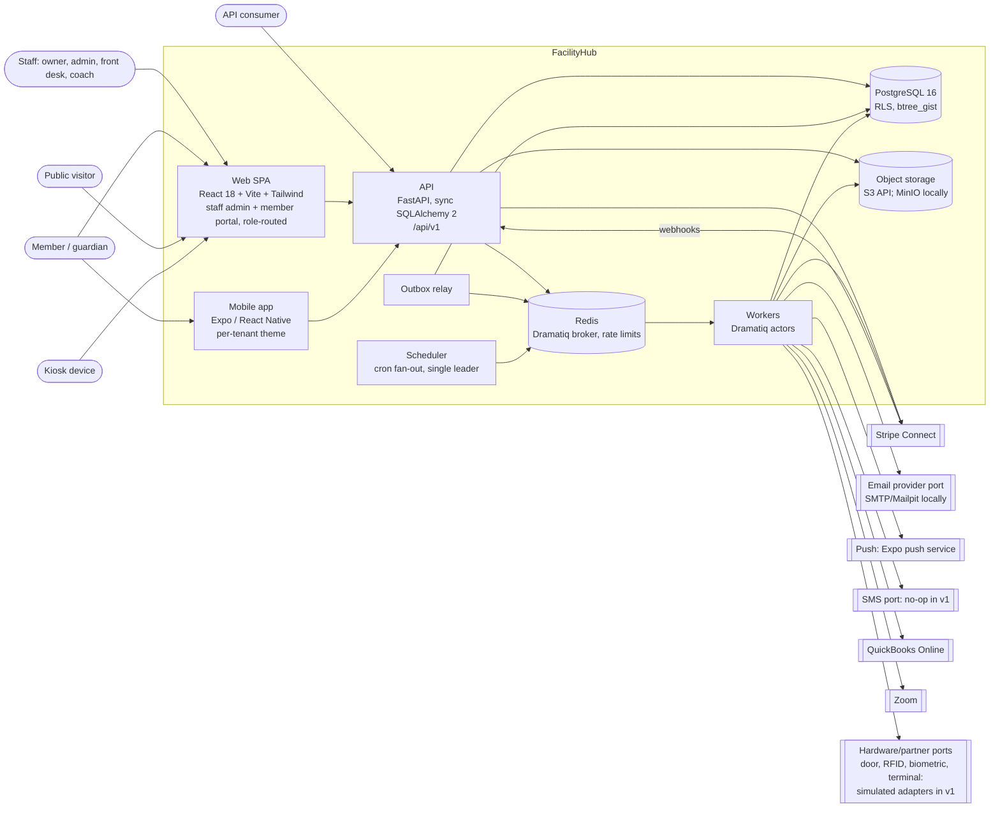
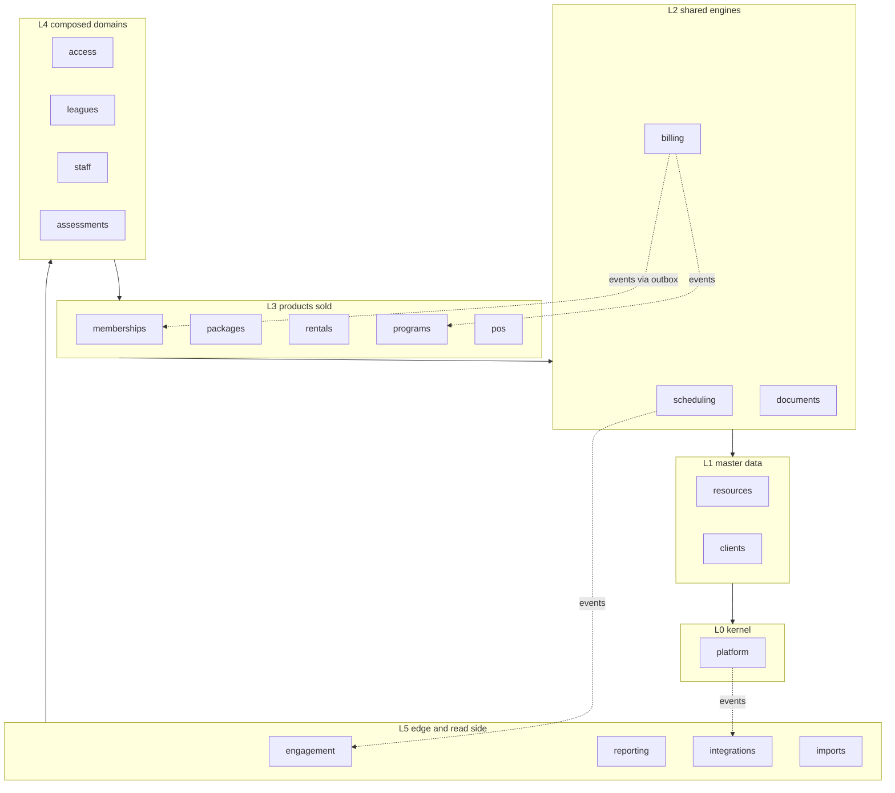

# FacilityHub Architecture Overview

Status: Phase 1 draft for GATE 1. Date: 2026-11-10. This is the spine: every ADR, the data model, the RBAC
matrix and the OpenAPI skeleton must conform to it. Where another document disagrees, this one wins until it
is amended here first. Feature IDs (`SCH-12`) refer to `docs/discovery/feature-inventory.md`; `A1`/`B5`/`C2`
refer to `docs/discovery/gaps-and-complaints.md`.

Clean-room reminder: we reproduce behaviour, never the reference product's code, text, layouts or brand. Entity
and screen names here are ours.

## 1. System context and containers



| Container | Process | Notes |
|---|---|---|
| `api` | uvicorn workers running the FastAPI app | Stateless. One DB transaction per request. Only synchronous third-party call allowed in-request is the payment provider (confirm/charge); everything else goes through the outbox. |
| `worker` | `dramatiq app.worker` | All actors. Queues: `default`, `billing`, `notifications`, `bulk` (campaign fan-out, ADR 0011), `reports`, `integrations`. |
| `scheduler` | one process, Postgres advisory lock for leadership | Enqueues fan-out actors on a 1-minute tick; never does tenant work itself. |
| `relay` | one process | Polls `outbox_event`, enqueues subscriber actors (section 3.11). |
| `web` | static build behind the API's reverse proxy | One SPA, three shells chosen by principal type: staff admin, member portal, kiosk. Public pages (schedules, registration, league site) are routes in the same SPA. |
| `mobile` | Expo app | Talks only to `/api/v1/portal/*` and `/api/v1/public/*`. |
| `postgres`, `redis`, `minio`, `mailpit` | Compose services | AWS mapping later: RDS, ElastiCache, S3, SES. No code depends on Compose-only features. |

Trade-off: sync SQLAlchemy sessions with a threadpool instead of async. Chosen for simpler transaction scoping
(`SET LOCAL` per transaction is trivially correct) and identical code in API and workers; rejected asyncio DB
access because the workload is transaction-bound CRUD, not fan-out I/O.

## 2. Bounded contexts

Nineteen Python packages under `backend/app/modules/` (Phase 8 added `imports`). Rules:

1. A context owns its tables. No other context reads or writes them through the ORM. The single exception is
   `reporting`, which reads other contexts' **published SQL views** (`rpt_*`, declared by the owning context).
2. Synchronous cross-context calls go through the callee's `service.py` public functions only, and only in the
   direction allowed by the "May call" column. The graph is acyclic and enforced in CI by `import-linter`
   contracts (layers below).
3. Anything that flows "upward" (billing telling memberships an invoice was paid) is a domain event through the
   transactional outbox, never a call.
4. Cross-context foreign keys are allowed (same database) but only to the referenced context's aggregate root
   id, and the referencing side never joins through it in ORM code; it asks the owning service.
5. A charge's origin is an opaque reference (`source_context`, `source_type`, `source_id`); billing never
   imports the selling context.

Layers (a context may call any context in a lower layer that its row lists):



Event names are `<context>.<aggregate>.<past_tense_verb>`. "Consumes" lists only business-relevant
subscriptions; `engagement` (notifications), `integrations` (outbound webhooks) and `reporting` (read-model
refresh) may subscribe to any event.

| Context | Responsibility | Aggregates it owns (root tables) | May call | Emits | Consumes |
|---|---|---|---|---|---|
| `platform` | Tenants, locations, identity and sessions, RBAC, audit, settings, entitlements, idempotency, outbox, files | `tenant`, `tenant_domain`, `location`, `facility_hours`, `identity`, `auth_session`, `staff_user`, `role`, `user_permission_override`, `user_location_access`, `api_key`, `kiosk_device`, `audit_event`, `outbox_event`, `idempotency_key`, `tenant_entitlement`, `stored_file`, `data_subject_request`, `subscription_plan`, `tenant_counter`, `role_permission`, `auth_token`, `support_access_grant`, `processed_event`, `job_run`, `failed_job`, `mfa_factor`, `mfa_recovery_code`, `identity_provider_config`, `external_login`, `logo`, `tenant_export`, `support_request` | none | `platform.tenant.created`, `platform.location.created`, `platform.staff_user.invited`, `platform.identity.locked`, `platform.data_subject_request.completed` | none |
| `resources` | Bookable things and their tree: venues, sub-venues, trainers-as-resources, lockers; resource groups; availability windows | `resource`, `resource_group`, `resource_link`, `availability_window`, `locker_room`, `locker`, `locker_term` | platform | `resources.resource.created`, `.archived`, `.tree_changed` | `staff.trainer.created` |
| `clients` | People: profiles, households, relationships, custom fields, tags, notes/tasks, merge, portal access links | `client`, `client_relationship`, `client_portal_access`, `custom_field`, `client_tag`, `client_note`, `client_task`, `client_alert` | platform | `clients.client.created`, `.updated`, `.disabled`, `.merged`, `clients.relationship.changed` | `platform.data_subject_request.completed` |
| `scheduling` | The calendar engine: bookings, holds, sessions (capacity occurrences), recurrence series, blackouts, checkout holds | `booking`, `resource_hold`, `booking_series`, `session`, `reservation_type`, `reservation_category`, `blackout`, `booking_series_rule`, `booking_series_run`, `booking_resource`, `slot_offer`, `scheduling_settings` | platform, resources, clients | `scheduling.booking.created`, `.rescheduled`, `.cancelled`, `scheduling.session.created`, `.cancelled`, `scheduling.hold.expired`, `scheduling.series.generated`, `scheduling.session.capacity_changed` | `resources.resource.tree_changed`, `clients.client.merged` |
| `billing` | Receivables and money: charges, invoices, payments, allocations, ledger, tax, revenue categories, coupons, account credit, autopay, dunning, payment methods, provider port | `charge`, `invoice`, `payment`, `payment_allocation`, `refund`, `ledger_entry`, `tax_rate`, `revenue_category`, `coupon`, `payment_method`, `payment_schedule`, `autopay_run`, `provider_account`, `dispute`, `catalog_item`, `ledger_transaction`, `tender_type`, `billing_settings`, `client_billing_profile`, `provider_customer`, `autopay_attempt`, `billing_notice`, `statement_batch`, `processor_payout` | platform, clients | `billing.charge.created`, `.reversed`, `billing.invoice.issued`, `.paid`, `.past_due`, `.voided`, `billing.payment.succeeded`, `.failed`, `.refunded`, `.disputed`, `billing.payment_method.expiring` | `clients.client.merged` |
| `documents` | Waiver/agreement templates (versioned), document instances, signatures, immutable acceptance snapshots, service bindings | `document_template`, `document_template_version`, `document_binding`, `client_document`, `document_acceptance`, `document_delivery`, `client_document_status`, `document_settings` | platform, clients | `documents.document.sent`, `.accepted`, `.declined`, `.expired` | `clients.client.merged` |
| `memberships` | Membership types, plans, contracts, billing schedule, freezes, suspensions, renewals, cancellations, sharing, visit limits | `membership_type`, `membership_plan`, `membership_contract`, `billing_schedule_period`, `membership_freeze`, `membership_share`, `membership_suspension`, `membership_visit`, `membership_settings` | platform, clients, billing, documents | `memberships.contract.activated`, `.renewed`, `.frozen`, `.unfrozen`, `.suspended`, `.cancelled`, `.expired` | `billing.invoice.paid`, `.past_due`, `billing.payment.refunded`, `documents.document.accepted`, `clients.client.merged` |
| `packages` | Package plans, sold packages, session-credit ledger, expiry, renewal, sharing | `package_plan`, `client_package`, `credit_ledger_entry`, `package_share`, `package_series`, `package_settings`, `package_billing_close` | platform, clients, billing, memberships | `packages.package.sold`, `.exhausted`, `.expired`, `.renewed`, `packages.credit.consumed`, `.restored` | `billing.invoice.paid`, `billing.payment.refunded`, `clients.client.merged`, `memberships.contract.activated`, `.renewed`, `.cancelled` (add-on packages, MEM-04) |
| `rentals` | Rental types, rate templates, rental pricing of bookings, online rental policy, prepaid rental plans, locker leases | `rental_type`, `rental_rate`, `rental_booking_charge`, `rental_plan`, `rental_plan_purchase`, `locker_lease`, `rental_booking`, `rental_plan_ledger_entry`, `rental_plan_share` | platform, resources, clients, scheduling, billing, memberships (read-only `active_membership`, RNT-02, RNT-05) | `rentals.rental.booked`, `.extended`, `.cancelled`, `rentals.rental_plan.sold`, `rentals.locker_lease.expiring` | `scheduling.booking.cancelled`, `scheduling.hold.expired`, `billing.invoice.paid`, `scheduling.booking.rescheduled` |
| `programs` | One enrolment engine: program groups and subgroups, classes/clinics/camps, enrolments, waitlists, online registration config, form builder and submissions | `program_group`, `enrollment`, `waitlist_entry`, `registration_config`, `form`, `form_version`, `form_submission`, `program_fee`, `attendance`, `registration_checkout`, `session_booking_policy`, `roster_invite` | platform, resources, clients, scheduling, billing, documents, packages | `programs.enrollment.created`, `.cancelled`, `.attended`, `programs.waitlist.promoted`, `programs.group.completed`, `programs.form.submitted` | `billing.invoice.paid`, `billing.payment.refunded`, `scheduling.session.cancelled`, `documents.document.accepted`, `clients.client.merged`, `scheduling.session.capacity_changed` |
| `pos` | Products, categories, inventory movements, registers, drawer sessions, sales, returns, equipment as loanable assets | `product`, `product_category`, `stock_movement`, `register`, `drawer_session`, `pos_sale`, `equipment_item`, `equipment_loan`, `product_stock`, `pos_return`, `pos_settings` | platform, clients, billing, packages | `pos.sale.completed`, `.returned`, `pos.stock.low`, `pos.equipment.loaned`, `.returned`, `pos.drawer.closed` | `billing.payment.refunded` |
| `access` | Check-in decisions, check-in log, kiosk, access rules and schedules, credentials, door/credential ports | `check_in`, `access_rule`, `access_schedule`, `credential`, `check_in_station`, `client_access`, `membership_type_access`, `access_settings`, `kiosk_settings`, `id_card_template` | platform, clients, scheduling, billing, documents, memberships, packages, programs | `access.check_in.granted`, `.denied`, `access.credential.assigned` | `memberships.contract.*`, `billing.invoice.past_due`, `clients.client.disabled`, `clients.client.created`, `.updated` (member-number credential projection, MEM-19) |
| `leagues` | Competitions (league, tournament), divisions, teams, rosters, schedule generation, games, results, standings, brackets, officials, public league site | `competition`, `division`, `team`, `roster_entry`, `game`, `standing`, `bracket`, `official`, `league_site_settings`, `sport`, `season`, `age_group`, `schedule_run`, `public_view`, `league_alert_setting` | platform, resources, clients, scheduling, billing, programs | `leagues.schedule.generated`, `leagues.game.rescheduled`, `.result_recorded`, `leagues.standings.updated` | `scheduling.booking.rescheduled`, `programs.enrollment.created`, `clients.client.merged` |
| `staff` | Trainer and salesperson records, pay rates, commissions, shifts, time clock, payroll runs | `staff_payee` (one table for trainers and salespeople, STF-01, STF-05), `pay_rate`, `commission_rule`, `bonus_rule`, `job_classification`, `staff_hourly_rate`, `shift`, `time_entry`, `payroll_run`, `pay_statement` | platform, resources, clients, scheduling, billing, memberships, packages, programs (read functions only, for payroll facts) | `staff.trainer.created`, `staff.time_entry.closed`, `staff.payroll_run.finalized` | `programs.enrollment.attended`, `billing.invoice.paid`, `scheduling.booking.created` |
| `assessments` | Assessment templates, fields, recorded results over time | `assessment_template`, `assessment_result`, `assessment_field`, `assessment_settings` | platform, clients | `assessments.result.recorded` | `clients.client.merged` |
| `engagement` | Notification routing and delivery (email, push, SMS port), campaigns, segments, suppression, reminders, portal/app content, video library | `message_template`, `campaign`, `segment`, `message`, `delivery_event`, `suppression`, `communication_preference`, `portal_content`, `video`, `inbox_item`, `email_verification`, `consent_event`, `device_registration`, `notification_route`, `reminder_rule`, `automation_rule`, `scheduled_notification`, `portal_settings`, `app_config`, `home_screen`, `trial_request`, `favorite`, `news_story` | platform, clients, read-only `audience(...)` functions of memberships, programs, access, leagues (segment resolution, MKT-04) | `engagement.message.delivered`, `.bounced`, `engagement.campaign.sent`, `engagement.contact_point.verified`, `engagement.consent.changed`, `engagement.tenant_sending.paused` | any (rule-driven); notably `programs.waitlist.promoted`, `billing.payment.failed`, `scheduling.booking.*` |
| `reporting` | Report catalogue, saved report definitions, export jobs, dashboards. Read-only over `rpt_*` views | `saved_report`, `report_run`, `export_job` (the report catalogue is a code registry, ADR 0010; there is no `report_definition` table) | platform; SQL views of all contexts | `reporting.export.completed` | none required |
| `integrations` | Public API surface and API-key scopes, outbound webhooks, QuickBooks sync, Zoom, calendar feeds, partner adapter registry | `webhook_endpoint`, `webhook_delivery`, `inbound_webhook_event`, `external_connection`, `sync_mapping`, `calendar_feed`, `accounting_export`, `adapter_command_log`, `video_meeting` | any service interface (facade only, no domain logic) | `integrations.connection.failed` | any (webhook fan-out); accounting reads `rpt_ledger_entry` per day, not billing events (ADR 0012) |
| `imports` | Generic CSV import (Phase 8 I1): templates, mapping, dry run, chunked commit, row report. Keys stay `platform.import_job.*` | `import_job`, `import_job_row` | platform, clients, memberships, billing, pos, engagement; no context imports it (two import-linter contracts) | none | none |

The aggregate column lists root and configuration tables; the complete per-context table inventory (child
tables included) is the table list of the owning `data-model-*.md` document, and the RLS meta-test is driven by
the ORM metadata, not by this table. "May call" entries marked read-only are pure query functions: they may
not write and may not publish events.

Known boundary exceptions (Phase 8 K3; `ignore_imports` in `backend/pyproject.toml`, reasons in
`docs/status/phase8-k3-checks.md`). Each awaits an owner decision, change the "May call" column or the call;
none is resolved here:

1. `integrations.service` imports `adapters.accounting` (not through a port).
2. `integrations.service` imports `adapters.video` (same).
3. `platform.privacy` imports `clients.service` (an upward call from L0).
4. `packages.service` imports `documents` (a downward call missing from the column).
5. `programs.selfservice` imports `memberships` (a same-layer call).
6. `engagement.handlers` imports `billing`.
7. `engagement.handlers` imports `scheduling`.
8. `engagement.service` imports `scheduling` (`get_booking`, `get_session`).

import-linter cannot see deep imports of another context's internals; K3 lists the ones that exist.

Placement decisions that are not obvious from the names:

- **Session capacity lives in `scheduling`**, enrolment lives in `programs`. `scheduling.reserve_seat(session_id)`
  takes `SELECT ... FOR UPDATE` on the `session` row and increments `booked_count` guarded by
  `CHECK (booked_count <= capacity)`. One lock site for classes, trainer appointments and group capacity
  (CLS-04, REG-09, REG-17). Rejected: a range constraint for capacity (cannot count).
- **One enrolment engine, two pricing strategies** (entitlement-consuming vs fee-based) instead of the reference
  product's separate class and group engines (CLS-01, CLS-10, REG-07). Cost: our vocabulary differs from theirs.
- **Trainers are `resource` rows** (`kind = 'trainer'`) owned by `resources`; `staff.staff_payee` holds pay data
  and points at the resource (STF-01, SCH-18). Video-meeting hosts are `resource` rows of `kind =
  'virtual_room'`, so the hold engine prevents double-booking a host (INT-09, ADR 0012). Trainer availability is `availability_window` rows with slots derived
  at query time; only bookings are constrained rows (SCH-07). Rejected: materialising every 15-minute slot.
- **Equipment is a loanable asset in `pos`** (checkout and return in one place); **lockers are `locker` rows
  (owned by `resources`, not `resource` rows: they have no calendar) with dated `locker_lease` rows in
  `rentals`**. Neither uses the session engine (RNT-14..18, POS-17, POS-18).
- **Identity is in `platform`, the person is in `clients`.** A client-kind identity may front several client
  records through `client_portal_access` because email is not an identity key in this domain (CLI-15, FAM-03).
- **Client merge** (CLI-13) is the one operation touching every context: each context that references clients
  subscribes to `clients.client.merged` and re-points its rows idempotently. `clients` keeps a tombstone
  (`merged_into_id`). No context may hold a client reference without registering a merge handler; a meta-test
  enforces it.
- **The member number is `client.member_number`** (owned by `clients`, MEM-19). `access` mirrors it as the
  primary `credential` row so one index resolves any scan; scan media (barcode, RFID, app card) are further
  credential rows. Rejected: the credential as system of record (access ships at module 10, the number is
  needed from module 4).
- **Sale rows carry `sold_by_staff_user_id`**; `staff` resolves the payee through `staff_payee.staff_user_id`
  (STF-05). No selling context holds a foreign key up into `staff`.

## 3. Conventions (mechanical rules)

### 3.1 Tables and columns

- `snake_case`, **singular** table names, one Postgres schema (`public`). A name must be unique and
  self-describing without its module: `membership_plan`, `package_plan`, `rental_plan`, never `plan`. Avoid
  reserved words (`staff_user` not `user`, `pos_sale` not `order`). Rejected: one schema per context (complicates
  Alembic and the RLS template for no isolation gain inside one database role).
- Mandatory columns on every tenant-owned table, in this order: `id uuid`, `tenant_id uuid`, domain columns,
  `created_at timestamptz NOT NULL DEFAULT now()`, `updated_at timestamptz NOT NULL DEFAULT now()` (set by the
  ORM on flush; no trigger). Location-partitioned tables add `location_id uuid NOT NULL`.
- Suffixes: `_id` foreign key; `_at` timestamptz; `_on` date (location-local calendar date); `_time` time
  without zone (location-local wall time); `_minor` bigint money; `_count` integer; `_pct` numeric; `_min` integer whole minutes
  (buffers, cut-offs, lengths; never `interval`); a calendar duration is the pair `<x>_count integer` plus
  `<x>_unit text` (`day`, `week`, `month`, `year`); an upper bound is `<x>_until_at` / `<x>_until_on`. Booleans
  read as a predicate: `is_` or `has_`, or a third-person verb where that reads better (`allows_`,
  `requires_`, `shows_`, `sends_`, `includes_`, `uses_`, `tracks_`, `was_`); never a bare noun or an imperative
  (`allow_x`, `show_x`). Ranges are named for what they cover (`during`, `valid_during`) and are half-open
  `[)`.
- `jsonb` only for genuinely schemaless tenant data (custom field values, form answers, settings blobs, audit
  diffs, event payloads). Anything filtered, joined or summed is a column.
- Aggregates edited concurrently by staff (`booking`, `invoice`, `membership_contract`) carry `version integer`;
  updates pass the version and a mismatch is a `409 version-conflict`.
- Global (non-tenant) tables are an explicit allow-list: `tenant`, `tenant_domain`, `subscription_plan`,
  `provider_account_lookup`, `inbound_webhook_event`. Everything else has `tenant_id` and RLS. A meta-test fails
  the build if a table is in neither set.

### 3.2 Enums: `text` + `CHECK`, never native `ENUM`

Fixed vocabularies are `text NOT NULL` with a named check, `CONSTRAINT ck_booking_status CHECK (status IN
('tentative','confirmed','cancelled'))`, mirrored by a Python `StrEnum` and mapped with
`sa.Enum(BookingStatus, native_enum=False, create_constraint=True)`. Why: adding or removing a value is an
ordinary transactional migration (drop and re-add the check); native enums cannot drop values, a newly added
value cannot be used in the same transaction, and Alembic autogenerate does not see enum changes. Cost: a few
bytes per row and no type-level catalogue, both irrelevant here. Tenant-configurable vocabularies (client
categories, reservation types, tags, referral sources) are tables, not enums.

### 3.3 Keys, foreign keys, indexes

- Primary key is `id uuid` alone. Every tenant table also has `UNIQUE (tenant_id, id)`.
- **Every FK between tenant tables is composite**: `FOREIGN KEY (tenant_id, client_id) REFERENCES client
  (tenant_id, id)`. FK checks run as the table owner and bypass RLS, so a single-column FK would let a bug attach
  tenant B's row to tenant A; the composite makes that a constraint violation. Cost: one extra unique index per
  table. Rejected: composite primary keys (awkward ORM identity, no extra safety).
- `ON DELETE RESTRICT` by default. `CASCADE` only from an aggregate root to its own child rows (`booking` to
  `resource_hold`). Never cascade across contexts.
- Constraint names come from one SQLAlchemy `MetaData(naming_convention=...)`: `pk_<table>`,
  `fk_<table>_<column>_<reftable>`, `uq_<table>_<columns>`, `ix_<table>_<columns>`, `ck_<table>_<name>`,
  `ex_<table>_<name>`. Where the column list would exceed PostgreSQL's 63-byte identifier limit or says less
  than a purpose word, the data-model documents give an explicit short name (`uq_booking_number`,
  `ix_booking_span`) and that explicit name is the contract; the convention is the default, not a rename
  mandate. Error mapping (3.13) keys off these names, so they are API-relevant.
- Indexes: every FK is indexed and the index leads with `tenant_id` (the composite FK index serves both). List
  endpoints get an index matching their default sort: `(tenant_id, <filter>, id)`. Work queues use partial
  indexes (`WHERE published_at IS NULL`, `WHERE status = 'due'`). Uniqueness of business keys is always scoped:
  `UNIQUE (tenant_id, membership_number)`. Post-launch index creation uses `CREATE INDEX CONCURRENTLY`.
- Extensions installed by the baseline migration: `btree_gist` (exclusion constraint), `citext` (emails),
  `pg_trgm` (client search, CLI-03).
- Migrations: one linear Alembic history in `backend/migrations/versions/`, file names prefixed with the
  context (`0007_scheduling_booking.py`). Rejected: per-module branch labels (cross-context FKs make merge
  ordering painful).

### 3.4 Tenancy and RLS

Three database roles:

| Role | Attributes | Used by |
|---|---|---|
| `fh_owner` | owns all tables; login only for migrations | Alembic |
| `fh_app` | `NOBYPASSRLS`, not owner; DML grants only | API, workers (all tenant work) |
| `fh_due_reader` | `NOLOGIN`, `BYPASSRLS`; owns the `due_*` work views and has `SELECT` on the tables they read (ADR 0008 section 8) | nobody connects as it; it exists so the views can see all tenants while `fh_platform` holds `SELECT` on the views only |
| `fh_platform` | `BYPASSRLS`; grants limited to `tenant`, `tenant_domain`, `outbox_event`, `inbound_webhook_event`, `provider_account_lookup`, and `SELECT` on the due-work views | relay, scheduler fan-out, inbound webhook resolution. Never used inside a request handler. |

Policy template, emitted by the helper `enable_rls(table)` that every table-creating migration must call:

```sql
CREATE SCHEMA IF NOT EXISTS app;
CREATE FUNCTION app.current_tenant_id() RETURNS uuid LANGUAGE sql STABLE AS
$$ SELECT NULLIF(current_setting('app.tenant_id', true), '')::uuid $$;

ALTER TABLE booking ENABLE ROW LEVEL SECURITY;
ALTER TABLE booking FORCE ROW LEVEL SECURITY;
CREATE POLICY tenant_isolation ON booking
  USING      (tenant_id = (SELECT app.current_tenant_id()))
  WITH CHECK (tenant_id = (SELECT app.current_tenant_id()));
GRANT SELECT, INSERT, UPDATE, DELETE ON booking TO fh_app;
```

- Unset or empty setting yields `NULL`, so the predicate is false: no context means zero rows and rejected
  writes (fail closed). `NULLIF` matters because a custom setting reverts to `''`, not `NULL`, after the first
  transaction on a pooled connection.
- The scalar subquery makes the planner evaluate the function once per statement instead of per row.
- `FORCE` keeps the policy active even if a table is accidentally owned by the connecting role.
- Append-only tables (`audit_event`, `ledger_transaction`, `ledger_entry`, `credit_ledger_entry`,
  `rental_plan_ledger_entry`, `document_acceptance`, `consent_event`, `billing_notice`, `stock_movement`,
  `adapter_command_log`) get `GRANT SELECT, INSERT` only. Tables that are never updated may omit `updated_at`
  (allow-list for the column meta-test: `audit_event`, `outbox_event`, `processed_event`, `idempotency_key`,
  `rental_plan_ledger_entry`, `consent_event`, `adapter_command_log`).
- Client merge must re-point `client_id` on some append-only tables. The single sanctioned path is the
  `fh_owner`-defined `SECURITY DEFINER` function `app.repoint_client(table, loser, survivor)`, callable by
  `fh_app`, restricted to an allow-list of tables and to the current tenant (CLI-13). `ledger_entry` is not on
  that list: its rows stay on the tombstone and views resolve the survivor through `client.merged_into_id`.
- **Location is not an RLS dimension.** Clients are shared across a tenant's locations (CLI-19) and payment at a
  non-home location is legitimate, so location filtering is a permission-layer concern (3.16).

Session pattern. One transaction per request or per job; the tenant is set as the first statement:

```python
@contextmanager
def tenant_session(tenant_id: UUID, actor: Actor | None = None) -> Iterator[Session]:
    with SessionLocal.begin() as s:                       # fh_app connection, BEGIN ... COMMIT
        s.execute(text("SELECT set_config('app.tenant_id', :t, true)"), {"t": str(tenant_id)})
        s.info["tenant_id"], s.info["actor"] = tenant_id, actor
        yield s
```

- `set_config(..., true)` is `SET LOCAL` with a bind parameter (plain `SET LOCAL` cannot be parameterised). It
  dies with the transaction, so pooled connections and PgBouncer transaction mode are safe.
- The FastAPI dependency `get_session` resolves the principal first, then opens `tenant_session`. Tenant
  resolution order: (1) authenticated token, whose non-secret prefix carries the tenant id
  (`fhs_<tenant>_<secret>` sessions, `fhk_<tenant>_<secret>` API keys, `fhd_...` kiosk devices) and whose hash
  is then verified under that tenant's RLS; (2) for anonymous routes, the request host via `tenant_domain`
  (subdomain or vanity domain, SSP-01). A host and token that disagree is `401`.
- Services receive the session; they never open their own, never commit, and never call `set_config`.
- The ORM base sets `tenant_id` on insert from `session.info`; passing a different one is a programming error
  that RLS `WITH CHECK` will also reject.

Background jobs:

- Every tenant-scoped actor is declared with `@tenant_actor`, whose first positional argument is `tenant_id`.
  The decorator wraps the body in `tenant_session(tenant_id, actor=SystemActor(job_name))`. A plain
  `@dramatiq.actor` touching tenant tables is forbidden and caught by a lint rule.
- Periodic work is two-stage: the scheduler enqueues a **fan-out actor** that uses `fh_platform` to read a
  due-work view (for example locations whose local autopay run time has passed, RES-01, PAY-09) and enqueues one
  `@tenant_actor` message per tenant and location. Tenant work never runs under `fh_platform`.
- Actors are idempotent by construction: they carry the business key (`billing_schedule_period_id`,
  `outbox_event_id`) and re-check state under a row lock before acting. Dramatiq retries are at-least-once.

### 3.5 Identifiers

UUIDv7 everywhere, generated in the application by `app.core.ids.new_id()` (48-bit Unix milliseconds, version
and variant bits, 74 random bits; about ten lines, replaced by `uuid.uuid7()` when we move to Python 3.14). The
baseline migration also creates SQL `app.uuid_v7()` as the column default so raw SQL seeds work. Rejected:
UUIDv4 (index locality), bigserial (leaks volume, awkward for client-generated ids and offline mobile). Because
v7 is time-ordered, `id` is the pagination tiebreaker and default sort. Human-facing numbers (invoice number,
membership number MEM-19) are separate per-tenant sequences stored in a `tenant_counter` row taken with
`FOR UPDATE`, never derived from the id.

### 3.6 Money and rounding

- Amounts are `bigint` minor units in columns ending `_minor`. Currency is `tenant.currency` (ISO 4217, one per
  tenant in v1) and is copied onto `payment`, `refund` and `ledger_entry` rows because those are immutable
  records and the provider needs it. No floats anywhere; Python arithmetic uses `Decimal` and the `Money` value
  object in `app.core.money`.
- Rates and percentages are `numeric`, never float: tax `rate numeric(7,6)` as a fraction (0.088750),
  discounts `numeric(5,2)` percent.
- **Rounding is half-up, once, at the line.** Order per charge line: quantity times unit price, minus discount
  (rounded), then tax on the discounted amount (rounded per tax per line). Invoice totals are sums of line
  values and are never re-rounded. Tax rate is selected by the line's revenue date (BIL-12).
- **Splitting never loses a minor unit.** Instalments (BIL-06), team-fee splits (REG-26) and proration across
  periods use largest-remainder allocation: floor each share, hand leftover units to the earliest shares, assert
  the sum equals the original.
- Proration (MEM-03) is day-based on location-local dates: `amount * days_used / days_in_period`, half-up. The
  reference product's arithmetic is undocumented, so this is our rule, not parity.
- Sign convention: `charge.amount_minor` is positive for a receivable; a reversal is a new negative charge
  linked by `reverses_charge_id` (BIL-07). `ledger_entry` rows come in balanced sets per `ledger_transaction_id`
  (sum of debits equals sum of credits, enforced by a deferred constraint trigger) and are never updated.

### 3.7 Time

- Store instants as `timestamptz` in UTC. API timestamps are RFC 3339 with `Z`. Dates are `YYYY-MM-DD`; local
  wall times are `HH:MM` and always travel with a location.
- Every `location` has an IANA zone (`time_zone text`, validated against `zoneinfo`). Anything the user thinks of
  as "a day" (facility hours, blackout dates, due dates, report periods, visit-limit windows, job run times) is
  evaluated in the location's zone. Records with no location use `tenant.default_time_zone`.
- Recurrence is stored as local wall time plus the rule and expanded to UTC per occurrence, so a 18:00 class
  stays at 18:00 across DST. A nonexistent local time shifts forward to the next valid instant; an ambiguous one
  takes the first occurrence. Both are covered by tests.
- Billing due dates are `date` columns (`due_on`) in location-local terms; the autopay and renewal jobs fire at
  the location's configured run time (RES-01), not at UTC midnight.
- The server never uses the process time zone; containers run with `TZ=UTC`, and the clock is injected
  (`app.core.clock.now()`) so tests can freeze it.

### 3.8 Scheduling holds (rule every booking-creating context follows)

```sql
CREATE TABLE resource_hold (
  id uuid PRIMARY KEY, tenant_id uuid NOT NULL, resource_id uuid NOT NULL, booking_id uuid NOT NULL,
  during tstzrange NOT NULL, origin text NOT NULL,        -- 'booked' | 'descendant' | 'linked'
  source_resource_id uuid NOT NULL,                       -- the booked or linked resource this row derives from
  expires_at timestamptz,                                 -- set only for checkout holds
  CONSTRAINT ex_resource_hold_overlap EXCLUDE USING gist
    (tenant_id WITH =, resource_id WITH =, during WITH &&)
);
```

- Only `scheduling.service` writes holds. Rentals, programs, leagues and staff create bookings through it.
- A booking writes a hold for the booked resource, for **every descendant** of it, and for each linked resource
  (trainer, linked venues: RES-05, SCH-13) together with that resource's descendants. This blocks both ways:
  booking a parent collides with any child's own hold, and booking a child collides with the hold a parent
  booking wrote on that child (SCH-15). See the open question below about ancestors.
- `during` includes the buffer: `[starts_at - buffer_before, ends_at + buffer_after)`. The booking keeps the
  customer-facing `starts_at`/`ends_at`. Buffers are copied from the reservation or rental type at creation and
  never recomputed (SCH-14, RNT-07).
- Online checkout writes the same holds with `booking.status = 'tentative'` and `expires_at`; payment
  confirmation flips the status; the expiry job sets the booking to `cancelled` with `cancel_reason =
  'hold_expired'`, deletes its holds and emits `scheduling.hold.expired`. The booking row is kept because
  owning contexts reference it with `RESTRICT` and cross-context cascades are forbidden (3.3).
- The constraint is not deferrable. A reschedule or series shift deletes the affected holds and re-inserts
  them in one transaction, one savepoint per occurrence, so a clash names its occurrence (ADR 0004).
- Adding a child resource back-fills holds from the parent's future bookings in the same transaction
  (`resources.resource.tree_changed`).
- Series fan-out above 50 occurrences runs as a job with per-occurrence results: each occurrence is its own
  savepoint, SQLSTATE `23P01` becomes a reported conflict, and the pre-commit preview (SCH-09) runs the same code
  in a transaction that is rolled back.

**Decided (Phase 1 review): no ancestor holds.** The lead's decision record says holds are also written on the
booked resource's *parent*. With a plain `(resource_id, during)` exclusion that makes two sibling sub-venues
collide with each other on the shared parent row, which is wrong (two half-courts must be bookable at once).
Self plus descendants already blocks in both directions, which is the behaviour the decision asked for
("sub-venues block both ways"). Cost of reversing later: a lane column in the constraint and a back-fill of
every future hold. Listed for the owner in `README.md`.

### 3.9 Soft delete

`deleted_at timestamptz` exists only where the reference product shows a restore path. v1 allow-list:
`program_group` (delete and restore, REG-05) and `client_document` (deleted documents are recoverable for 30
days, DOC-06). On those tables business-key uniqueness uses partial indexes
`WHERE deleted_at IS NULL` and the repository filters by default. Everything else uses state:

- People and catalogue rows are never deleted once referenced: `client.status` (`active`, `disabled`, CLI-14;
  plus `merged_into_id` for CLI-13), `is_active` on catalogue rows (revenue categories BIL-13, plans, products,
  resources).
- Transactions end in a terminal status (`cancelled`, `voided`, `reversed`), never removal.
- Erasure under a data-subject request (IMP-04) is a real delete of profile data plus anonymisation of rows that
  must survive for accounting. It is a dedicated workflow, not soft delete.

Rejected: a blanket `deleted_at` on every table (every query and unique index pays for it, and "is it gone?"
becomes ambiguous).

### 3.10 Audit log

- `audit_event` is append-only (grants, 3.4): `id`, `tenant_id`, `occurred_at`, `actor_type`
  (`staff`, `client`, `api_key`, `kiosk`, `system`), `actor_id`, `on_behalf_of_client_id`, `location_id`,
  `action` (the permission-style verb, for example `scheduling.booking.reschedule`), `entity_type`, `entity_id`,
  `changes jsonb` (`{"field": [old, new]}`), `request_id`, `ip`.
- Written by the service layer with `audit.record(session, ...)` in the same transaction as the change. Rule:
  every public service function that mutates state records exactly one event per aggregate touched; a test
  helper asserts it. Also audited: sign-in, failed sign-in, permission and role changes, act-on-behalf sessions
  (FAM-03), exports, data-subject requests.
- Field values of secrets, tokens, signatures and payment details are never written; listed PII fields are
  stored as changed-flag only.
- The staff activity report (PLT-17) and billing history (BIL-09) are filtered reads of this table. Money
  correctness does not depend on it: the ledger is its own immutable record.
- Rejected: database triggers (no actor or intent, noisy row-level diffs, hard to redact).

### 3.11 Domain events and transactional outbox

Events are frozen Pydantic models in each context's `events.py` with a `type` literal and `schema_version`.
Payloads are thin (ids plus old and new values of the transition); handlers re-read current state. One
sanctioned exception: `scheduling.booking.*`, `scheduling.session.*` and `programs.enrollment.*` also carry
`starts_at`, `location_id`, `client_id` and the trainer's `staff_user_id`, because `engagement` materialises
reminders from them and may not call `scheduling` (data-model-programs 3.13). No PII beyond ids. Removing or
retyping a field bumps `schema_version` and consumers accept the previous version for one release; the same
payloads are the outbound webhook bodies, so this is a public contract.

```sql
CREATE TABLE outbox_event (
  id uuid PRIMARY KEY, tenant_id uuid NOT NULL, event_type text NOT NULL,
  aggregate_type text NOT NULL, aggregate_id uuid NOT NULL, payload jsonb NOT NULL,
  occurred_at timestamptz NOT NULL DEFAULT now(), published_at timestamptz, attempts integer NOT NULL DEFAULT 0
);
CREATE INDEX ix_outbox_event_unpublished ON outbox_event (occurred_at) WHERE published_at IS NULL;
```

- `events.publish(session, event)` inserts the row in the caller's transaction. No event is ever sent from
  request code directly to Redis.
- The relay loops: `SELECT ... WHERE published_at IS NULL ORDER BY occurred_at LIMIT 200 FOR UPDATE SKIP
  LOCKED`, enqueues one Dramatiq message per registered subscriber (`subscribers.py` maps event type to
  `@tenant_actor`s), sets `published_at`, commits. Poll interval one second. Published rows are purged after 30
  days.
- Delivery is at-least-once and unordered across aggregates. Every subscriber is wrapped by
  `@handles(event_type)`, which inserts `(consumer_name, event_id)` into `processed_event` in the handler's
  transaction and skips on conflict.
- Rejected: Debezium/CDC (operational weight for a monolith), publishing after commit from the request (loses
  events on crash), LISTEN/NOTIFY as the transport (not durable; may be added later purely as a wake-up).

### 3.12 Idempotency

```sql
CREATE TABLE idempotency_key (
  id uuid PRIMARY KEY, tenant_id uuid NOT NULL, scope text NOT NULL, key text NOT NULL,
  request_hash text NOT NULL, status text NOT NULL,       -- 'in_progress' | 'completed'
  response_status integer, response_body jsonb, created_at timestamptz NOT NULL DEFAULT now(),
  expires_at timestamptz NOT NULL,
  CONSTRAINT uq_idempotency_key_tenant_scope_key UNIQUE (tenant_id, scope, key)
);
```

- `Idempotency-Key` header is **required** on every `POST` that moves money, creates a booking or enrolment from
  portal, mobile, kiosk or public API, completes a POS sale, or issues a refund; optional elsewhere. `scope` is
  principal id plus route template. Keys live 24 hours.
- Flow: insert `in_progress` in its own short transaction; run the handler; store the response and mark
  `completed` in the handler's transaction. Replay with the same hash returns the stored response. Same key with
  a different hash is `422 idempotency-key-reused`. A concurrent duplicate is `409 request-in-progress`.
- Provider calls carry a deterministic key derived from our row, `"{tenant_id}:{operation}:{row_id}"`, so a
  retried job cannot double-charge even if our own record of the attempt was lost.
- Inbound webhooks: insert into `inbound_webhook_event` with `UNIQUE (provider, provider_event_id)` before any
  processing; a duplicate returns `200` and does nothing. The tenant is resolved from the provider account id
  via `provider_account_lookup`, then a `@tenant_actor` does the work. Handlers apply state transitions that are
  safe out of order (a late `succeeded` after `refunded` is ignored by the state machine).
- Jobs are idempotent by business key (3.4); they do not use this table.

### 3.13 Error model

All non-2xx responses are `application/problem+json` (RFC 9457):

```json
{
  "type": "/problems/booking-conflict",
  "title": "Resource is already booked",
  "status": 409,
  "detail": "Court 2 is held 18:00-19:00 by another booking.",
  "instance": "/api/v1/bookings",
  "code": "booking-conflict",
  "trace_id": "0193...",
  "conflicts": [{"resource_id": "...", "during": ["2026-11-12T00:00:00Z", "2026-11-12T01:00:00Z"]}]
}
```

- `code` equals the last segment of `type` and is the stable machine contract; `title` and `detail` are
  human text and may change. Validation failures add `errors: [{"pointer": "/starts_at", "code": "...",
  "detail": "..."}]` using JSON Pointers.
- Status mapping: `400` malformed request; `401` unauthenticated; `402 payment-declined` (with the provider
  decline category); `403 permission-denied`; `404 not-found` (also for any id outside the caller's tenant or
  location scope: never reveal existence); `409` state conflicts (`booking-conflict`, `capacity-full`,
  `version-conflict`, `invalid-state-transition`, `request-in-progress`); `422 validation-failed`; `429
  rate-limited` with `Retry-After`; `5xx` carries only `trace_id`.
- Services raise subclasses of `DomainError` from `app.core.errors`; routers never build error bodies. One
  exception handler renders them. Database errors are mapped by constraint name: `ex_resource_hold_overlap`
  (SQLSTATE `23P01`) to `booking-conflict`, `uq_*` (`23505`) to `already-exists` with the field, `ck_*` to
  `validation-failed`. Other exclusion constraints map to their own codes: `ex_membership_contract_term_overlap`
  to `membership-overlap`, `ex_membership_freeze_overlap` and `ex_membership_suspension_overlap` to
  `freeze-overlap`; `ck_client_package_balance` to `package-exhausted`; `ck_session_booked_within_capacity` to
  `capacity-full`. ADR 0004 adds `resource-blacked-out` and `outside-availability`; ADR 0003 adds
  `period-locked`. An unmapped constraint is a `500` and a bug.
- The problem catalogue is generated into the OpenAPI document; each operation lists the codes it can return.

### 3.14 Lists: pagination, filtering, sorting

- Keyset pagination only: `?limit=50&cursor=<opaque>`; default 50, maximum 200. Response:
  `{"data": [...], "page": {"next_cursor": "..." | null, "has_more": true}}`. Single resources are returned
  bare. A total is computed only on `?include=total`. Rejected: offset paging (unstable under writes, slow on
  the large lists in BIL-02 and CLI-03).
- Sorting: `?sort=-starts_at,last_name`; fields are a per-endpoint allow-list; `id` is always appended as the
  tiebreaker. The cursor encodes the sort key values.
- Filtering: flat query parameters named after fields (`?status=active&location_id=...`); operators as bracket
  suffixes from a fixed set `[gte] [gt] [lte] [lt] [in] [ne]` (`?starts_at[gte]=...&status[in]=a,b`); `q=` is
  the free-text search for the resource. Unknown parameters are `400`. Rejected: a filter expression language
  (large attack and support surface).
- Every list endpoint that is location-partitioned accepts `location_id` and is implicitly restricted to the
  caller's permitted locations.
- Exports are jobs (`export_job`), not large pages.

### 3.15 API surface and versioning

- Prefix `/api/v1`. Additive change (new field, new optional parameter, new endpoint, new enum value on fields
  documented as open) is non-breaking. Anything else needs `/api/v2` mounted beside v1, with `Deprecation` and
  `Sunset` headers on v1. Clients must ignore unknown fields.
- Surfaces, chosen by principal type; each context's `router.py` exports up to four routers:

| Prefix | Principal | Notes |
|---|---|---|
| `/api/v1/<resource>` | staff session or API key (scoped) | The staff admin and the public REST API are the same resources (INT-01..04, INT-06). API keys carry scopes that are a subset of the permission catalogue. |
| `/api/v1/portal/<resource>` | client identity | Acts for self or a related client (FAM-03, SSP-19, INT-05). Used by web portal and mobile. |
| `/api/v1/public/<resource>` | anonymous, tenant from host | Schedules, registration listings, league site, embeds (SCH-20, LGE-17). Rate-limited, cacheable. |
| `/api/v1/kiosk/<resource>` | device token | Check-in only (CHK-05). |
| `/webhooks/<provider>` | signature-verified | Unversioned inbound. |

- Resource names are plural kebab-case nouns; actions that are not CRUD are sub-resources with a verb
  (`POST /bookings/{id}/reschedule`, `POST /membership-contracts/{id}/freezes`). JSON is snake_case.
- One OpenAPI 3.1 document at `/api/v1/openapi.json`, tagged by context. A snapshot is committed at
  `docs/api/openapi.json`; CI fails on an uncommitted diff and on a breaking diff.
- Auth: opaque tokens, SHA-256 hashed at rest; staff and clients are `identity` rows of different `kind`;
  argon2id passwords; magic links are single-use, 15-minute tokens; OIDC through a provider interface. Web
  uses an `HttpOnly`, `SameSite=Lax` cookie plus CSRF header; mobile and API keys use `Authorization: Bearer`.

### 3.16 Permission checks

- Each context's `permissions.py` declares its entries in the static catalogue (PLT-04):
  `Permission("scheduling.booking.create", scope=LOCATION, subject="reservation_type")`. Keys are
  `<context>.<aggregate>.<verb>`. Level-typed permissions (PLT-06) are separate keys per level.
- Effective staff permissions = role grants, then per-user overrides win (PLT-05), intersected with
  `user_location_access`. Subject-scoped grants (per reservation type, SCH-05) are rows with a `subject_id`;
  a `role_permission` row with a null `subject_id` is the default for every subject of that key and a specific
  row overrides it, so a new subject needs no back-fill and never has a window without grants.
- Two gates, both mandatory:
  1. Router: `Depends(require("scheduling.booking.create"))` rejects principals who lack the key anywhere.
  2. Service: `authorize(principal, perm, location_id=..., subject_id=...)` on the loaded aggregate, and
     `scope_query(stmt, principal, perm)` on every list query to add the location predicate. The service gate is
     the real one; jobs and other contexts call services directly.
- Client principals do not use the catalogue. Their policy is ownership: `can_act_for(identity, client_id)` is
  true for the identity's own clients and for relationships that grant acting rights (FAM-03). Entitlement use
  (check-in, booking against a shared membership or package) reads share rows, not the family graph (FAM-04,
  FAM-05).
- Denial is `403` when the principal can see the resource but not perform the action, `404` when it is outside
  their tenant or location scope.
- Keys flagged `+` also need a re-authentication in the last 10 minutes, Owners included: `check_step_up` in
  `core/auth/permissions.py`, called by both gates, answers `403 step-up-required` (rbac-matrix section 2).
- Plan features and limits are checked through `platform.entitlements` only (`require_feature`: `403
  feature-not-in-plan`; `enforce_limit`: `409 plan-limit-reached`).
- System roles seeded per tenant: Owner, Admin, Front Desk, Coach/Trainer (resource-scoped through
  `staff_user.linked_resource_id`), League Admin, Scorekeeper (PLT-11), View Only (PLT-04, ADR 0009). The
  reference's Advertising Manager is a documented custom-role recipe, not a seed. Member and Parent/Guardian are client
  identities, not roles.

### 3.17 Configuration, files, logging

Non-secret configuration lives in `config/app.yaml` plus an `app.<FH_ENV>.yaml` overlay behind one typed settings
object (`core/settings.py`); secrets come only from environment variables; tenant behaviour is data on `tenant`
and `location`, not config. Logs are structured JSON with `trace_id`, `tenant_id`, `principal_id` and no PII.

Files (Phase 8 K1; platform README "Files and object storage"): every upload goes through `platform.files`
(`clean`, `store`, `read`, `load`, `remove`, `download_url`) over the storage port (`ports/storage.py`; local disk
or S3-compatible adapter) under `t/<tenant_id>/...`, with a `stored_file` row. `store` runs the scanner port
first (`ports/scanner.py`: no-op or clamd; a hit is `422 file-infected`), and settings refuse the no-op scanner
outside dev and test. Signed URLs last 5 minutes and are issued after a permission check; `t/<tenant>/public/`
holds logos only. Uploads stay in-request (20 MiB on the routes in `BodyLimitMiddleware.UPLOAD_PATHS`); the
presigned upload with quarantine is deferred. An hourly `purge_files` deletes purged bytes and reports orphans.

### 3.18 Jobs, retention and entitlements (Phase 8)

- **Jobs** (K2, ADR 0008): a message that exhausts its retries lands in `failed_job` (Dramatiq middleware
  `FailedJobRecorder`); `python -m app.cli failed-jobs` requeues or discards, audited. `core.jobs.on_dead_letter`
  registers a hook per actor, so a dead job marks its domain row failed. Long work is `@chunked_actor`: one
  bounded chunk per message, progress on the domain row, re-sent after commit (reporting export, tenant export
  and import use it).
- **Retention** (`platform/retention.py`): the hourly `purge_expired` removes expired sessions, tokens,
  idempotency keys, published outbox rows, `processed_event` rows and audit rows past `retain_until_on`, in
  batches, per tenant; other contexts add purgers with `retention.register_purge`.
- **Entitlements** (T1, platform README "Plans and entitlements"): `subscription_plan` (global catalogue) and
  `tenant_entitlement` (per-tenant feature, flag or limit rows) resolve through `platform.entitlements`; counted
  tables register a usage counter from their own package.

### 3.19 Sign-in, MFA and step-up (Phase 8)

Details: platform README sections "Sign-in hardening", "MFA, step-up and session lifetimes" and "OIDC sign-in
for staff"; `security-baseline.md` section 5.

- **One session cookie** for web sessions, `__Host-fh_session` (`Secure; HttpOnly; SameSite=Lax`), with idle
  expiry that slides on use and an absolute limit; no refresh token on the web. Mobile clients use bearer tokens.
- **CSRF:** a per-session synchroniser token (stored hashed) on every non-GET from `client.ts`, plus the Origin
  check; sign-in and emailed-link requests need the `__Host-fh_pre` pre-session cookie (login CSRF).
- **MFA:** TOTP with ten single-use recovery codes. After the first factor the API answers `202 {mfa_token}` and
  the session starts only after the code. Tenant policy `privileged` (default), `all` or `optional`.
- **Step-up:** `POST /auth/step-up` (code if enrolled, else password) rotates the session through
  `auth._start_session` and elevates it for 10 minutes; OIDC-only users step up through the provider
  (`prompt=login`, `max_age=0`).
- **OIDC:** per-tenant providers (generic, Google, Microsoft presets), code flow with PKCE, managed only by the
  Owner. A first sign-in never starts a session: the matched staff user is emailed a 15-minute link that stores
  the link only when opened in the same browser. MFA is skipped only when the provider is marked `asserts_mfa`
  and the token shows two factors. An OIDC sign-in is never elevated.
- Every path checks the staff IP allow-list (no role bypasses it) and runs through `_second_factor` and
  `_start_session`.

## 4. Repository layout

```
/
  CLAUDE.md                      lean project rules (<120 lines)
  docker-compose.yml             postgres, redis, minio, mailpit, api, worker, scheduler, relay, web
  backend/
    pyproject.toml  uv.lock      uv-managed; ruff, mypy, pytest, import-linter config
    config/                      base.yaml, dev.yaml, test.yaml, prod.yaml
    migrations/                  env.py, versions/NNNN_<context>_<what>.py
    seeds/                       per-module demo data, idempotent
    app/
      main.py                    app factory, router mounting, exception handler
      worker.py                  Dramatiq broker and actor discovery
      scheduler.py  relay.py     the two singleton processes
      core/
        db/                      engine, session.py (tenant_session), base.py (mixins, naming), rls.py (enable_rls)
        ids.py  money.py  clock.py  errors.py  pagination.py  filtering.py
        auth/                    principal resolution, tokens, password hashing, require()/authorize()
        events/                  publish(), @handles, subscribers registry
        idempotency.py  audit.py  jobs.py (@tenant_actor)  storage.py  settings.py
      ports/                     PaymentProvider, EmailProvider, PushProvider, SmsProvider,
                                 DoorController, CredentialReader, CardTerminal, WaiverImport, AccountingSync
      adapters/                  stripe_connect/, fake_payments/, smtp/, expo_push/, noop/, simulated/
      modules/
        <context>/               one package per context in section 2
          __init__.py            re-exports the public service interface only
          models.py              SQLAlchemy models (this context's tables only)
          schemas.py             Pydantic request/response models
          service.py             public functions: the only entry point for routers, jobs, other contexts
          domain/                optional: pure functions and value objects (pricing, recurrence, standings)
          router.py              admin_router, portal_router, public_router, kiosk_router as needed
          events.py              event models this context emits
          handlers.py            @handles subscribers for events it consumes
          jobs.py                @tenant_actor actors and fan-outs
          permissions.py         catalogue entries
          views.sql              rpt_* views it publishes to reporting
          README.md  tests/      short README; test_service_*.py, test_api_*.py, test_isolation.py, factories.py
    tests/                       cross-cutting: conftest.py (fixtures), test_rls_meta.py, test_contract.py,
                                 test_import_boundaries.py, test_outbox.py, test_idempotency.py
  web/
    package.json  pnpm-lock.yaml  vite.config.ts  tailwind.config.ts
    src/
      app/                       router, providers, role-routed shells (admin, portal, kiosk, public)
      api/                       client generated from docs/api/openapi.json, TanStack Query hooks
      features/<context>/        screens and components per context, mirroring backend modules
      components/  lib/          accessible design-system primitives; money, time-zone, auth helpers
    e2e/                         Playwright specs, axe checks
  mobile/
    app.config.ts  app/  src/api/   per-tenant theme (APP-02), Expo Router screens, same generated client
  infra/
    docker/  postgres/init.sql   Dockerfiles; roles fh_owner, fh_app, fh_platform and extensions
  docs/
    BRIEF.md  discovery/         brief and Phase 0 outputs
    architecture/                overview.md (this file), data-model.md, rbac.md, security.md
    adr/  api/openapi.json       ADRs; committed contract snapshot
```

Rules: a module file may import `app.core`, `app.ports`, its own package, and other contexts' top-level package
(`from app.modules import billing`) only when section 2 allows it; never another context's `models`, `schemas`
internals or `domain`. Adapters are wired in `main.py` and `worker.py` by configuration; modules depend on
ports only. `web/src/features/<context>` mirrors the backend so a module branch touches one folder on each
side.

## 5. Testing strategy

Tests run against real PostgreSQL 16 and Redis from Compose (never SQLite: RLS, exclusion constraints and
`tstzrange` are the system under test) and connect as `fh_app`, because an owner or superuser connection would
silently bypass the policies being tested. Each test runs inside `tenant_session` wrapped in a savepoint that is
rolled back; migrations run once per session.

| Definition of done (brief) | How it is proven | Where |
|---|---|---|
| Tenant-isolation test proves no cross-tenant reads/writes | (a) Meta-test over the SQLAlchemy metadata and `pg_catalog`: every non-allow-listed table has `tenant_id`, `UNIQUE (tenant_id, id)`, composite FKs, RLS enabled and forced, and the `tenant_isolation` policy; `fh_app` lacks `BYPASSRLS` and owns nothing. (b) `two_tenants` fixture builds tenants A and B through each module's factories; a generated test per table asserts A's session sees zero of B's rows, cannot insert with B's `tenant_id`, cannot update or delete B's rows, and that a session with no tenant set sees nothing. (c) A generated test per OpenAPI path with an id parameter calls it with A's token and B's id and expects `404`. | `backend/tests/test_rls_meta.py`, each module's `tests/test_isolation.py` |
| At least 80% coverage on domain logic | `pytest --cov` with the gate `fail_under = 80` computed over `app/modules/*/service.py`, `app/modules/*/domain/` and `app/core/{money,ids,pagination}.py`. Routers, schemas and adapters are measured but not gated. Branch coverage on. | CI, `pyproject.toml` |
| Contract tests on API | Schemathesis runs against the app from the generated OpenAPI document (responses conform, documented error codes only, no `5xx`). The committed `docs/api/openapi.json` must equal the generated one, and `oasdiff` blocks breaking changes inside `/api/v1`. The web and mobile clients are generated from the same file, so type-checking them is a second contract check. | `backend/tests/test_contract.py`, CI |
| Idempotent payment and webhook handlers | Shared helper `assert_idempotent(call)`: same key twice returns the identical response with exactly one side effect (one `payment`, one balanced ledger transaction, one provider call on `FakeProvider`); same key with a different body is `422`; two concurrent calls yield one success. Webhook suite replays every `FakeProvider` event twice and in reversed order and asserts final state and ledger are unchanged. Every `@tenant_actor` in `billing` is run twice in its test. | `backend/tests/test_idempotency.py`, `billing/tests/` |
| Time zones handled per location, store UTC | Fixtures parameterise locations over `America/Chicago`, `Asia/Kolkata` and `Pacific/Auckland`; recurrence, facility hours, due-date and report-period tests run across both DST transitions with a frozen clock. A lint rule bans `datetime.now()` and naive datetimes outside `app.core.clock`. | module tests, ruff rule |
| Accessibility WCAG 2.1 AA | axe checks in every Playwright spec, keyboard-only path for each primary flow, component tests assert labels and roles. Manual screen-reader pass at each GATE demo. | `web/e2e/` |
| Docs updated | CI checks the OpenAPI snapshot, that each module has a `README.md`, and that `CLAUDE.md` stays under 120 lines. | CI |

Additional suites that every relevant module must include:

- **Booking concurrency**: two transactions race for the same resource and range; exactly one commits and the
  other surfaces `booking-conflict`. Repeated for parent/child and linked resources, and for the last seat in a
  session.
- **Ledger invariants**: property-based tests (Hypothesis) generate sequences of charge, pay, allocate, reverse,
  refund and void; after each step debits equal credits and invoice balance equals charges minus allocations.
- **Outbox**: a rolled-back transaction leaves no event; a committed one is delivered at least once; a handler
  invoked twice has one effect.
- **Boundaries**: `import-linter` contracts for the layer graph, and the merge-handler registration meta-test.
- **Web**: Vitest and Testing Library for components and hooks. Playwright end-to-end for the flows demoed at
  each GATE, against the Compose stack with `FakeProvider`.
- **Mobile**: Jest and React Native Testing Library; device end-to-end deferred to module 17.

Payment tests never call Stripe. `StripeConnectProvider` has its own adapter tests using recorded fixtures and
Stripe test mode, run on demand, not in the default suite.

## 6. Build modules, contexts and discovery prefixes

Counts are computed from `docs/discovery/parity-matrix.md` (453 rows: P0 202, P1 195, P2 35, v2-adapter 21).
Each discovery prefix is assigned to exactly one build module so the columns sum to those totals.

| # | Build module (brief) | Primary contexts | Discovery prefixes | P0 | P1 | All |
|---|---|---|---|---|---|---|
| 1 | Platform core | platform | PLT, ONB, IMP, REL | 7 | 18 | 31 |
| 2 | Resources and scheduling | resources, scheduling | RES, SCH | 16 | 12 | 30 |
| 3 | Rentals and events | rentals | RNT | 9 | 8 | 18 |
| 4 | Members and households | clients | CLI, FAM | 17 | 10 | 27 |
| 5 | Memberships and packages | memberships, packages | MEM, PKG | 15 | 21 | 39 |
| 6 | Programs and registration | programs | CLS, REG | 15 | 18 | 36 |
| 7 | Waivers | documents | DOC | 7 | 4 | 15 |
| 8 | Billing and payments | billing | BIL, PAY | 27 | 12 | 43 |
| 9 | POS and inventory | pos | POS | 14 | 5 | 23 |
| 10 | Check-in and access | access | CHK | 9 | 9 | 21 |
| 11 | Leagues and tournaments | leagues | LGE | 11 | 15 | 33 |
| 12 | Staff | staff | STF | 9 | 5 | 15 |
| 13 | Engagement | engagement | MKT, SSP | 25 | 11 | 42 |
| 14 | Fitness assessments | assessments | FIT | 3 | 2 | 5 |
| 15 | Reporting | reporting | RPT | 10 | 30 | 41 |
| 16 | Integrations | integrations | INT | 4 | 5 | 15 |
| 17 | Mobile app | (client of portal API) | APP | 4 | 10 | 19 |
| | **Total** | | | **202** | **195** | **453** |

Features whose prefix does not match the context that implements them:

| Features | Implemented in | Reason |
|---|---|---|
| RNT-14, RNT-15, RNT-16 (equipment) | `pos` (with POS-17, POS-18), build module 9 | One asset-loan concept; duplicates across prefixes collapse. |
| RES-07, RES-08, RES-09, RNT-17, RNT-18 (lockers, padlocks) | `resources` (locker as resource) and `rentals` (lease) | Dated leases, no session engine. |
| RES-06, PLT-11, PLT-12, LGE-26 | `leagues` data, `platform` RBAC | League users are ordinary staff with scoped roles; no second user store. |
| REG-14 (publish group as league) | `leagues` | Becomes "create competition from program group"; no cross-product publish. |
| CLS-08, SSP-18, INT-09 (Zoom) | `integrations` port, surfaced by `scheduling` | One meeting-link port. |
| SSP-02..SSP-12, SSP-17, SSP-20 (portal flows) | the owning context's `portal_router`, built with that context | Module 13 delivers the portal shell, configuration, content and video library, not the flows. |
| P0 reports (RPT-03..06, 12, 21, 30, 32, 37), RNT-12, MEM-21, PKG-15 | owning context publishes the `rpt_*` view with its module | Module 15 delivers the report centre, saved definitions, exports and the remaining catalogue. |
| IMP-04, PLT-16 (data-subject export and erasure) | `platform` orchestrates, each context implements an erasure handler | Same registration pattern as client merge. |
| APP-06, CHK-13 (digital card) | `access` issues signed credentials; mobile renders | |

Forward dependencies in the build order (the order stands; these are the thin slices that must land early so
later modules extend rather than rewrite):

1. **Module 1 ships both principal kinds** (staff and client identity, sessions, magic link) and the four
   surface prefixes, because module 3 already needs online rental booking by a client (RNT-06).
2. **Module 2 ships a skeleton `clients` context** (`client` with name, contact, status, and
   `client_portal_access`) so bookings have a real FK. Module 4 completes it; no table is renamed.
3. **Module 3 ships the `billing` kernel**: `charge`, `invoice`, `ledger_entry`, `payment` with `FakeProvider`,
   and the `PaymentProvider` port. Modules 3, 5, 6 and 7 create charges through `billing.service` from day one.
   Module 8 adds Stripe Connect, stored methods, autopay, dunning, refunds, tax, coupons, statements and the
   workbench. GATE 8 is where money is demonstrated end to end.
4. **Module 2 ships `engagement`'s notification port as a no-op** (`notify(event)`), so reminders and
   confirmations are wired as events from the start and module 13 only adds delivery.
5. **The module 3 billing kernel includes `revenue_category`, `tax` and `tax_rate`** (rental types and
   reservation types reference them); `reservation_type.revenue_category_id` gets its FK in that migration.
6. **`reporting.export_job` ships with module 4** (client export, IMP-03) as a table plus the generic export
   actor; module 15 adds the report centre around it.
7. **Module 5 needs no `access` table**: the member number lives on `client`; the credential projection
   arrives with module 10 and back-fills from existing numbers.

Within a module: P0 first, then P1; P2 and v2-adapter rows are ports, flags or deliberate omissions recorded in
the module README.

## 7. Deliberate divergences from the reference product

Each is a place where we keep the behaviour users rely on but change the design. Parity vocabulary may differ.

| # | Divergence | Driven by |
|---|---|---|
| 1 | One UI generation. No Classic/New switch; only per-tenant feature flags. | PLT-09, REL-03; B1, C1 |
| 2 | Leagues, registration and core share one model and one identity store. No publish step, no separate player database, no second role set. | PLT-11, LGE-04, LGE-26, REG-14; C2 |
| 3 | Login identity is separate from client email; one login can front a household; a guardian's device can hold every dependent's card. | CLI-15, FAM-02, FAM-03, APP-06; A4, A7 |
| 4 | Conflicts are enforced by the database for every booking source, including generated league games (the reference's "avoid double booking" is opt-in). The API returns the specific conflicting resource and range and can offer the waitlist. | SCH-12, LGE-08; A9 |
| 5 | Immutable ledger: every undo is a negating entry; item void is a privileged terminal state, not a delete; edits to paid charges create adjustments. | BIL-01, BIL-07, BIL-08, PAY-04, PAY-05; B5 |
| 6 | Bulk invoicing of mixed clients splits per payer instead of billing everything to the first ticked client. | BIL-02 |
| 7 | One payment port, so refund-to-original-method works uniformly; a record-only external refund path remains for cash and cheque tenders. | PAY-05, PAY-11; C3 |
| 8 | Every billing run has a dry-run preview and runs as a resumable job with per-item results; large invoices post in the background. | PAY-09, BIL-02, MEM-11; B3, B5 |
| 9 | Signed documents are evidence: immutable rendered snapshot plus hash per acceptance, versioned templates, structured guardian signing. | DOC-01, DOC-03, DOC-04, DOC-06 |
| 10 | Form schemas are versioned; deleting a question never erases captured answers. Inventory caps and capacity are transactional counters. | REG-15, REG-16, REG-17 |
| 11 | Sharing of memberships, packages and rental plans is evaluated from share rows at use time, so it does not depend on whether the relationship existed before the sale. | FAM-04, FAM-05, FAM-06, PKG-06 |
| 12 | Waitlist promotion is an event with configurable email, push and SMS notifications. | CLS-06, REG-09; B8 |
| 13 | Every rental occurrence carries an explicit charge-decision state and unbilled occurrences appear in a queue, closing the revenue-leak path while keeping bill-later flexibility. | RNT-03, RNT-04, BIL-03 |
| 14 | No admin-typed or emailed temporary passwords: single-use reset links, magic link, OIDC. | PLT-03; A7 |
| 15 | Plan limits (resource and member counts) are entitlement data checked in services, never baked into the schema. | PLT-14; B9 |
| 16 | Raw delivery events kept 90 days, per-recipient message rows 24 months, aggregates indefinitely (reference documents 45 days). | MKT-07, RPT-29; C5 |
| 17 | Member card works offline as a signed, time-boxed QR with server-authoritative state; front-desk lookup is the fallback. | CHK-13, APP-06; A1, A3 |
| 18 | Saved, filterable report definitions and CSV/XLSX export on every list, instead of a fixed catalogue only. | RPT-01; B4 |

Not divergences, just scope: items marked v2-adapter (DOC-12, DOC-13, PAY-12, PAY-13, POS-15, POS-21, CHK-15,
CHK-16, MKT-15 and the partner integrations) exist as ports with no-op or simulated adapters; multi-currency is
out of v1 and the `_minor` plus tenant-currency rule is the only provision made for it.

## 8. Open questions for the lead: resolved in the Phase 1 review

Recorded in `docs/architecture/README.md` ("Decisions for the owner" where a reasonable owner might disagree).

1. **Ancestor holds**: self plus descendants plus linked resources; no hold on the parent (3.8).
2. **Early kernel slices**: confirmed, with the additions listed as forward dependencies 5 to 7 in section 6.
3. **`fh_platform` role**: kept, narrowly granted; `fh_due_reader` added as the non-login owner of the due-work
   views (3.4, ADR 0008).
4. **Tenant in the token prefix**: kept (3.4). The alternative global token-lookup table stays rejected.
5. **Scheduler**: a single APScheduler process holding an advisory lock (ADR 0008).

Cross-document reconciliations made in the same review (member-number ownership, seller attribution, staff
roots, QuickBooks export shape, consent proof, series runs, soft-delete and append-only lists, View Only role)
are reflected in sections 2 and 3 above.
